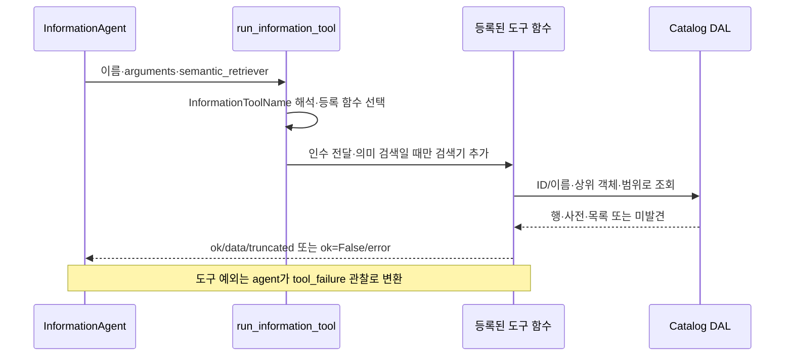
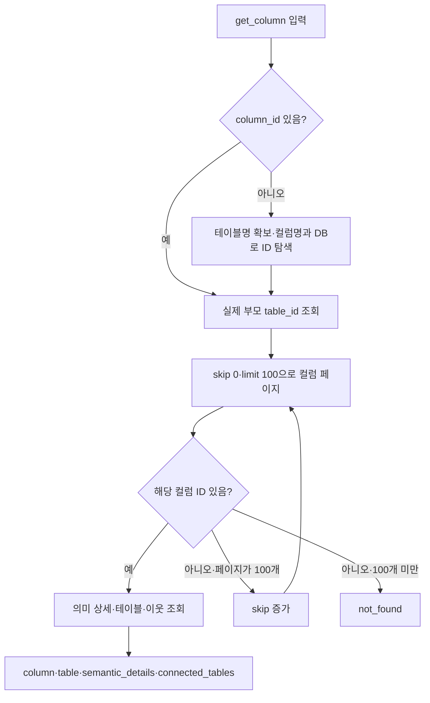
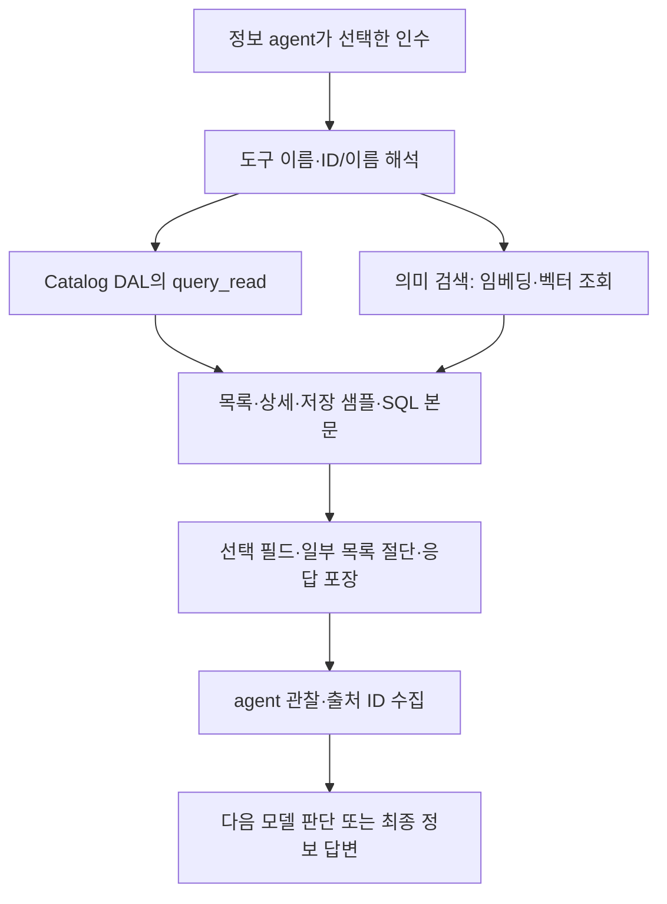

# Chapter 02-2. 정보 조회 도구의 ID 해석·카탈로그 접근과 반환 경계

## 1. 먼저 정의할 개념과 분석 범위

**Catalog(카탈로그)**는 수집한 데이터 구조와 업무 의미를 보관하는 내부 저장소다. **Metadata**는 테이블·컬럼의 이름·타입·설명 같은 부가 정보다. **원본 DB**는 실제 업무 데이터가 있는 데이터베이스이고, **DB**는 데이터베이스의 줄임말이다. 여기서 **dataset**은 catalog에 등록한 DB 객체를 가리킨다. **Schema(스키마)**는 DB 안에서 테이블을 묶는 이름 공간이며, 컬럼은 테이블의 한 항목이다.

**Tool(도구)**은 이름과 입력 인수를 정해 둔 조회 함수다. **Dispatcher(디스패처)**는 도구 이름을 실제 함수로 연결하는 코드다. **DAL(Data Access Layer, 데이터 접근 계층)**은 catalog 조회를 담당하는 함수 모음이다. **ID**는 객체 식별자이고, **이름 해석(resolve)**은 이름이나 ID에서 조회할 객체를 정하는 과정이다.

**Term**은 업무 개념, **ColumnAttribute**는 컬럼의 업무 의미, **SqlAttribute**는 이름 붙인 SQL 정의, **CustomAnalysis**는 저장된 사용자 분석이다. **SQL**은 DB 조회 언어다. **FK(외래 키)**는 다른 테이블의 키를 참조하는 관계다. **SEMANTIC_FK(의미 FK)**는 컬럼이 다른 컬럼의 의미 속성을 참조하는 저장 관계이고, **HAS_ATTRIBUTE**는 컬럼이 속성을 소유하는 연결이다. **JOIN**은 조건으로 테이블 행을 연결하는 연산이다.

**Pagination(페이지 조회)**은 전체 목록을 여러 구간으로 나눠 읽는 방식이다. **Skip**은 건너뛸 항목 수, **limit**는 한 번에 읽거나 반환할 항목 수다. **Truncated**는 결과 일부를 생략했다는 응답 표시다. **Sentinel row**는 더 많은 결과가 있는지 확인하려고 제한보다 한 개 더 읽는 행이다.

**Zone**은 이 프로젝트에서 접근 가능한 데이터 범위를 묶는 객체이고, **zone_ids**는 DAL에 그 범위를 전달하는 인수다. **조회 범위 지정**과 **접근 권한 확인**은 다른 책임이다. **Retriever**는 검색 객체, **임베딩**은 텍스트를 숫자 벡터로 바꾸는 처리, **벡터 검색**은 그 거리로 관련 문서를 찾는 방식이다. **Label**은 Term·속성 같은 검색 객체 종류다.

**JSON**은 사전·목록·값을 텍스트로 표현하는 형식이고 **None**은 Python의 값 부재 표시다. **State**는 공유 처리 데이터, **observation(관찰)**은 도구 결과를 다음 모델 판단에 제공하는 기록이다. 상세 용어는 [용어집](../01-architecture/chapter-00-glossary.md)을 참고한다.

이 장은 `information_tools.py`의 13개 도구를 실제 DAL 함수까지 추적한다. 모델의 행동 선택·호출 한도·관찰 소비는 [Chapter 02-1](chapter-02-1-information-agent-loop.md)과 연결한다. 실제 DB·모델·테스트 실행 없이 로컬 소스와 assertion을 읽은 정적 분석이다. Assertion은 테스트의 기대 조건 검사다.

## 2. 공통 호출·응답·오류 계약

`run_information_tool`은 이름을 Enum, 즉 허용된 이름 목록으로 해석한다. 모르는 문자열이면 unknown_tool 오류를 반환한다. 등록된 함수만 호출하며 임의 SQL 문자열을 실행하는 도구는 없다. 대부분의 도구는 `**_`로 쓰지 않는 인수를 받아 무시하므로 공통 행동 인수에 들어 있다는 사실만으로 해당 도구가 그 인수를 적용한다고 볼 수 없다.

| 결과 | 구조 | 의미 |
|---|---|---|
| 성공 | `{ok: True, data: ..., truncated: bool}` | 조회·조립을 완료했다는 뜻. 모든 중첩 목록을 완전하게 반환했다는 보장은 아님 |
| 예상된 입력/대상 오류 | `{ok: False, error: {code, message}}` | invalid_arguments·not_found·ambiguous·not_found_or_ambiguous·unavailable 등 |
| 호출 중 예외 | 디스패처 자체가 일괄 변환하지 않음 | InformationAgent의 실행 try에서 tool_failure 관찰로 바뀜 |

`_safe`는 사전·목록·튜플·집합을 재귀 변환하고 UUID·날짜·시간은 문자열로 만든다. UUID는 전역적으로 구분하기 위한 식별자 형식이다. 모든 임의 Python 타입을 변환하는 직렬화기는 아니며, 집합을 목록으로 만든 결과 순서에도 의미를 부여하지 않는다.

직접 도구 함수를 호출하면 agent의 인수 모델 검증과 예외 포장을 거치지 않는다. 정수 변환 오류·DAL 장애를 항상 ok=False로 반환한다고 설명하면 안 된다. 이 도구 계층에 공통 재시도 반복문도 없다. 의미 검색 내부 재시도는 별도다.

근거: [도구 등록·공통 응답·디스패치](../../../code/auto-ontology/auto_ontology/retrieval/text_to_sql/agents/information_tools.py), [agent의 예외 포장](../../../code/auto-ontology/auto_ontology/retrieval/text_to_sql/agents/information_agent.py).

## 3. 구조 목록: DB → 스키마 → 테이블 → 컬럼

| 도구·입력 | DAL 호출·결과 | 반환 제한·미발견 |
|---|---|---|
| list_databases | fetch_databases → databases·total·limit | 전체 조회 후 앞 25개, 초과 시 truncated |
| list_schemas(database_id 또는 dataset_id) | fetch_schemas_for_database → database_id·schemas·total·limit | 앞 25개, DAL None이면 not_found |
| list_tables(schema_id, database_name 선택) | fetch_tables_for_schema → schema_id·tables·total·limit | 전체 조회 후 앞 50개, 없는 ID도 빈 성공 목록 가능 |
| list_columns(table_id, skip=0, limit=100) | fetch_columns_for_table와 count_columns_for_table | skip≥0, limit 1~100으로 보정. 테이블 자체가 없으면 not_found |

부모 ID를 요구하는 세 목록 도구는 부모 인수가 없으면 invalid_arguments다. list_schemas는 둘 다 있으면 database_id를 우선한다. list_databases/list_schemas/list_tables의 일반 limit·skip 인수는 응답 페이지를 조절하지 않고 무시된다.

### 3.1 DB 인수가 실제로 적용되는 위치

`fetch_databases`는 DB와 스키마를 내부 연결해 스키마가 있는 DB만 읽고 DB 이름으로 정렬한다. 응답의 schemas는 빈 목록이다. 자식 구조는 필요한 단계에서 별도로 읽는 방식이다.

`fetch_schemas_for_database`는 스키마와 테이블을 내부 연결한다. 따라서 DB가 존재해도 테이블 있는 스키마가 하나도 없으면 None이다. 도구의 not_found를 “DB 행이 없음”과 정확히 같은 뜻으로 쓰면 안 된다. 스키마 이름은 `name`이 아니라 `schema_name` 필드로 반환된다.

`fetch_tables_for_schema`는 schema_id로 조회하며 **database_name을 받아도 사용하지 않는다**. 전역 스키마 ID가 조회 기준이라는 구현 계약이다. 다른 DB 이름을 함께 보냈다고 교차 확인하거나 거부하지 않는다. 이 사실은 DAL 테스트에서도 직접 확인한다.

### 3.2 컬럼 페이지는 존재 확인과 내용 조회를 분리한다

`fetch_columns_for_table`은 먼저 table_id로 테이블 헤더를 조회하고, 있으면 컬럼 페이지를 별도로 읽는다. 컬럼 순서는 ordinal_position, 동률이면 id다. Ordinal position은 원본 구조에서의 컬럼 순번이다. 페이지를 끝 너머로 넘겨도 테이블 헤더와 빈 columns를 반환하고, 테이블이 없을 때만 None이다.

컬럼에는 id·column_name·data_type·description·인증 표시·저장 샘플·tag가 들어간다. Tag는 분류 표시다. 샘플은 저장 값을 표시 문자열 목록으로 변환한 것이며, 이 요청에서 원본 DB를 다시 읽은 값이 아니다. 컬럼 설명은 저장된 의미 설명을 대체값으로 사용할 수 있다.

목록 도구는 전체 컬럼 수를 별도 count로 읽고 `skip + 반환 수 < total`일 때 truncated를 참으로 표시한다. 헤더·페이지·count가 한 시점의 변경 불가 스냅샷이라고 함수가 보장하지는 않는다. 스냅샷은 특정 시점 자료를 함께 보관한 상태를 뜻한다.

근거: [목록 도구](../../../code/auto-ontology/auto_ontology/retrieval/text_to_sql/agents/information_tools.py), [DB·스키마·테이블·컬럼 DAL](../../../code/auto-ontology/auto_ontology/dal/datasources.py).

## 4. Dataset·table 상세와 이름 해석

### 4.1 get_dataset: ID 우선 입력이어도 비교는 ID와 이름을 함께 한다

입력은 dataset_id 또는 dataset_name이며 둘 다 있으면 전자를 고른다. `_match_record`는 입력의 양끝 공백·대소문자를 정리한 뒤 각 행의 id 또는 name과 정확히 비교한다. 부분 문자열·오타 유사 검색이 아니다. 서로 다른 행에서 한쪽은 ID, 다른 쪽은 이름이 같은 경우 둘 다 매칭해 ambiguous가 될 수 있다.

DB 전체 목록을 읽어 한 대상을 찾고, 그 DB의 스키마를 최대 25개 순회하며 테이블을 붙인다. 테이블 **총 50개를 모든 스키마에 나눠 쓰는 제한**이다. 스키마별 50개가 아니다. 50개를 채우면 순회를 멈추고 남은 스키마도 있을 경우 truncated다.

반환은 dataset·schemas·limits다. DB 조회가 성공했지만 스키마 조회가 None이면 빈 스키마 목록의 성공 응답이 가능하다. 컬럼까지 펼쳐 주지는 않는다. `_match_record` 비교의 미발견·모호 결과와 hierarchy 일부가 비어 있는 성공 결과를 구분한다.

### 4.2 _resolve_table과 get_table

`_resolve_table`은 truthy한 table_id가 있으면 `fetch_table_by_id`로 존재를 확인한다. 이 경로에서는 **table_name·database_name과 일치하는지 다시 확인하지 않는다**. ID가 틀렸어도 이름으로 재탐색하지 않고 not_found다.

이름 경로는 table_name이 필수이며 `find_table_id_by_name(table_name, database_name)`을 쓴다. 테이블명은 대소문자를 무시한다. DB 이름이 없으면 최대 두 행을 보고 동명이면 None, 있으면 그 DB 조건으로 한 행만 읽는다. DB 이름 비교는 저장 문자열과 직접 비교한다. **스키마 인수와 ORDER BY가 없으므로 같은 DB 내 여러 스키마의 동명 테이블을 거부한다고 볼 수 없다.** 미해결은 not_found_or_ambiguous다.

get_table은 해석한 ID로 다음 자료를 합친다.

| 필드 | 실제 조회와 제한 |
|---|---|
| table | fetch_table_by_id: id·name·schema_name·description·pk. DB 이름 필드는 이 헤더에 없음 |
| columns | fetch_columns_for_table(limit=101) 후 앞 100개 |
| connected_tables | fetch_join_neighbors 전체 후 앞 50개 |
| terms | fetch_terms_and_attributes_for_table의 Term 목록 전체 |
| column_attributes | 같은 DAL의 속성 행 앞 100개 |

Connected tables는 **저장된 table__join 연결의 양방향 이웃**이다. 이 함수가 지금 의미 FK를 따라 새 경로를 탐색하거나 모든 실제 FK를 재계산하는 것은 아니다. SQL에 함께 등장한 연결·의미 FK·원본 선언 FK가 동일하다고 가정하면 안 된다.

Term 목록은 해당 테이블을 대표하는 source=semantic Term, 속성 목록은 HAS_ATTRIBUTE로 테이블 컬럼에 소유된 source=semantic 속성이다. 참조 속성 전체·SQL 속성 전체를 이 목록에 합치지 않는다. 컬럼·이웃·속성의 초과를 truncated에 반영하지만 terms 개수·텍스트 길이는 여기서 제한하지 않는다.

근거: [대상 해석·상세 조립](../../../code/auto-ontology/auto_ontology/retrieval/text_to_sql/agents/information_tools.py), [ID/이름·연결 이웃 DAL](../../../code/auto-ontology/auto_ontology/dal/datasources.py), [테이블의 의미 정의 DAL](../../../code/auto-ontology/auto_ontology/dal/terms.py).

## 5. get_column은 단일 ID를 찾으면서 여러 페이지를 읽을 수 있다

컬럼 ID가 있으면 `fetch_parent_table_id_for_column`으로 실제 부모 테이블을 찾는다. 함께 받은 table_id·table_name·database_name을 검증 기준으로 쓰지 않는다. 부모가 없으면 not_found다.

컬럼 이름만 있으면 테이블 이름도 필요하다. table_id만 함께 있으면 그 ID의 테이블명부터 읽고, **그 이름과 column_name으로 다시 조회**한다. 이후 실제 부모 ID를 다시 읽는다. 따라서 table_id를 받았다는 이유로 최종 이름 조회가 그 ID에 엄격히 한정된다고 설명하면 안 된다. 같은 이름의 다른 테이블과 만날 수 있는 경계는 실행 미검증이다.

이름 DAL은 테이블·컬럼 이름을 대소문자 무시 비교한다. DB 이름이 없으면 여러 매칭을 미해결로 보고, 있으면 그 DB에서 첫 행을 사용한다. 스키마 조건은 없다.

매 페이지는 컬럼 ID를 찾을 때까지 100개씩 진행한다. **페이지 수 전체를 제한하는 상한은 없다.** 도구 한 번에 내부 catalog 조회가 여러 번 발생할 수 있으므로 agent의 최대 6회 도구 호출과 최대 6회 DB 조회는 다르다. 조회 중 구조가 계속 바뀌는 시나리오·전체 시간 제한은 여기서 제어하지 않는다.

반환 semantic_details는 `fetch_column_exploration_details` 결과다. 여기에는 단일 column_attribute, 단일 outgoing foreign_key_column, 최대 50개 referencing_columns, 해당 컬럼을 참조한 저장 sql_queries가 들어간다. 참조 컬럼은 이 컬럼을 외래 키 대상으로 삼는 컬럼이다. 저장 SQL 목록 자체에는 이 함수의 고정 개수 제한이 없다.

도구의 truncated는 connected_tables가 50개를 넘었는지만 검사한다. 내부 상세가 자체 제한으로 일부 참조를 생략했는지·긴 SQL이 있는지까지 같은 flag가 포괄하지 않는다. 저장 SQL을 반환한다는 사실이 SQL을 실행한다는 뜻도 아니다.

근거: [컬럼 탐색·페이지 반복](../../../code/auto-ontology/auto_ontology/retrieval/text_to_sql/agents/information_tools.py), [컬럼 이름·부모·페이지 DAL](../../../code/auto-ontology/auto_ontology/dal/datasources.py), [컬럼 주변 상세 DAL](../../../code/auto-ontology/auto_ontology/dal/exploration.py).

## 6. get_table_semantic_fks는 전체 JOIN 가능성 검사와 다르다

테이블을 해석한 뒤 `fetch_table_context`로 전체 컬럼과 선언 FK를 읽는다. 도구는 이 중 columns의 **앞 100개만** 검사하고, 반환된 fks 목록 자체를 출력 관계로 사용하지 않는다.

각 컬럼마다 `fetch_column_exploration_details`를 호출해 단일 column_attribute.relationship_type이 SEMANTIC_FK인 경우만 남긴다. 선택된 속성의 `fetch_column_attribute_exploration_details`에서 연결 컬럼을 읽고 앞 50개를 붙인다. 관계 항목이 50개가 되면 즉시 멈추며 이때 더 남아 있는지 별도로 확인하지 않고 truncated=True다.

| 반환 | 의미 |
|---|---|
| source_column | 검사한 원래 컬럼의 catalog 문맥 |
| attribute | 단일 상세에서 선택한 의미 FK 속성 |
| connected_columns | 그 속성을 소유하거나 참조하는 컬럼 앞 50개 |
| table·limits | 테이블 헤더·연결/속성당 컬럼 제한 |

Exploration의 `_attribute_link`는 HAS_ATTRIBUTE와 SEMANTIC_FK를 합치지만 `use_in_join_paths`를 걸러내지 않는다. 또한 컬럼 상세는 source=semantic 속성 중 **ORDER BY 없이 limit(1)**로 하나를 읽는다. 따라서 컬럼이 여러 의미 연결을 가지면 이 도구가 모두 반환하거나 우선순위를 보장하지 않는다. 선택된 하나가 소유 관계면 다른 의미 FK가 있어도 이번 검사에서 빠질 수 있다는 것은 코드에서 도출한 추론이며 실행 재현하지 않았다.

연결 컬럼도 ‘이 컬럼이 직접 참조할 유일한 대상’ 목록으로 제한하지 않는다. 같은 속성을 참조하는 다른 컬럼이 포함될 수 있다. SQL 경로에 실제 선택된 관계·원본 무결성 검증과 정보 표시를 구분한다.

속성 상세 호출에 limit를 주지 않으므로 DAL은 연결 컬럼을 모두 읽은 다음 도구가 50개로 자른다. 컬럼마다 추가 조회를 수행해 관계 수에 따라 조회량이 늘어난다. 반환 항목 제한이 DB 작업량의 동일한 상한을 뜻하지 않는다.

근거: [의미 FK 도구](../../../code/auto-ontology/auto_ontology/retrieval/text_to_sql/agents/information_tools.py), [전체 테이블 문맥](../../../code/auto-ontology/auto_ontology/dal/datasources.py), [단일 속성·연결 컬럼 조회](../../../code/auto-ontology/auto_ontology/dal/exploration.py).

## 7. Term 목록·상세의 조회 집합은 같지 않다

`list_terms(search, limit=25)`는 limit를 1~50으로 보정하고 `fetch_all_terms(limit+1)`과 count_terms를 호출한다. 앞 limit개와 total을 반환하고, 한 개 더 읽었거나 total이 크면 truncated다. skip 인수는 도구가 적용하지 않으므로 이 도구만으로 다음 페이지를 읽는 계약은 없다.

목록 DAL은 source=semantic이고 테이블 대표 연결이 하나 이상인 Term만 대상으로 한다. Search는 이름에 대한 대소문자 무시 **문자 그대로의 부분 문자열**이며 `%`·`_`를 와일드카드로 취급하지 않도록 이스케이프한다. 와일드카드는 임의 문자열·문자와 맞추는 검색 기호다. 정렬은 이름 소문자·ID다.

`_resolve_term`은 term_id가 있으면 `get_full_term_by_id`로 직접 읽는다. 이 상세 함수는 ID와 선택적 zone 범위를 검사하지만 목록과 동일한 source/대표 테이블 필터를 추가하지 않는다. 이름만 있으면 목록 검색의 앞 **51개**에서 `_match_record`로 정확한 ID/이름을 찾고, 하나를 고른 뒤 상세를 다시 읽는다. 그러므로 다음을 구분한다.

- ID로 읽을 수 있는 모든 객체가 이름 목록의 검색 대상에도 포함된다는 보장은 없다.
- 정확한 이름이 전체 부분 문자열 매칭의 52번째 이후라면 후보 창 안에 없어 not_found가 될 수 있다. 이는 코드에서 도출한 가능성이며 실행 검증하지 않았다.
- 같은 이름이 여러 개라도 반환 창 안에서 확인한 결과로만 ambiguous를 판정한다.

`get_term`은 상세의 대표 tables를 50개로 자르고 컬럼·SQL 속성을 각각 101개 요청해 100개씩 반환한다. `term.table_count`는 원래 전체 수일 수 있어 잘린 tables 길이와 구분한다. SqlAttribute 목록은 저장 SQL 연결이 있고 Term과 연결된 객체가 대상이다. 반면 ColumnAttribute 목록의 실제 필터는 연결 테이블의 Term ID가 아니라 **`attr.term_name == 해당 Term의 name`**과 source=semantic이다. 같은 이름의 Term·불일치한 저장 연결의 효과는 통합 미검증이다.

속성 목록의 각 항목에는 primary_column·referenced_columns·샘플 같은 중첩 정보가 들어갈 수 있다. Primary column은 속성을 소유한 컬럼 중 ID 순 첫 컬럼, referenced columns는 의미 FK로 속성을 참조하는 컬럼이다. 상위 속성 개수가 100개라는 제한만으로 이 중첩 목록도 100개 이하라고 볼 수 없다.

근거: [Term 목록·해석·상세 도구](../../../code/auto-ontology/auto_ontology/retrieval/text_to_sql/agents/information_tools.py), [목록/상세와 속성의 실제 조건](../../../code/auto-ontology/auto_ontology/dal/terms.py), [컬럼 연결 정보](../../../code/auto-ontology/auto_ontology/dal/attributes.py), [SQL 속성 목록](../../../code/auto-ontology/auto_ontology/dal/sql_attributes.py).

## 8. 두 속성 상세는 이름 해석·누락 조건이 다르다

| 도구 | 해석 순서 | 주요 반환 |
|---|---|---|
| get_column_attribute | 명시 Term 우선 해석 → 없으면 속성 ID의 exploration에서 Term 하나 탐색 → 해당 Term의 앞 101개 속성에서 ID/이름 매칭 | column_attribute·term·linked_columns 앞 50개·linked_columns_total |
| get_sql_attribute | 속성 ID 우선 → 없으면 이름 완전 일치로 첫 ID → full SQL 속성·exploration 조회 | sql_attribute·term·sql |

### 8.1 ColumnAttribute ID를 알아도 전체 집합을 직접 읽지는 않는다

속성 이름으로 조회하려면 Term ID/이름이 필요하다. 속성 ID만 주면 exploration에서 Term을 먼저 구하고, 그 Term의 속성 목록으로 다시 존재를 확인한다. 연결 Term이 없거나 목록 조건에 걸리면 속성 ID 자체가 존재해도 not_found가 가능하다.

속성은 이름·ID 순의 앞 101개에서 찾는다. 101번째는 sentinel이면서도 매칭 대상에 포함되며, 그 이후는 도구가 재페이지하지 않는다. 이름 비교는 `_match_record`의 공백 정리·대소문자 무시 ID/이름 일치다. 둘 이상 매칭하면 ambiguous다.

별도의 exploration은 limit=51로 읽어 linked_columns 앞 50개를 내보내고 columns_total로 잘림을 판단한다. 그러나 column_attribute 본체에 이미 들어간 referenced_columns 같은 중첩 필드를 다시 50개로 자르지는 않는다. 속성 후보가 101개였다는 이유만으로 최종 단일 속성 응답의 truncated도 참이 될 수 있다.

### 8.2 SqlAttribute 이름은 대소문자를 무시하지 않는다

`find_attr_by_name(name, None)`은 저장 name과 같은지 직접 비교하고 ID 정렬의 첫 항목만 반환한다. 이 경로에는 Term·DB·스키마 제한이나 복수 이름 매칭 오류가 없다. 이름이 아예 없으면 not_found 대신 invalid_arguments가 나올 수 있다. 명시 ID가 없을 때 이름 해석이 실패하면 둘을 같은 인수 오류로 처리하기 때문이다.

`get_full_sql_attribute_by_id`는 속성·Term·저장 SQL이 연결된 형태를 조회하므로 SQL 연결 없는 속성은 보이지 않는다. SQL이 여러 개면 ID 순 첫 SQL 문자열을 대표로 고른다. Exploration도 별도로 SQL 하나와 Term 하나를 읽는다. SQL은 `{id, sql}` 사전이며 문자열 자체와 구분한다. 텍스트 길이 제한은 없고 이 도구의 truncated는 기본 False다.

저장 SQL이 길거나 여러 관계가 있어도 반환 flag만 보고 완전한 정의·모든 연결을 가져왔다고 할 수 없다. 이 조회는 SQL 내용을 읽을 뿐 실행하거나 파싱해 검증하지 않는다.

근거: [속성 상세 도구](../../../code/auto-ontology/auto_ontology/retrieval/text_to_sql/agents/information_tools.py), [Term의 속성 조회](../../../code/auto-ontology/auto_ontology/dal/terms.py), [이름·대표 SQL 조회](../../../code/auto-ontology/auto_ontology/dal/sql_attributes.py), [속성 exploration](../../../code/auto-ontology/auto_ontology/dal/exploration.py).

## 9. 의미 검색의 limit는 종류별 요청 수다

`search_semantic_layer`는 비어 있지 않은 query와 semantic_retriever가 필요하다. 검색기가 없으면 unavailable, 빈 query나 지원 밖 label은 invalid_arguments다. 허용 종류는 Term·ColumnAttribute·SqlAttribute·CustomAnalysis 네 가지다. Labels를 생략하거나 빈 목록을 주면 네 종류 모두 검색한다.

입력 limit 기본 5를 1~10으로 보정해 `search_semantic_index`의 **per_label_k**로 전달한다. 공통 검색기는 label마다 조회하고 결과를 이어 붙인다. 이후 도구가 전체의 `rows[:10]`을 반환한다. 따라서 limit=5가 최종 전체 결과 최대 5라는 계약은 아니다. 실제 테스트도 limit=5 요청에 모형이 12행을 주면 최종 10개를 기대한다.

공통 검색기의 label 순회는 집합에서 만든 목록이며, 모든 종류를 합친 후 전역 거리순으로 정렬하는 코드가 이 경로에 없다. 종류별 검색 결과가 가까운 순서라는 것과 최종 10개가 모든 종류 중 가장 가까운 10개라는 것은 다르다. 어떤 종류가 먼저 10개를 채우는지 실제 실행 결과는 미검증이다.

Database_name은 전달받았을 때 검색 메타데이터 필터로 사용한다. Agent가 선택한 target_db를 이 도구에 자동 주입하지는 않는다. Schema_name 인수도 이 도구가 전달하지 않는다. 반환은 matches·allowed_labels이며 잘림 표시는 공통 검색 결과가 10개보다 많은지만 검사한다. 벡터 저장소에 추가 문서가 존재하는지 전체 count를 확인하는 표시는 아니다.

임베딩·벡터 조회의 실패·재시도·빈 결과 대체는 [검색 Chapter 01](../07-retrieval/chapter-01-search-contract-and-retry.md)의 계약과 연결한다. 검색 오류가 하위 계층에서 빈 결과로 바뀌었다면 이 도구의 ok=True·빈 matches만으로 무관한 개념이라고 단정할 수 없다.

근거: [의미 검색 도구](../../../code/auto-ontology/auto_ontology/retrieval/text_to_sql/agents/information_tools.py), [종류별 검색과 결과 구성](../../../code/auto-ontology/auto_ontology/retrieval/data_access/semantic_search.py).

## 10. DB 선택·접근 권한·읽기와 상태 소비의 경계

도구 함수들은 connector의 원본 SQL 실행 함수를 호출하지 않고 catalog DAL과 의미 검색을 사용한다. 원본 데이터의 현재 값을 새로 계산하는 것이 아니라 **이미 저장된 샘플·설명·SQL·관계를 읽는 것**이다. 의미 검색은 별도 임베딩 모델 호출과 벡터 저장소 접근을 수행할 수 있다. 검색기 초기화의 저장 경계는 검색 Chapter 01과 같다.

이 도구의 공통 인수에는 zone_ids가 없고 호출도 DAL에 zone_ids를 전달하지 않는다. `resolve_accessible_catalog_ids(None)`은 범위 제한 없음, 빈 목록은 접근 가능한 범위 없음이라는 다른 계약이다. 따라서 DAL에 선택적 권한 인수가 존재한다는 사실만으로 **이 정보 도구가 요청자의 zone 범위를 전달한다**고 볼 수 없다.

DB 이름을 검색에 쓰거나 schema_id·table_id로 조회하는 것은 대상 선택이다. 그것만으로 사용자별 접근 허용을 증명하지 않는다. 상위 인증·호출 허용 정책 전체는 01-10/01-11 분석에 남기며, 이번 코드만으로 배포 환경의 실제 권한 침해 발생을 주장하지 않는다.

여러 DAL 호출을 하나의 공통 트랜잭션으로 감싼 도구 코드는 없다. 트랜잭션은 여러 변경·조회에 한 묶음의 처리 경계를 주는 단위다. 헤더·페이지·총수·의미 관계 사이에 저장소가 바뀌는 상황의 일관성은 미검증이다. 도구 수준에서 catalog 정의를 새로 쓰거나 답변을 영구 저장하는 코드도 없다.

최종 결과는 정보 agent의 observation에 들어가며, agent는 알고 있던 ID와 선택 출처를 대조하고 답변을 만든다. 개수 제한·truncated·ok는 각각 반환 계약이며 **답변 전체 사실성·데이터 최신성·권한 검증 완료**를 뜻하는 하나의 성공 표시가 아니다.

## 11. 테스트 근거·작은 예시와 미검증

**Mock**은 실제 의존성 대신 쓰는 모형이다. 이번에는 테스트를 실행하지 않고 아래 assertion을 읽었다.

| 근거 | 확인한 기대 조건 |
|---|---|
| [test_information_tools.py](../../../code/auto-ontology/auto_ontology/retrieval/text_to_sql/tests/test_information_tools.py): 목록·dataset 사례 | 부모 ID 필수, dataset 대소문자 무시 해석·미발견/모호 오류, 51개 테이블에서 50개 반환·잘림 |
| 같은 파일: table·column 사례 | 모형 컬럼/의미/이웃의 반환, 컬럼 ID가 둘째 페이지에 있으면 skip=[0,100]으로 탐색 |
| 같은 파일: semantic FK 사례 | HAS_ATTRIBUTE를 제외하고 SEMANTIC_FK인 모형 컬럼만 반환 |
| 같은 파일: Term·두 속성 사례 | 두 속성 종류·연결 컬럼·공식/저장 SQL이 결과에 포함 |
| 같은 파일: dispatch·semantic search 사례 | delete_table 이름 거부, 검색기·label 전달, 모형 12개 중 최종 10개·truncated |
| [test_datasources_semantic.py](../../../code/auto-ontology/auto_ontology/dal/tests/test_datasources_semantic.py) | schema 목록의 database_name 무시, 컬럼 순번 페이지, 끝 너머 빈 페이지와 테이블 없음 구분, 저장 샘플 목록 변환 |
| [test_exploration.py](../../../code/auto-ontology/auto_ontology/dal/tests/test_exploration.py)의 test_no_zone_ids_means_unscoped_not_empty | None과 빈 zone 목록이 다른 범위 계약임을 데이터 그래프 사례에서 확인 |

예를 들어 “orders의 revenue 정의를 알려 줘”라는 질문에서 먼저 get_table(table_name="orders", database_name="sales")로 객체 ID를 받고, 이어 get_column(column_id=관찰한 ID)로 저장 의미·이웃을 읽을 수 있다. 이는 설명용 흐름이다. 첫 도구의 컬럼 100개에 revenue가 없으면 list_columns의 다음 페이지를 읽어야 할 수 있고, 이미 컬럼 ID를 알면 get_column이 내부에서 여러 페이지를 찾는다. 실제 모델이 이 순서를 고른 결과는 아니다.

미확인 사항은 다음과 같다.

- 도구 테스트는 DAL을 모형으로 바꾼 사례가 많다. 그 성공만으로 실제 저장 관계·동시 변경·권한 전달을 검증했다고 볼 수 없다.
- ID와 충돌하는 DB/이름·같은 DB의 다중 스키마·table_id에서 이름으로 바뀌는 컬럼 조회는 실행 재현하지 않았다.
- 51개 Term 후보 창·101개 속성 후보 창 뒤의 대상, Term ID/이름 조회 집합 차이·term_name 기반 소속은 통합 미검증이다.
- 다중 의미 연결의 단일 선택·use_in_join_paths 차이·정확히 50개일 때 잘림 표시, 중첩 참조 컬럼/SQL 본문 길이·조회량 증가는 코드에서 확인한 구조와 실제 비용을 구분한다.
- `_safe`가 처리하지 않는 값, 빈 성공과 장애 대체 결과의 구분, 벡터 검색 종류 순서·최종 품질·실제 한국어 답변은 실행 검증하지 않았다.
- 원본 코드·AGENTS.md를 수정하지 않았다. Mermaid 3개를 작성했으며 렌더링하지 않았다. 다음 단계는 [Chapter 03 Evidence 보정](chapter-03-evidence-refinement.md)이다.
