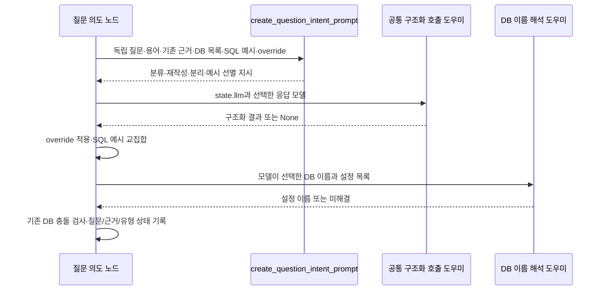
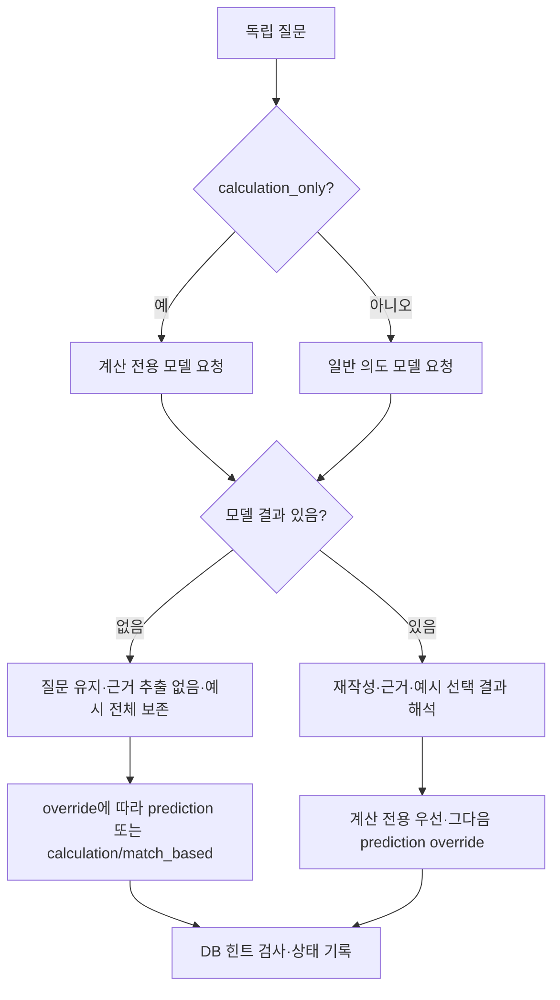
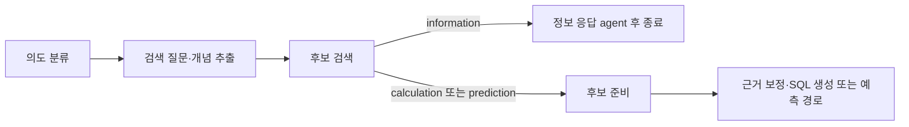

# Chapter 02. 질문 의도·계산 종류와 질문 속 근거 분리

## 1. 개념을 먼저 구분한다

**SQL**은 데이터베이스에 조회를 요청하는 언어이고 **DB**는 데이터베이스의 줄임말이다. **질문 의도(intent)**는 질문이 어떤 종류의 처리를 요구하는지 뜻한다. 여기서 **information**은 저장된 데이터 구조·업무 정의 설명, **prediction**은 미래 또는 아직 모르는 결과의 예측, **calculation**은 저장 데이터의 조회·조건 적용·계산 결과 요청이다.

**Subtype(하위 유형)**은 calculation을 다시 나눈 분류다. **LLM(대규모 언어 모델)**은 이 분류와 질문 재작성을 수행한다. **프롬프트**는 모델에 보내는 지시·문맥, **구조화 응답**은 자유 문장 대신 정해진 필드로 받은 결과다. **Pydantic**은 그 필드와 값의 관계를 검사하는 Python 라이브러리다. **Enum**은 허용한 이름만 선택하도록 정의한 목록이다. **None**은 Python에서 값이 없음을 나타낸다.

**Evidence(근거)**는 답을 어떻게 해석·계산할지 설명한 제약·공식·힌트다. **Inline evidence**는 그 내용이 질문 문장 안에 함께 들어 있는 경우다. **Glossary**는 사용자가 관리한 용어 정의 목록이다. **SQL example**은 다른 질문과 SQL을 구조 참고용으로 묶은 예시이고, **SQL template**은 이 프로젝트가 계산 유형별로 제공하는 SQL 모양의 예문이다. 둘 다 실행할 SQL로 확정한 결과가 아니다.

**State**는 처리 단계가 공유하는 데이터, **path_state**는 그 안의 중간 결과 사전이다. **Override**는 호출자가 모델 판단보다 우선하도록 지정한 설정이다. **Connector**는 DB와 통신하는 객체다. **Metadata**는 데이터 구조·의미에 대한 설명 정보다. **Catalog**는 이 정보를 보관하는 내부 저장소다. 상세 용어는 [용어집](../01-architecture/chapter-00-glossary.md)과 연결한다.

이 장은 `QuestionIntentAgent.execute`가 하나의 구조화 응답으로 질문 종류·하위 유형·재작성·근거·DB 힌트·SQL 예시를 처리하는 과정을 분석한다. 정보 응답의 반복 실행은 [Chapter 02-1](chapter-02-1-information-agent-loop.md), 개별 조회 도구는 [Chapter 02-2](chapter-02-2-information-tools-and-catalog-access.md)로 나눈다. 실제 DB·모델·테스트를 실행하지 않은 정적 분석이다.

## 2. 세 질문 종류는 요청한 결과를 기준으로 설명한다

| 종류 | 프롬프트가 제시하는 기준 | 설명용 질문 |
|---|---|---|
| information | 테이블·컬럼 의미, 연결 관계, 기존 지표의 정의·계산법 설명 | “매출은 어떤 공식으로 정의돼 있나?” |
| prediction | 미래 또는 현재 알려지지 않은 결과의 예상 | “다음 달 고객 이탈 가능성은?” |
| calculation | 조건 조회·정렬·비교·개수·집계·산술·값 해석 | “올해 지역별 매출을 계산해 줘.” |

날짜가 있다는 이유만으로 prediction을 고르지 말고, 기존 기록을 묻는지 예측을 요구하는지 구분하도록 지시한다. 불확실할 때 calculation을 선택하라는 규칙도 프롬프트에 있다. 이는 모델 지시이며 한국어 질문에서도 항상 정확히 분류한다는 실행 보장은 아니다. 확률·확신도 필드는 응답 모델에 없다.

### 2.1 계산 하위 유형은 고정된 아홉 개다

| 이름 | 먼저 이해할 뜻 | 포함된 예문의 구조 |
|---|---|---|
| match_based | 명시 값·조건에 맞는 행 찾기 | 국가·등급 조건과 COUNT |
| ranking | 기준값으로 순서를 매겨 상위/하위 항목 고르기 | 조회 수 내림차순·LIMIT 5 |
| comparison | 다른 값·임계값과 비교하기 | 순위 값이 기준보다 큰지 검사 |
| counting | 행 또는 값의 개수 세기 | 주소 조건에 맞는 회원 COUNT |
| aggregation | 여러 행을 합계·평균·최솟값 등으로 요약하기 | 키의 평균 AVG |
| domain_knowledge | 업무 규칙·전문 기준을 적용하기 | 검사값 임계치와 반복 관측 조건 |
| numeric_computation | 비율·백분율·산술식을 계산하기 | 조건부 개수의 백분율 |
| synonym | 다른 표현을 저장된 개념·값에 대응하기 | 질문 의미를 저장 코드에 대응한 조건 |
| value_illustration | 예시·묘사에서 해당 저장 값을 찾기 | 주 단위 빈도를 나타내는 저장 문자열 조건 |

COUNT는 개수, AVG는 평균을 구하는 SQL 함수이고 LIMIT는 반환 행 수를 제한하는 문법이다. 서로 다른 유형의 예문에 COUNT가 반복되므로 유형과 SQL 연산자가 일대일로 대응하는 것은 아니다.

`_load_calculation_subtypes`는 모듈을 읽을 때 `calculation_subtypes.json`을 읽는다. JSON은 목록·사전·값을 텍스트로 표현하는 형식이다. 파일은 목록이어야 하고, 각 항목의 type·description·sql_template는 비어 있지 않은 문자열이어야 한다. 중복 type을 거부하고 Enum의 아홉 이름과 집합이 정확히 같아야 한다. 파일 읽기·형식·정의 불일치 실패를 빈 기본값으로 대체하는 처리는 없다.

선택된 유형의 예문은 path_state.sql_template가 된다. 이후 `format_calculation_sql_template`가 SQL 생성 프롬프트의 구조 참고 블록으로 넣으며, 실제 스키마와 질문이 독립적으로 요구하지 않는 테이블명·컬럼명·상수는 복사하지 말라고 지시한다. 이 단계가 예문을 원본 DB에서 실행하는 것은 아니다.

근거: [유형·로더·프롬프트](../../../code/auto-ontology/auto_ontology/retrieval/text_to_sql/agents/question_intent.py), [JSON 정의](../../../code/auto-ontology/auto_ontology/retrieval/text_to_sql/agents/calculation_subtypes.json), [SQL 생성의 참고 블록](../../../code/auto-ontology/auto_ontology/retrieval/text_to_sql/agents/sql_from_semantic.py).

## 3. 진입과 모델 입력: 검색 재작성 이전의 독립 질문을 쓴다

`validate_input`은 `get_standalone_question(state)`가 비어 있지 않은지 확인한다. 독립 질문은 대화 맥락을 풀어 쓴 path_state.processing_question이 있으면 그것, 없으면 initial_question이다. 기존 normalized_question보다 이 값을 먼저 쓰도록 의도 agent가 접근자를 선택했다. 공백 검사까지 이 함수가 새로 수행하지는 않는다.

Execute는 독립 질문·기존 evidence·glossary·SQL 예시·connector의 DB 이름·두 override를 읽는다. 실제 테이블 목록·샘플 값·DB 스키마를 여기서 조회하지 않는다. Connector에서 truthy한 database_name만 문자열로 모아 입력 순서를 유지하며 중복 제거한다.

Agent는 SystemMessage 하나를 구성한다. 이는 모델의 역할·지시를 담는 메시지다. 다만 공통 호출 도우미는 메시지가 전부 시스템 메시지일 때 마지막 것을 사용자 메시지로 바꿀 수 있으므로, 실제 전송 역할까지 이 agent의 구성만으로 단정하지 않는다.

프롬프트에는 아홉 유형의 설명·예문 전체가 들어간다. 용어 정의는 해석에 쓰되 질문에서 직접 분리한 내용이 아니라면 extracted_evidence로 복사하지 말라고 지시한다. 기존 근거도 다시 추출하지 말라고 지시한다. 입력 후보 예시는 질문과 SQL이 둘 다 있을 때만 표시하고, 원래 목록의 1부터 시작하는 번호를 유지한다. 잘못된 항목을 생략했다고 뒤 번호를 다시 붙이지는 않는다.

근거: [질문 입력·프롬프트 구성](../../../code/auto-ontology/auto_ontology/retrieval/text_to_sql/agents/question_intent.py), [질문 접근자](../../../code/auto-ontology/auto_ontology/retrieval/text_to_sql/state.py), [공통 메시지 보정](../../../code/auto-ontology/auto_ontology/utils/llm_invoke.py).

## 4. 응답 계약과 override의 우선순위

| 응답 필드 | 일반 QuestionIntentModel | 계산 전용 모델 |
|---|---|---|
| question_type | 세 Enum 값 중 하나, 필수 | 필드 자체가 없음 |
| calculation_subtype | 계산이면 필수 선택, 다른 종류면 None | 아홉 값 중 하나 필수 |
| rewritten_question | 문자열 필수 | 동일 |
| extracted_evidence | 문자열 필수 | 동일 |
| target_db | 문자열 또는 None, 키 필수 | 동일 |
| relevant_sql_example_numbers | 정수 목록, 기본 빈 목록 | 동일 |

두 모델은 `StrictLLMOutputModel`을 상속한다. 이 기반 모델은 `$`로 시작하는 제공자 부가 키를 먼저 제거하고 그 외 정의하지 않은 필드를 거부한다. 이름에 Strict가 있다고 모든 값의 의미·실제 업무 조건까지 검증하는 것은 아니다. 일반 모델은 calculation인데 subtype이 없거나, 다른 종류인데 subtype이 있으면 응답 검증 오류다.

`calculation_only=True`면 처음부터 계산 전용 응답 모델을 사용한다. 상위 종류 선택을 빼도 재작성·근거 분리·DB 힌트·예시 선별은 수행한다. 단순히 모델 호출을 생략하는 설정이 아니다.

| 호출 조건 | 정상 모델 결과 이후 처리 | 모델이 None을 반환한 경우 |
|---|---|---|
| calculation_only 참 | calculation 강제, 모델의 subtype 사용 | calculation / match_based |
| 위 조건 거짓·prediction_override가 정확히 True | prediction 강제·subtype 제거 | prediction / None |
| 위 조건 거짓·override가 정확히 False·모델 prediction | calculation / numeric_computation으로 변경 | calculation / match_based |
| override False·모델 information 또는 calculation | 모델 분류 유지 | calculation / match_based |
| override 없음 또는 None | 모델 분류 유지 | calculation / match_based |

따라서 정상 응답에서 prediction을 금지해 바꾸는 기본 유형과, 모델 실패 때의 기본 유형은 다르다. 호출자의 예측 요청이 있어도 calculation_only가 우선한다. 두 override는 프롬프트 지시뿐 아니라 응답 이후 코드에서도 적용한다. 정보·계산 요청을 예측으로 강제해도 나머지 전처리 결과는 그대로 사용할 수 있다.

근거: [응답 모델과 execute](../../../code/auto-ontology/auto_ontology/retrieval/text_to_sql/agents/question_intent.py), [기반 응답 모델](../../../code/auto-ontology/auto_ontology/utils/llm_invoke.py).

## 5. 질문·근거·DB 이름을 각각 어떻게 바꾸는가

### 5.1 질문 재작성과 근거 병합

프롬프트는 공식·정의·대응 규칙·테이블 힌트를 근거로 옮기되 실제 업무 필터·날짜·요청 지표·그룹·정렬·출력 조건은 질문에 남기라고 지시한다. 설정된 DB 선택 문구는 target_db로 보내고 질문·근거에서는 빼라고 한다. 실제로 어느 문구를 제거했는지 코드가 원질문과 정렬해 검증하지는 않는다.

정상 응답의 rewritten_question은 strip 후 비었으면 독립 질문으로 대체한다. 이 값은 **normalized_question에 기록**하고 initial_question·processing_question·messages를 새로 쓰지는 않는다. 다음 QuestionExtractionAgent는 이 값을 읽고 검색에 맞게 다시 정리해 normalized_question을 한 번 더 바꿀 수 있다.

`_merge_evidence`는 기존·새 근거의 양끝 공백을 제거하고, 한쪽이 비면 다른 쪽을 사용한다. 새 근거가 대소문자 무시 기준으로 기존 문자열 안에 포함돼 있으면 중복으로 보아 기존 값만 남긴다. 그렇지 않으면 줄바꿈으로 덧붙인다. 문장·의미 단위 중복 제거가 아니며 서로 다른 설명의 충돌을 판정하지 않는다.

예를 들어 질문 “지역별 매출을 구해 줘. 매출은 총판매액에서 환불액을 뺀 값이다.”는 설명용으로 다음처럼 나눌 수 있다.

| 상태 | 예시 |
|---|---|
| initial_question | 제출 질문 유지 |
| processing_question | 호출자가 만든 독립 질문 유지 |
| normalized_question | “지역별 매출을 구해 줘.” |
| extracted_evidence | “매출은 총판매액에서 환불액을 뺀 값이다.” |
| 최상위 evidence | 기존 근거가 있다면 새 근거와 병합 |

이 표는 실제 한국어 모델 실행 결과가 아니다. 기존 근거가 공백만 있어도 원래 문자열이 참인 값이면 최종 evidence에 빈 문자열 갱신을 반환할 수 있다. 모든 근거가 처음부터 비었으면 evidence 키를 결과에 넣지 않는다.

### 5.2 질문 DB 힌트는 호출자 DB 지정과 해석 규칙이 다르다

모델의 target_db가 있으면 `_resolve_question_target_database_name`을 호출한다. 공백 제거 후 대소문자 무시 일치가 하나면 설정 이름을 채택하고, 아니면 문자열 유사도 도우미 `get_close_matches`로 cutoff=0.8·최대 1개를 고른다. 유사도는 질문 의미의 확률이 아니라 문자열이 얼마나 비슷한지 비교하는 기준이다.

일치가 없으면 힌트를 무시하고 기존 DB 값을 남긴다. 둘 이상의 비슷한 이름을 사용자에게 다시 확인하는 절차는 없으며, 대소문자만 다른 설정 이름도 뒤의 사전 구성에서 합쳐질 수 있다. 호출자 target_db를 엄격히 확인하는 resolve_target_database_name과 같은 규칙으로 보아서는 안 된다.

해석된 DB와 기존 path_state.target_db가 모두 있으면 기존 값을 엄격한 helper로 정규화해 비교한다. 다르면 execute가 ValueError를 발생시킨다. **검사는 의도 필드 기록과 반환보다 먼저** 일어나므로 이 지점의 직접 호출 실패는 완성된 새 의도 결과를 반환하지 않는다.

다만 그래프는 이 함수를 공통 agent_wrapper로 감싸고 일반 예외를 오류 상태로 바꾸며, question_intent 다음 연결은 고정 question_extraction이다. 따라서 단위 테스트가 직접 execute의 ValueError를 확인했다는 사실을 전체 요청이 반드시 중단된다는 보장으로 확대하지 않는다. 오류 상태 이후 실제 흐름은 통합 미검증이다. 원리는 [Chapter 01](chapter-01-request-state-and-graph-contract.md)의 래퍼 계약과 같다.

근거: [병합·DB 해석·기록 순서](../../../code/auto-ontology/auto_ontology/retrieval/text_to_sql/agents/question_intent.py), [호출자 DB 검증](../../../code/auto-ontology/auto_ontology/retrieval/text_to_sql/connector_routing.py), [후속 질문 추출](../../../code/auto-ontology/auto_ontology/retrieval/entity_coverage/agents/question_extraction.py), [고정 그래프 연결](../../../code/auto-ontology/auto_ontology/retrieval/text_to_sql/text_to_sql_graph.py).

## 6. SQL 예시는 질문 표현보다 구조 기준으로 선별한다

프롬프트는 출력 형태·집계·그룹의 기준·상위/하위 순위·반환 개수 구조가 맞는 예시를 고르라고 지시한다. 예를 들어 “매출 1위 상품”과 “주문 수 1위 고객”은 업무 대상이 달라도 순위 구조가 참고가 될 수 있다. 단순한 단어 유사성이 선별 기준은 아니다.

코드는 반환 번호를 집합으로 만들고 **원래 예시 목록 순서**로 순회해 선택 번호에 속한 항목만 남긴다. 예시 질문과 SQL이 모두 비어 있지 않아야 한다. 중복 번호는 합쳐지고 범위 밖·0·음수 번호는 일치 항목이 없어 무시된다. 응답 모델의 번호에 별도 양수·범위 제약을 지정한 것은 아니다.

번호 교집합은 모델이 실제 SQL 구조를 맞게 판단했는지 재검사하지 않는다. 정상 응답이 빈 번호 목록이면 예시를 모두 제거한다. 모델 None이면 필터를 실패한 것으로 보고 **원래 예시 전체를 보존**하며 이 분기에서는 같은 유효성 필터를 다시 적용하지 않는다.

근거: [예시 표시·번호 교집합](../../../code/auto-ontology/auto_ontology/retrieval/text_to_sql/agents/question_intent.py).

## 7. 최종 상태와 실패·저장 경계

| 출력 위치 | 내용·변화 |
|---|---|
| path_state.question_type | 최종 종류 문자열 |
| calculation_subtype·sql_template | 선택한 하위 유형·고정 JSON 예문, 비계산이면 None |
| normalized_question | 모델 재작성 또는 독립 질문 대체 |
| extracted_evidence | 이번에 분리한 문자열만 |
| target_db | 유효하게 해석된 질문 힌트가 있을 때 변경 |
| 최상위 sql_examples | 선택된 예시 목록 또는 None 응답 때 원래 전체 |
| 최상위 evidence | 조건부로 병합 문자열 반환 |

Execute는 기존 path_state 사전을 직접 수정한다. 반환 사전이 새 객체라는 이유로 입력 상태가 전혀 안 바뀐다고 설명하면 안 된다. 이 노드가 decision을 새로 쓰거나 별도 선택 설명을 thoughts_log에 추가하지는 않는다.

Agent 수준의 모델 호출은 한 번이지만 공통 `invoke_with_structured_output` 내부에는 재시도와 조건부 추론 모델 대체가 있다. 추론 모델은 더 복잡한 판단용으로 설정한 별도 모델이다. 모델이 state.reasoning_llm을 이 agent에서 직접 읽는 것은 아니다. Agent 호출 횟수와 실제 네트워크 요청 횟수를 같게 세지 않는다.

None 응답의 기본값과 달리, 입력 누락·프롬프트 구성 오류·DB 충돌·응답 해석 중 예외를 같은 execute 안에서 모두 기본 유형으로 바꾸지는 않는다. 공통 호출 도우미가 흡수한 실패와 도우미 호출 바깥의 실패를 구분한다.

이 노드는 질문의 모델 해석과 메모리 상태 갱신을 수행한다. DB에 SQL을 실행하거나 catalog의 업무 정의를 저장하지 않는다. 계산 유형 JSON은 로컬에서 모듈을 읽을 때 조회한다. 후속 정보 응답은 다음 흐름처럼 후보 검색 뒤에 갈라진다.

`route_question_type_or_evidence`에 information을 직접 넣으면 근거 보정 분기가 나올 수 있지만, 실제 정보 경로는 앞의 `route_after_candidate_retrieval`에서 이미 분리된다. 라우터 하나의 직접 호출 테스트와 전체 그래프의 도달 경로를 구분해야 한다.

## 8. 테스트 근거와 다음 인계

**Assertion**은 테스트가 기대 조건을 검사하는 구문, **mock**은 실제 의존성 대신 쓰는 모형이다. 아래는 assertion을 읽은 결과이며 실행 결과가 아니다.

| 근거 | 읽어서 확인한 기대 조건 |
|---|---|
| [test_question_intent.py](../../../code/auto-ontology/auto_ontology/retrieval/text_to_sql/tests/test_question_intent.py): 모델·JSON 사례 | 아홉 subtype 유효, JSON 정의·예문 존재, 종류/subtype 불일치 거부 |
| 같은 파일: 재작성·DB·근거 사례 | 오타 test_datset을 test_dataset으로 보정, 무관 DB 힌트 무시, 기존 DB 보존·직접 execute 충돌 예외, 같은 근거 중복 방지 |
| 같은 파일: 예시 필터 사례 | 선택 [2,2,99]에서 둘째 예시만 유지, None이면 전체 보존, 구조 선별 지시가 프롬프트에 존재 |
| 같은 파일: 계산 전용·실패 사례 | 상위 종류 필드 없는 모델 사용, 예측 override보다 계산 전용 우선, None 때 match_based·원질문 대체 |
| [test_prediction_override.py](../../../code/auto-ontology/auto_ontology/retrieval/text_to_sql/tests/test_prediction_override.py): 최초 다섯 사례 | True 강제·False 예측 제외·information 보존·None/누락 때 분류 유지, 전처리 호출 계속 수행 |
| question_intent 테스트의 그래프 사례 | 신규 entry와 reconstruct 재개, 정보 분기가 후보 준비 전에 선택됨 |

DB 충돌 이후 래퍼를 포함한 전체 실행, 동률·대소문자 중복 DB 힌트, 긴 근거의 부분 문자열 중복, 실제 한국어 의미 보존·구조 선별·잘못 제거한 조건의 복구는 실행 재현하지 않았다. 예문이 실제 환경의 SQL 방언·스키마에 맞게 바뀌는 품질도 미검증이다.

Mermaid 3개를 작성했으며 렌더링하지 않았다. 다음 장은 정보 응답의 행동 모델·호출 한도·중복·오류·출처 처리다. 개별 도구의 DB/이름 해석·실제 DAL 조회는 Chapter 02-2에서 별도로 추적한다.
