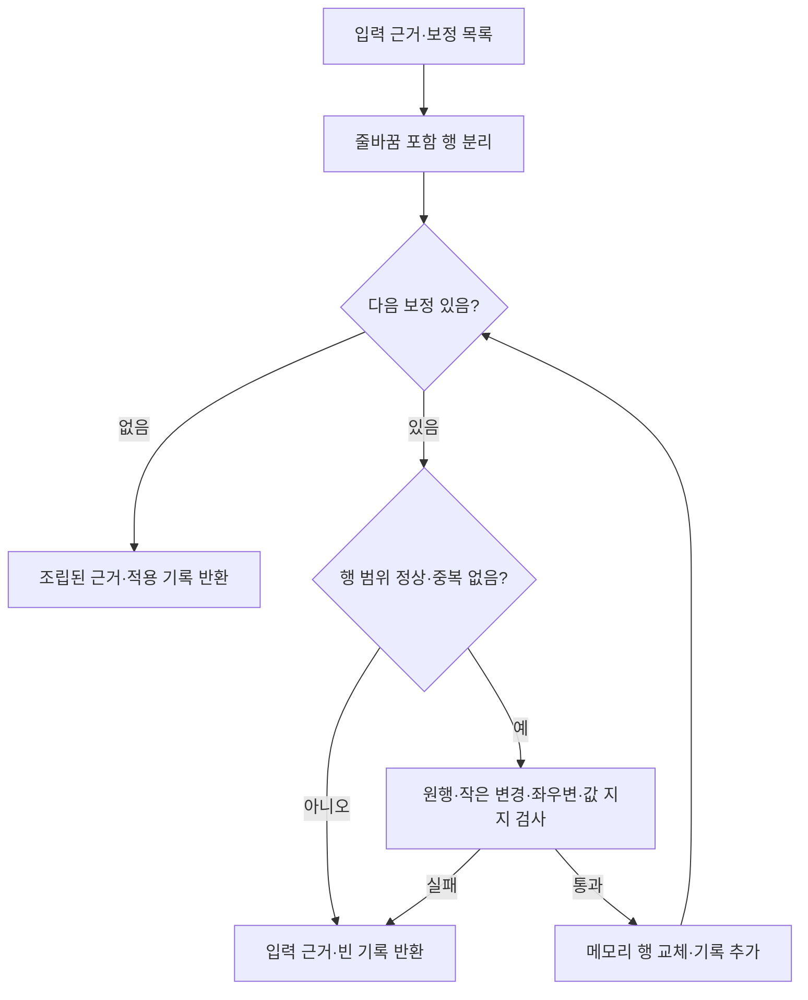
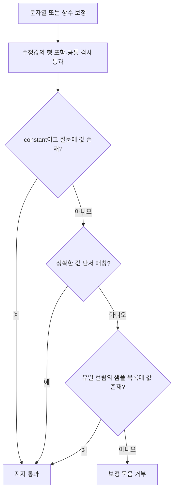
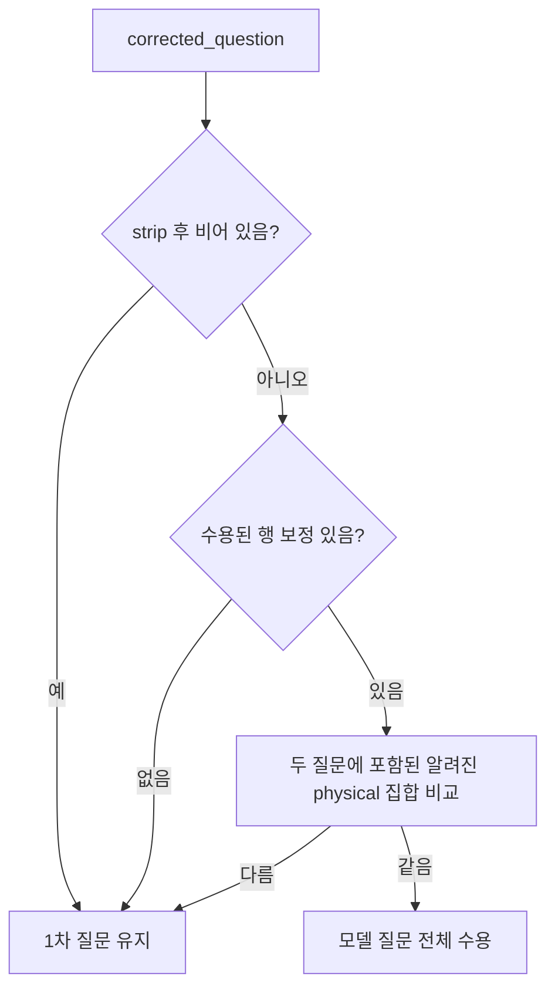

# Chapter 03-1. 근거 행의 값·비교 연산자 보정과 질문 갱신

## 1. 먼저 정의할 개념과 검증의 기준

**Evidence(근거)**는 SQL 생성에서 따라야 할 조건·공식·해석 설명이다. **SQL**은 데이터베이스 조회 언어다. **Scalar(단일 값)**는 숫자 100·문자열 Active처럼 하나의 값이고, **literal(리터럴)**은 문장이나 코드에 직접 적힌 값이다. **Predicate(조건식)**는 `amount >= 100`처럼 참·거짓을 가리는 식이다. **비교 연산자**는 `=`, `!=`, `<>`, `>`, `>=`, `<`, `<=`다.

**좌변/우변**은 비교 연산자 왼쪽/오른쪽 부분이다. **행 보정(repair)**은 문자열의 임의 조각 대신 근거의 한 행 전체를 수정안으로 제시하는 방식이다. **트랜잭션**은 저장 작업 등을 한 묶음의 성공·실패로 처리하는 단위다. **원자적 적용**은 여기서 이번 메모리 수정 묶음을 전부 적용하거나 전부 버리는 뜻이다. **물리 필드**는 실제 스키마·테이블·컬럼을 가리키는 이름이며, 스키마는 테이블을 묶는 이름 공간이고 컬럼은 테이블의 항목이다.

**Value anchor(값 단서)**는 질문 표현과 특정 컬럼의 저장 값을 연결한 자료다. **샘플**은 미리 저장한 대표 값이다. **Catalog**는 구조·의미·샘플을 보관하는 내부 저장소, **DB**는 데이터베이스다. **LLM(대규모 언어 모델)**은 수정안을 제안하며 **프롬프트**는 그 지시·문맥이다. **State/path_state**는 공유 처리 데이터/중간 결과 사전이다. **None**은 Python의 값 부재 표시다.

**정규식**은 문자열의 형태를 패턴으로 찾는 도구이고 **SequenceMatcher**는 두 문자열의 같은 부분·다른 구간을 나누는 Python 도우미다. SQL 파서, 즉 SQL 문법 전체를 구조로 해석하는 도구와는 다르다. 용어는 [상세 용어집](../01-architecture/chapter-00-glossary.md)과 연결한다.

이 장은 [Chapter 03](chapter-03-evidence-refinement.md)의 1차 필드 연결 이후 적용하는 값·연산자 검사를 설명한다. 실제 모델·DB·테스트 실행 없는 정적 분석이다. 아래 ‘지지’는 코드가 입력 자료에서 값을 찾았다는 뜻이며 원본 DB를 다시 조회해 모든 조건을 증명했다는 뜻은 아니다.

## 2. 모델 입력과 완성 행 응답

2차 요청은 연결 후 질문, `1| ...`부터 번호를 붙인 근거, 표시 가능한 값 단서, 관련 테이블·저장 샘플을 포함한다. 값 단서는 샘플보다 먼저 표시하고, 근거 행을 추가·삭제하거나 수식·필드·논리 연결·정렬·출력 조건을 고치지 말라고 지시한다. 문장 보존의 실제 검사는 뒤 절처럼 제한된 문자열 규칙이다.

| EvidenceLineRepair 필드 | 계약 |
|---|---|
| line_number | 1 이상 정수. 실제 근거 범위는 적용 함수가 확인 |
| original_line | 번호 접두사 없는 원래 행 전체 |
| corrected_line | 고친 행 전체 |
| kind | string_representation·constant_value·predicate_operator 중 하나 |
| corrected_value | 최종 단일 값 또는 비교 연산자 문자열 |
| table_name·column_name | 기본 빈 문자열. 샘플/값 단서 지지 검사에 필요 |
| reason | 이유 문자열 필수. 내용의 진실성을 별도 증명하지는 않음 |

상위 `EvidenceRefinementResult`는 reasoning 기본 빈 문자열·repairs 기본 빈 목록·corrected_question 기본 빈 문자열이다. 세 kind는 각각 문자열의 실제 표기, 잘못된 상수, 잘못된 비교 연산자를 고친다는 뜻이다. 빈 보정 목록은 정상 응답이며 오류로 취급하지 않는다.

근거: [모델·프롬프트](../../../code/auto-ontology/auto_ontology/retrieval/text_to_sql/agents/evidence_refinement.py).

## 3. 원행 일치·행 번호·한 묶음 조립

`apply_evidence_repairs`는 근거를 줄바꿈을 포함한 행 목록으로 나누고 각 보정을 순회한다. 모델의 번호에서 1을 빼 실제 인덱스를 만든다. 범위 밖 번호·같은 행 번호 두 번은 즉시 **원근거와 빈 적용 기록**을 반환한다. 마지막 수정 우선으로 합치지 않는다.

각 행은 원래 줄 끝의 CR/LF를 분리해 원문과 비교한다. CR/LF는 운영체제에 따라 쓰는 줄바꿈 문자다. 검증이 통과하면 수정 행에 원래 줄바꿈을 붙이고 accepted에 모델 사전을 쌓는다. 명시하지 않은 행은 이 2차 조립 단계에서 그대로 남긴다.

앞에서 수정한 행이 있어도 뒤의 하나가 실패하면 외부로 부분 결과를 내보내지 않는다. 다만 원자성은 **2차 입력 근거**에 대한 것이다. 1차에서 이미 수용한 필드 연결까지 원래 사용자 근거로 되돌리는 기능은 아니다.

근거: [apply_evidence_repairs](../../../code/auto-ontology/auto_ontology/retrieval/text_to_sql/agents/evidence_refinement.py).

## 4. 모든 kind가 먼저 통과해야 하는 문자열 검사

| 조건 | 실제 검사 |
|---|---|
| 원문 일치 | original_line이 해당 행과 정확히 같아야 함 |
| 변화 존재·행 범위 | corrected_line이 원행과 달라야 하고 두 행에 `\n`이 없어야 함 |
| 보정값 존재 | corrected_value.strip()이 비면 거부 |
| 수식 보호 | 첫 비교 연산자 뒤에 `*`, `+`, `/`가 있으면 거부 |
| 작은 변경 | SequenceMatcher의 변경 구간이 1~3개, 변경 전/후 문자 수 합이 `max(32, 값 길이×3+8)` 이하 |
| 필드 쪽 보존 | 첫 비교 연산자 앞 문자열이 수정 전/후 정확히 같아야 함 |

수식 보호는 문자 패턴이다. 뺄셈 `-`를 이 정규식이 포함하지 않으며, 인용 문자열 안의 기호인지 SQL 수식인지 파싱하지 않는다. 예를 들어 날짜·URL·문자열에 들어 있는 기호의 영향은 실행 미검증이다. 이 검사를 모든 산술식 변경의 완전한 차단으로 설명하지 않는다.

비교식도 문자열에서 **첫 번째** 연산자를 찾는다. 여러 조건을 가진 행의 전체 의미 구조를 해석하지 않는다. 좌변 보존은 그 첫 연산자 앞 문자에 대한 조건이다.

Predicate_operator는 수정 연산자가 corrected_value와 같고 연산자 뒤 문자열 전체가 그대로여야 한다. 값 kind 둘은 원래·수정 연산자가 같아야 한다. 수정 우변에서 corrected_value가 처음 등장하는 위치를 찾고 인접 따옴표까지 허용 구간으로 잡는다. 우변의 각 변경 구간이 그 수정 결과 위치 안에 있어야 한다.

이 방식은 작은 국소 변경을 제한하지만 **새 값이 하나의 SQL 리터럴로 완전히 파싱되는지·변경 전 숫자가 하나의 의도된 값인지**까지 검사하지 않는다. 따옴표 제거 helper도 양끝의 짝이 같은 작은/큰따옴표 한 쌍만 제거하며 SQL 문자열 탈출 전체를 해석하지 않는다.

근거: [_valid_repair·좌우변·수식·크기 검사](../../../code/auto-ontology/auto_ontology/retrieval/text_to_sql/agents/evidence_refinement.py).

## 5. 문자열·상수를 지지하는 자료와 실제 우선순위

| kind | 추가로 필요한 지지 |
|---|---|
| string_representation | 정확한 값 단서 **또는** 유일하게 찾은 컬럼 샘플에 값 존재 |
| constant_value | 질문 안에 값이 단어 경계로 존재 **또는** 위 저장값 지지 |
| predicate_operator | 다음 절의 질문 비교 표현이 하나의 연산자로 모임 |

값 kind는 corrected_value의 따옴표를 벗긴 값이 corrected_line 안에 있어야 한다. 이 포함 검사는 단순 부분 문자열이다. Kind별 지지는 그 뒤에 추가한다.

### 5.1 값 단서 검사

`_anchor_supports`는 table_name·column_name이 비면 거부한다. 표·컬럼은 strip/casefold로 대소문자 무시 비교하고, **값은 문자열 정확히 일치**해야 한다. Kind가 absent인 단서는 제외한다. Absent는 해당 값이 없다고 표시한 단서다. Kind 누락은 value로 취급하며 그 밖의 종류를 별도로 열거해 제한하지 않는다.

표 이름은 단서의 tbl과 같거나, 수정안의 table_name을 점으로 나눈 마지막 부분이 tbl과 같으면 맞는 것으로 본다. 따라서 DB·스키마가 붙은 수정안도 짧은 테이블명 단서로 지지될 수 있다. 별도의 DB 동일성 검사·단서 개수 유일성 검사·phrase의 질문 의미 검증은 없다.

`_stored_value_supports`는 anchor 검사 **또는** sample 검사다. Anchor가 성공하면 샘플을 읽지 않지만, 같은 컬럼의 다른 값 단서가 존재해도 이번 보정값과 안 맞으면 샘플로 넘어갈 수 있다. 프롬프트의 ‘단서 우선’을 충돌하는 단서가 있을 때 샘플을 절대 금지하는 규칙으로 옮기면 안 된다.

### 5.2 샘플 검사

`_column_samples`는 수정안의 테이블명이 준비 테이블의 짧은 name 또는 `database.schema.table`의 존재하는 부분을 붙인 이름과 맞는지 본다. 컬럼명도 대소문자를 무시한다. **정확히 하나의 컬럼 항목**으로 좁혀져야 샘플 목록을 반환하며 0개·여러 개면 미지지다. 수정안의 table_name·column_name이 근거 행 좌변의 실제 필드와 같은지는 별도로 파싱해 대조하지 않는다. 근거 행의 앞부분을 보존한다는 검사와 지지 자료가 같은 필드에 속하는지 검증하는 것은 다른 조건이다.

샘플은 `stringify_sample_values`로 표시 문자열 목록으로 만들고 보정값이 그 목록에 정확히 속하는지 검사한다. 이 호출에는 길이 상한을 주지 않는다. 숫자도 표시 문자열로 비교하며, 샘플이 없다는 사실은 원본 데이터에 그 값이 없다는 증명이 아니다.

### 5.3 질문의 상수 검사

`_question_contains_literal`은 따옴표를 벗긴 값을 질문 전체에서 단어 경계 정규식으로 찾는다. 값의 대소문자를 무시하는 flag는 없다. **그 값이 수정하려는 표·컬럼의 조건인지**까지 연결하지 않는다. 질문의 다른 조건에서 같은 숫자가 나오는 경우의 의미 오판 가능성은 코드에서 도출한 경계이며 실행 재현하지 않았다.

근거: [값 단서·샘플·질문 상수](../../../code/auto-ontology/auto_ontology/retrieval/text_to_sql/agents/evidence_refinement.py), [저장 샘플의 문자열 변환](../../../code/auto-ontology/auto_ontology/utils/sample_values.py).

## 6. 비교 연산자: 영문 표현에서 하나의 종류만 인정한다

| 질문에서 찾는 표현 | 연산자 |
|---|---|
| at least·no less than·starting from·on or after | >= |
| greater than·larger than·more than·after | > |
| at most·no more than·up to·on or before | <= |
| less than·fewer than·before | < |
| exactly·equal to | = |

정규식은 대소문자를 무시하고 일부 표현이 겹치지 않도록 앞의 no·or를 검사한다. 찾은 **연산자 종류 집합의 크기가 1일 때만** 그 값을 반환한다. 같은 뜻의 표현 두 개가 있어도 결과 종류가 하나면 가능하고, “최소 10이면서 20 미만”처럼 종류가 둘이면 거부한다.

이는 컬럼별 조건을 분리한 분석이 아니라 질문 전체 표현의 집계다. 한국어 “이상·초과·이하”나 기호 자체를 이 영문 cue 목록으로 해석하지 않는다. 허용 비교 연산자에는 !=·<>가 있어도 이 cue 목록은 그 두 종류를 반환하지 않으므로 현재 경로에서 그 연산자로 새로 바꾸는 지지는 얻지 못한다.

예를 들어 “starting from today”가 있는 질문에서 `created_at > today`를 `>=`로 고칠 수 있다. “after today”인데 >=를 제안하면 질문의 >와 맞지 않아 거부한다. 이는 테스트가 다루는 규칙이며 실제 날짜 경계나 시간대를 원본 DB에서 검증한 것은 아니다.

근거: [_OPERATOR_CUES·연산자 검사](../../../code/auto-ontology/auto_ontology/retrieval/text_to_sql/agents/evidence_refinement.py).

## 7. corrected_question은 행 보정과 다른 검사를 받는다

`_validate_corrected_question`은 수정 질문을 strip하고 비었으면 1차 질문을 유지한다. Accepted repairs가 없으면 질문 변경을 허용하지 않는다. 보정이 하나 이상 수용됐으면 catalog의 알려진 physical 문자열 중 각 질문에 나타난 **집합**을 비교한다.

여기서는 **수용된 보정값이 질문에서 정확히 같은 방식으로 변경됐는지** 다시 적용해 대조하지 않는다. 필드의 등장 횟수·배치·부정 표현·정렬·조건 전체가 같다는 검사도 없다. 알려지지 않은 새 필드가 들어왔는지 별도로 파싱하지 않는다. 두 질문 모두 알려진 physical이 하나도 없으면 두 집합은 모두 빈 집합일 수 있다.

따라서 이 함수의 ‘value-only’ 설명은 의도이고, 실제 기계적 조건은 비어 있지 않은 질문·수용된 행 존재·알려진 필드 집합 동일성이다. 완전한 질문 의미 보존을 증명하는 검사로 부르지 않는다. 수용 질문은 path_state.normalized_question으로 전달되며 원래 제출 질문을 대체하지 않는다.

## 8. 상태·실패·테스트와 인계

**Assertion**은 테스트가 기대 조건을 검사하는 구문이다.

예를 들어 근거가 `status = 'restricted'`와 `amount > 10` 두 행이고 첫 수정은 저장 샘플 Restricted로 지지되지만 둘째 999는 질문·저장 자료에 없다고 하자. **둘째 하나 때문에 두 행 수정 모두 버리고 2차 입력 근거를 반환**한다. 설명용 예시이며 이 조합의 원리는 테스트 assertion에도 있다.

Agent는 accepted가 있으면 path_state.evidence_repairs_applied에 모델 보정 사전을 넣는다. 그 목록에는 reason·표/컬럼 이름도 포함되지만 DB에서 증명한 별도 인증 기록은 아니다. 적용이 없으면 기존 목록을 명시적으로 지우지 않는다. 최종 evidence는 SQL 생성의 우선 근거 블록으로 전달된다.

모델 호출 자체가 None이면 코드 보정 함수를 실행하지 않고 1차 연결 근거를 유지한다. 행 묶음이 거부됐어도 모델 reasoning은 실행 기록에 남을 수 있다. 예외·전체 재시도·원요청 복원은 Chapter 03과 후속 Chapter 06의 경계를 따른다. 이 검사는 메모리 문자열·저장 입력 자료만 읽고 원본 DB를 새로 조회하거나 catalog에 쓰지 않는다.

[test_evidence_refinement.py](../../../code/auto-ontology/auto_ontology/retrieval/text_to_sql/tests/test_evidence_refinement.py)의 assertion을 읽었으며 실행하지 않았다. Mock은 실제 모델을 대신하는 모형이다.

| 테스트 묶음 | 확인한 기대 조건 |
|---|---|
| 샘플 기반 문자열·전체 행 사례 | restricted→Restricted, italian→Italian, 고치지 않은 행 유지 |
| 값 단서 우선·샘플 대체 사례 | 단서가 맞으면 샘플 함수 미호출, 안 맞는 단서 뒤 샘플로 지지 가능 |
| 큰 변경·상수·수식 사례 | 넓은 문장 재작성 거부, 질문의 100은 허용, 999와 나눗셈/곱셈 수식 보정 거부 |
| test_rejects_entire_response_when_any_patch_is_invalid | 한 행이 실패하면 먼저 유효했던 행도 적용하지 않음 |
| 연산자 사례 | starting from의 >= 수용, after에 대한 맞지 않는 >= 보정 비적용 |
| 값/질문 필드 변경 거부 사례 | 값 보정이 연결된 필드를 다른 컬럼으로 바꾸거나 질문의 알려진 필드 집합을 바꾸면 거부 |
| agent 기록·프롬프트 사례 | 적용 기록 생성, 1차→2차 순서, 값 단서가 샘플 블록보다 앞에 있음 |

테스트의 잘못된 after 예시는 corrected_line을 원행과 같게 설정하므로, 그 결과만으로 **연산자 불일치 분기 하나만** 독립 검증했다고 해석하지 않는다. 원문과 같은 보정 자체도 공통 검사에서 거부된다.

한국어 비교 표현·여러 조건의 같은 숫자·같은 이름의 다른 DB 단서·부분 문자열과 인용 기호·뺄셈/문자열 기호·빈 필드 집합의 질문 변경·중복/범위 밖 행·줄바꿈 다양성·과거 기록 잔존은 실행 재현하지 않았다. 코드에서 도출한 검증 한계와 실제 오보정 발생을 구분한다.

Mermaid 3개를 작성했으며 렌더링하지 않았다. 다음 분석은 Chapter 04 SQL 생성의 입력 프롬프트·모델 선택·응답 계약·빈 SQL·오류와 상태다.
