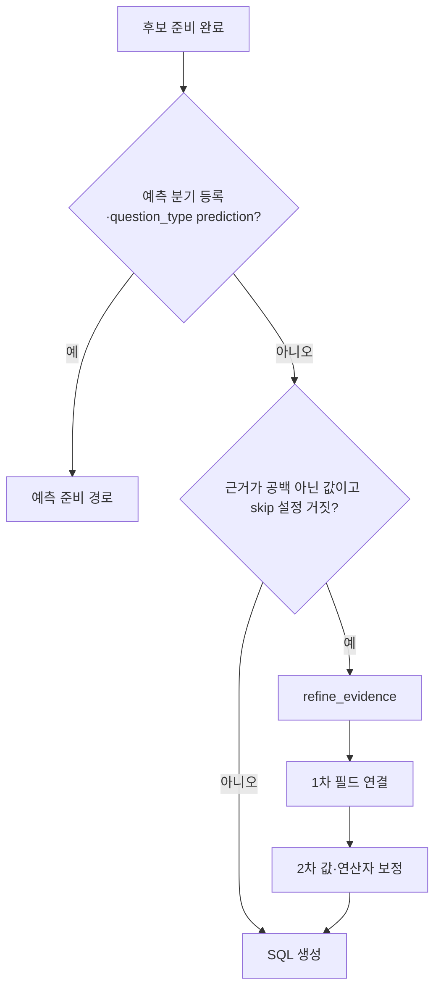
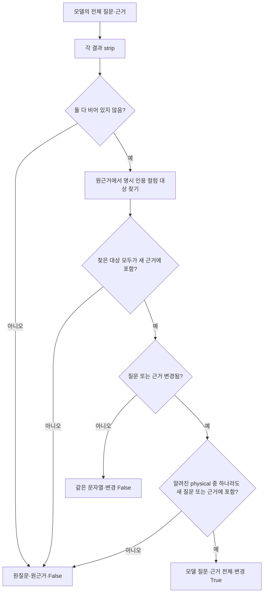
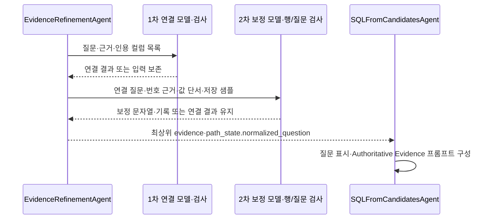

# Chapter 03. 근거의 필드 연결과 두 단계 보정 조율

## 1. 먼저 정의할 개념과 목적

**Evidence(근거)**는 질문을 해석하거나 답을 계산할 때 따라야 하는 공식·조건·대응 설명이다. 예를 들어 “유료 계정은 Premium Account (Y/N)이 1인 계정”이라는 설명이다. **Schema grounding(스키마 연결)**은 이 설명의 업무 표현을 실제 테이블·컬럼 참조에 연결하는 처리다. **물리 컬럼**은 DB에 존재하는 실제 항목이고, **스키마**는 테이블을 묶는 이름 공간이다. **DB**는 데이터베이스의 줄임말이다.

**SQL**은 DB 조회 언어다. **Identifier(식별자)**는 테이블·컬럼 등의 이름, **qualified reference(한정 참조)**는 스키마·테이블·컬럼을 붙여 위치를 명확히 한 이름이다. **Quoting(인용)**은 공백·예약어가 있는 이름도 하나의 식별자로 읽히도록 따옴표 등으로 감싸는 처리다. **Dialect(방언)**는 DB마다 다른 SQL 문법·인용 방식이다.

**LLM(대규모 언어 모델)**은 필드 연결과 보정안을 제안한다. **프롬프트**는 그 모델에 보내는 지시·문맥이다. **Structured output(구조화 응답)**은 정해진 필드로 받는 결과다. **State**는 처리 단계의 공유 데이터, **path_state**는 중간 결과 사전이다. **Normalized question**은 앞 단계에서 검색에 맞게 정리한 질문이며 이 단계에서 실제 컬럼 조건을 포함한 표현으로 다시 바뀔 수 있다.

**Connector**는 DB와 통신하는 객체다. **Catalog**는 저장된 테이블·컬럼·의미 설명을 보관하는 내부 저장소다. **Value anchor(값 단서)**는 질문 표현이 특정 컬럼의 저장 값과 연결됐다는 자료이고 **sample value(샘플)**는 앞서 저장해 둔 대표 값이다. 이 장의 ‘검증’은 아래 코드 조건의 통과를 말하며 원본 DB 전체를 재조회한 검증과 구분한다. 상세 용어는 [용어집](../01-architecture/chapter-00-glossary.md)을 참고한다.

이 단계는 질문과 근거를 먼저 물리 컬럼에 연결하고, 그 결과에 값·연산자 보정을 적용한다. 값 보정의 개별 검사는 [Chapter 03-1](chapter-03-1-evidence-value-and-operator-repairs.md)에서 분리한다. 로컬 소스·관련 테스트를 읽은 정적 분석이며 실제 모델·DB·테스트는 실행하지 않았다.

## 2. 그래프 진입과 생략 조건

정보 요청은 이보다 앞인 후보 검색 뒤 InformationAgent로 갈라진다. 예측 노드가 등록된 그래프는 prediction일 때 이 근거 보정을 우회한다. 나머지 준비 경로에서 `route_evidence_refinement`는 `skip_evidence_refinement`가 거짓이고 최상위 evidence를 strip한 결과가 있을 때만 refine_evidence를 선택한다.

Agent의 `validate_input`도 근거가 공백이 아닌지만 검사한다. 직접 `execute`를 호출해 근거가 없으면 `{}`를 반환하지만, 공통 래퍼로 호출한 입력 거부는 예외 경로가 될 수 있다. 그래프의 생략·직접 호출·래퍼 검사는 같은 처리로 설명하지 않는다.

이 단계에는 질문 종류·후보 개수에 따른 추가 조기 종료 조건이 없다. 테이블이 비어 있어도 근거가 있으면 두 모델 단계를 시도할 수 있다. 다만 connector 선택의 모호성 오류는 그 전에 발생할 수 있다.

근거: [그래프 라우팅·등록](../../../code/auto-ontology/auto_ontology/retrieval/text_to_sql/text_to_sql_graph.py), [agent 입력·실행](../../../code/auto-ontology/auto_ontology/retrieval/text_to_sql/agents/evidence_refinement.py), [공통 래퍼](../../../code/auto-ontology/auto_ontology/retrieval/text_to_sql/base.py).

## 3. 모델에 줄 실제 컬럼 참조를 만든다

Execute는 evidence를 읽고 path_state의 바깥 사전을 복사한다. 질문은 `get_question_for_processing`을 사용하므로 normalized_question → 독립 질문 → 제출 질문 순의 대체 규칙을 따른다. 입력은 relevant_tables·target_db·connectors이고, 모델에 넘길 문맥은 두 종류다.

| 문맥 | 생성 함수·내용 | 사용하는 단계 |
|---|---|---|
| tables_block | format_tables_for_prompt: 테이블·컬럼·타입·설명·저장 샘플 등 | 2차 값 보정 |
| catalog_columns | _catalog_columns: 정확한 인용 물리 참조·테이블/컬럼 설명 | 1차 연결·코드 검사 |

`resolve_connector_from_tables`는 테이블의 DB 이름으로 connector를 고른다. 여러 DB에 걸친 테이블, 다중 connector인데 DB를 식별할 수 없는 상황 등은 ValueError가 될 수 있다. target_db를 이 함수의 별도 인수로 넘기지는 않는다. 선택 상세는 Chapter 05에서 이어간다.

`_catalog_columns`는 이름 없는 테이블·비사전 컬럼·이름 없는 컬럼을 건너뛴다. 테이블명·스키마·DB·설명은 문자열로 정리하며, DB는 테이블 필드가 있으면 그것, 없으면 target_db다. Connector가 있으면 `connector.qualify(schema, table)`로 테이블 위치를 만들고, 없으면 `qualified_name(database, schema, table, dialect)`를 쓴다. 마지막 컬럼명은 `quoted_identifier`로 인용한다.

| 결과 필드 | 의미 |
|---|---|
| table·schema·column | 원래 테이블·스키마·컬럼명 |
| qualified_table·physical | 인용한 테이블 참조·컬럼까지 붙인 전체 참조 |
| table_description | 테이블 설명 |
| column_description | description·usage_evidence·constraints·format의 비어 있지 않은 값을 ` \| `로 연결 |

Usage evidence는 사용 근거 설명, constraints는 제약, format은 값의 표기 규칙이다. 이름을 인용하는 helper는 SQLGlot이라는 SQL 표현 도구를 쓰고, 모르는 방언 등으로 실패하면 큰따옴표 방식으로 대체한다. 모든 DB에서 동일한 점 세 개 형식이라고 가정하지 않는다.

첫 단계의 실제 사용자 메시지는 **질문·근거·정확한 컬럼 목록과 설명**이다. System prompt에 관련 테이블 구역을 언급하는 문장이 있지만 execute는 첫 요청에 tables_block 전체를 넣지 않는다. 저장 샘플과 값 단서도 이때 별도 블록으로 넣지 않는다. 사용자 용어 정의·업무 규칙·SQL 예시도 두 요청에 독립 입력으로 주입하지 않는다. 이미 evidence에 들어간 규칙은 그 문자열을 통해 전달된다. 목록이 비면 `(none)`이다. 컬럼 수·설명 길이를 이 함수에서 추가로 제한하지 않는다.

근거: [문맥 구성](../../../code/auto-ontology/auto_ontology/retrieval/text_to_sql/agents/evidence_refinement.py), [스키마 문맥 표시](../../../code/auto-ontology/auto_ontology/retrieval/text_to_sql/formatters_util.py), [이름 인용](../../../code/auto-ontology/auto_ontology/utils/sql_identifiers.py), [connector 선택](../../../code/auto-ontology/auto_ontology/retrieval/text_to_sql/connector_routing.py).

## 4. 1차 모델 지시와 응답

필드 연결 프롬프트는 근거에 설명된 필드만 고치라고 지시한다. “refers to”, “means” 등 앞의 업무 개념을 질문에서 찾으면 물리 컬럼뿐 아니라 **근거에 있는 연산자·값·수식까지 포함한 전체 규칙**으로 최소 문구를 대체하라고 한다. 동일 철자가 아니어도 단복수·대소문자·일반적인 바꿔 말하기를 해석하도록 지시한다.

근거에 없는 질문의 다른 필드, 값·수식·그룹·정렬·출력 조건은 바꾸지 말라고 한다. 명시적으로 인용한 컬럼명은 의미가 비슷한 다른 컬럼보다 우선한다. 불확실한 필드는 그대로 남기라는 규칙이다. 이 내용은 **모델에 대한 요구**이며 다음 절의 실제 코드 검사와 구분해야 한다.

`EvidenceGroundingResult`는 다음 필드를 갖는다.

| 필드 | 계약 |
|---|---|
| reasoning | 짧은 설명, 기본 빈 문자열 |
| grounded_question | 전체 연결 후 질문 문자열, 필수 |
| grounded_evidence | 전체 연결 후 근거 문자열, 필수 |

공통 StrictLLMOutputModel은 `$` 시작 부가 키를 제거하고 정의 밖 키를 거부한다. ‘Strict’라는 이름이 필드 값의 모든 의미·문장 보존을 검사한다는 뜻은 아니다.

이 agent는 `state.llm`을 직접 전달하지 않고 **safe_invoke_structured_nr**를 호출한다. 이 도우미는 일반 모델을 구하고, 실패 시 설정된 추론 모델 대체와 구조화 호출 재시도를 사용할 수 있다. 추론 모델은 복잡한 판단용으로 설정한 별도 모델이다. 정상 경로의 agent 수준 호출은 1차·2차 두 번이지만 실제 네트워크 요청은 재시도로 더 많을 수 있다.

근거: [두 프롬프트·응답 모델](../../../code/auto-ontology/auto_ontology/retrieval/text_to_sql/agents/evidence_refinement.py), [일반 모델 호출·재시도·대체](../../../code/auto-ontology/auto_ontology/utils/llm_invoke.py).

## 5. validate_schema_grounding이 실제로 검사하는 범위

**원자적 수용**은 질문·근거의 제안 전체를 함께 받아들이거나 둘 다 입력으로 되돌린다는 뜻이다. **트랜잭션**은 저장 작업 등에 한 묶음의 성공·실패 경계를 주는 단위다. 여기서의 원자성은 DB 저장 처리가 아니라 메모리 문자열의 선택이다.

`_explicit_identifier_targets`는 원근거에서 백틱·큰따옴표로 감싼 토큰을 찾는다. 그 안 문자열과 컬럼명이 대소문자 무시로 같아야 한다. 후보가 여럿이면 **근거 전체에 테이블 이름이 단어 경계로 등장하는지**로 다시 줄인다. 하나로 좁혀지면 그 인용 토큰에 대응할 physical을 잠근다.

이 과정은 SQL 파서가 아니다. 인용된 문자열이 컬럼명과 일치하면 검사 후보가 될 수 있고, 모호한 인용 토큰은 잠그지 않는다. 각 참조가 나타난 바로 근처의 테이블명만 분석하는 것도 아니다. 확정한 physical은 새 **근거에 포함돼야** 하지만 새 질문에 모두 나타나야 하는 별도 검사는 없다.

변경이 있을 때의 추가 검사는 알려진 physical 중 **하나라도** 새 질문·근거에 있는지다. 모든 새 참조를 허용 목록과 대조하거나, 변경한 모든 문구가 근거에 정의됐는지 검사하지 않는다. 모델에 요구한 다음 항목도 이 함수가 완전하게 증명하지는 않는다.

- 모든 값·연산자·수식·무관 문장 보존
- 오직 근거에 설명된 개념만 질문에서 대체
- 새로 추가한 참조가 전부 catalog에 존재
- 바꿔 말한 질문과 연결 후 규칙의 의미 동등성

코드는 결과 전체에 strip을 적용하므로 양끝 공백까지 바이트 단위로 보존한다는 보장도 아니다. 이 한계를 기록하는 것이 실제 모델이 그런 변경을 했다는 실행 결과를 뜻하지는 않는다.

근거: [명시 인용 대상·수용 검사](../../../code/auto-ontology/auto_ontology/retrieval/text_to_sql/agents/evidence_refinement.py).

## 6. 2차 조율·실패별 상태와 최종 소비

1차가 None이면 원질문·원근거로 계속한다. 결과가 있어도 수용 검사를 못 통과하면 마찬가지다. 1차가 실패했다고 2차 값 보정을 생략하지 않는다. 반대로 1차가 수용되면 normalized_question을 기록한 뒤 2차를 시작한다.

2차 입력에는 1차 질문·행 번호를 붙인 근거·값 단서·tables_block을 넣는다. 모델은 완성된 수정 행들과 corrected_question을 반환하고, agent는 코드 검사를 통과한 행만 묶음 적용한다. 자세한 값·행 검사는 다음 장을 따른다.

| 조건 | 최종 evidence·질문 | 기록 |
|---|---|---|
| 근거 없는 직접 execute | 갱신 없음 | `{}` |
| 1차 None·검사 거부 | 입력 질문·근거로 2차 진행 | 거부된 응답에도 reasoning이 있으면 thoughts_log에 기록 가능 |
| 1차 수용 | grounded 질문·근거가 2차 기준 | normalized_question 기록 |
| 2차 None | grounded_evidence 유지 | 현재 로컬 path_state 반환 |
| 2차 응답·행 묶음 거부 | grounded_evidence 유지 | accepted 빈 목록, 이유 텍스트는 기록 가능 |
| 2차 수용 | 행 보정 근거·별도 검사한 질문 | evidence_repairs_applied에 모델 행 기록 |

**Thoughts log**는 agent가 받은 짧은 설명을 붙이는 실행 기록이다. 기록 존재가 실제 변경 수용을 뜻하지는 않는다. 1차·2차에서 같은 그래프 노드명 refine_evidence로 여러 설명을 붙일 수 있다.

기존 path_state는 얕은 복사, 즉 바깥 사전만 복사한다. accepted가 있을 때만 evidence_repairs_applied를 새로 쓰며 없을 때 이전 키를 지우지 않는다. 이 필드의 존재만으로 이번 실행에서 새 보정이 적용됐다고 단정하지 않는다. Original/processing 질문·messages·value_anchors·relevant_tables는 정상 반환에서 교체하지 않는다.

Connector 선택·문맥 구성·검사 중 예상 밖 오류를 execute 전체에서 따로 잡아 원근거 성공 반환으로 바꾸지는 않는다. 공통 agent_wrapper는 일반 예외를 error 상태로 바꿀 수 있다. 이때 근거의 로컬 변경이 최상위 state에 이미 반영됐다고 가정해서도 안 된다. 1차 질문을 로컬 path_state에 썼더라도 정상 반환 전 예외가 나면 그 반환 갱신은 전달되지 않는다.

SQL 생성은 최상위 evidence를 `format_authoritative_evidence(evidence_first_sql=True)`로 감싸고 질문보다 먼저 근거의 규칙을 구성하라고 지시한다. Normalized question도 검색용 질문 접근자로 읽어 제출 질문과 함께 표시한다. **Authoritative Evidence**는 우선해서 따라야 한다는 프롬프트 제목이며 원본 DB 검증 인증을 뜻하지 않는다. 이 입력은 이후 생성 품질에 영향을 주므로 보정 검사의 제한을 함께 봐야 한다.

이 agent는 이미 준비된 catalog 문맥·샘플을 읽고 모델을 호출한다. 원본 DB의 값을 새로 조회하거나 관계·근거를 영구 저장하지 않는다. Connector는 이름 한정·방언을 위해 사용하며 SQL 실행을 호출하지 않는다.

근거: [두 단계 실행·반환](../../../code/auto-ontology/auto_ontology/retrieval/text_to_sql/agents/evidence_refinement.py), [기록 도우미](../../../code/auto-ontology/auto_ontology/retrieval/text_to_sql/base.py), [SQL 생성 소비](../../../code/auto-ontology/auto_ontology/retrieval/text_to_sql/agents/sql_from_semantic.py), [근거 프롬프트](../../../code/auto-ontology/auto_ontology/retrieval/text_to_sql/prompts.py).

## 7. 설명용 예시·테스트와 미검증

“유료 계정 수는?”과 “유료 계정은 account_flags의 `Premium Account (Y/N)` = 0”이라는 근거를 생각하자. 1차는 실제 인용 참조로 필드를 연결하고 **값 0은 유지**하도록 지시받는다. 2차에서 해당 컬럼의 값 단서가 1을 뒷받침하면 그때 값 보정을 제안할 수 있다. 두 단계의 역할을 보여 주는 설명이며 실제 한국어 모델 결과는 아니다.

**Assertion**은 테스트의 기대 조건 검사다. [test_evidence_refinement.py](../../../code/auto-ontology/auto_ontology/retrieval/text_to_sql/tests/test_evidence_refinement.py)의 assertion을 읽었다. Mock은 실제 모델 대신 응답을 정해 주는 모형이다.

| 테스트 | 확인한 기대 조건 |
|---|---|
| test_schema_grounding_uses_exact_evidence_column_and_rewrites_question | 명시 컬럼이 연결된 전체 질문·근거 수용 |
| test_schema_grounding_quotes_every_identifier_for_dialect | Postgres 큰따옴표·Spark 백틱 결과 수용 |
| test_explicit_evidence_column_rejects_semantic_alternative | 인용한 정확한 컬럼 대신 의미가 비슷한 컬럼을 택한 결과 거부 |
| test_agent_grounds_schema_before_value_anchor_repair | 1차→2차 모델 순서, 값 단서는 2차에만 표시, 연결된 필드에서 값 보정 |
| test_llm_failure_keeps_original_evidence | 두 모델 호출을 None으로 만든 경우 입력 근거 유지 |
| 라우팅·그래프 세 테스트 | 근거/skip 조건, 생성 직전 연결, 예측 경로 우회 |

테스트가 일부 잘못된 컬럼 변경을 거부한다는 사실을 모든 문장·수식 변경 차단의 증거로 일반화하지 않는다. 실제 한국어 개념 연결·모호 인용·허용 밖 참조·샘플 최신성·모델 장애·connector 오류·기존 보정 기록 잔존은 실행 재현하지 않았다. 코드 검사 범위에서 도출한 한계와 실제 발생 사례를 구분한다.

Mermaid 3개를 작성했으며 렌더링하지 않았다. 다음 장은 값·연산자 검증과 corrected_question의 실제 수용 범위다. 두 장 이후 Chapter 04 SQL 생성 상세로 이어간다.
