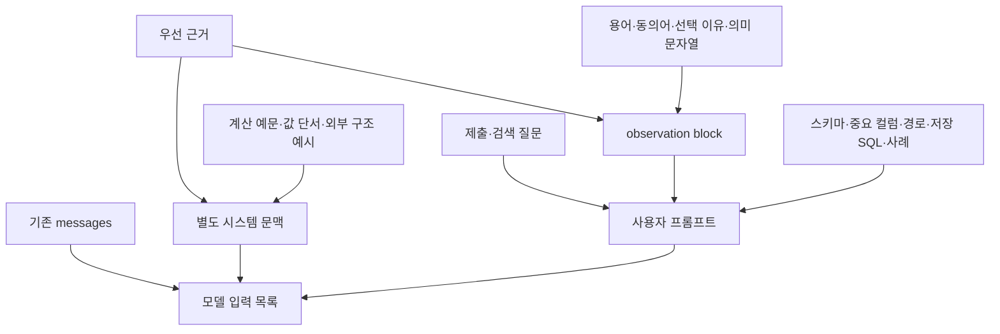
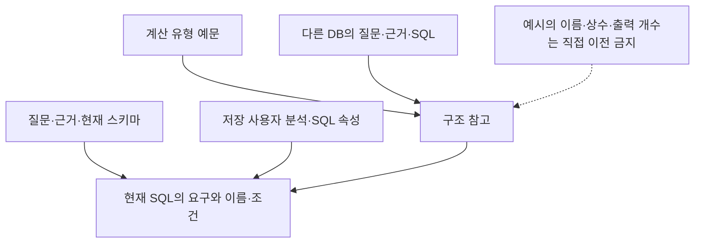
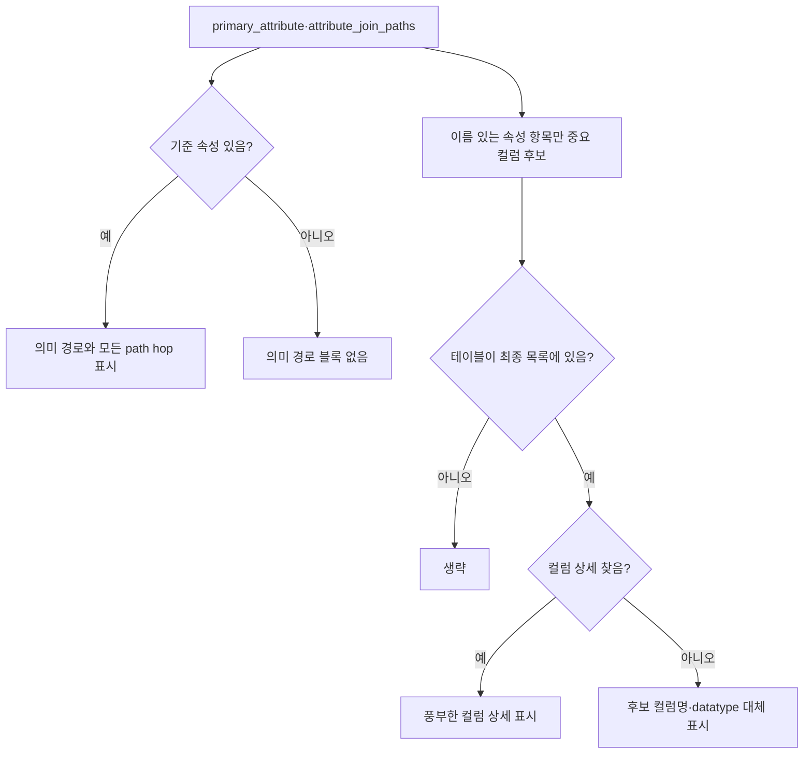

# Chapter 04-1. SQL 생성 문맥·포맷터와 프롬프트 규칙

## 1. 먼저 정의할 개념과 읽는 기준

**SQL**은 데이터베이스 조회 언어이고 **프롬프트**는 모델에 보내는 질문·자료·지시다. **Formatter(포맷터)**는 자료를 프롬프트에 넣을 문자열로 바꾸는 함수다. **스키마**는 테이블의 이름 공간과 데이터 구조를 뜻하며, 컬럼은 테이블의 한 항목이다. **DB**는 데이터베이스다.

**Evidence(근거)**는 따라야 할 공식·조건·해석 설명이다. **Value anchor(값 단서)**는 질문 표현과 특정 컬럼의 저장 값의 연결이다. **SQL template**은 계산 유형별 고정 예문, **reference query pattern**은 다른 질문/DB의 SQL 구조 참고 예시다. **CustomAnalysis**는 저장된 사용자 분석, **SqlAttribute**는 이름 붙인 SQL 정의다. 이 네 종류의 예시·정의는 같은 신뢰도·용도로 취급하지 않는다.

**Anchor**는 기준 의미 속성, **ColumnAttribute**는 컬럼의 업무 의미, **Term**은 업무 개념이다. **JOIN path**는 테이블을 연결하는 실제 컬럼 쌍의 순서이고 **hop**은 한 번의 이동이다. **Bridge**는 경로의 중간 테이블이다. JOIN은 조건으로 테이블 행을 연결하는 연산이다. **Glossary**는 사용자 용어 정의, **synonym**은 같은 개념의 다른 이름이다.

**Projection(투영)**은 SELECT로 반환할 컬럼·표현식을 고르는 일이다. **Aggregation(집계)**은 여러 행을 합계·개수 등으로 요약하는 일이다. **Row grain**은 결과 한 행이 무엇을 나타내는지 뜻한다. **NULL**은 값이 없거나 알려지지 않았음을 나타낸다. **FK(외래 키)**는 다른 키를 참조하는 관계다. **Dialect(방언)**는 DB별 SQL 차이다.

**State/path_state**는 공유 처리 데이터/중간 결과 사전이다. **LLM**은 대규모 언어 모델이다. 이 문서의 ‘우선순위’는 주로 **모델에게 지시한 규칙**이며 코드가 생성 SQL을 모두 대조·강제했다는 보장이 아니다. 호출·출력·재시도는 [Chapter 04](chapter-04-sql-prompt-and-output.md), 상세 용어는 [용어집](../01-architecture/chapter-00-glossary.md)과 연결한다. 실제 모델·DB·테스트를 실행하지 않은 정적 분석이다.

## 2. 문맥 출처와 실제 들어가는 위치

| 문맥 | 실제 출처 | 표시 위치·역할 |
|---|---|---|
| 제출/검색용 질문 | 접근자 두 개 | 사용자 프롬프트 Question |
| 최상위 evidence | 근거 보정 후 문자열 | 별도 system message **및** 사용자 observation에 중복 |
| 계산 유형 예문 | path_state.sql_template | 별도 system message·구조만 참고 |
| 값 단서 | state.value_anchors | 별도 system message·대상 컬럼/정확한 저장 표기 힌트 |
| 외부 SQL 예시 | state.sql_examples | 별도 system message·다른 DB의 구조 참고 |
| relevant_queries | 준비 단계에서 읽은 사용자 분석 SQL 목록 | 사용자 Example SQL Queries |
| custom_analyses·sql_attributes | 검색 후보/재조회 정의 | 사용자 의미 정의와 SQL 블록 |
| 스키마·경로·중요 컬럼 | 관련 테이블·anchor·path 상태 | 사용자 Available Schema·중요 컬럼·JOIN 규칙 |
| 용어·동의어·테이블 선택 이유 | glossary·term_synonyms·table_relevance_reasoning | 사용자 observation |
| 과거 질문 사례 | path_state.similar_questions | 사용자 Conversation History |

**Observation block**은 이 생성 함수가 설명 자료를 모은 문자열 이름이다. InformationAgent의 도구 실행 observation과 같은 자료구조가 아니다. 사용자 분석/SQL 속성의 `*_str` 필드는 목록 상태를 그대로 문자열 보간하므로 Python 목록의 표현 기호가 표시될 수 있다. Relevant_queries도 별도 SQL 코드 블록으로 한 개씩 정리하지 않고 목록을 프롬프트에 보간한다.

기존 state.messages도 앞에 붙는다. 최초 시스템 메시지의 날짜·custom_prompts는 이 상속 경로로 들어온다. 반면 SQLFromCandidatesAgent가 state.domain_rules를 새 독립 블록으로 읽지는 않는다. 용어·규칙이 다른 단계에서 해석됐다는 사실과 이 생성 함수에 직접 들어간 입력을 구분한다.

근거: [build_messages·사용자 슬롯 구성](../../../code/auto-ontology/auto_ontology/retrieval/text_to_sql/agents/sql_from_semantic.py), [공통 사용자 템플릿](../../../code/auto-ontology/auto_ontology/retrieval/text_to_sql/prompts.py).

## 3. 질문 세 표현이 항상 세 블록으로 표시되지는 않는다

**Original question**은 제출 질문, **standalone question**은 대화 맥락을 풀어 쓴 독립 질문, **normalized question**은 전처리·근거 연결 후 질문이다. 공유 helper `format_dual_question_block`은 세 입력을 받을 수 있지만, **현재 SQL 생성 호출은 제출·검색용 질문 두 인수만 전달**한다.

둘이 strip 기준으로 같으면 검색용 질문만 반환한다. 다르면 Original user request와 Normalized retrieval question을 구분한다. 이 호출에서 standalone 블록을 따로 넣는 세 번째 인수는 비어 있다. 다만 검색용 질문이 독립 질문에서 파생됐거나 기존 messages에 초기 독립 질문이 남아 있을 수는 있다. ‘독립 질문 자체를 전혀 볼 수 없다’고 확대 해석하지 않는다.

유사 대화 사례는 `(question, answer)`처럼 인덱스 0·1로 읽을 수 있는 항목을 가정하고 문자열로 바꾼다. 현재 준비 단계는 이 값을 새로 검색해 생성하지 않는다. 제공된 text_to_sql Python 소스에서 읽기·초기화/재시도 제거·주석 외 자동 조회 호출을 확인하지 못했다. 외부 초기 상태로 주입하는 경우와 매 요청 자동 대화 검색을 구분한다.

생성용 질문 자체에는 새로 날짜 경계를 계산하는 코드가 없다. 영문 last week·last month·last year가 부분 문자열로 있으면 ‘완료된 달력 기간을 사용하고 이동 기간을 사용하지 말라’는 메시지를 뒤에 붙인다. 한국어 표현을 같은 검사로 찾지는 않는다.

근거: [질문 두 인수·유사 사례·기간 메시지](../../../code/auto-ontology/auto_ontology/retrieval/text_to_sql/agents/sql_from_semantic.py), [질문 표시 helper](../../../code/auto-ontology/auto_ontology/retrieval/text_to_sql/prompts.py), [준비 단계 반환](../../../code/auto-ontology/auto_ontology/retrieval/text_to_sql/agents/candidates_preparation.py).

## 4. 근거·계산 예문·외부 SQL 예시의 우선순위

`format_authoritative_evidence(evidence_first_sql=True)`는 원래 evidence 문자열을 그대로 뒤에 붙인다. 생성은 근거의 규칙을 먼저 개별화해 물리 컬럼에 대응하고, 필터·수식·연결을 구성한 뒤 질문의 나머지 요구를 더하라고 지시한다. 수식 순서까지 유지하고 미리 계산된 다른 필드로 대체하지 말라는 규칙이다.

**Authoritative**는 우선해서 따라야 한다는 프롬프트 표현이다. 앞 단계 보정의 검사를 모두 통과했거나 원본 DB 사실이 인증됐다는 뜻으로 쓰지 않는다. Evidence는 system과 사용자 observation 양쪽에 들어간다. 기본 생성 테스트는 그 내용이 두 번 나타남을 직접 확인한다.

계산 유형 예문은 type 이름과 SQL 원문을 별도 구조 참고 블록으로 만든다. 빈 예문이면 생략한다. 예문 테이블·컬럼·리터럴을 현재 질문이 독립적으로 요구하지 않으면 복사하지 말라고 지시한다. 리터럴은 SQL에 직접 적는 값이다.

외부 `format_sql_examples_section`은 SQL이 있는 항목만 표시하고 유효 블록에 새 순번을 붙인다. Question은 선택 사항이다. 입력에 db가 있으면 출처 DB 이름을 표시하고, evidence도 있으면 포함한다. SQL·예시 근거의 여러 공백/줄바꿈은 한 칸으로 합친다. SQL을 파싱해 의미를 보존하는 변환은 아니며, 이 단계에서 예문을 실행하지 않는다.

시스템 지시는 예시의 **출력 종류·집계·조건부 비율·수식의 SQL 전개 방식**을 참고하고 실제 이름·상수·컬럼 개수·LIMIT·필요한 JOIN 수를 가져오지 말라고 한다. LIMIT는 반환 행 수 제한이다. 가장 먼저 나온 예시가 구조상 최선이라고 가정하지 말라는 규칙도 있다. 표시 helper는 직접 재랭킹하거나 내용의 구조 적합성을 다시 검증하지 않는다. 재랭킹은 관련도 순서를 다시 매기는 처리다.

위 그림은 모델 지시의 관계다. 서로 다른 입력에 모순이 있을 때 코드가 하나를 삭제해 단일 결정으로 만드는 도식은 아니다. 저장 사용자 분석 SQL은 현재 DB의 안내 예제로서 사용자 템플릿에서 관련 WHERE 값을 참고하도록 지시하는 반면, 외부 reference examples의 값은 복사하지 말라고 명시한다. 두 예시 구역을 섞으면 이 차이를 놓친다.

근거: [근거·외부 예시·시스템 규칙](../../../code/auto-ontology/auto_ontology/retrieval/text_to_sql/prompts.py), [계산 예문 표시](../../../code/auto-ontology/auto_ontology/retrieval/text_to_sql/agents/sql_from_semantic.py).

## 5. 값 단서는 정확 일치·포함·부재를 구분해 표시한다

`format_value_anchors_section`은 phrase가 있는 항목을 읽고 kind가 absent면 부재 목록에 넣는다. 나머지는 tbl·col·stored_value가 모두 있어야 발견 목록에 넣는다. 이 함수는 문자열 인수를 전제한 strip을 사용하며 모든 숫자·임의 타입을 변환하는 일반 검증기는 아니다.

| 단서 종류 | 프롬프트 표시·지시 |
|---|---|
| value 또는 그 밖의 비contains/nonabsent 값 | table.column = 저장 표기, 동일 표기에 대한 등호 조건 힌트 |
| contains | 그 표현이 값 안에 포함되며 표현 자체와 같은 값은 아니라는 설명 |
| absent | 이 표현이 어디에도 저장되지 않았다고 전달받은 관찰. 다른 표현·조건을 찾도록 지시 |

같은 phrase·같은 테이블에서 여러 컬럼이 경쟁하면 row count 표시를 생략한다. Row count는 그 값이 들어 있는 행 수다. 경쟁 여부는 대소문자·양끝 공백을 정리한 phrase/table별 컬럼 집합으로 판단한다. 그 외 정확 일치 항목은 숫자 형식의 n_rows가 있으면 개수를 표시할 수 있다. Contains 문구에는 이 count를 붙이지 않는다.

컬럼 description이 있으면 괄호로 붙여 의미 구분에 쓰게 한다. 여러 컬럼에 같은 단서가 있으면 리스트 순서가 아니라 질문의 표현과 컬럼 역할로 고르라고 지시한다. 근거가 이 단서보다 우선한다고 명시하며, 목록에 없는 표현이 곧 DB에 없는 표현은 아니라는 문구도 있다.

**Verified Database Values**라는 제목은 전달받은 단서를 강하게 표현하는 문구다. Formatter가 여기서 원본 DB를 새로 조회하거나 단서의 실제 출처·빈도·DB 범위를 다시 검증하는 것은 아니다. 값과 이름도 SQL 실행용으로 탈출·인용해 조립하는 함수가 아니라 모델에게 보여 주는 텍스트다.

근거: [값 단서 formatter](../../../code/auto-ontology/auto_ontology/retrieval/text_to_sql/prompts.py), [앞 단계 단서 정리](../07-retrieval/chapter-06-table-selection-and-context-reconciliation.md).

## 6. 스키마·의미 경로·중요 컬럼은 서로 다른 필터를 거친다

### 6.1 Available Schema

`format_tables_for_prompt`는 테이블명·label·설명·기본 키, 컬럼명·타입·NULL 허용·의미 FK·설명·샘플·format을 파이프 구분 표로 만든다. 기본 키는 테이블 행의 식별 키다. `_plain_cell`은 줄바꿈/여러 공백을 정리하고 `|`를 `/`로 바꿔 표가 깨지지 않게 한다. 모든 행에서 빈 헤더는 생략한다.

컬럼 sample_values는 표시 문자열 목록으로 만든 뒤 쉼표로 합친다. JSON 타입이 있으면 키·중첩 경로 안내를 덧붙인다. JSON은 구조화 데이터 형식이며 JSONB는 PostgreSQL의 JSON 저장 타입이다. 이 formatter가 샘플 원본에서 모든 유효 JSON 경로를 새로 탐색하는 것은 아니다. Column.format이 설명에 이미 format:으로 적혀 있으면 별도 format 표시는 생략한다.

여기서 관련 테이블·컬럼 전체를 받아 표시하며 추가 최대 개수·문자 수를 두지 않는다. 테이블명 한정은 qualify_table을 사용한다. 시스템 프롬프트의 SQLite/DuckDB bare-name 지시와 달리 formatter는 전달된 DB/스키마 필드를 붙일 수 있는 코드다. **프롬프트의 이름 지시와 실제 표시 이름의 일치 여부**는 Chapter 05에서 별도로 추적한다.

### 6.2 의미 경로

`format_semantic_context`는 primary_attribute가 참인 값일 때만 호출된다. 기준 테이블은 강한 힌트이며 강제가 아니라는 문구, 경로는 필요한 것만 선택하되 선택한 경로의 중간 테이블·hop을 생략하지 말라는 문구가 들어간다.

Attr_name·col_name·table_name이 없는 구조 항목은 structural bridge라는 일반 제목을 붙인다. 경로마다 source/target 컬럼을 등식으로 표시하며, 없는 DB는 target_db로 대체한다. 이 루프는 경로를 최종 relevant_tables와 교차 검증하거나 누락 컬럼을 모두 거르지 않는다. 허브 발견 항목의 컬럼 누락 경계는 [검색 Chapter 05-1](../07-retrieval/chapter-05-1-hub-sibling-expansion.md)과 같다. 허브는 여러 테이블이 참조하는 중심 테이블이다.

기준 속성이 없고 구조 경로만 있으면 이 의미 경로 블록을 만들지 않는다. ‘attribute_join_paths에 있으면 항상 모델에게 JOIN 등식이 보인다’는 설명은 정확하지 않다.

### 6.3 Semantically Important Columns

중요 컬럼 formatter는 primary_attribute와 경로 항목 중 attr_name·table_name·col_name이 모두 있는 것만 읽는다. `{path: ...}`만 있는 구조 경로는 제외한다. 그 컬럼의 테이블이 최종 목록에 없으면 생략한다. 테이블 비교는 이름·선택적 스키마/DB를 대소문자 무시로 대조한다.

테이블이 있으면 같은 컬럼을 찾아 설명·샘플·format·NULL·의미 FK를 다시 표시한다. **테이블은 있지만 컬럼이 없으면** 후보의 컬럼명·datatype으로 대체 문구를 만들 수 있다. 최종 테이블 컬럼 목록에 실제 존재하는지 이 함수가 무조건 거부하는 것은 아니다. 스키마에 있는 컬럼만 쓰라는 모델 지시와 표시 helper의 대체 동작을 구분한다.

근거: [스키마·경로·중요 컬럼 formatter](../../../code/auto-ontology/auto_ontology/retrieval/text_to_sql/formatters_util.py), [블록 호출 조건](../../../code/auto-ontology/auto_ontology/retrieval/text_to_sql/agents/sql_from_semantic.py).

## 7. 사용자 분석·SQL 속성·용어의 중복 문맥

사용자 분석은 custom_analyses_str가 observation에 표시되는 것 외에 `format_custom_analyses_section(custom_analyses)`로 이름·설명·있으면 SQL을 따로 표시한다. 이 후자는 검색 후보 목록을 읽으며 prepared relevant_queries의 SQL을 자동으로 되채우지 않는다. 어떤 조회 경로에서 얻은 SQL인지 확인해야 한다.

SQL 속성도 sql_attributes_str와 별도 이름·설명·expression·full SQL 블록으로 나타난다. Expression은 계산 표현식이다. 전체 SQL이 expression과 같으면 반복하지 않는다. 모델에는 맞는 저장 정의를 재사용 가능한 계산 구성 요소로 쓰라고 지시한다.

TERM GLOSSARY는 term_name → 다른 이름 목록이고 사용자 Glossary는 name·description 정의다. 후자의 helper는 비어 있지 않은 이름만 표시하며 `## name` 구조 대신 평평한 목록으로 넣는다. 두 입력을 합쳐 고유 이름으로 중복 제거하는 공통 단계는 없다.

Table selection reasoning은 모델 관련성 필터의 설명이다. 그 뒤에 bridge·junction을 강제로 보충한 최종 목록을 다시 설명한 결과가 아니다. Junction은 연결 테이블 표시가 있는 테이블이다. 따라서 생성 모델에는 최종 스키마와 앞선 선택 설명이 함께 전달될 수 있다.

근거: [의미 블록 조립](../../../code/auto-ontology/auto_ontology/retrieval/text_to_sql/agents/sql_from_semantic.py), [사용자 분석 표시](../../../code/auto-ontology/auto_ontology/retrieval/text_to_sql/prompts.py), [사용자 용어 표시](../../../code/auto-ontology/auto_ontology/retrieval/entity_coverage/prompts.py), [최종 테이블 보충](../07-retrieval/chapter-06-table-selection-and-context-reconciliation.md).

## 8. 일반 규칙과 요청별 출력·방언 지시

사용자 템플릿은 스키마 안의 이름만 사용, 별칭 정의, 집계/그룹의 관계, 필요한 모든 JOIN hop 유지, 조건부 집계, DISTINCT·NULL·시간·LIMIT 등의 지시를 포함한다. 별칭은 SQL 안에서 테이블·표현식에 붙인 짧은 이름, DISTINCT는 중복 제거다. 이 생성 함수가 최종 SQL을 파싱해 각 규칙 준수를 검사하는 것은 아니다.

| 규칙 묶음 | 모델에게 주는 지시 |
|---|---|
| 투영·식별 | 요청 컬럼과 순서만 반환, 이름 요청에 ID 추가 금지, 순위값을 요구하지 않으면 출력에 추가하지 않음 |
| 집계·조건 | 행별 WHERE와 집계별 HAVING 구분, 조건부 집계는 CASE 사용 |
| DISTINCT | FK나 반복 ID만으로 유일 결과를 추론하지 말고 질문·근거가 요구할 때 사용 |
| NULL | nullable 표시 자체만으로 행 제거하지 말고 요청 값 존재가 필요한 경우에만 조건 적용 |
| 기간·개수 | 질문이 요청한 기간만 필터, 완료된 달력 기간, 질문의 단수/복수/숫자에 따라 LIMIT |
| JOIN | 필요한 경로의 중간 테이블과 조건을 그대로 유지, 잘못된 타입/키 연결 금지 |

`shorten_answer=True`는 단지 자연어 답변 길이만 줄이는 설정이 아니다. `format_projection_rules`가 SQL 출력 규칙을 추가한다. 정확한 필드 수, 대안 범주의 단일 집계/OR, 기본 정보 요청의 제한된 컬럼, 카테고리 개수 다음 백분율 순서, 쉼표 뒤 공백, 파생 계산 내부의 NULL 처리 등이 포함된다. 기본 False에도 투영 규칙은 이미 존재한다.

`format_dialect_rules`는 방언별 추가 문자열을 고른다. 선택 범위의 예로 SQLite 함수 대체, PostgreSQL JSON 숫자·숫자 타입/이름 인용, MySQL 나눗셈·불필요한 반올림 방지 지시가 있다. 이들은 **로컬 프롬프트가 지시하는 내용**이며 이번에 DB 버전별로 검증한 지원 표가 아니다. 사용자 요청으로 제외한 엔진의 상세는 분석하지 않는다.

공통 시스템 프롬프트의 기본 예문도 실제 요청 방언별 완전한 실행 템플릿이라고 보장하지 않는다. 현재 스키마·질문·방언으로 다시 작성하라는 지시와 실제 모델 결과를 구분한다. 이름 한정·분기별 모순 가능성은 Chapter 05, 실제 문법/의도·값·실행 검사는 01-9로 인계한다.

근거: [사용자/시스템 프롬프트·투영/방언 helper](../../../code/auto-ontology/auto_ontology/retrieval/text_to_sql/prompts.py).

## 9. 테스트·예시·미검증과 다음 인계

**Assertion**은 기대 조건 검사, **mock**은 실제 모델 등을 대신하는 모형이다. 이번에 테스트를 실행하지 않았다.

| 근거 | 읽어서 확인한 범위 |
|---|---|
| [test_sql_from_semantic.py](../../../code/auto-ontology/auto_ontology/retrieval/text_to_sql/tests/test_sql_from_semantic.py) | 날짜 format 표시·미표시, JOIN 축소 유도 없음, NULL/DISTINCT 지시, 요청별 투영·MySQL 규칙 문자열, 계산 예문, 중요 컬럼 상세·구조 항목 제외, 근거 두 번 주입 |
| [test_formatters_util.py](../../../code/auto-ontology/auto_ontology/retrieval/text_to_sql/tests/test_formatters_util.py)의 의미 경로 사례 | catalog를 포함한 이름, bridge 경로 DB 대체, 모든 hop 표시와 테이블/경로의 같은 이름 표기 |
| [test_evidence_prompt.py](../../../code/auto-ontology/auto_ontology/retrieval/text_to_sql/tests/test_evidence_prompt.py) | 근거 원문 유지·수식 생략 금지·근거 우선 컬럼 대응 지시 |
| [test_evidence_agents.py](../../../code/auto-ontology/auto_ontology/retrieval/text_to_sql/tests/test_evidence_agents.py) | 별도 tables agent의 근거/예시 안내/출력 설정. 기본 그래프의 생성 경로 테스트와 구분 |

예를 들어 “주문 수가 가장 많은 고객 이름”에 COUNT/순위 구조 예시가 제공돼도 그 예시 DB의 고객 테이블명을 복사하지 말고 현재 스키마의 이름을 써야 한다. 출력으로 이름만 요청했으면 개수 컬럼을 덧붙이지 말라는 지시도 있다. 이는 설명용 예시이며 실제 모델의 준수 결과는 아니다.

공통 예시/값 단서 formatter를 직접 다루는 테스트는 검색한 Python 테스트에서 확인하지 못했다. 실제 한국어 지시 준수·출처가 다른 값의 혼동·긴 문맥 비용·문자열 정리의 영향·필드 대체 표시·이름 지시 충돌·모델별 메시지 순서의 생성 효과는 실행 미검증이다. 테스트의 문자열 포함 assertion을 SQL 의미 정확성 증명으로 사용하지 않는다.

Mermaid 3개를 작성했으며 렌더링하지 않았다. 다음은 Chapter 05의 대상 DB·방언·테이블 이름 계약이다.
