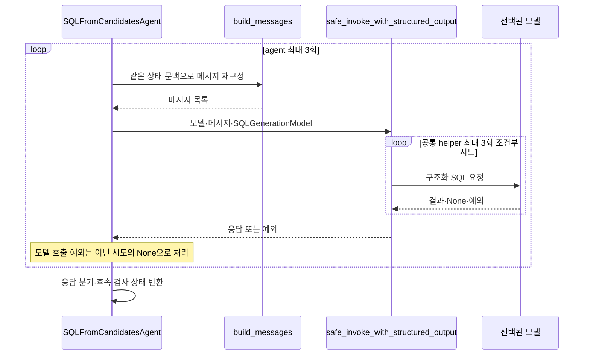
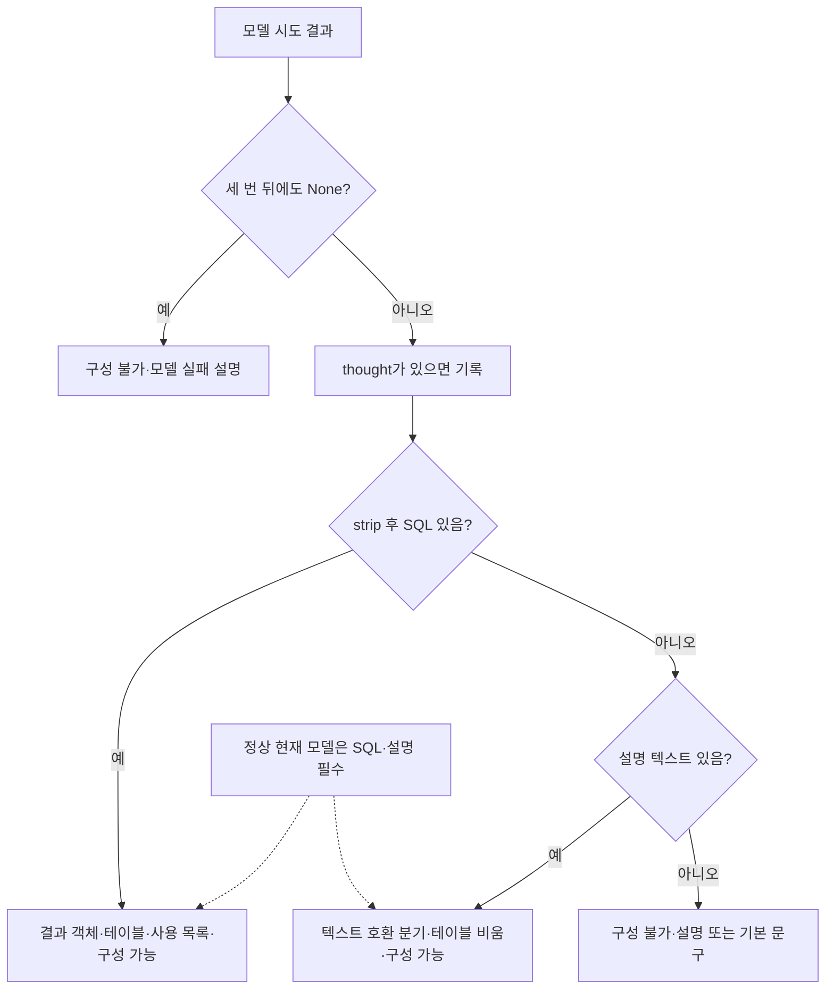
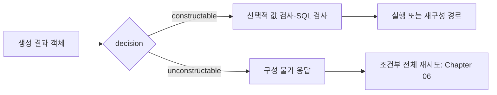

# Chapter 04. SQL 생성 조율·모델 출력과 상태 전이

## 1. 먼저 정의할 개념과 범위

**SQL**은 데이터베이스에 조회를 요청하는 언어이고 **DB**는 데이터베이스의 줄임말이다. **SQL 후보**는 모델이 생성했지만 아직 후속 검증·실행을 마치지 않은 SQL이다. **LLM(대규모 언어 모델)**은 이 후보와 짧은 설명을 만든다. **프롬프트**는 모델에 보내는 지시·문맥이다.

**Agent**는 한 역할의 처리 객체, **그래프 노드**는 전체 실행 흐름에 등록한 단계다. **State**는 공유 데이터이고 **path_state**는 그 안의 중간 결과 사전이다. **Decision**은 다음 분기에 쓰는 문자열이며 여기서 constructable은 ‘생성 가능’, unconstructable은 ‘구성 불가’다. 생성 가능은 SQL 검증·실행 성공을 뜻하지 않는다.

**구조화 응답**은 정해진 필드로 받은 모델 결과다. **Pydantic**은 그 필드·타입·일부 값을 검사하는 Python 라이브러리다. **Schema**는 이 문서에서 맥락에 따라 응답의 필드 계약 또는 테이블의 이름 공간을 뜻한다. **Connector**는 원본 DB와 통신하는 객체, **dialect(방언)**는 DB별 SQL 문법 차이다.

**Evidence(근거)**는 질문 해석·계산의 공식·조건 설명이다. **Normalized question**은 전처리와 근거 보정을 거친 질문이다. **Anchor**는 질문의 기준 의미 속성, **JOIN path**는 테이블을 연결할 컬럼 쌍의 순서다. JOIN은 테이블의 행을 조건으로 연결하는 연산이다. **CustomAnalysis**는 저장된 사용자 분석, **SqlAttribute**는 이름 붙인 SQL 정의다. 상세 용어는 [용어집](../01-architecture/chapter-00-glossary.md)을 참고한다.

이 장은 실제 생성 agent의 입력 검사·모델 선택·호출/재시도·출력 계약·상태 반환을 분석한다. 각 문맥의 표시·규칙은 [Chapter 04-1](chapter-04-1-sql-context-and-prompt-rules.md)로 분리한다. 로컬 코드·테스트를 읽은 정적 분석이며 실제 모델·DB·테스트는 실행하지 않았다.

## 2. 실제 생성 노드와 진입 계약

그래프는 `SQLFromCandidatesAgent()`를 만들고 `agent_wrapper`로 감싸 construct_sql_from_candidates에 등록한다. 내부 agent 이름은 sql_from_semantic이며 두 이름은 로그·진행 기록에서 구분한다. 근거 보정을 했으면 그 직후, 생략했으면 후보 준비에서 바로 이 노드로 간다.

`validate_input`은 path_state에 다음 키 중 **하나라도 존재하는지** 검사한다.

- primary_attribute
- attribute_join_paths
- retrieved_column_attributes

값이 None·빈 목록이어도 키가 있으면 통과한다. 실제 SQL에 충분한 테이블·컬럼·연결 정보가 있는지 증명하는 검사는 아니다. Docstring의 retrieved_candidates라는 필드는 실제 필수 검사와 다르며 execute가 그 이름을 읽지도 않는다.

입력 거부는 공통 래퍼의 실패 경계를 따른다. 이 agent는 별도 failure_decision을 생성자에 지정하지 않으므로 입력 거부를 자동으로 구성 불가 응답으로 바꾸는 전용 처리가 아니다. 자세한 공통 계약은 [Chapter 01](chapter-01-request-state-and-graph-contract.md)에 있다.

근거: [실제 클래스·입력 검사](../../../code/auto-ontology/auto_ontology/retrieval/text_to_sql/agents/sql_from_semantic.py), [등록·연결](../../../code/auto-ontology/auto_ontology/retrieval/text_to_sql/text_to_sql_graph.py).

## 3. 모델·connector와 문맥 준비의 예외 경계

모델은 `state.reasoning_llm`이 참인 값이면 그것, 아니면 state.llm이다. Reasoning model은 복잡한 판단용으로 설정한 추론 모델이다. 일반 의도 분류·정보 agent의 기본 모델 사용과 다르다. 모델이 유효한 객체인지는 이 선택문만으로 검사하지 않는다.

Connector는 `resolve_connector_from_tables(relevant_tables, connectors)`로 고른다. 테이블의 DB가 여러 개이거나 설정과 맞지 않는 경우의 ValueError는 모델 호출 try보다 먼저 발생한다. 이 단계에서 원본 DB 연결을 열어 SQL을 실행하는 것은 아니다. 선택 상세는 Chapter 05로 인계한다.

읽는 문맥은 아래와 같다.

| 출처 | 필드 |
|---|---|
| 최상위 state | 제출 질문·검색용 질문 접근자·evidence·sql_examples·value_anchors·glossary·messages·shorten_answer·모델/connector |
| path_state | primary_attribute·attribute_join_paths·relevant_tables·relevant_queries·similar_questions |
| 의미 정의 | custom_analyses·custom_analyses_str·sql_attributes·sql_attributes_str·term_synonyms |
| 보조 기록 | table_relevance_reasoning·calculation_subtype·sql_template·target_db |

Glossary는 사용자 용어 정의, term_synonyms는 저장 Term의 동의어, Term은 업무 개념이다. 서로 다른 입력이다. Docstring의 파일 추출 데이터·feedback 처리는 이 execute에서 별도 키로 읽거나 전용 분기로 다루지 않는다. Feedback은 이전 결과에 대한 추가 지시다. `data_for_sql` 같은 이름이 주석에 있다고 현재 기본 경로의 실제 입력으로 적지 않는다.

근거: [execute·build_messages](../../../code/auto-ontology/auto_ontology/retrieval/text_to_sql/agents/sql_from_semantic.py), [DB 선택](../../../code/auto-ontology/auto_ontology/retrieval/text_to_sql/connector_routing.py).

## 4. 메시지 조립과 두 층의 재시도

**SystemMessage**는 모델 역할·규칙, **HumanMessage**는 질문·작업 문맥, **AIMessage**는 모델 답변을 표현하는 메시지 객체다. Agent가 만드는 순서는 다음과 같다.

1. 기존 state.messages
2. 생성용 system prompt
3. 있으면 우선 근거·계산 유형 예문·값 단서·외부 SQL 예시의 system message
4. 스키마·중요 컬럼·의미 경로·저장 SQL 등을 담은 사용자 프롬프트
5. 검색용 질문에 last week/month/year가 있으면 달력 기간 안내 system message

이 순서는 agent가 구성한 목록이다. 공통 호출 helper는 모델 이름에 anthropic/claude가 있으면 시스템 메시지를 앞에 모으되 각 그룹 내부 순서를 유지한다. 따라서 모든 모델에 대한 실제 전송 순서가 위 목록과 동일하다고 볼 수 없다.

Agent의 MAX_RETRIES는 3이다. 응답이 None일 때만 다음 바깥 시도를 하고, None 아닌 응답을 받으면 곧바로 종료한다. 매번 메시지를 다시 만들지만 이전 바깥 시도의 실패 설명을 상태에 추가해 다음 프롬프트에 반영하지는 않는다. 바깥 반복 자체의 대기 시간도 없다.

공통 `safe_invoke_with_structured_output`는 내부 최대 3회다. 모델 내부 호출에서 발생한 응답 검증 오류·시간 초과·재시도 가능한 장애 등에 조건별 재시도가 있다. 첫 검증 실패에는 오류 설명을 메시지에 붙이고 다음 실패 뒤에는 원래 문맥으로 되돌릴 수 있다. 반면 결과 사전을 최종 `schema.model_validate`로 바꾸는 부분은 내부 try 밖에 있어 그 위치의 검증 오류가 같은 내부 복구를 반드시 거치지는 않는다.

**코드에서 도출한 상한**으로, 한 번의 생성 노드에서 내부 3회가 매번 소진되는 경로는 agent 3회와 결합해 최대 9회의 helper 내부 모델 호출을 만들 수 있다. 클라이언트·전송 계층의 별도 재시도까지 합산한 총 요청 수를 측정한 값은 아니다. 전체 파이프라인 재시도나 SQL 재구성 횟수와도 다르다.

이 agent는 `invoke_with_structured_output`라는 안전 대체 래퍼가 아니라 `safe_invoke_with_structured_output`를 직접 호출한다. 선택 모델 실패 뒤 일반 모델/추론 모델 사이를 자동으로 바꾸는 그 상위 래퍼의 동작을 이 경로에 덧붙여 설명하지 않는다.

### 4.1 모든 오류가 모델 재시도로 이어지는 것은 아니다

`run_with_context`는 build_messages를 **모델 try 앞**에서 실행한다. 따라서 메시지 필드의 잘못된 타입·문자열 포맷 오류는 해당 try의 None 대체에 걸리지 않는다. 앞선 connector 선택·similar_questions의 항목 인덱싱도 같은 모델 try 밖이다.

모델 호출 예외만 이 내부 함수가 로그 후 `(None, messages)`로 바꾼다. 모델 응답 처리 중 예상 밖 오류는 다시 공통 agent_wrapper 경계를 따른다. 상태·문맥 오류까지 모두 세 번 고쳐 본다는 설명은 부정확하다.

근거: [바깥 반복·try 범위](../../../code/auto-ontology/auto_ontology/retrieval/text_to_sql/agents/sql_from_semantic.py), [공통 구조화 호출·메시지 재배치](../../../code/auto-ontology/auto_ontology/utils/llm_invoke.py).

## 5. SQLGenerationModel의 실제 필드와 검증

| 필드 | 계약·의도 |
|---|---|
| thought | 필수 문자열. 짧은 접근 방법·시간/누락값/동률 등의 가정을 설명하도록 지시 |
| sql_code | 길이 1 이상 필수 문자열, 완전한 SQL을 요구 |
| response | 길이 1 이상 필수 문자열, 사용자용 영문 2~4문장 요약을 요구 |

필드 선언 순서는 thought → sql_code → response다. Thought는 짧은 방법·가정 요약이며 비공개 내부 추론 전체를 요구하는 것으로 설명하지 않는다. 영문 문장 수·SQL 주석 금지·완전한 실행 가능성 등은 필드 설명과 프롬프트의 요구이지 모두 코드 validator가 검사하는 조건은 아니다.

기반 StrictModel은 정의 밖 필드를 금지하고 대입 때 재검사하며 기본 문자열 최소 길이를 1로 둔다. 다른 단계의 StrictLLMOutputModel처럼 `$` 시작 키를 먼저 제거하는 모델은 아니다.

sql_code와 response의 validator는 strip한 값이 점·줄임표 대체 문자열이면 거부한다. `...`, `…`, `..`, `.`와 짧은 점/공백 조합을 막으며, 공백만 있는 문자열도 strip 후 빈 집합 조건에 걸린다. 이 필드들은 단순 공백 SQL을 정상 응답으로 받는 통로가 아니다. 다만 정상 문자열로 보이는 SQL의 문법·카탈로그 컬럼·조회 결과까지 여기서 검증하지 않는다.

정상 SQLGenerationModel에는 **custom_analyses_used 필드가 없다**. Extra forbid 때문에 모델이 해당 필드를 추가하면 정상 응답 계약에 맞지 않는다. 아래 코드에 남아 있는 사용 항목 필터 분기는 호환·대체 객체 경계로 구분해야 한다.

근거: [StrictModel·SQLGenerationModel](../../../code/auto-ontology/auto_ontology/retrieval/text_to_sql/models.py), [모델에 요구하는 출력 명세](../../../code/auto-ontology/auto_ontology/retrieval/text_to_sql/prompts.py).

## 6. 반환 분기와 실제 도달 가능한 경로

그림의 텍스트/빈 분기는 코드에 존재하지만 **현재 정상 출력 모델은 비어 있지 않은 SQL을 요구**한다. 따라서 비SQL 답변을 지원한다는 모듈 설명을 기본 실행 보장으로 받아들이지 않는다. 검증을 우회한 모형·대체 응답 객체 등에서는 분기 자체를 설명할 수 있으나 실제 서비스 도달은 별도 문제다.

| 분기 | messages 반환 | path_state·decision |
|---|---|---|
| 응답 전부 None | 새 messages 반환 없음 | 기존 상태 + unconstructable_explanation, decision=unconstructable |
| SQL 존재 | 마지막 생성 입력 messages 그대로 | sql_generation_result 객체·relevant_tables·custom_analyses_used, decision=constructable |
| SQL 없음·텍스트 있음 | 생성 입력 + AIMessage | 결과 객체·빈 relevant_tables·사용 목록, decision=constructable |
| SQL/텍스트 둘 다 없음 | 새 messages 없음 | 설명 또는 기본 오류 문구·unconstructable |

SQL 분기는 모델 요약을 AIMessage로 바로 붙이지 않는다. 후속 응답 단계가 형식을 만들기 때문이다. `sql_generation_result`는 문자열 사전이 아니라 Pydantic 결과 객체다. **이 노드가 새 path_state.sql_code를 기록하지는 않는다.** 후속 SQLValidationAgent가 결과 객체의 sql_code를 읽고 필요한 보정·검사를 수행하며 실행용 sql_code를 기록하는 경계와 나눈다.

정상 현재 모델에서 custom_analyses_used는 빈 목록이다. 호환 객체에 그 필드가 있으면 SQL 분기는 입력 custom_analyses의 ID와 교집합을 남기고 classification이 참인 id/label을 추출한다. 이 필터는 현재 정상 모델에 새 필드를 추가해 주는 기능이 아니다. 텍스트 호환 분기는 표시 helper로 후보와 매칭한 링크를 붙일 수 있다.

Thought가 strip 후 있으면 그래프 노드명으로 thoughts_log에 기록한다. 기존 path_state를 직접 읽고 기록 helper를 호출하므로 반환만 새 사전이라고 모든 내부 변경이 독립적인 것은 아니다. 실패·성공 분기 모두 기존 키를 펼쳐 보존하므로 과거 sql_generation_result·sql_code·구성 불가 설명이 새 결과와 함께 남을 가능성도 고려해야 한다. 이 함수가 모든 과거 실패 키를 정리하지는 않는다.

근거: [응답 처리·상태 반환](../../../code/auto-ontology/auto_ontology/retrieval/text_to_sql/agents/sql_from_semantic.py), [사용 항목 helper](../../../code/auto-ontology/auto_ontology/retrieval/data_access/custom_analyses.py), [후속 검증 진입](../../../code/auto-ontology/auto_ontology/retrieval/text_to_sql/agents/sql_parse_validation.py).

## 7. 후속 검사·저장 경계와 별도 tables agent

`route_decision`은 constructable을 validate_sql_query로 바꾼다. `route_generated_sql`은 요청의 validate_sql_values가 참이면 그 앞에 값 검사 노드를 선택한다. Unconstructable은 구성 불가 응답 노드로 간다. **일부 호환 분기의 constructable이 SQL 존재를 따로 보장하는 라우터는 아니다.** 검증·실행·재구성 상세는 01-9에서 확인한다.

이 노드는 이미 준비한 스키마·의미 정의를 읽어 모델을 호출한다. 원본 SQL 실행·catalog 쓰기·대화 영구 저장을 하지 않는다. Connector는 방언 선택에 사용한다. 이 노드의 바깥 모델 재시도는 DB 실패를 고쳐 SQL을 재구성하는 반복과 다르다.

`SQLFromTablesAgent`의 docstring은 후보가 부족할 때 대체한다고 설명하지만 현재 create_graph는 이 클래스를 import·등록하지 않는다. 제공된 auto_ontology Python 소스 검색에서 확인한 참조는 정의와 테스트다. 기본 의미 후보 경로가 실패하면 자동으로 이 클래스로 전환된다고 적지 않는다. 외부 코드가 직접 호출할 가능성까지 부정하는 것은 아니다.

직접 tables agent를 호출하면 준비 테이블이 없을 때 검색하고, state.llm과 `invoke_with_structured_output`를 사용하며, 근거 유무에 따라 시스템 프롬프트를 고른다. 이는 추론 모델 우선·직접 safe helper·의미 문맥을 사용하는 기본 agent와 다르다. 근거 테스트도 이 별도 클래스를 직접 호출하므로 기본 경로의 전체 동작 검증으로 합치지 않는다.

근거: [실제 그래프](../../../code/auto-ontology/auto_ontology/retrieval/text_to_sql/text_to_sql_graph.py), [별도 tables agent](../../../code/auto-ontology/auto_ontology/retrieval/text_to_sql/agents/sql_from_tables.py), [직접 호출 테스트](../../../code/auto-ontology/auto_ontology/retrieval/text_to_sql/tests/test_evidence_agents.py).

## 8. 테스트 근거·예시와 미검증

**Assertion**은 테스트의 기대 조건 검사, **mock**은 실제 의존성 대신 쓰는 모형이다. [test_sql_from_semantic.py](../../../code/auto-ontology/auto_ontology/retrieval/text_to_sql/tests/test_sql_from_semantic.py)의 test_sql_generation_uses_reasoning_client는 모형 응답으로 실제 SQLGenerationModel을 반환하고 다음을 확인한다.

- reasoning_llm이 호출 대상이다.
- 결과 decision은 constructable이다.
- 같은 evidence가 모델 메시지 두 곳에 들어가고 마지막 사용자 메시지에도 있다.

같은 파일의 출력 도구 설명 테스트는 SQLGenerationModel의 외부 설명에 특정 내부 추론 유도 문구가 없는지를 확인한다. 이 문자열 assertion이 실제 모델의 거절률·SQL 품질을 이번에 재측정한 결과는 아니다.

설명용으로 “계정 수는?”에 모델이 `SELECT COUNT(*) FROM accounts`와 요약을 반환하면 생성 노드는 그 객체를 저장하고 constructable을 반환한다. accounts가 존재하는지·요청에 맞는지·SQL이 실행되는지는 이 반환만으로 확정하지 않는다. 테스트에도 같은 모형 결과가 있지만 실제 DB 실행 결과가 아니다.

세 번의 바깥 재시도·최대 9회의 조건부 내부 호출·현재 모델로 도달하기 어려운 텍스트 분기·점/공백 validator·과거 상태 잔존은 코드에서 확인했으며 해당 경로를 실행 재현하지 않았다. 실제 모델·방언·문맥 오류·구조화 출력 장애·장문 비용·생성 SQL의 안전성과 정확성도 통합 미검증이다.

Mermaid 3개를 작성했으며 렌더링하지 않았다. 다음 장은 같은 생성의 문맥별 포맷터·출력 규칙·우선순위를 설명한다. 이후 Chapter 05 대상 DB/방언으로 이어간다.
