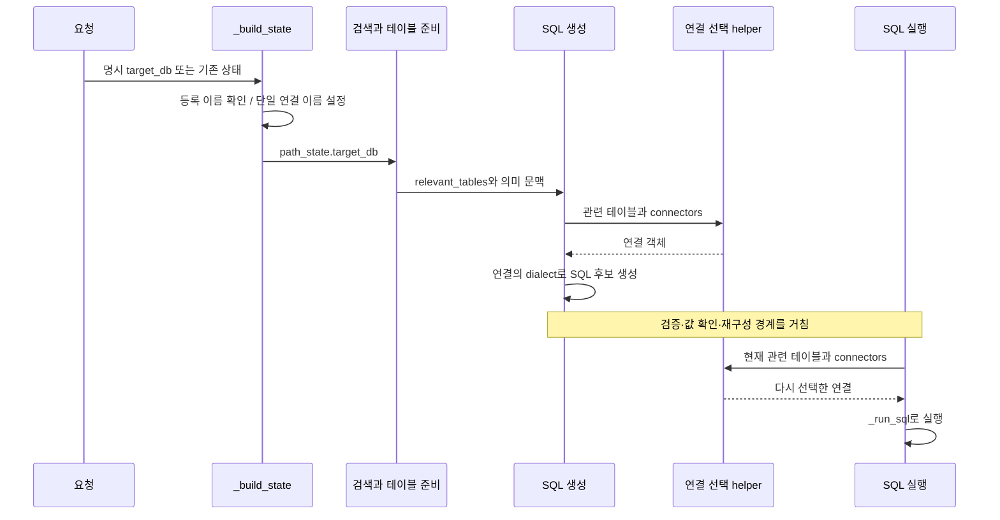
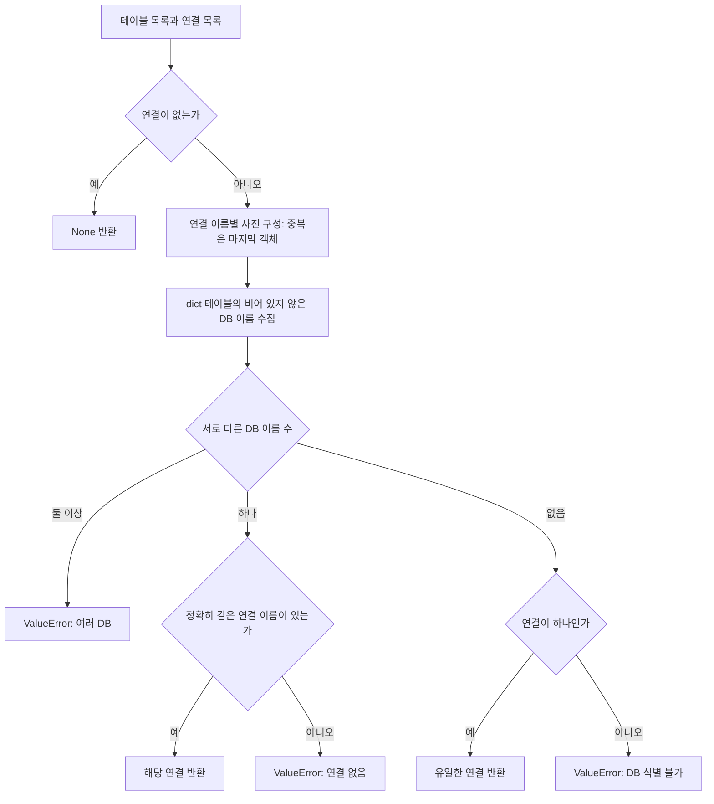
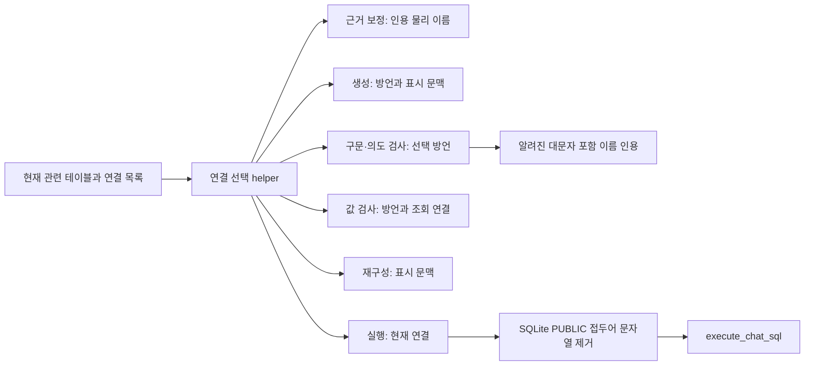

# Chapter 05. 대상 DB·방언과 테이블 이름의 계약

이 장은 요청이 가리키는 데이터베이스를 확인한 뒤, 관련 테이블로 연결을 고르고 그 연결의 SQL 문법과 이름 표기를 사용하는 흐름을 설명한다. 요청의 이름 확인, 연결 객체 선택, 프롬프트의 이름 표기는 별도 처리이며 각각의 비교·생략 규칙이 다르다.

로컬 코드와 테스트를 정적으로 읽은 결과다. 실제 DB·모델·테스트를 실행하지 않았다. [생성 조율](chapter-04-sql-prompt-and-output.md), [생성 문맥](chapter-04-1-sql-context-and-prompt-rules.md), [기존 실행 경계](../03-connectors/chapter-10-sql-execution-boundary.md)를 함께 읽는다.

## 1. 먼저 정의할 용어

| 용어 | 쉬운 뜻과 예시 |
|---|---|
| DB / SQL | Database, 데이터를 저장하는 시스템 / Structured Query Language, 그 데이터를 조회·계산하는 언어. 주문 DB에서 주문 수를 구한다. |
| Connector | 특정 DB의 접속·실행을 담당하는 객체. 설정된 연결 목록에서 하나를 선택해 SQL을 보낸다. |
| Routing / canonical name | 사용할 연결을 고르는 처리 / 설정에 등록된 원래 이름. 요청 `SALES`를 등록 이름 `sales`로 돌려줄 수 있다. |
| Dialect / SQLGlot | DB마다 다른 SQL 문법 / SQL을 분석·변환하는 라이브러리. `connector.dialect`의 `postgres` 등을 그대로 전달한다. |
| Catalog / schema | 테이블을 구분하는 이름 공간. Databricks의 `lakehouse.gold.orders`는 catalog·schema·table 세 부분이다. 이 catalog와 프로젝트의 메타데이터 저장소인 catalog는 구분한다. |
| Identifier / qualification / quoting | 테이블·컬럼 같은 대상 이름 / 상위 이름을 붙이기 / 따옴표로 이름의 경계를 표시하기. `public.orders`와 `"public"."orders"`의 차이다. |
| Formatter / prompt | 상태를 모델용 문자열로 바꾸는 함수 / 모델에게 전달하는 자료와 지시. 표기 함수와 생성 지시가 항상 같은 규칙은 아니다. |
| Agent / graph / wrapper | 작업 한 단계 / 단계 연결 흐름 / 입력 검사·예외 처리를 감싸는 코드. 실패 결정이 다음 경로 선택에 쓰인다. |
| State / metadata | 단계들이 공유하는 중간값 / 테이블의 DB 이름 같은 설명 정보. `path_state`는 현재 처리 경로의 상태 묶음이다. |
| Probe / reconstruction | 확인용 DB 조회 / 오류를 보고 SQL을 다시 구성하기. 연결 선택 실패와 SQL 실행 실패를 구분한다. |
| Assertion / mock | 테스트의 기대 조건 검사 / 실제 DB 등을 대신하는 모형. 테스트 파일을 읽는 것과 테스트를 실행하는 것은 다르다. |
| JSON / numeric type alignment | JavaScript Object Notation, 결과를 키·값으로 표현하는 형식 / 숫자 타입 정합성, 같은 값을 요구한 숫자 타입으로 맞추는 선택 기능. 실행 단계의 `numeric_type_alignment`로 켠다. |

상세 용어와 다른 기능의 정의는 [용어집](../01-architecture/chapter-00-glossary.md)에 있다.

## 2. 입력·출력과 호출 경계

| 처리 | 입력 | 출력·상태 경계 |
|---|---|---|
| `resolve_target_database_name` | 요청 문자열·연결 목록 | 등록 이름 문자열 또는 `ValueError`. 연결 객체를 반환하지 않는다. |
| `main.py::_build_state` | 요청·연결 목록·기존 경로 상태 | `path_state.target_db` 초기값. 명시 요청이 없고 연결이 하나면 해당 이름 사용 |
| `resolve_connector_from_tables` | 관련 테이블 목록·연결 목록 | 연결 객체·`None` 또는 `ValueError`. `target_db` 인수가 없다. |
| 생성·보정의 방언 선택 | 위에서 얻은 연결 | `getattr(connector, "dialect", None)`을 프롬프트·포맷터에 전달 |
| `SQLExecutionAgent` | 검증 SQL 또는 생성 결과의 SQL·관련 테이블 | 연결을 다시 고르고 실행 결과·오류·결정을 상태에 반영 |

`target_db`는 요청·검색의 DB 문맥이다. `relevant_tables[*].database_name`은 생성 이후 연결 선택의 근거다. 이 두 값이 항상 같은지 router에서 대조하지는 않는다. 예를 들어 힌트가 `sales`라도 테이블 정보가 `hr`이고 그 연결이 있으면 router는 `hr` 연결을 반환한다.

근거: [요청 구성](../../../code/auto-ontology/auto_ontology/retrieval/text_to_sql/main.py)의 `_build_state`, [연결 helper](../../../code/auto-ontology/auto_ontology/retrieval/text_to_sql/connector_routing.py), [생성 agent](../../../code/auto-ontology/auto_ontology/retrieval/text_to_sql/agents/sql_from_semantic.py)의 `execute`, [실행 agent](../../../code/auto-ontology/auto_ontology/retrieval/text_to_sql/agents/sql_execution.py)의 `execute`.

## 3. 요청 이름 확인: 정확 일치 이후 대소문자 보정

`resolve_target_database_name()`은 요청 앞뒤 공백을 제거한다. 연결의 비어 있지 않은 `database_name`은 문자열로 모으되 공백 제거·중복 제거는 하지 않는다.

1. 정확한 문자열이 목록에 있으면 그 요청 이름을 반환한다.
2. 없으면 `casefold()`로 대소문자 차이를 줄여 비교한다. 일치 항목이 정확히 하나여야 등록 표기를 반환한다.
3. 나머지는 사용 가능한 이름을 포함한 `ValueError`다. 연결 ID를 DB 이름으로 바꾸는 조회는 하지 않는다.

| 설정 이름과 요청 | 코드에서 도출한 결과 |
|---|---|
| `sales`, 요청 ` SALES ` | 공백 제거 뒤 유일한 대소문자 일치 → `sales` |
| `Sales`, `sales`, 요청 `Sales` | 정확 일치가 우선 → `Sales` |
| `Sales`, `sales`, 요청 `SALES` | 일치 두 항목 → 예외 |
| `sales`, `sales`, 요청 `sales` | 정확 일치 → 허용 |
| `sales`, `sales`, 요청 `SALES` | 중복을 제거하지 않아 일치 두 항목 → 예외 |

`_build_state`는 최상위 요청의 `target_db`가 참인 값일 때 위 함수를 호출한다. 없고 연결이 하나이며 이름이 있으면 그 이름을 기존 경로 상태 위에 쓴다. 그 외에는 복사한 기존 `path_state.target_db`가 남을 수 있으므로 모든 진입 상태가 이 helper로 다시 정규화된다고 볼 수 없다.

질문에서 DB를 추출하는 의도 agent에는 별도 이름 매칭이 있다. 대소문자 일치 외에 유사 문자열 후보도 찾고 기존 힌트와 충돌을 검사한다. 명시 요청 helper의 규칙과 합쳐 설명하지 않는다. 해당 예외와 전체 그래프의 후속 처리는 [의도 분류 Chapter 02](chapter-02-intent-and-information-routing.md)에 있다.

근거: [연결 helper](../../../code/auto-ontology/auto_ontology/retrieval/text_to_sql/connector_routing.py), [요청 구성](../../../code/auto-ontology/auto_ontology/retrieval/text_to_sql/main.py), [질문 의도](../../../code/auto-ontology/auto_ontology/retrieval/text_to_sql/agents/question_intent.py)의 `_resolve_question_target_database_name`·`execute`.

## 4. 관련 테이블로 연결 선택: 정확한 이름을 다시 비교한다

테이블이 사전이 아니면 건너뛴다. 각 DB 이름은 `str(... or "").strip()`으로 만들며 빈 값은 제외한다. 설정 연결 이름의 공백·대소문자는 이 단계에서 보정하지 않는다.

| 경계 사례 | 실제 분기 |
|---|---|
| 모든 테이블이 `sales`, 연결 `sales`·`hr` | `sales` 연결 |
| 테이블 `sales`·`hr` | 여러 DB 오류. 연결이 하나여도 이 검사가 먼저다. |
| 테이블 `Sales`·`sales` | 서로 다른 두 문자열로 수집 → 여러 DB 오류 |
| 테이블 `SALES`, 연결 `sales` 하나 | 이름 불일치 오류. 단일 연결 대체보다 알려진 이름 검사가 먼저다. |
| 일부 테이블만 `sales`, 나머지는 이름 누락 | 알려진 이름 하나로 선택 가능. 모든 행의 DB 필수 검사는 아니다. |
| 이름이 전부 없거나 테이블 목록이 비었고 연결 하나 | 해당 연결 반환. 연결 이름 자체가 없어도 이 분기는 가능 |
| 이름이 없고 연결 여러 개 | DB 식별 불가. 오류 문구의 target_db 안내가 helper 입력을 바꾸지는 않는다. |
| `sales` 이름의 연결 두 개 | 사전 구성 때 마지막 객체가 앞 객체를 덮어씀 |
| 연결 목록이 비었음 | 테이블 혼합 여부를 검사하기 전에 `None` |

**사용 시 읽어야 할 경계:** `target_db`만 설정해서 누락된 테이블 정보를 직접 채우는 함수가 아니다. 앞선 검색·준비가 관련 테이블의 DB 정보를 유지해야 한다. 표시 포맷터의 `target_db` 대체도 원본 테이블 정보를 수정하지 않는다. 따라서 프롬프트에 DB 이름이 보인다는 사실만으로 복수 연결 선택 성공을 보장하지 않는다.

선택 함수는 SQL 본문을 읽지 않고 DB 접근 권한·실제 테이블 소유·여러 DB에 걸친 SQL 실행 가능 여부를 검사하지 않는다. 사용자에게 허용된 연결을 구성하는 책임 및 SQL 자체 검증과 구분한다.

근거: [연결 helper](../../../code/auto-ontology/auto_ontology/retrieval/text_to_sql/connector_routing.py)의 `resolve_connector_from_tables`, [포맷터](../../../code/auto-ontology/auto_ontology/retrieval/text_to_sql/formatters_util.py)의 `format_tables_for_prompt`. 검색의 DB 선택은 [검색 Chapter 03](../07-retrieval/chapter-03-candidate-recall-and-database-selection.md), 최종 테이블 정보는 [검색 Chapter 06](../07-retrieval/chapter-06-table-selection-and-context-reconciliation.md)에 있다.

## 5. 방언과 이름 한정은 연결이 제공하는 인터페이스다

`SQLDatabase.dialect`는 SQLGlot에 전달 가능한 방언 문자열, `database_name`은 라우팅에 사용할 이름이다. 이름이 의미하는 물리 계층은 엔진마다 다르다. 기본 `qualify(schema, table)`은 비어 있지 않은 schema·table을 각각 인용해 잇는다. 호출자가 DB 이름을 무조건 앞에 붙이도록 설계되지 않았다.

| 분석 대상 | `dialect` | `database_name`의 코드상 구성 | `qualify` |
|---|---|---|---|
| PostgreSQL | `postgres` | 연결 후 `current_database()` 조회 | 기본 schema·table |
| MySQL | `mysql` | 접속 인수의 `database` | 기본 schema·table |
| SQLite | `sqlite` | DB 파일 경로의 확장자를 뺀 이름 | 기본 schema·table |
| DuckDB | `duckdb` | 연결 후 `current_database()` 조회 | 기본 schema·table |
| Databricks | `databricks` | 연결이 대상으로 삼는 catalog 이름 | catalog·schema·table을 인용해 연결. schema가 없으면 예외 |
| ClickHouse | `clickhouse` | 설정의 `database` | 기본 schema·table |

`qualified_name()`은 각 부분을 `quoted_identifier()`로 인용한다. SQLGlot 인용 생성에서 예외가 나면 내부 쌍따옴표를 이스케이프한 표준 쌍따옴표 표기로 대체한다. 이는 해당 DB가 그 대체 표기를 실제 수용했다는 확인과 다르다.

Databricks의 `qualify`는 catalog를 생략하면 다른 이름 공간을 볼 수 있다는 이유로 재정의되어 있다. 이 장에서는 선택된 여섯 엔진만 비교하고 제외된 엔진의 상세는 다루지 않는다.

근거: [공통 계약](../../../code/auto-ontology/auto_ontology/connectors/base.py)의 세 인터페이스, [PostgreSQL](../../../code/auto-ontology/auto_ontology/connectors/postgres.py)·[MySQL](../../../code/auto-ontology/auto_ontology/connectors/mysql.py)·[SQLite](../../../code/auto-ontology/auto_ontology/connectors/sqlite.py)·[DuckDB](../../../code/auto-ontology/auto_ontology/connectors/duckdb.py)·[Databricks](../../../code/auto-ontology/auto_ontology/connectors/databricks.py)·[ClickHouse](../../../code/auto-ontology/auto_ontology/connectors/clickhouse.py), [인용 helper](../../../code/auto-ontology/auto_ontology/utils/sql_identifiers.py).

## 6. 표시 문자열·조회용 이름·시스템 지시는 별도 규칙이다

`formatters_util.qualify_table()`은 DB·schema·table을 점으로 잇는 표시 함수다. 이름을 인용하지 않는다. DB와 schema가 대소문자 무시 기준으로 같고 방언이 공통 예외 집합에 없으면 DB 부분을 줄인다. 예외 집합은 `spark`, `trino`이며 **현재 Databricks 연결이 반환하는 `databricks`는 포함되지 않는다.** 서로 다른 DB·schema는 그대로 세 부분으로 표시한다.

테이블 자신의 DB 이름이 있으면 `target_db`보다 우선하고, 없을 때만 힌트를 표시용으로 대체한다. 의미 경로의 끝점도 자신의 DB를 우선한다. 이 이름 표시가 연결을 선택하거나 실제 SQL 식별자를 인용하는 기능은 아니다.

반면 `create_sql_from_candidates_prompt()`의 시스템 지시는 `sqlite`·`duckdb`에 테이블 이름만 쓰도록 하고, 그 외 방언에는 schema 접두어를 유지하되 DB 접두어는 추가하지 말라고 한다. 분기는 `dialect.lower()`로 결정하며 `target_db` 값이 분기를 결정하지 않는다. 추가 방언 규칙 helper의 `strip().lower()`와도 문자열 정리 방식이 다르지만, 위 내장 연결은 고정 소문자 값을 반환한다.

다음은 함수를 읽어 도출한 표시 예시다. DB에서 실행한 결과가 아니다. 인용 표기는 해당 방언으로 이름을 만드는 코드 의도를 보여준다.

| DB·schema·table / 방언 | `qualify_table` 표시 | `connector.qualify` 표기 | 시스템 지시 |
|---|---|---|---|
| sales·public·orders / postgres | `sales.public.orders` | `"public"."orders"` | schema.table, DB 접두어 금지 |
| shop·shop·orders / mysql | `shop.orders` | `` `shop`.`orders` `` | schema.table, DB 접두어 금지 |
| shop·main·orders / sqlite | `shop.main.orders` | `"main"."orders"` | 테이블 이름만 |
| warehouse·main·orders / duckdb | `warehouse.main.orders` | `"main"."orders"` | 테이블 이름만 |
| lakehouse·lakehouse·orders / databricks | `lakehouse.orders` | `` `lakehouse`.`lakehouse`.`orders` `` | schema.table, DB 접두어 금지 |

**확인한 사실:** 표기 함수·조회용 이름 생성·시스템 지시의 규칙이 다르다. 근거 보정의 `_catalog_columns`는 연결이 있으면 `connector.qualify`로 물리 이름을 만들지만 같은 단계의 테이블 블록은 표시 포맷터를 사용한다. 같은 요청 안에서도 서로 다른 형태가 함께 나타날 수 있다.

**코드에서 도출한 영향:** 모델이 어느 표기를 따르느냐에 따라 생성 SQL이 달라질 수 있고, 특히 schema와 catalog가 같은 이름인 경우에도 생략 규칙이 다를 수 있다. 실제 세션 기본값·이름 해석과 후속 보정에 따라 결과가 달라지므로 이 표만으로 모든 예시의 실행 성공·실패를 단정하지 않는다. 모델이 항상 올바른 표기로 통일한다고도 보장하지 않는다.

근거: [포맷터](../../../code/auto-ontology/auto_ontology/retrieval/text_to_sql/formatters_util.py)의 `qualify_table`·`_hop_column`·`format_tables_for_prompt`, [프롬프트](../../../code/auto-ontology/auto_ontology/retrieval/text_to_sql/prompts.py)의 `create_sql_from_candidates_prompt`·`format_dialect_rules`, [근거 보정](../../../code/auto-ontology/auto_ontology/retrieval/text_to_sql/agents/evidence_refinement.py)의 `_catalog_columns`·`execute`.

## 7. 후속 검증·재구성·실행에서도 선택한다

이 도식은 helper의 사용처를 보여주며 모든 agent가 매 요청 반드시 실행된다는 뜻은 아니다. 각 단계가 현재 상태로 연결을 계산하며 생성 때의 연결 객체 하나를 경로 상태에 고정해 전달하는 계약은 아니다. 관련 테이블이나 연결 순서가 달라지면 선택도 달라질 수 있다는 것은 코드에서 도출한 가능성이다.

구문 검증은 선택 연결의 방언으로 이름 인용·여러 결정적 검사를 수행한다. 별도 구문 검증 helper에는 **전체 연결 목록에서 수집한 방언 목록**을 전달한다. 따라서 구문 검사를 시도한 방언 목록과 최종 실행 연결의 방언도 구분해야 한다. 상세 검사 순서와 통과 의미는 01-9 분석으로 인계한다.

`quote_known_mixed_case_identifiers()`는 관련 테이블·컬럼 이름에 대문자가 있으면 SQL을 분석하고, 정확히 같은 철자의 인용되지 않은 이름에 인용을 추가한다. 잘못된 대소문자를 추측해 고치거나 DB·schema 부분을 일괄 교체하지 않는다. 알려진 이름이 없거나 분석에 실패하면 원문을 반환한다. 이 보정이 앞 절의 접두어 차이 전체를 해결하는 것은 아니다.

실행의 `_sanitize_sql_for_dialect()`는 SQLite일 때 정규식 `\bPUBLIC\.`를 대소문자 무시로 제거한다. SQL 문법 구조를 분석하는 변환이 아니라 문자열 치환이므로 임의의 DB·schema 접두어를 정확히 제거하는 일반 보정으로 읽지 않는다. `numeric_type_alignment`가 켜졌고 실제 제출 문자열이 달라지면 교정 SQL을 후속 재구성에 전달한다. 해당 옵션이 꺼져도 SQLite 치환 자체는 수행한다.

실행용 SQL은 `path_state.sql_code`를 우선하고 비었으면 생성 결과에서 가져온다. 연결은 다시 관련 테이블로 고른다. `execute_chat_sql`은 받은 연결로 실행하고 로그·지원되는 시간제한을 전달하며, SQL에서 DB를 찾아 새 연결로 전환하지 않는다.

근거: [구문·의도 검증](../../../code/auto-ontology/auto_ontology/retrieval/text_to_sql/agents/sql_parse_validation.py)의 `execute`·`quote_known_mixed_case_identifiers`·`_validate_intent`, [값 검사](../../../code/auto-ontology/auto_ontology/retrieval/text_to_sql/agents/sql_value_validation.py)의 `execute`, [재구성](../../../code/auto-ontology/auto_ontology/retrieval/text_to_sql/agents/sql_reconstruction.py), [실행](../../../code/auto-ontology/auto_ontology/retrieval/text_to_sql/agents/sql_execution.py), [Chat SQL 실행 경계](../../../code/auto-ontology/auto_ontology/retrieval/text_to_sql/chat_sql.py). 엔진별 시간제한·자원 수명은 [기존 Chapter 11](../03-connectors/chapter-11-execution-timeout-and-resources.md)에 있다.

## 8. 실패·재시도·저장 경계

| 실패 위치 | 처리와 해석 |
|---|---|
| 초기 요청의 명시 DB 이름 확인 | `_build_state`에서 예외. 모델 생성 반복 안의 오류가 아니다. 호출자 응답 경계는 Chapter 01 참조 |
| 연결 선택 helper | 내부 재시도 없음. 잘못된 이름·여러 DB·식별 불가 예외를 호출자에게 전달 |
| SQL 생성의 연결 선택 | 모델 호출 반복에 들어가기 전에 수행. 모델 응답 재시도만으로 이 선택 오류가 복구된다고 볼 수 없음 |
| 검증·재구성 등의 선택 오류 | 각 agent를 감싼 wrapper와 그래프의 실패 결정 규칙에 따름. 모든 노드의 동일한 종료를 가정하지 않음 |
| 실행 단계의 선택 오류 | `_run_sql` 바깥에서 발생. 실행 agent의 `failure_decision="invalid_sql"`을 wrapper가 적용 |
| `_run_sql`에 연결 없음 | 실행 없이 `No connector available to execute SQL.` 오류 응답 |
| 선택 후 실제 실행·결과 변환 실패 | `_run_sql`이 오류를 반환. 실행 agent가 기반 시설 오류와 SQL 오류를 구분해 다음 경로 결정 |

이름 확인·연결 선택·포맷터 자체는 catalog DB에 객체를 저장하거나 누락된 테이블 DB 이름을 갱신하지 않는다. 선택 후 probe·실행은 원본 DB에 접근할 수 있고 검증은 catalog의 schema 정보를 읽는다. 생성 SQL 객체·검증 SQL·실행 결과는 서로 다른 상태 필드에 남는다. DB 연결 성공과 SQL 생성·검증·실행 성공을 한 상태로 취급하지 않는다.

근거: [초기 요청/호출자](../../../code/auto-ontology/auto_ontology/retrieval/text_to_sql/main.py), [생성 agent](../../../code/auto-ontology/auto_ontology/retrieval/text_to_sql/agents/sql_from_semantic.py), [wrapper](../../../code/auto-ontology/auto_ontology/retrieval/text_to_sql/base.py), [실행 agent](../../../code/auto-ontology/auto_ontology/retrieval/text_to_sql/agents/sql_execution.py). 전체 상태 계약은 [Chapter 01](chapter-01-request-state-and-graph-contract.md)에 있다.

## 9. 테스트로 확인한 기대와 미검증

아래는 소스의 assertion을 읽은 결과다. 실제 테스트 통과를 보고하는 표가 아니다.

| 테스트 파일 | 확인한 기대 조건과 한계 |
|---|---|
| [test_connector_routing.py](../../../code/auto-ontology/auto_ontology/retrieval/text_to_sql/tests/test_connector_routing.py) | 두 테이블의 두 번째 DB 연결 선택, DB 누락+복수 연결 거부, 단일 연결 대체, 요청 대문자→등록 이름, 알 수 없는 요청 이름 거부의 5개 사례 |
| [test_formatters_util.py](../../../code/auto-ontology/auto_ontology/retrieval/text_to_sql/tests/test_formatters_util.py) | 중복 DB/schema 축약·대소문자 무시·다른 schema 유지·누락 부분 생략, `databricks` 중복 축약, `spark` 표기 보존, 테이블 자신의 DB 우선·target_db 표시 대체와 경로/테이블 표기 일치 |
| [test_mixed_case_quoting.py](../../../code/auto-ontology/auto_ontology/retrieval/text_to_sql/tests/test_mixed_case_quoting.py) | spark·databricks에서 역따옴표, postgres에서 쌍따옴표, 모두 소문자면 원문 유지. 실제 DB의 이름 해석 검사가 아님 |
| [test_registry_dialects.py](../../../code/auto-ontology/auto_ontology/connectors/tests/test_registry_dialects.py) | 연결을 생성하지 않고 등록 클래스의 방언 property를 읽어 SQLGlot의 알려진 이름인지 검사. DB 버전별 모든 SQL 지원 검사가 아님 |
| [test_numeric_types.py](../../../code/auto-ontology/auto_ontology/retrieval/text_to_sql/tests/test_numeric_types.py)의 SQLite 교정 사례 | 라우터를 mock으로 대체. 모형 연결에 `PUBLIC.t`를 제거한 SQL 한 번 제출, 교정 오류·문자열·invalid_sql 반환을 기대. 실제 라우팅 통합 검사는 아님 |
| [test_sql_execution.py](../../../code/auto-ontology/auto_ontology/retrieval/text_to_sql/tests/test_sql_execution.py) | 실행 결과 컬럼 중복·JSON 변환·숫자 metadata 오류를 모형으로 검사. 다중 DB 연결 선택을 증명하는 테스트와 구분 |

라우터 소스 주석이 언급하는 `test_rejects_cross_database_tables`는 현재 로컬 테스트 검색에서 찾지 못했다. 여러 DB 거부는 구현 분기를 근거로 설명한다. 읽은 라우터 테스트에는 중복 연결 이름·부분 누락·대소문자 불일치·힌트와 테이블 DB 충돌 사례가 없다.

실제 DB 버전·세션 기본 catalog/schema·동명 DB 연결·권한별 연결 구성·모델의 이름 지시 준수·자동 보정 뒤의 최종 실행·실패 후 전체 재시도는 미검증이다. Mermaid 3개를 작성했으며 렌더링하지 않았다.

다음은 Chapter 06의 전체 재시도·재개와 상태 수명이다. 구문/의도·값 검사·probe·재구성의 상세 조건과 실행 결과 보장은 01-9로 인계한다.
