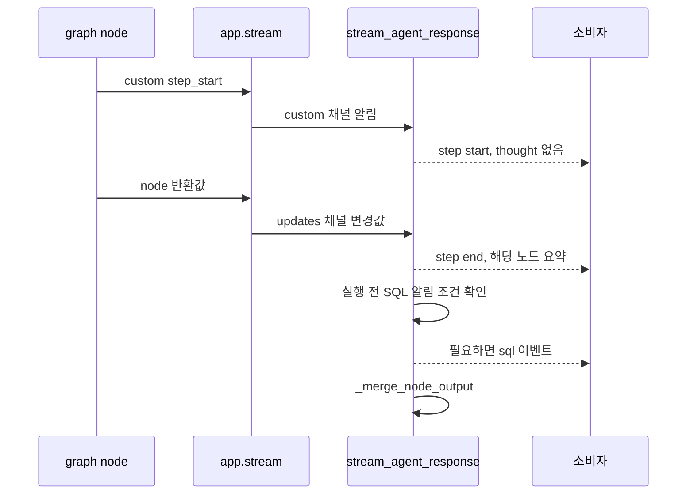
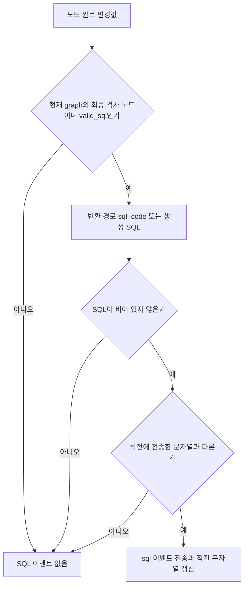
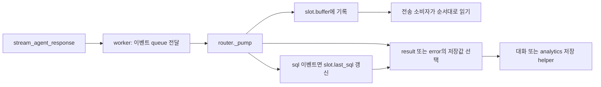

# Chapter 06-1. SQL 이벤트·부분 답변과 호출자 저장 경계

생성 후보, 실행 직전에 알린 SQL, 최종 답변의 SQL, 오류 때 보존한 SQL은 서로 다른 시점의 값이다. 이 장은 이벤트 생성과 상태 병합, 오류 응답, 호출자의 기록 경계만 추적한다.

로컬 코드·관련 테스트 정적 분석이며 실제 서비스·DB·모델·테스트를 실행하지 않았다. [전체 재시도와 재개](chapter-06-full-retry-and-resume.md), [상태 계약](chapter-01-request-state-and-graph-contract.md)을 함께 읽는다.

## 1. 먼저 정의할 용어

| 용어 | 쉬운 뜻과 예시 |
|---|---|
| SQL / DB | Structured Query Language, 데이터를 조회하는 언어 / Database, 데이터를 저장하는 시스템. |
| Streaming / event / generator | 결과를 순서대로 조금씩 전달하기 / 전달할 사건 한 건 / 필요할 때 다음 값을 만드는 함수. 완료를 기다리지 않고 단계 시작을 먼저 보낸다. |
| Node / graph / state | 작업 단계 / 단계 연결 흐름 / 단계 사이에 공유하는 값. `path_state`는 현재 경로 중간값이다. |
| Custom / updates channel | 실행 중 사용자 정의 알림 / 단계 완료 후 상태 변경값을 받는 통로. 시작 시점과 완료 시점을 구분한다. |
| Validation gate / precheck | 실행 전 통과해야 할 검사 단계 / 실행 직전 추가 검사. SQL 이벤트는 생성 완료만으로 발생하지 않는다. |
| Thought | 단계가 남긴 짧은 방법·판단 요약. 비공개 내부 추론 전체가 아니라 상태의 `thoughts_log`에 기록된 문자열이다. |
| Partial answer / fallback | 실패 전 존재하던 SQL·설명 일부 / 정상 결과 대신 사용할 대체 값. 실행 성공 보장과 구분한다. |
| Worker / queue / slot / pump | 별도 작업 프로세스 / 프로세스 사이 전달 통로 / 한 요청의 진행 기록 / 작업 이벤트를 계속 읽어 처리하는 함수. |
| Persistence / analytics | 대화·실행 기록을 저장하기 / 질문 처리 이력. 화면으로 전송하는 것과 저장하는 것은 다른 동작이다. |
| SSE / JSON | Server-Sent Events, 서버에서 클라이언트로 사건을 순서대로 보내는 통신 형식 / JavaScript Object Notation, 키·값 데이터 표현 형식. |
| Assertion / mock | 테스트 기대 조건 / 실제 graph·DB 등을 대신하는 모형. 이 장은 테스트의 코드를 읽었으며 실행하지 않았다. |

상세 용어는 [용어집](../01-architecture/chapter-00-glossary.md)에 있다. 이 장의 재접속은 전송 기록 다시 읽기를 가리키며 그래프 중간 노드부터의 재개와 구분한다.

## 2. 세 호출 인터페이스의 결과 계약

| 함수 | 정상 반환 | 그래프 실행 중 예외 |
|---|---|---|
| `stream_agent_response` | step·sql 이벤트 뒤 result 이벤트 | error 이벤트에 노드·오류 종류·부분 답변 |
| `get_agent_response` | 위 스트림에서 result.answer 반환 | error를 `AgentRunError`로 바꾸고 node·partial_answer 속성 제공 |
| `get_agent_response_with_state` | 최종 답변 사전과 병합한 path_state | 오류 설명·현재 path_state.sql_code·path_state 사전 반환 |

두 전체 실행 루프 모두 최대 두 전체 시도와 마지막 SQL 대체 helper를 사용한다. 상태 반환 함수는 스트리밍 wrapper를 호출하지 않고 별도 `app.stream()` 루프를 돈다. 따라서 단계 이벤트·thoughts 요약·오류 필드가 자동으로 동일하지는 않다.

초기 `_build_state()`는 두 실행 함수의 `try` 바깥에 있다. 연결·검색기 누락 등의 초기화 오류가 위 표의 error 이벤트나 상태 반환 오류 사전으로 항상 변환되는 것은 아니다. `get_agent_response()`의 예외 변환도 스트림이 error 이벤트를 내는 경우에 한정된다.

근거: [main.py](../../../code/auto-ontology/auto_ontology/retrieval/text_to_sql/main.py)의 세 공개 함수·`AgentRunError`.

## 3. 시작 알림·완료 알림·상태 누적 순서

시작 알림을 받으면 `last_node`를 갱신하므로 반환값을 내기 전에 실패한 단계도 오류 위치로 표시할 수 있다. 시작 알림 쓰기 자체는 최선 노력 방식이므로 모든 실패에 반드시 정확한 시작 알림이 있는 것은 아니다.

완료 이벤트의 thought는 반환된 `path_state.thoughts_log` 마지막 항목이 현재 노드와 같은 이름일 때만 사용한다. 이전 노드의 요약을 현재 단계의 것으로 붙이지 않도록 하는 조건이다. `_entry_router`는 상태만 병합하고 사용자 이벤트·마지막 완료 노드 계산에서 제외한다. 다른 custom 알림은 무시한다.

`_merge_node_output()`은 path_state를 키별 `update()`하고 다른 상위 키는 통째로 덮어쓴다. 빠진 경로 키를 삭제하지 않고 중첩 사전을 재귀 병합하지도 않는다. messages도 이 누적 함수에서 자동 이어 붙이지 않는다. 각 agent가 만든 반환 목록을 받는다.

시작 이벤트가 있어도 예외가 나면 완료 이벤트는 없을 수 있다. 이 generator는 소비자가 다음 값을 요구할 때 진행한다. 도식에서 완료·SQL 이벤트를 보낸 후 병합한다는 순서와, 이벤트를 끝까지 소비하는 호출자의 책임을 구분한다.

근거: [main.py](../../../code/auto-ontology/auto_ontology/retrieval/text_to_sql/main.py)의 스트리밍 루프·`_merge_node_output`, [노드 시작 알림](../../../code/auto-ontology/auto_ontology/retrieval/text_to_sql/text_to_sql_graph.py)의 `announce_node_start`·`wrap_node_with_logging`.

## 4. SQL 이벤트는 실행 허가 시점의 문자열이다

`_sql_about_to_run()`은 graph 구성 때 실제 `precheck_combined` 노드가 포함됐는지 확인한 값을 사용한다. 요청 중 설정을 다시 읽어 최종 알림 단계를 바꾸지는 않는다.

| 실제 graph 구성 | SQL 이벤트 조건 |
|---|---|
| 결합 사전 검사 없음 | `validate_sql_query` 반환값의 decision이 `valid_sql` |
| 결합 사전 검사 있음 | `precheck_combined` 반환값의 decision이 `valid_sql` |
| 생성·재구성만 완료, 검사 거부, 다른 노드 | 이벤트 없음 |

그 노드가 반환한 경로의 `sql_code`를 공백 제거해 사용하고, 없으면 생성 결과 객체의 `sql_code`로 대체한다. 누적된 전체 경로에서 자동으로 오래된 SQL을 찾아내는 방식이 아니다.

중복 검사는 지금까지 나온 모든 SQL의 집합이 아니라 마지막 문자열 하나와 비교한다. A→A는 한 번만 전송하지만 A→B→A라면 다시 A를 보낼 수 있다. 전체 재시도를 시작할 때 `streamed_sql=None`으로 초기화하므로 다음 시도의 같은 SQL도 다시 알릴 수 있다.

이 이벤트는 DB 응답을 기다리기 전에 발생한다. 이후 실행에서 이름 표기 보정·오류·빈 결과·재구성이 생길 수 있어 **SQL 이벤트가 있었다는 사실은 해당 SQL의 실행 성공 증거가 아니다.** 마지막 대체 반환 SQL도 이 helper를 다시 통과시키지 않고 result.answer에 추가될 수 있다.

첫 전체 시도의 step/sql 이벤트는 이미 소비자에게 전송됐다. 두 번째 시도를 위해 서버 내부 상태·직전 SQL·last_node를 초기화하지만 앞선 이벤트를 취소하는 별도 이벤트는 여기서 만들지 않는다.

근거: [SQL 알림과 재시도](../../../code/auto-ontology/auto_ontology/retrieval/text_to_sql/main.py)의 `_COMBINED_PRECHECK_IN_GRAPH`·`_sql_about_to_run`·`stream_agent_response`, [실행 입력/보정](../../../code/auto-ontology/auto_ontology/retrieval/text_to_sql/agents/sql_execution.py).

## 5. 최종 답변과 오류 때 보존하는 값

`_extract_answer()`는 `path_state.final_response`가 `None`이 아니면 사용한다. 없으면 마지막 messages 항목, 그것도 없으면 빈 문자열로 대체한다. 사전은 그대로 돌려주고 나머지는 `{"response": str(...)}`로 감싼다. SQL 필드를 자동으로 생성 결과에서 채우지는 않는다.

스트리밍 정상 종료 시 현재 경로의 thoughts_log를 노드 표시 이름과 함께 문자열로 잇고 answer.thoughts에 추가한다. 별도 모델 호출은 없다. 전체 재시도는 thoughts_log를 초기화하므로 최종 요약은 앞선 실패 시도 전체의 완전한 기록이 아니다. 다만 앞선 단계 이벤트는 이미 전송될 수 있다.

| 오류 경로 | 보존 값·제약 |
|---|---|
| 스트리밍 error | message·node·error_type·partial_answer. 부분 SQL은 경로 sql_code 우선, 없으면 생성 객체 SQL. 설명·thought는 생성 객체에서 가져옴 |
| get_agent_response | error 이벤트를 AgentRunError로 전달. 일반 빈 답변으로 숨기지 않음 |
| 상태 반환 함수의 except | response 오류 설명·경로의 sql_code·path_state. 생성 객체의 SQL로 대체하는 코드는 없음 |

부분 답변에는 실행 여부·정확성을 확인하는 추가 검사가 없다. 경로 SQL과 생성 객체의 설명·thought가 서로 다른 수정 시점의 것일 가능성도 재대조하지 않는다. 상태 반환 함수의 오류 설명 주석에 실행 SQL 보존을 언급하더라도 경로의 SQL이 실제 실행 성공했는지 검사하는 것은 아니다.

근거: [답변·요약·부분 답변](../../../code/auto-ontology/auto_ontology/retrieval/text_to_sql/main.py)의 `_extract_answer`·`_build_thoughts_summary`·`_extract_partial_answer`·두 실행 함수.

## 6. 호출자는 이벤트를 전달하고 별도 기록을 저장한다

worker는 요청마다 질문·처리용 질문·근거·연결·검색기 등으로 새 payload를 만든다. 이 chat 경로는 interactive coordinator의 path_state 재개 입력과 다르다. 이벤트를 queue에 보내고, 요청 종료 표시는 finally에서 보낸다. worker 자체 초기화·queue·취소 상세는 01-10으로 인계한다.

router의 `_pump()`는 이벤트를 읽으며 step에 표시 label을 추가하고, sql 이벤트의 문자열을 `slot.last_sql`에 기억한다. result/error 때 저장할 SQL은 다음과 같다.

| 이벤트 | 저장용 SQL 선택 |
|---|---|
| result | 최종 answer.sql_code가 참인 값이면 그것, 없으면 slot.last_sql |
| error | slot.last_sql. 이 위치에서 partial_answer의 SQL을 읽지 않음 |
| sql 이벤트가 한 번도 없음 | 대체할 last_sql 없음 |

따라서 생성 후 검사 전에 실패해 partial_answer에 SQL이 있어도, 전송 SQL 이벤트가 없었다면 이 저장 경로는 그 부분 SQL을 자동 저장하지 않는다. 반대로 최종 답변이 SQL을 비워도 이전에 알린 SQL은 실패 이력으로 저장할 수 있다. 기록된 SQL이 최종 성공 결과라는 의미는 아니다.

사용자·analytics 식별자가 있어야 저장을 시도하며, 대화 식별자가 있으면 대화 저장 helper, 없으면 analytics 저장 helper를 호출한다. 설명과 SQL이 모두 없으면 저장하지 않는다. 저장 성공 뒤 중복 저장을 막는 표시를 세우며 저장 예외는 로그로 남긴다. 저장 실패를 전송 성공과 같은 것으로 취급하지 않는다.

첫 시도 이벤트는 slot에도 남을 수 있고 slot.last_sql은 main의 전체 재시도 초기화와 따로 관리된다. 전송 재접속의 buffer 재생은 모델·SQL graph를 다시 실행하는 것과 다르다. buffer 보존 기간·클라이언트 취소·저장 트랜잭션·차트 결과 기록 상세는 01-10의 범위다.

근거: [worker](../../../code/auto-ontology/auto_ontology/server/chat/worker.py)의 `_worker_loop`, [router](../../../code/auto-ontology/auto_ontology/server/chat/router.py)의 `_Slot`·`_pump`, [저장 helper](../../../code/auto-ontology/auto_ontology/server/chat/helpers.py).

## 7. 테스트와 미검증

| 테스트 | 읽어서 확인한 assertion·한계 |
|---|---|
| [test_stream_sql_events.py](../../../code/auto-ontology/auto_ontology/retrieval/text_to_sql/tests/test_stream_sql_events.py) | 생성만으로 알림 없음, 검사 통과 뒤 실행 전 SQL 전송, 결합 검사 유무별 마지막 gate, 거부 SQL 미전송, 같은 SQL 반복 억제·새 SQL 알림, 결과 이벤트, generator 지연 소비, 시작/완료·시작 선행·투명 노드 숨김·다른 custom 무시. graph를 mock으로 대체 |
| [test_agent_run_failure.py](../../../code/auto-ontology/auto_ontology/retrieval/text_to_sql/tests/test_agent_run_failure.py) | 생성 후 오류의 부분 SQL·설명·thought 유지, 비스트리밍 AgentRunError, 첫/다음 노드 실행 중 예외의 시작 노드 귀속 |
| [test_full_pipeline_retry.py](../../../code/auto-ontology/auto_ontology/retrieval/text_to_sql/tests/test_full_pipeline_retry.py) | 전체 재시도 중간 실패의 result를 따로 내지 않고 마지막 결과 반환. 모형 graph의 시도 수·최종 SQL 대체 |
| [test_pump_sql_events.py](../../../code/auto-ontology/auto_ontology/server/chat/tests/test_pump_sql_events.py) | buffer의 SQL 이벤트, 오류/빈 최종 SQL에서 마지막 전송 SQL 저장, 최종 답변 SQL 우선, SQL 이벤트가 없으면 None. 저장 helper·worker를 모형으로 대체 |

실제 graph 라이브러리의 이벤트 순서·프로세스 queue 전달·소비 중단·전송 재접속·저장 실패/중복·두 전체 시도 사이의 화면 표시·fallback SQL의 실행 여부는 미검증이다. 문자열 assertion과 실제 DB 결과 정확성을 구분한다. Mermaid 3개를 작성했으며 렌더링하지 않았다.

이 장과 Chapter 06으로 01-8의 예정 정적 분석 범위를 정리한다. 다음은 01-9의 구문·정적·의도 검증과 probe·재구성·실행·빈 결과 보정이다. 테스트 실행과 운영 검증은 완료로 표시하지 않는다.
