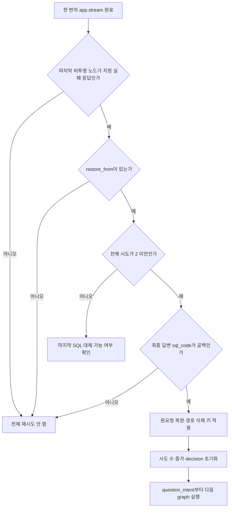
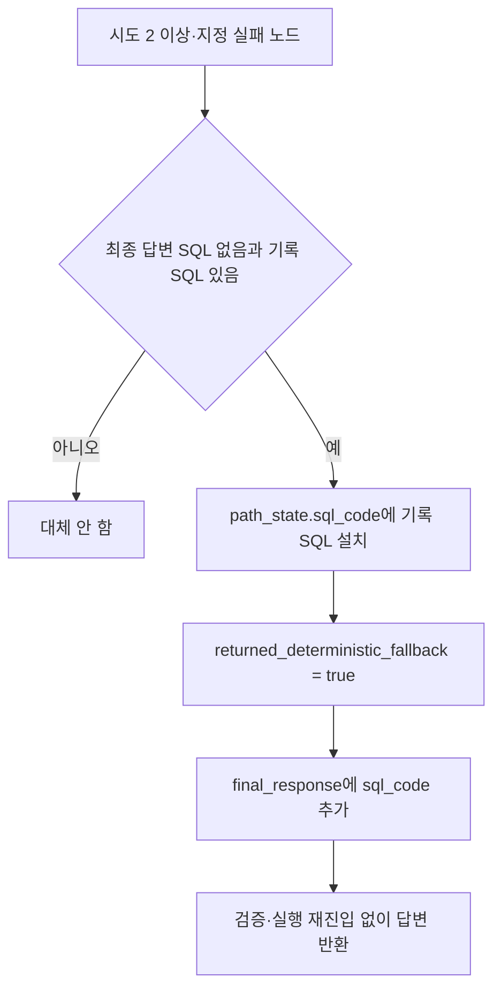
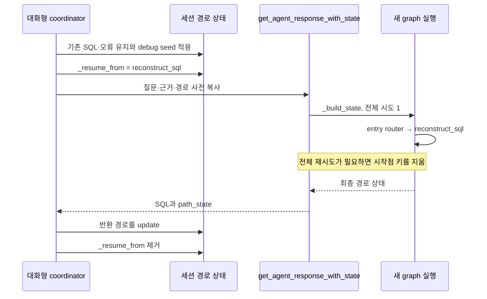

# Chapter 06. 전체 재시도·재개와 생성 상태 수명

질문부터 다시 처리하는 재시도와 기존 SQL을 이어서 고치는 재개는 시작점·상태·횟수의 단위가 다르다. 이 장은 복원 입력, 삭제·유지 필드, 종료 조건과 마지막 SQL 대체 반환을 코드로 추적한다.

로컬 소스·테스트의 정적 분석이며 실제 DB·모델·테스트는 실행하지 않았다. [요청·상태 계약](chapter-01-request-state-and-graph-contract.md), [생성 조율](chapter-04-sql-prompt-and-output.md), [연결 선택](chapter-05-database-and-dialect-routing.md)을 선행 문서로 읽는다.

## 1. 먼저 정의할 용어

| 용어 | 쉬운 뜻과 예시 |
|---|---|
| SQL / DB / 모델 | Structured Query Language, 데이터 조회 언어 / Database, 데이터 저장 시스템 / 질문을 해석하고 SQL을 제안하는 언어 모델. |
| Pipeline / graph / node | 질문 해석부터 답변까지의 처리 묶음 / 단계의 연결 흐름 / 개별 작업 단계. 의도 분류가 한 node다. |
| Full retry / attempt | 처리 묶음 전체를 다시 시작하기 / 그 묶음 한 번의 시도. 첫 실패 뒤 두 번째 전체 시도가 가능하다. |
| Reconstruction | 실패 이유를 보고 SQL을 다시 구성하는 단계. 질문 의도 분류부터 재실행하는 전체 재시도와 다르다. |
| Resume / seed | 지정한 중간 단계부터 이어가기 / 그때 넘겨주는 기존 상태. 이전 SQL과 오류를 넣어 재구성부터 시작한다. |
| State / path_state / decision | 단계 사이의 공유값 / 현재 처리 경로의 중간값 사전 / 다음 분기를 선택하는 문자열. |
| Snapshot / shallow copy | 복원용으로 저장한 값 묶음 / 바깥 사전·목록만 복사하기. 안쪽 사전·메시지 객체까지 복제되지는 않는다. |
| Cache / one-shot guard | 같은 조회 결과를 재사용하는 저장값 / 한 번 수행한 보정을 반복하지 않도록 하는 표시. |
| Terminal node / fallback | 해당 흐름에서 마지막으로 완료한 단계 / 정상 경로가 끝났을 때 대체 값을 반환하는 처리. 대체 SQL이 실행 성공한 SQL이라는 뜻은 아니다. |
| Deterministic / intent check | 정해진 코드 규칙으로 수행하는 검사 / 모델이 질문·근거와 SQL의 의미를 비교하는 검사. |
| Checkpoint / recursion limit | 중단 지점의 실행 상태 저장 / 그래프 진행 단계 수에 대한 상한. 여기의 재개는 저장된 실행 프레임을 복구하는 방식이 아니다. |
| Assertion / mock | 테스트의 기대 조건 / 실제 모델·그래프 등을 대신하는 모형. 테스트를 읽은 결과와 실행 결과를 구분한다. |
| API / JSON·JSONB / NULL / LIKE | Application Programming Interface, 호출 입력·출력 접점 / JavaScript Object Notation, 키·값 데이터 형식과 이를 DB 내부 이진 표현으로 다루는 타입 / 값 없음 / 문자열 패턴 비교. 보정 횟수 필드 이름에도 나타난다. |

상세 정의는 [용어집](../01-architecture/chapter-00-glossary.md), 이벤트·부분 답변·저장 경계는 [Chapter 06-1](chapter-06-1-streaming-and-caller-boundaries.md)에 있다.

## 2. 네 가지 반복 단위를 구분한다

| 반복 단위 | 시작점·조건 | 한도·상태 |
|---|---|---|
| 생성 응답 재시도 | 생성 agent의 모델 호출 | 바깥 반복·모델 helper의 재시도. 전체 처리 횟수와 별도. Chapter 04 참조 |
| SQL 재구성 | 검증·실행 등이 수정 가능한 오류로 분기 | `failed_attempts` 길이에 따른 router 한도 및 개별 보정 한도 |
| 전체 재시도 | 지정 실패 노드로 종료하고 최종 답변에 SQL 없음 | `full_pipeline_attempt` 1→2. 복원 후 의도 분류부터 |
| 대화형 재개 | 호출자가 기존 상태와 `_resume_from` 전달 | 새 호출의 전체 시도는 다시 1. `reconstruct_sql`부터 시작 가능 |

각 graph 실행에는 `recursion_limit=45`를 전달한다. 이것은 모델 호출 수·DB 조회 수·전체 처리 시간 45초를 뜻하지 않는다. 모델 재시도·재구성·전체 재시도가 겹치므로 이 숫자들을 곱해 실제 최대 호출 수라고 단정하지 않는다.

근거: [main.py](../../../code/auto-ontology/auto_ontology/retrieval/text_to_sql/main.py)의 두 호출 루프, [그래프](../../../code/auto-ontology/auto_ontology/retrieval/text_to_sql/text_to_sql_graph.py)의 `route_sql_validation`, [생성 agent](../../../code/auto-ontology/auto_ontology/retrieval/text_to_sql/agents/sql_from_semantic.py).

## 3. 복원 기준은 요청을 받아 만든 초기 상태다

`_build_state()`는 입력의 `path_state`를 사전으로 복사하고 DB 이름·처리용 질문을 정리한 다음 `restore_from`을 만든다. 완전히 비어 있는 상태가 아니라 **호출자가 주입한 기존 상태도 포함하는 요청 경계**다.

| 복원 묶음 필드 | 저장 시점·의미 |
|---|---|
| `initial_question` | 제출 질문의 앞뒤 공백을 제거한 문자열 |
| `evidence` | 최상위 입력 근거. 없으면 빈 문자열 |
| `messages` | 시스템 메시지·처리용 질문 메시지의 목록 복사 |
| `sql_examples`·`value_anchors` | 원래 참고 SQL 예시·값 단서의 목록 복사 |
| `glossary` | 입력 용어 목록 복사. 질문 추출 이후 축소된 목록과 구분 |
| `path_state` | 정리한 초기 경로 사전의 복사 |

`RetryRestoreState`의 주석은 immutable이라고 부르지만 타입 선언·`dict()`·`list()`가 중첩 객체의 변경을 막지는 않는다. 예시 목록 안의 사전, 메시지 객체, 초기 경로 안의 목록은 공유될 수 있다. 바깥 키 교체를 되돌리는 것과 안쪽 객체의 제자리 변경까지 되돌리는 것은 다른 보장이다.

전체 재시도는 `_build_state()`를 다시 호출하지 않는다. 원래 시스템 메시지의 날짜, 연결·검색기·모델 객체 등을 새로 구성하는 동작도 아니다. `restore_from`이 제공하는 값과 현재 상위 상태를 조합한다.

근거: [상태 타입](../../../code/auto-ontology/auto_ontology/retrieval/text_to_sql/state.py)의 `RetryRestoreState`, [초기화·복원](../../../code/auto-ontology/auto_ontology/retrieval/text_to_sql/main.py)의 `_build_state`·`_restore_for_full_pipeline_retry`.

## 4. 전체 재시도 조건은 마지막 노드와 최종 답변이다

`_should_retry_full_pipeline()`의 지정 노드는 `unconstructable_sql_response`다. `_entry_router`는 실행 시작점만 고르는 투명 노드로 취급하여 마지막 노드 계산에서 제외한다.

검사 대상 SQL은 `_extract_answer(final_state)`가 돌려준 답변의 `sql_code`다. `path_state.sql_code`나 생성 결과 객체에 SQL이 남았는지를 직접 검사하지 않는다. 실패 응답 agent가 최종 답변 SQL을 빈 문자열로 만들면, 경로에 이전 SQL이 있어도 두 번째 시도로 갈 수 있다.

| 종료 상황 | 전체 재시도 |
|---|---|
| 정상 답변 또는 정보 설명 응답의 빈 SQL | 없음. 지정 실패 노드로 끝난 경우가 아니다. |
| 지정 실패 응답·빈 SQL·복원값 있음·시도 1 | 시도 2로 재시작 |
| 지정 실패 응답이지만 답변 SQL이 있음 | 없음 |
| 지정 실패 응답·빈 SQL·이미 시도 2 | 없음 |
| 그래프 실행에서 예외 발생 | 예외 처리로 이동. 이 helper를 통한 자동 전체 재시도는 하지 않음 |

기반 시설 오류로 실패 노드에 도달해도 위 조건을 만족하면 바깥 루프는 다시 시도할 수 있다. “SQL을 고쳐도 연결 장애가 해결되지 않으므로 현재 그래프에서 중단”하는 분기와 “전체 처리 재시도도 금지”를 같은 것으로 읽지 않는다.

근거: [main.py](../../../code/auto-ontology/auto_ontology/retrieval/text_to_sql/main.py)의 `_extract_answer`·`_should_retry_full_pipeline`·두 루프, [실패 응답](../../../code/auto-ontology/auto_ontology/retrieval/text_to_sql/agents/sql_unconstructable.py)의 `execute`, [실행 분기](../../../code/auto-ontology/auto_ontology/retrieval/text_to_sql/agents/sql_execution.py).

## 5. 복원은 초기 경로를 고르고 명시된 키를 제거한다

`_restore_for_full_pipeline_retry()`의 순서는 다음과 같다.

1. 현재 실패 경로가 아니라 `restore_from.path_state`를 얕게 복사한다.
2. `_FULL_RETRY_PATH_KEYS_TO_CLEAR`에 있는 키를 그 복사본에서 제거한다.
3. 현재 상위 상태를 사전으로 복사하고 질문·근거·메시지·예시·값 단서·용어집·경로를 복원값으로 교체한다.
4. `decision=""`로 초기화하고 `full_pipeline_attempt`를 1 늘린다.

| 경로에서 지우는 종류 | 대표 키 |
|---|---|
| 재개·질문 파생값 | `_resume_from`, `normalized_question`, `question_type`, `calculation_subtype`, `sql_template`, `extracted_evidence`, `entities`, `subject` |
| 검색·선택·의미 문맥 | `retrieved_*`의 명시 항목, `candidates`, `relevant_tables`, `relevant_queries`, `similar_questions`, `custom_analyses*`, `sql_attributes*`, `primary_attribute`, `attribute_join_paths`, `table_relevance_reasoning` |
| SQL·오류·수정 이력 | `sql_code`, `sql_generation_result`, `error`, `failed_attempts`, `prior_round_failed_attempts`, `interpretation_history`, `error_type`, `error_analysis_done`, `error_known_fixable`, `last_intent_rejected_sql` |
| 답변·실행·숫자 정보 | `final_response`, `formatted_response`, `sql_response_from_db`, `result_numeric_kinds*`, `result_values_digest`, `sql_columns`, `sql_tables`, `custom_analyses_used`, `returned_deterministic_fallback`, `unconstructable_explanation` |
| 보정 횟수·방문 기록 | `sql_attempts`, `reconstruction_count`, JSONB/경로 보정 횟수, 값/NULL/LIKE 보정 표시, `evidence_repairs_applied`, `thoughts_log`, `node_visit_counts` |

이 표의 `*`는 설명용 묶음이다. 코드가 접두어에 맞는 모든 키를 자동 삭제하는 것은 아니며, 실제 집합에는 개별 이름이 명시되어 있다. 여기서는 각 검사 내부 대신 그 보정 횟수가 초기화되는지만 다룬다.

`processing_question`, `target_db`, 호출자 고유 문맥 등 초기 경로의 삭제 대상 아닌 값은 유지한다. 첫 시도의 자동 DB 선택 등 **실패 중 새로 생긴 값은 초기 경로에 없으면 복원 대상이 아니다.**

반대로 초기 입력에 있던 `sql_correction`, `information_tool_calls`, `information_sources` 등은 삭제 집합에 포함되지 않는다. 따라서 임의의 재개 입력을 받았을 때 모든 파생 필드가 자동 정리된다고 보장하지 않는다. 이 관찰은 초기 seed에 있던 값에 관한 것이며, 실패 도중에만 생긴 같은 키가 모두 다음 시도로 넘어간다는 뜻은 아니다.

| 상위 상태 | 전체 재시도 시 처리 |
|---|---|
| 질문·근거·messages·sql_examples·value_anchors·glossary | 복원 묶음으로 교체 |
| decision·full_pipeline_attempt | 초기화·증가 |
| sql_value_validation_cache | 현재 값을 유지. 실패한 시도에서 쌓인 조회도 재사용 가능 |
| 모델·연결·검색기·요청 옵션·domain_rules·enriched_question | 별도 재생성/복원 없이 현재 상위 상태에서 유지 |
| 그 외 상위 키 | 명시 교체 목록 밖이므로 현재 값 유지 |

새 API 호출의 `_build_state()`는 값 검증 캐시를 `{}`로 만든다. 같은 호출 안의 두 전체 시도가 캐시를 공유하는 것과, 대화형 호출을 여러 번 하는 동안 같은 캐시를 자동 공유하는 것은 다르다. 캐시의 조회 키·무효화 상세는 01-9에서 분석한다.

근거: [전체 삭제 집합·복원](../../../code/auto-ontology/auto_ontology/retrieval/text_to_sql/main.py), [값 검증 캐시 소비](../../../code/auto-ontology/auto_ontology/retrieval/text_to_sql/agents/sql_value_validation.py)의 `execute`.

## 6. 재구성 한도와 최종 SQL 대체 반환

`route_sql_validation()`은 이미 `unconstructable`이면 그대로 중단 경로를 고른다. `invalid_sql`이고 `len(failed_attempts) >= 7`이면 실패 경로, 그보다 작으면 재구성 경로다. 다른 결정은 이 router에서 `valid_sql`로 분류하므로 이 함수 자체가 모든 가능한 decision 값을 엄격히 검증하는 것은 아니다.

일반 재구성은 실패 SQL·오류를 `failed_attempts`에 추가한다. 코드가 제공한 SQL 교정을 설치하는 경로도 실패 항목을 추가할 수 있다. 따라서 이 길이를 모델 호출 수와 같다고 보지 않는다. 보조 검사 router는 `invalid_sql`이라도 길이가 5보다 크면 검사를 더 막지 않고 통과 경로를 고른다. 두 상한의 적용 위치가 다르다.

**주석과 구현의 구분:** `INTENT_VALIDATION_SKIPPED_AFTER=5`라는 이름과 일부 주석은 의도 검사를 건너뛴다고 설명한다. 현재 `sql_parse_validation.py`의 실제 함수에서는 이 상수를 읽는 분기를 찾지 못했고, graph의 보조 검사 router가 이 값을 사용한다. 이름만으로 현재 의도 모델 검사가 6회부터 생략된다고 설명하지 않는다.

두 번째 전체 시도까지 실패 응답·빈 SQL로 끝나면 `_apply_last_deterministic_sql_fallback()`은 `last_intent_rejected_sql`을 확인한다. 이 키는 정적 검사 이후 의도 검사에서 실제 문제를 지적해 거부한 SQL을 기록하는 지점에서 만들어진다.

이 함수는 SQL을 다시 검사·실행하지 않고, 기존 실패 설명도 성공 설명으로 바꾸지 않는다. 기존 결과 행·컬럼 정보와 대체 SQL의 일치를 여기서 다시 만들거나 확인하지 않는다. 기록 키에 새 값을 쓰는 지점이 있다는 사실과 모든 후속 실패에서 그 기록이 최신·유효하게 정리된다는 보장도 구분한다. 대체 함수 자체는 키의 출처를 재검증하지 않는다.

근거: [라우터](../../../code/auto-ontology/auto_ontology/retrieval/text_to_sql/text_to_sql_graph.py)의 `route_sql_validation`·`_make_soft_check_router`, [재구성](../../../code/auto-ontology/auto_ontology/retrieval/text_to_sql/agents/sql_reconstruction.py)의 `execute`·`_install_sql_correction`, [의도 거부 기록](../../../code/auto-ontology/auto_ontology/retrieval/text_to_sql/agents/sql_parse_validation.py)의 `_validate_intent`, [대체 반환](../../../code/auto-ontology/auto_ontology/retrieval/text_to_sql/main.py)의 `_apply_last_deterministic_sql_fallback`.

## 7. 재개는 새 호출의 시작 노드를 바꾼다

그래프는 `_entry_router_fn()`이 읽은 `path_state._resume_from`으로 시작 경로를 고른다. 기본값은 `question_intent`이며 등록된 분기는 `question_intent`·`reconstruct_sql` 두 개다. 임의 노드명까지 지원하는 재개 API가 아니다. 명시 키가 빈 값 등일 때 기본값으로 대체하는 별도 검사도 이 함수에는 없다.

`main.py`는 `graph.compile()`을 호출하며 이 위치에서 checkpoint 저장기를 연결하지 않는다. 재개는 기존 실행 프레임 복구 대신 **새 입력 상태로 그래프를 실행하면서 시작 노드만 선택**한다.

`_apply_debug_seed()`는 호출자가 준 DB 오류를 쓰거나, 오류가 없으면 결과가 틀렸을 때 점검할 지시를 넣는다. 기존 `failed_attempts`가 있으면 `prior_round_failed_attempts`로 보관해 참고 문맥과 새 횟수를 분리한다. 그 뒤 현재 실패 이력·JSONB/경로 보정 횟수·값/NULL/LIKE 일회성 표시를 제거하고, `sql_attempts`·`reconstruction_count`·`error_analysis_done`을 초기화한다. 이전 실패 이력을 새 한도에 그대로 합산하지 않도록 하는 코드다.

`_run_sql_generation()`은 `get_agent_response_with_state()`의 반환 경로를 세션에 `update()`한 뒤 `_resume_from`을 제거한다. 그래프 entry 함수가 키를 소비하며 지우는 것은 아니다. 다른 호출자가 재개 키를 계속 재전달하면 다음 호출도 같은 시작점을 요청할 수 있다. 함수가 결과를 반환하기 전에 예외를 던지면 coordinator의 제거 줄까지 도달한다는 보장도 없다.

세션 병합은 키별 덮어쓰기이며 반환 사전에 빠진 세션 키를 자동 삭제하지 않는다. “반환 경로가 깨끗하다”와 “기존 세션의 모든 파생 키가 제거됐다”도 구분한다. 후속 질문 seed는 기존 SQL·질문 정규화·실패 이력·보정 표시 등을 별도로 제거하고 관련 테이블은 문맥 힌트로 남긴다. 질문 보강·외부 평가 제출·숫자 타입 재시도 상세는 01-12로 인계한다.

근거: [그래프 진입점](../../../code/auto-ontology/auto_ontology/retrieval/text_to_sql/text_to_sql_graph.py)의 `_entry_router_fn`·`create_graph`, [대화형 coordinator](../../../code/auto-ontology/auto_ontology/retrieval/interactive/coordinator.py)의 `_apply_debug_seed`·`_apply_follow_up_seed`·`_run_sql_generation`, [세션 상태](../../../code/auto-ontology/auto_ontology/retrieval/interactive/state.py)의 `InteractiveSessionState`.

## 8. 테스트·예시·미검증

예를 들어 사용자의 원래 근거가 첫 시도에서 보정되고 용어 목록이 축소되어도, 전체 재시도는 복원용 원래 근거·용어 목록으로 돌아간다. 기존 SQL을 틀린 결과 때문에 고치는 debug 호출은 새 실패 횟수로 재구성부터 시작한다. 이 예시는 코드 분기 설명이며 실제 모델의 결과가 아니다.

| 테스트 | 읽어서 확인한 assertion |
|---|---|
| [test_full_pipeline_retry.py](../../../code/auto-ontology/auto_ontology/retrieval/text_to_sql/tests/test_full_pipeline_retry.py) | 원래 질문·근거·메시지·예시·용어·호출자 경로 복원, 시도 2, 빈 decision, 값 검증 옵션/캐시 유지, 실패 후 성공·두 번 실패 종료·정보 응답 재시도 없음·상태 반환 호출의 같은 루프·마지막 SQL 대체 |
| [test_infrastructure_failure.py](../../../code/auto-ontology/auto_ontology/retrieval/text_to_sql/tests/test_infrastructure_failure.py) | 포기 결정 전달, SQL 오류 재구성, 한도 초과 거부, 일곱 재구성 뒤 종료의 모형 상태 전이, 실패 설명이 최종 응답에 전달됨 |
| [test_question_intent.py](../../../code/auto-ontology/auto_ontology/retrieval/text_to_sql/tests/test_question_intent.py)의 entry 사례 | 기본 시작점과 reconstruct_sql 지정 시작점 |
| [test_coordinator.py](../../../code/auto-ontology/auto_ontology/tests/interactive/test_coordinator.py)의 seed 사례 | 재개 키·카운터·오류 설정, 실제 오류/debug 경로, 후속 질문 교체·빈 질문 대체·기존 SQL/정규화 질문 제거. 실제 생성은 mock으로 대체한 사례 포함 |

첫 테스트 파일은 초기화와 graph를 모형으로 바꾸므로 실제 전체 그래프의 두 번 실행, 중첩 객체 독립성, 모든 삭제 키, 재개 키 소비, DB 재접속 성공을 증명하지 않는다. 최종 SQL 대체 사례도 실제 정적 검사·실행을 통과시킨 검사가 아니라 기록 키가 있는 실패 응답을 만든다.

실제 모델·DB·그래프 라이브러리 통합, 중첩 변경의 복원, 초기 seed의 삭제 목록 밖 파생값, 보존 캐시의 최신성, 두 번째 실행의 호출 수/시간, 최종 대체 SQL의 정확성과 결과 대응은 미검증이다. Mermaid 3개를 작성했으며 렌더링하지 않았다.

스트리밍·부분 오류·호출자 저장은 [Chapter 06-1](chapter-06-1-streaming-and-caller-boundaries.md)에서 이어진다. SQL 검증·보정 내부는 01-9, chat의 프로세스·취소·재접속 수명은 01-10으로 인계한다.
