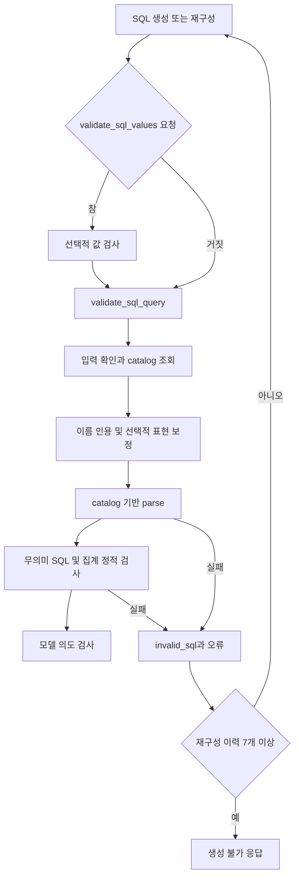
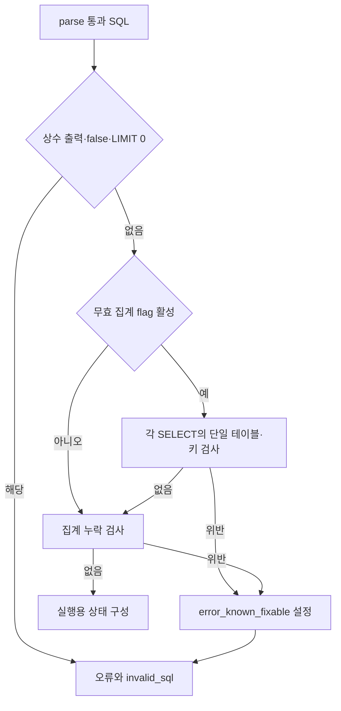
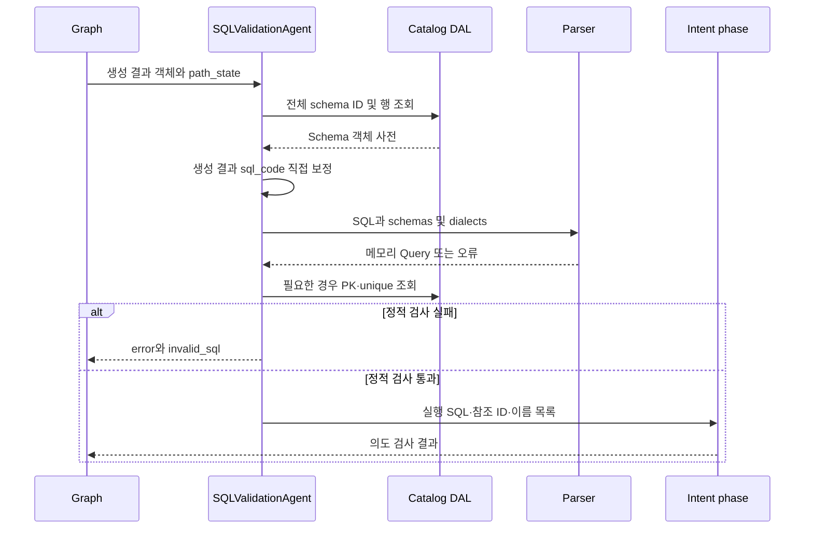

# Chapter 01. SQL 구문·catalog 참조와 정적 검사

- 분석일: 2026-11-14.
- 범위: `SQLValidationAgent.execute`의 진입부터 `_validate_intent` 호출 직전까지. 로컬 코드·관련 테스트를 정적으로 읽었고 실행하지 않았다.
- 선행: [요청·상태·그래프](../08-sql-generation/chapter-01-request-state-and-graph-contract.md), [SQL 생성](../08-sql-generation/chapter-04-sql-prompt-and-output.md), [DB·방언 선택](../08-sql-generation/chapter-05-database-and-dialect-routing.md).
- 용어집: [상세 용어집](../01-architecture/chapter-00-glossary.md)

| 용어 | 뜻·이 문서에서의 의미 |
|---|---|
| SQL (Structured Query Language) | DB에 데이터를 요청하는 언어다. |
| 정적 검사 | 대상 DB에서 SQL을 실행하기 전에 문자열·구조·저장된 메타데이터로 판단하는 검사다. |

## 1. 역할과 호출 경계

자연어를 SQL로 바꾸는 Text-to-SQL 흐름에서, 이 노드는 생성한 SQL을 실행용 상태로 옮길 수 있는지 검사한다. SQLGlot은 SQL을 구조로 읽고 다시 문자열로 만드는 라이브러리다. AST(Abstract Syntax Tree, 추상 구문 트리)는 SELECT·컬럼·조건·집계 등을 노드로 표현한 구조다.

실제 graph 이름은 `validate_sql_query`, 클래스는 `SQLValidationAgent`, 파일은 `agents/sql_parse_validation.py`다. 별도 `intent_validation.py` 파일은 현재 소스에 없다. 같은 클래스 안에서 정적 검사 후 모델 의도 검사를 수행한다. 파일 맨 위 주석의 오래된 역할 설명만으로 현재 동작을 정하지 않는다.



선택적 값 검사와 재구성 내부는 후속 분석 범위다. 위 그림의 재구성 화살표는 graph의 반복 구조이며 값 검사 결과만으로 통합 검증 노드를 건너뛰지 않는다. 실제 graph edge와 다음 노드 판정은 [Chapter 02](chapter-02-intent-validation-and-routing.md)에 정리한다.

## 2. 입력과 조기 종료

| 입력 | 소비 방식과 조건 |
|---|---|
| `state.decision` | `unconstructable`이면 입력 검사를 통과시킨 뒤 같은 결정을 즉시 반환한다. 생성 불가라는 뜻이다. |
| `path_state.sql_generation_result` | 생성 결과 객체. 입력 검사에서는 객체가 참으로 평가되는지, 즉 비어 있지 않은 값인지 정도만 확인한다. `execute`는 `.sql_code` 접근이 가능하다고 전제한다. |
| `state.connectors` | DB 연결 객체 목록. 전체 객체에서 비어 있지 않은 `.dialect`를 순서대로 추출한다. dialect는 DB별 SQL 문법이다. |
| `path_state.relevant_tables` | 검색·준비 단계가 만든 테이블·컬럼 목록. 연결 선택과 알려진 이름의 인용에 사용한다. |
| `path_state.target_db` | 키 메타데이터 조회의 선택적 DB 범위다. 모든 catalog 조회를 이 DB로 제한하는 인수는 아니다. |
| `state.numeric_type_alignment` | 참이면 숫자·문자열 집계 표현 보정과 `DISTINCT ON` 거부를 활성화한다. |

`unconstructable`을 제외하면 `fetch_all_schema_ids()` → `get_schemas_by_ids(ids)`를 먼저 호출한다. catalog는 테이블·컬럼·관계 정보를 저장한 프로젝트 내부 메타데이터 저장소다. 이 단계에서 조회하는 스키마는 `relevant_tables`로 축소하지 않은 전체 스키마다.

생성 결과가 없으면 `validate_input`이 False를 반환한다. 실제 `agent_wrapper`는 오류를 기록하고, 이 클래스에는 `failure_decision` 지정이 없으므로 `AgentExecutionError`를 발생시킨다. 입력이 없는데 빈 업데이트로 통과시키는 경로로 설명하면 안 된다.

일반 예외는 다른 계약이다. `agent_wrapper`의 `except Exception`은 `handle_error`로 `{type, message, agent}` 오류 사전을 저장한다. `SQLValidationAgent`는 실패 결정을 지정하지 않아 이 업데이트에는 새 `decision`이 없다. 따라서 catalog 조회·잘못된 결과 객체·프롬프트 구성 등의 예상 밖 예외를 자동으로 `invalid_sql`로 바꾼다고 보장하지 않는다. 이전 결정과의 병합 결과는 실제 graph 통합 실행으로 확인하지 않았다.

근거: [검증 agent](../../../code/auto-ontology/auto_ontology/retrieval/text_to_sql/agents/sql_parse_validation.py)의 `validate_input`, `execute`, [공통 래퍼](../../../code/auto-ontology/auto_ontology/retrieval/text_to_sql/base.py)의 `agent_wrapper`, `handle_error`.

## 3. 검사 전에 실제로 SQL을 바꾸는 처리

### 3.1 알려진 대문자 포함 이름의 인용

`quote_known_mixed_case_identifiers(sql, relevant_tables, selected_dialect)`는 목록에서 대문자를 포함한 테이블·컬럼 이름을 모은다. SQLGlot으로 읽은 테이블·컬럼 식별자가 이미 인용되지 않았고, 알려진 실제 철자와 **정확히 일치**할 때 인용을 추가한다.

예를 들어 실제 컬럼이 `kubeType`이면 PostgreSQL에서는 `"kubeType"`, Spark에서는 `` `kubeType` ``로 출력한다. `kubetype`을 `kubeType`으로 추측해 바꾸지는 않는다. 스키마·DB 이름 전체를 인용하는 처리도 아니다. 후보 컬럼은 테이블별 사전이 아닌 이름 사전에 모으므로 동일 이름·서로 다른 대소문자 충돌의 해결을 보장하지 않는다.

입력·알려진 이름이 없거나 파싱에 실패하면 원문을 반환한다. 변경이 생겼을 때만 트리를 선택 방언으로 다시 출력하고, 생성 결과 객체의 `sql_code`를 직접 바꾼다. 아직 실행용 `path_state.sql_code`를 갱신한 시점은 아니다.

### 3.2 `numeric_type_alignment`가 참인 요청

| 순서 | 실제 처리 | 적용 범위 |
|---|---|---|
| 1 | `float_casts_to_numeric` | PostgreSQL에서 명시적 REAL·FLOAT 등의 cast(타입 변환)를 NUMERIC으로 변경한다. 원래 컬럼이 float라는 이유만으로 모두 변환하지 않는다. |
| 2 | 같은 helper의 추가 보정 | NULL을 구분하는 비교 표현을 같은 의미의 조합으로 바꾸고, 최상위 산술·AVG 출력에 decimal cast가 있으면 바깥 NUMERIC cast를 추가하는 조건이 있다. |
| 3 | `order_string_aggregates` | PostgreSQL의 순서 없는 `STRING_AGG`에 집계 대상 값 기준 ORDER BY를 붙인다. 기존 ORDER BY는 유지한다. |
| 4 | SQLGlot으로 `Distinct.on` 탐색 | `DISTINCT ON (...)`이 있으면 재구성 요청 오류를 남기고 즉시 `invalid_sql`을 반환한다. 평가기의 키워드 제거 동작을 피하려는 정책이다. |

NUMERIC은 십진수를 표현하는 타입이다. 문자열 집계는 여러 값을 하나의 문자열로 합치는 처리다. 숫자 타입 정렬이라는 이름의 옵션이 문자열 집계 순서와 NULL 비교 표현에도 영향을 준다. `DISTINCT ON` 거부 조건에는 PostgreSQL 방언 확인이 따로 없고, 선택 방언으로 파싱한 결과에 해당 구조가 있는지 검사한다.

두 helper는 적용 방언·변경 대상·파싱 조건을 만족하지 않으면 원문을 유지한다. `DISTINCT ON` 탐색용 파싱 실패도 이 자리에서는 거부하지 않고 다음 parse 검사에 넘긴다. 옵션이 없거나 False이면 이 블록 전체를 건너뛴다.

근거: [숫자 표현 helper](../../../code/auto-ontology/auto_ontology/retrieval/text_to_sql/numeric_types.py)의 `float_casts_to_numeric`, `order_string_aggregates`. 실행 후 결과 타입을 읽는 보정은 이 장 범위 밖이다.

## 4. catalog 기반 parse의 실제 계약

parse는 SQL 문자열을 문법 구조로 읽는 처리다. 이 노드는 다음 호출을 수행한다.

```text
SQLValidationAgent._sql_parse_validation(schemas, sql, dialects)
  → parse_query_single
    → Query 임시 객체 생성
    → parse_query_slim
      → extract_tables_and_columns
      → 인식한 table/column ID 및 참조 edge 구성
    → 인식한 table ID가 없으면 None
```

Query는 SQL과 참조 객체들을 담는 메모리 객체다. edge는 두 객체의 연결을 표현한 항목이다. 여기서 UUID(충돌 가능성이 낮은 식별자)를 만든다고 catalog에 SQL을 저장하는 것은 아니다. 이 호출 경로는 `add_query` 등의 저장 함수를 호출하지 않는다.

### 4.1 방언과 이름 해석

`extract_tables_and_columns`는 전체 connector에서 얻은 방언을 순서대로 시도하고 **처음 문법 파싱에 성공한 방언**을 사용한다. 방언 목록이 비어 있으면 기본 방언으로 재시도하지 않고 구문 오류를 발생시킨다. 선택 connector의 방언만 쓰는 이름 보정·정적 검사와 입력 범위가 다르다.

CTE(Common Table Expression)는 WITH로 만든 임시 이름이다. 실제 테이블 수집에서는 CTE 이름을 제외한다. 스키마 접두어가 있으면 그 이름을 사용하고, 접두어 없는 테이블은 스키마들을 순회하며 먼저 찾은 소유 스키마에 연결한다.

SQLGlot `qualify`로 컬럼의 소유 테이블을 붙이고 별표를 확장하지만 `validate_qualify_columns=False`다. qualify가 실패해도 원래 트리로 계속한다. 소유가 불명확한 컬럼은 catalog를 이용해 유일 후보를 찾고, JOIN 공통 키 예외를 제외한 모호한 컬럼은 추측하지 않고 생략한다. 추출 종료 시 컬럼이 하나도 연결되지 않은 테이블 항목도 제거한다.

### 4.2 성공이 의미하는 것

`parse_query_slim`은 catalog에서 찾은 테이블·컬럼을 Query에 연결한다. 알려지지 않은 테이블·컬럼은 일부 경로에서 건너뛰며, 최종 반환은 `bool(query_obj.get_tables_ids())`다. `parse_query_single`이 None이면 통합 검사에서 오류가 된다.

따라서 확인한 성공 조건은 **문법 파싱 후 catalog에 연결되는 테이블 ID(식별자)가 적어도 하나 남았음**이다. 모든 이름이 실제 DB에 존재함·권한이 있음·전체 컬럼이 해결됨·결과가 질문에 맞음을 입증한 것은 아니다. 테이블이 없는 `SELECT 1`은 정상 문법이어도 이 catalog 계약에서 거부될 수 있다. SQL 문장을 SELECT로만 제한하는 명시적인 검사도 이 parse helper에는 없다.

근거: [catalog 파서](../../../code/auto-ontology/auto_ontology/catalog/sql_parse.py)의 `parse_query_single`, `parse_query_slim`, [SQLGlot 추출기](../../../code/auto-ontology/auto_ontology/catalog/parsers/sqlglot_extractor.py)의 `extract_tables_and_columns`.

### 4.3 반환 데이터

| 반환 필드 | 의미 |
|---|---|
| `success=True` | 위 호출이 예외·None 없이 끝났다는 표시 |
| `sql_tables`, `sql_columns` | Query에서 추출한 catalog ID를 문자열로 바꾼 목록 |
| `used_tables`, `used_columns` | 스키마의 `id_to_node`에서 ID를 이름으로 해석한 정렬·중복 제거 목록. 찾지 못한 ID는 이름 목록에 추가하지 않는다. |
| `error`, `another_try=1` | 예외 문자열과 보조 표시. 이 노드는 error만으로 거부하며 another_try를 retry 카운터로 쓰지 않는다. |

`get_schemas_by_ids`의 사전 키는 소문자 스키마명이며 DB 이름을 합친 키가 아니다. 서로 다른 DB의 같은 스키마명이 하나의 키로 합쳐지거나 덮이는 경계가 있다. 전체 스키마 조회 후 `target_db`로 다시 제한하는 단계는 이 경로에서 확인되지 않았다. 다중 DB의 동명 스키마·테이블 정확성은 미검증이다.

## 5. 세 가지 정적 검사

catalog parse에 성공한 다음 아래 순서로 검사한다. 각 helper는 거부 이유 문자열 또는 빈 문자열을 반환한다. 빈 문자열은 해당 검사에서 거부하지 않았다는 뜻이다.

| 검사 | 대상과 동작 | 범위·설정 |
|---|---|---|
| `detect_degenerate_sql` | 상수·NULL·Boolean만 반환, 단순한 상수 false WHERE, LIMIT 0 | 선택한 SELECT의 출력과 직접 WHERE/LIMIT. 내부 모든 논리를 증명하는 검사는 아니다. |
| `detect_vacuous_group_by` | 이미 유일한 키로 묶거나 유일 키 동등 조건으로 한 행만 남기는 집계를 탐지 | `DETECT_VACUOUS_GROUP_BY`가 참일 때만 실행. 기본 비활성. JOIN 없는 SELECT 블록 대상. |
| `detect_missing_aggregation` | GROUP BY에 참여하지 않는 다수 쪽 테이블 값을 집계 없이 출력하는 좁은 패턴 탐지 | 별도 활성 flag 없음. 같은 SELECT에 GROUP BY·JOIN·해석 가능한 테이블 한정 컬럼이 있어야 한다. |

무의미 SQL의 상수 false 검사는 `FALSE` 또는 서로 다른 숫자 literal의 EQ(등호 비교)다. literal은 식에 직접 적은 값으로, `1=0`의 1과 0이 예다. 논리식을 일반적으로 단순화하지 않는다. `LIMIT`도 숫자 literal 이름이 `0`인 경우다. 루트가 SELECT가 아니면 `find(Select)`로 첫 SELECT를 찾으므로 UNION 등 복합 문장의 모든 분기를 검사한다고 확대하면 안 된다.

무효 집계(vacuous aggregation)는 각 그룹에 한 행만 남아 집계가 기대한 요약 역할을 못 하는 상태를 말한다. 예를 들어 `orders.id`가 기본 키일 때, 전체 주문을 고객별로 묶어야 하는 질문에 `GROUP BY orders.id`로 AVG를 구하는 형태다. 이 helper는 질문 자체를 입력받지 않으므로 이것이 실제 질문에 부적절한지는 구조·키 정보로 추정한다.



### 5.1 무효 집계의 키·블록 경계

키는 행을 구별하는 컬럼이다. PK(Primary Key, 기본 키)는 컬럼 여러 개의 조합일 수 있고, 여기서 `unique`는 표본 관찰로 유일하다고 저장된 컬럼이다.

- 환경 변수는 helper 호출 때 읽는다. `1`, `true`, `yes`, `on`을 허용한다.
- SQL에 `group by`, `partition by`, `avg(`·`sum(`·`count(`·`min(`·`max(` 중 단서가 있어야 파싱한다. 문자열 사전 검사이므로 모든 공백·표기 변형을 포괄하지 않는다.
- 모든 SELECT 블록을 순회하되 그 블록에 JOIN이 있으면 생략한다. CTE·하위 쿼리의 단일 테이블 집계는 별도로 검사할 수 있다.
- GROUP BY와 window의 PARTITION BY에서 직접 컬럼 이름을 모은다. window는 여러 행의 집합을 참조하면서 행을 유지하는 계산이고 PARTITION BY는 그 계산 집합을 나누는 기준이다.
- `unique`는 하나만 일치해도, 복합 PK는 전체 컬럼이 포함되어야 거부한다. GROUP BY가 없는 집계는 WHERE의 EQ 양쪽에 나타난 컬럼 이름들을 같은 방식으로 검사한다.

마지막 조건은 EQ가 실제로 한 행을 고정하는지까지 증명하지 않는다. 예를 들어 OR 안의 비교나 자기 비교도 EQ 순회 대상이다. GROUP BY 컬럼 수집도 이름 기준이며 쿼리의 의미를 완전히 해석하지 않는다. 기본 비활성 이유인 불완전한 키·관찰 정보의 오탐 가능성과 함께 읽어야 한다.

### 5.2 집계 누락의 좁은 판정

`_many_side_tables`는 JOIN ON의 컬럼 간 EQ를 보고, 한쪽 컬럼이 PK 또는 unique 목록에 있고 다른 쪽은 없을 때 다른 쪽 테이블을 다수 쪽으로 분류한다. FK(Foreign Key, 외래 키) 선언을 직접 따라가는 함수는 아니다. 두 쪽 모두 유일하거나 모두 비유일하면 이 분류에 추가하지 않는다. 테이블명이 같은 self JOIN도 생략한다.

GROUP BY에 직접 적힌 한정 컬럼에서 기준 테이블을 구한다. 한정 컬럼은 `o.customer_id`처럼 소유 이름을 붙인 컬럼이다. SELECT 출력의 다수 쪽 컬럼 중 집계 함수 안에 없고, 직접 GROUP BY 또는 동일하게 출력되는 GROUP BY 표현식에 포함되지 않으면 거부한다. ORDER BY·HAVING은 이 검사의 검사 대상이 아니다.

이 helper의 유일성 비교는 PK 목록의 **개별 컬럼 포함**으로 판단한다. 무효 집계 helper의 복합 PK 전체 포함 조건과 다르다. 따라서 복합 PK 일부를 독립 유일 키처럼 취급할 수 있고, 한쪽 키 정보가 비어 있는 경우도 비유일 쪽으로 볼 수 있다. 주석의 보수적 판정 설명을 곧바로 무오탐 보장으로 읽지 않는다.

키 조회는 [DAL](../../../code/auto-ontology/auto_ontology/dal/datasources.py)의 `find_table_key_columns(table_name, database_name)`다. DAL(Data Access Layer)은 저장소 조회를 담당하는 계층이다. DB 인수가 있으면 범위를 제한하지만 스키마는 인수에 없고 `limit(1)`이다. 같은 DB의 동명 테이블 경계는 남는다. 대상 DB 원본 데이터를 이 함수가 새로 스캔하지는 않는다.

## 6. 상태 변화와 저장·조회 경계



| 시점 | 상태 갱신 |
|---|---|
| 이름·표현 보정 | 생성 결과 객체의 `.sql_code`를 직접 변경한다. 이후 parse가 실패해도 그 객체 변경은 이미 발생했다. |
| parse·무의미 SQL 거부 | 기존 path_state에 `error`를 기록하고 `invalid_sql`을 반환한다. |
| 두 집계 검사 거부 | 위 상태에 `error_known_fixable=True`를 추가한다. 재구성의 오류 분석이 아직 실행되지 않은 조건에서 이 값을 소비해 모델 분류·테이블 탐색을 생략한다. |
| 정적 검사 전체 통과 | 얕은 사전 복사로 `sql_response_from_db=None`, 참조 ID, `custom_analyses_used`, 실행용 `sql_code`를 갱신하고 의도 검사로 보낸다. |

`custom_analyses_used`는 단순 ID 목록이 아니다. `get_custom_analyses_ids`가 classification이 참이며 ID·label이 있는 항목을 `{"id": ..., "label": ...}`로 반환한다. 이 분류가 실제 SQL 사용을 독립 검증하는 것은 아니다.

성공 준비 시 이전 DB 결과는 None으로 초기화하지만 이전 `error`·`last_intent_rejected_sql`을 명시 삭제하지 않는다. 정적 실패의 조기 반환은 실행용 SQL·참조 ID·이전 결과를 전부 지우는 동작도 아니다. 이후 노드가 어느 상태를 소비하는지까지 구분해야 한다.

## 7. 관련 테스트와 확인 수준

아래 assertion은 소스에서 읽었다. 이 작업에서 pytest·대상 DB·모델·graph를 실행하지 않았다.

| 테스트 파일·함수 | 실제 확인 범위 |
|---|---|
| [test_intent_validation.py](../../../code/auto-ontology/auto_ontology/retrieval/text_to_sql/tests/test_intent_validation.py) `test_parse_failure_does_not_call_intent_llm` | parse 메서드를 오류 반환 mock으로 바꿔 invalid·오류 보존·모델 미호출을 확인한다. 실제 잘못된 컬럼 추출 시험은 아니다. |
| 같은 파일 `test_parse_result_populates_catalog_ids_and_qualified_names` | Query mock의 ID가 문자열·정규 이름 목록으로 옮겨지는지 확인한다. |
| 같은 파일 `test_parse_result_without_catalog_table_is_invalid` | parse helper의 None 반환 mock이 catalog 테이블 오류가 되는지 확인한다. |
| 같은 파일 `test_unconstructable_decision_passes_through_unified_validation` | 생성 불가 결정은 입력 검사와 execute를 그대로 통과한다. |
| [test_mixed_case_quoting.py](../../../code/auto-ontology/auto_ontology/retrieval/text_to_sql/tests/test_mixed_case_quoting.py) | Spark·Databricks의 backtick, PostgreSQL의 이중 따옴표, 소문자 SQL 유지 assertion이 있다. 실제 DB 실행은 하지 않는다. |
| [test_numeric_types.py](../../../code/auto-ontology/auto_ontology/retrieval/text_to_sql/tests/test_numeric_types.py) `test_validation_*` | catalog 조회·연결 선택을 대체하고 parse에서 의도적으로 멈춰, 옵션별 SQL 보정·유지와 SQLite 유지 여부를 확인한다. |

로컬 테스트 검색에서 `detect_degenerate_sql`, `detect_vacuous_group_by`, `detect_missing_aggregation`을 직접 호출하는 테스트는 찾지 못했다. 이 세 helper의 실제 DB 의미·오탐·SQLGlot 버전별 범위를 검증했다고 표시하지 않는다.

## 8. 인계

확인한 사실은 호출·조건·반환 구조다. 일부 이름 누락 허용, 복합 PK 개별 포함, EQ 수집의 넓은 범위에서 생기는 정확성 경계는 코드로부터 도출한 판단이며 실제 실패 재현 결과는 아니다. 실제 DB 버전·권한·다중 DB 이름 충돌·키 최신성·일반 예외 뒤 graph 분기·Mermaid 렌더링은 미검증이다.

다음 [Chapter 02](chapter-02-intent-validation-and-routing.md)는 정적 검사 후 모델에 무엇을 보여주고 어떤 응답을 거부하는지 설명한다. 선택적 값 검사·실행 전 probe·재구성 내부·실행 후 보정은 [09단계 계획](../../../.codex/plan/auto-ontology/01-9_sql-validation.md)의 후속 항목이다.
