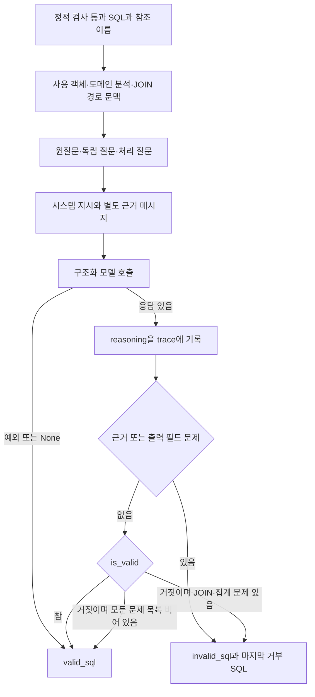
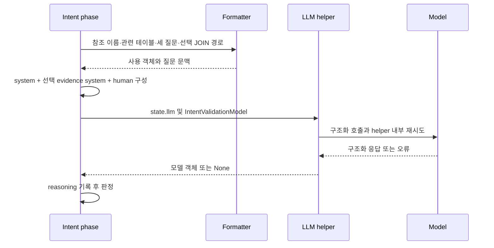
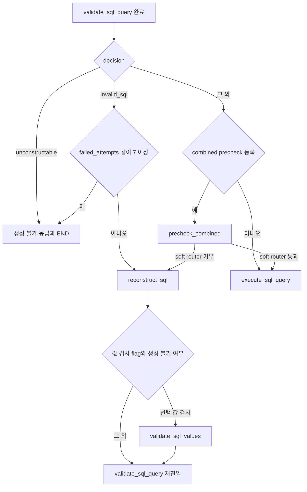

# Chapter 02. 모델 의도 검사·판정과 재구성 분기

- 분석일: 2026-11-14.
- 범위: `SQLValidationAgent._validate_intent`, 출력 모델·프롬프트, graph의 실제 후속 분기. 로컬 소스·테스트 정적 분석이며 실제 호출 결과가 아니다.
- 선행: [구문·정적 검사](chapter-01-parse-and-static-validation.md), [생성 재시도·재개](../08-sql-generation/chapter-06-full-retry-and-resume.md).
- 용어집: [상세 용어집](../01-architecture/chapter-00-glossary.md)

| 용어 | 뜻·이 문서에서의 의미 |
|---|---|
| 의도 검사 | SQL이 사용자 질문과 제공된 근거를 따르는지 모델에게 판단시키는 단계다. |
| LLM (Large Language Model, 대규모 언어 모델) | 자연어·SQL 문맥을 읽고 구조화된 판정을 반환하는 모델이다. |

## 1. 통합 노드 안의 마지막 검사

`execute`가 catalog parse와 정적 검사를 통과하면, 실행용 SQL·참조 ID를 준비하고 `_validate_intent(state, updated_path_state, used_tables, used_columns)`를 호출한다. 이 메서드는 SQL을 DB에서 실행하지 않는다.

`INTENT_VALIDATION_SKIPPED_AFTER=5`라는 상수가 있지만 현재 통합 노드에는 그 값을 비교해 의도 검사를 생략하는 분기가 없다. `full_pipeline_attempt=2`에서도 의도 검사 호출을 유지한다. 전체 재시도는 처음부터 파이프라인을 다시 도는 것이고, 재구성은 생성한 SQL을 오류에 맞춰 고치는 내부 반복이다.



근거: [통합 검증](../../../code/auto-ontology/auto_ontology/retrieval/text_to_sql/agents/sql_parse_validation.py)의 `_validate_intent`, `IntentValidationModel`.

## 2. 모델 입력을 만드는 순서

### 2.1 도메인 분석·사용 객체

도메인 분석은 사용자가 특정 업무 계산의 정의나 SQL 패턴으로 등록한 CustomAnalysis다. `path_state.custom_analyses_str`가 비어 있지 않으면 그 문자열들을 안내 목록으로 만든다. 없으면 `custom_analyses` 객체 목록을 `format_custom_analyses_section`에 넘긴다. 이 자리는 새 분석 검색을 시작하지 않는다.

`relevant_tables`와 connector로 방언을 다시 결정하고, `format_used_schema_for_prompt`에 parse에서 얻은 사용 테이블·컬럼 **이름**을 넘긴다. 이 포맷터는 입력 테이블 목록 안에서 이름·스키마를 casefold(대소문자 차이를 줄인 비교)로 매칭해 설명·label·PK·컬럼 타입·표본 등을 보충한다. catalog를 다시 조회하는 함수는 아니다.

예를 들어 SQL이 `orders.customer_id`, `customers.name`을 참조하면 그 컬럼의 설명·표본을 보여주고 사용되지 않은 `orders.internal_note`는 제외한다. 이름이 포맷터의 입력에서 발견되지 않으면 사용 이름 자체만 출력한다. 사용 컬럼이 하나도 해결되지 않으면 `None resolved`가 들어간다.

매칭은 DB ID로 하지 않고 스키마·테이블 이름과 첫 일치 항목으로 수행한다. `target_db`는 출력 이름을 만들 때 보조 값으로 쓰이며 매칭 후보 전체를 DB별로 엄격하게 제한하는 조건이 아니다. 전체 catalog에서 파악한 참조와 `relevant_tables`의 보충 문맥은 같은 집합이라고 가정하지 않는다.

근거: [포맷터](../../../code/auto-ontology/auto_ontology/retrieval/text_to_sql/formatters_util.py)의 `format_used_schema_for_prompt`.

### 2.2 JOIN 판단 모드와 설정을 읽는 시점

JOIN은 여러 테이블의 행을 조건으로 연결하는 SQL 연산이다. `_JOINS_VALIDATED_ELSEWHERE`는 모듈 import 때 다음 설정으로 결정된다.

```text
INTENT_VALIDATION_JOINS_VALIDATED_ELSEWHERE
  없으면 DB_PROBE_JOIN_PATH_CHECK
  둘 다 없으면 "false"
→ strip().lower()가 1 / true / yes 중 하나인지
```

명시 설정이 빈 문자열이거나 false이면 fallback 설정이 참이어도 해당 명시값을 사용한다. 이 값은 helper 호출마다 환경 변수를 읽는 무효 집계 설정과 읽는 시점·허용 문자열이 다르다. 여기서는 `on`을 참으로 인정하지 않는다.

| 모드 | 모델에게 주는 문맥과 지시 |
|---|---|
| False | `primary_attribute`와 `attribute_join_paths`가 모두 있을 때 AUTHORITATIVE JOIN PATHS 블록을 만든다. 의미 모델의 확인된 경로를 따르는 JOIN을 거부하지 말라고 지시한다. |
| True | 위 경로 블록 생성을 생략하고 모든 JOIN의 실재성은 별도 검사에서 확인됐다고 가정하는 프롬프트를 쓴다. 자명한 잘못이나 질문과 다른 대상을 잇는 경우는 여전히 판단하도록 지시한다. |

이 설정은 의도 모델의 지시를 선택한다. 실제 별도 검사 성공 기록을 이 메서드가 조회해 확인하는 조건은 없다. graph의 precheck 활성 설정과 반드시 같은 수명·값이라는 보장은 이 메서드만으로 세울 수 없다.

### 2.3 질문·근거·출력 요구

호출은 `get_original_question`, `get_standalone_question`, `get_question_for_processing`의 세 값을 `create_intent_validation_prompt`에 넘긴다. 원질문은 사용자가 준 질문, 독립 질문은 대화 문맥 없이 이해할 수 있게 만든 질문, 처리 질문은 검색·생성에서 실제 사용한 표현이다. 포맷 함수가 원질문과 정리 질문이 같다고 판단하면 하나만 반환하므로 항상 세 블록이 모두 렌더링되는 것은 아니다.

evidence는 값·컬럼 매핑·계산식·조건 등에 관한 권위 있는 근거 문자열이다. 이 메서드는 `state.evidence`를 읽으며 별도로 정제 결과를 다시 조회하지 않는다. 근거가 truthy이면 별도 SystemMessage로 `format_authoritative_evidence`를 넣고 사람 메시지에도 엄격한 근거 준수 검사 항목을 추가한다. 공백만 있는 문자열을 이 메서드에서 strip해 제외하지는 않는다.

`shorten_answer=True`이면 최상위 SELECT가 질문·근거가 요구한 출력 필드를 정확히 한 번씩, 같은 형태로, 추가 필드 없이 반환하도록 검사 지시를 추가한다. projection(투영)은 SELECT가 결과로 내보낼 컬럼·식의 목록이다. 이 지시는 프롬프트의 시스템·사람 메시지 양쪽에 있다. 별도 SQL AST 기반 출력 비교를 구현한 것은 아니다.



근거: [프롬프트](../../../code/auto-ontology/auto_ontology/retrieval/text_to_sql/prompts.py)의 `INTENT_VALIDATION_SYSTEM_PROMPT`, 다른 JOIN 모드 상수, `create_intent_validation_prompt`, `format_dual_question_block`.

## 3. 구조화 응답과 실제 판정표

구조화 응답은 정해진 필드에 값을 넣는 모델 출력이다. Pydantic은 그 출력의 타입·필드를 확인하는 라이브러리다.

| `IntentValidationModel` 필드 | 기본값·의미 |
|---|---|
| `reasoning: str` | 기본 빈 문자열. 간단한 판정 설명. 비어 있지 않으면 trace에 기록한다. |
| `is_valid: bool` | 필수. 모델의 전체 유효 판정. |
| `join_issues`, `aggregation_issues` | 기본 빈 목록. JOIN·집계의 중대한 문제. |
| `projection_issues`, `evidence_issues` | 기본 빈 목록. 요구 출력·근거의 위반. |

네 문제 목록의 입력이 빈 문자열 `""`이면 field validator가 빈 목록으로 바꾼다. 일반 설명 문자열이나 다른 모든 잘못된 타입을 자동 보정하는 validator는 아니다.

`is_valid`만으로 판정하지 않는다. 코드의 순서를 그대로 풀면 다음과 같다.

| 모델 호출·응답 | 조건 | 실제 반환 |
|---|---|---|
| 로컬 try 안의 예외 | helper 호출 또는 `state["llm"]` 접근 오류 | `valid_sql` |
| `None` | helper 실패·응답 없음 | `valid_sql` |
| 응답 있음 | `evidence_issues` 또는 `projection_issues` 있음 | `is_valid`와 무관하게 `invalid_sql` |
| 응답 있음 | 위 두 목록이 비어 있고 `is_valid=True` | `join_issues`·`aggregation_issues`가 있어도 `valid_sql` |
| 응답 있음 | `is_valid=False`이며 모든 문제 목록이 비어 있음 | `valid_sql` |
| 응답 있음 | `is_valid=False`, JOIN 또는 집계 문제 있음 | `invalid_sql` |

따라서 True와 JOIN 문제 목록이 모순되면 전체 True 판정이 우선한다. 근거·출력 문제는 우선 거부한다. `shorten_answer=False`라도 모델이 `projection_issues`를 반환하면 코드의 거부 조건은 그대로 작동한다. 일반 모드에서는 그 엄격한 목록을 채우도록 요구하는 프롬프트를 생략할 뿐이다.

프롬프트는 일반 JOIN·집계에는 관대하고, 근거 준수와 짧은 답변의 출력 필드는 엄격하게 보도록 지시한다. 모델이 그렇게 판단할 확률이나 SQL의 정답률은 이 코드·mock 테스트로 측정되지 않았다.

## 4. 실패·재시도와 trace 상태

`invoke_with_structured_output(state["llm"], messages, IntentValidationModel)`를 호출한다. 생성 단계의 reasoning 모델 우선 선택 코드를 여기서 반복하지 않는다.

공용 helper의 `safe_invoke_with_structured_output`는 `RETRY_MAX_ATTEMPTS` 범위에서 timeout·허용된 서비스 오류·스키마 검증 오류·None 결과를 다룬다. 첫 출력 검증 재시도에서는 오류 설명을 메시지에 추가하고, 이후에는 원래 메시지로 되돌리는 조건이 있다. 바깥 helper는 실패 시 None을 반환하며, 비추론 모델의 실패라면 reasoning 모델 대체 조건도 가진다. 재구성 횟수와 모델 helper의 시도 횟수는 서로 다른 단위다.

의도 메서드의 try는 **helper 호출 주변**에만 있다. 그 앞의 connector 선택·포맷터·메시지 구성 예외가 전부 통과 처리로 흡수되는 것은 아니다. 그 경계는 [Chapter 01의 공통 래퍼 설명](chapter-01-parse-and-static-validation.md)에 있다.

응답의 reasoning이 있으면 판정 전에 `record_thought(path_state, "validate_sql_query", text)`를 호출한다. 거부 사유가 있는 경우에도 설명 trace를 남긴다. 최종 거부 시 문제 종류별 텍스트를 이어서 `path_state.error`에 저장하고 `last_intent_rejected_sql`에 지금 SQL을 저장한다. 이 SQL은 [전체 재시도·fallback 분석](../08-sql-generation/chapter-06-full-retry-and-resume.md)에서 설명한 대체 반환의 후보가 될 수 있다.

이 메서드는 통과 시 이전 error·마지막 거부 SQL을 명시 삭제하지 않는다. DB 결과를 성공으로 채우지도 않는다. 확인한 변경은 메모리 상태·trace·로그이며, 원본 DB 실행·catalog 쓰기·대화 영구 저장은 호출 경로에 없다.

근거: [모델 helper](../../../code/auto-ontology/auto_ontology/utils/llm_invoke.py), [trace helper](../../../code/auto-ontology/auto_ontology/retrieval/text_to_sql/base.py)의 `record_thought`.

## 5. graph에서 다음 단계로 이동하는 조건

graph는 `SQLValidationAgent`를 `agent_wrapper`로 감싸 `validate_sql_query`에 등록한다. 다음 분기는 [text_to_sql_graph.py](../../../code/auto-ontology/auto_ontology/retrieval/text_to_sql/text_to_sql_graph.py)의 `route_sql_validation`이다.



| 조건 | 분기·상태 경계 |
|---|---|
| `decision=unconstructable` | 현재 이력 길이와 관계없이 생성 불가 응답으로 보낸다. |
| `decision=invalid_sql`이고 이력 길이 `<7` | SQL 재구성으로 보낸다. 이 router가 이력을 추가하는 것은 아니다. |
| `decision=invalid_sql`이고 이력 길이 `>=7` | 생성 불가 응답으로 보낸다. |
| 그 외 모든 decision | router는 `valid_sql` 경로를 반환한다. 허용된 문자열 집합을 엄격하게 검사하는 함수는 아니다. |

`failed_attempts`는 재구성 단계가 `{sql, error}`를 append하는 목록이다. 정상 경로에서 처음 SQL이 실패하고 목록이 0일 때 첫 재구성을 허용하며, 7개를 쌓은 후 다시 실패하면 중단한다. SQL 검사 호출을 총 7번만 한다는 뜻은 아니다. 일부 재구성 조기 경로의 이력·종료는 후속 장에서 추적한다.

선택적 값 검사(`validate_sql_values`)는 최초 생성과 재구성 뒤에 flag로 연결되며 그 뒤에는 고정 edge로 통합 검증을 다시 수행한다. 재구성에서 이미 `unconstructable`이 나오면 값 검사를 생략하고 통합 검증이 결정을 보존한다.

`precheck_combined`는 graph 생성 시 값·JOIN·JSONB 경로 검사 flag 중 하나라도 활성일 때 등록한다. JSONB는 PostgreSQL의 구조화 JSON 저장 타입이며, 경로 검사는 키 접근이 실제 구조와 맞는지 살피는 기능이다. 세부 구현·조회 예산은 후속 분석 대상이다.

그 노드와 빈 결과 검사 등에 쓰는 `_make_soft_check_router`는 `invalid_sql`이고 이력 길이가 **5보다 클 때** 차단을 중단하고 통과시킨다. 정확히 5일 때는 아직 재구성을 요구한다. 이것은 통합 의도 검사의 생략 조건이 아니다. 정적·의도 검사와 실행 실패에는 7회 재구성 상한 router가 계속 적용된다.

## 6. 설명용 예시

다음은 실행 결과가 아닌 입력·판정 계약 예시다.

질문이 “매출 합계를 알려줘”이고 근거가 `net_amount * exchange_rate`를 쓰라고 지정했다고 하자. SQL이 `SUM(converted_amount)`를 선택하면, 모델이 `is_valid=True`와 함께 `evidence_issues=["지정 계산식을 사용하지 않음"]`을 반환하더라도 코드가 거부한다. `error`와 마지막 거부 SQL을 남겨 재구성으로 보낸다.

반대로 근거·출력 문제가 없고 `is_valid=True`, `aggregation_issues=["집계 문제"]`가 함께 오면 현재 조건은 통과시킨다. 이 조합은 코드에서 도출한 경계이며 해당 모델 응답을 실제로 관찰했다는 뜻은 아니다.

## 7. 테스트가 확인하는 범위

| 파일·함수 | 입력·mock과 assertion |
|---|---|
| [test_intent_validation.py](../../../code/auto-ontology/auto_ontology/retrieval/text_to_sql/tests/test_intent_validation.py) `test_intent_validation_keeps_authoritative_attribute_join` | JOIN 모드를 False로 고정하고 모델을 True 응답으로 대체한다. 경로·사용 테이블 설명·사용 컬럼 표본이 들어가고 사용하지 않은 컬럼이 빠지는지 검사한다. |
| 같은 파일 `test_intent_validation_receives_verbatim_authoritative_evidence` | 근거가 별도 시스템 메시지에 원문 그대로 있고 엄격 준수 지시가 추가되는지 검사한다. |
| 같은 파일 `test_intent_validation_rejects_and_reports_evidence_violation` | True 판정과 근거 문제를 동시에 반환하는 mock으로 invalid·오류·마지막 SQL 기록을 확인한다. |
| 같은 파일 `test_short_answer_validation_requires_exact_projection` | True 판정과 추가 출력 필드 문제를 반환해 거부와 두 메시지의 엄격 지시를 확인한다. |
| 같은 파일 `test_non_short_answer_validation_omits_strict_projection_check` | 일반 모드에서는 엄격 출력 지시가 없는지 확인한다. 모델의 정확도 시험은 아니다. |
| 같은 파일 `test_retry_threshold_still_runs_intent_llm` | 정적 parse 성공을 mock으로 대체하고 이력 6개에서 parse와 의도 helper가 한 번씩 호출되는지 확인한다. helper는 None을 반환한다. |
| 같은 파일 `test_final_full_pipeline_attempt_still_runs_intent_llm` | 전체 시도 2에서도 parse와 의도 helper 호출을 유지하는지 확인한다. |
| [test_sql_value_validation.py](../../../code/auto-ontology/auto_ontology/retrieval/text_to_sql/tests/test_sql_value_validation.py) `test_post_generation_routes_are_feature_flagged` | flag별 router 반환과 graph edge에 값 검사 → 통합 검증이 포함되는지 확인한다. |
| [test_infrastructure_failure.py](../../../code/auto-ontology/auto_ontology/retrieval/text_to_sql/tests/test_infrastructure_failure.py) `test_router_*`, `test_the_loop_uses_seven_reconstructions` | 생성 불가 보존·invalid 재시도·상한 초과 종료를 검사한다. 7개 이력 반복은 목록 append로 재현하며 실제 graph를 구동하지 않는다. |

이 작업에서는 테스트를 읽었으며 실행하지 않았다. 일반 False·빈 문제 목록, True·JOIN 문제 목록, 의도 helper 예외, soft router의 5/6 경계에 대한 직접 assertion은 이 장에서 확인한 테스트 범위에 포함되지 않는다. 코드 조건으로 설명한 내용과 테스트로 확인되는 계약을 구분한다.

## 8. 미확인 사항과 다음 분석

실제 모델의 근거·출력 판단 정확도, 여러 프롬프트 지시의 충돌, None·서비스 오류 비율, 별도 JOIN 검사와 모드 설정의 일치, 원본 DB 권한·실행 결과, 전체 graph 반복과 최종 fallback의 정확성은 미검증이다. Mermaid도 렌더링하지 않았다.

이 장까지로 09단계의 **통합 구문·정적·의도 검사**를 정리했다. 다음 시작점은 [09단계 계획](../../../.codex/plan/auto-ontology/01-9_sql-validation.md)의 선택적 SQL 값 검사다. DB probe(작은 확인용 SQL 조회)·JOIN/JSONB precheck·재구성 내부·실행·빈 결과 보정은 계속 대기 상태다.
