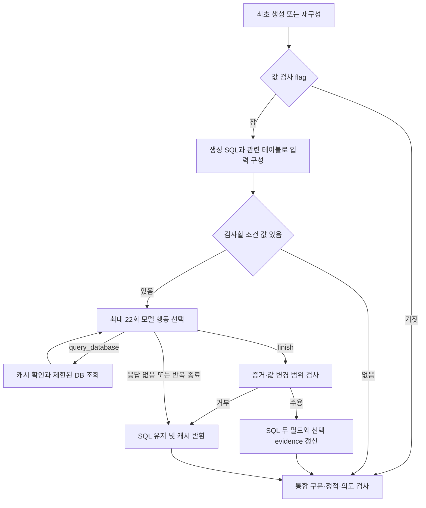
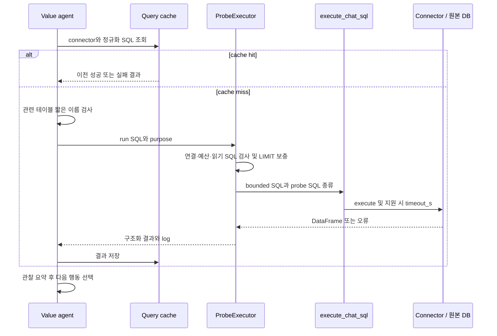
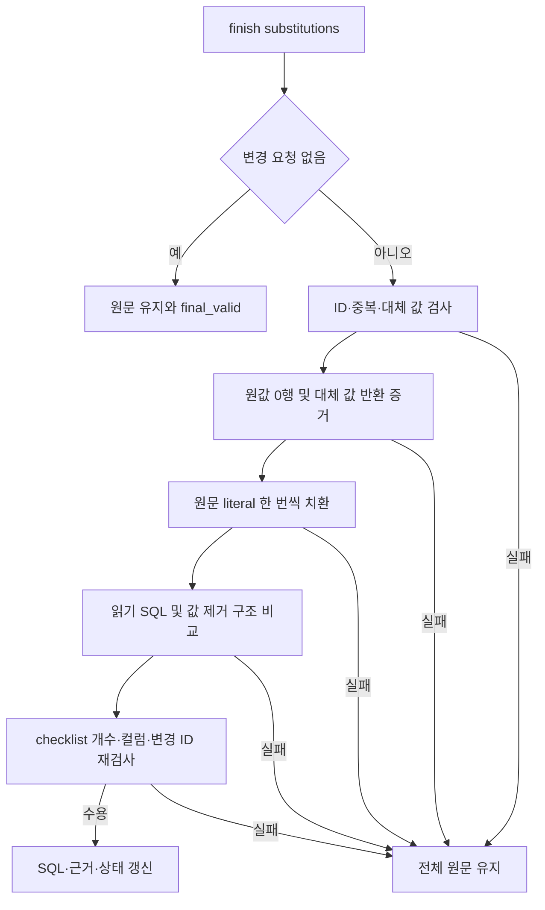

# Chapter 03. 선택적 SQL 값 검사·보정과 확인용 DB 조회

- 분석일: 2026-11-14.
- 범위: `SQLValueValidationAgent`와 공통 `ProbeExecutor`, graph·요청 상태·관련 테스트. 로컬 소스를 정적으로 읽었으며 실제 DB·모델·테스트는 실행하지 않았다.
- 선행: [구문·정적 검사](chapter-01-parse-and-static-validation.md), [의도 검사와 분기](chapter-02-intent-validation-and-routing.md), [생성 재시도·재개](../08-sql-generation/chapter-06-full-retry-and-resume.md).
- 용어집: [상세 용어집](../01-architecture/chapter-00-glossary.md)

| 용어 | 뜻·이 문서에서의 의미 |
|---|---|
| Literal (리터럴) | SQL에 직접 적은 값이다. `status = 'actve'`의 `'actve'`처럼 저장 값과 철자가 다를 수 있다. |
| Probe | 이를 확인하려고 원본 DB에 보내는 작은 조회 SQL이다. |

## 1. 역할과 실제 진입 조건

이 agent는 생성 SQL의 조건에 적힌 값을 추출해 모델에게 확인용 조회를 선택하게 하고, 조회 근거를 만족하는 값만 보정한다. 입력 flag인 `validate_sql_values`는 기본 False다. [main.py](../../../code/auto-ontology/auto_ontology/retrieval/text_to_sql/main.py)의 초기 상태 구성에서 payload의 값을 옮기고 조회 캐시는 빈 사전으로 만든다.

graph는 최초 생성과 재구성 뒤에 `validate_sql_values` 노드를 선택적으로 연결한다. 이 노드 다음에는 고정 edge로 `validate_sql_query`가 있다. 즉 이 값 검사는 앞 장의 구문·정적·의도 검사보다 먼저 수행될 수 있다. 원본 DB에서 최종 SQL을 실행해 나온 빈 결과를 보정하는 기능과는 별도다.



이 클래스는 `validate_input=True`이며 `execute` 안에서 조건을 확인한다. flag가 꺼져 있거나 SQL이 비었거나 검사 항목이 없으면 `{}`를 반환한다. `decision`을 유효·무효로 정하는 노드는 아니다. 생성 불가 결정은 graph가 값 검사 대신 통합 검증으로 보내 보존한다.

근거: [값 검사 agent](../../../code/auto-ontology/auto_ontology/retrieval/text_to_sql/agents/sql_value_validation.py), [graph](../../../code/auto-ontology/auto_ontology/retrieval/text_to_sql/text_to_sql_graph.py)의 `route_generated_sql`, `route_reconstructed_sql`, `create_graph`.

## 2. 검사 항목 추출과 입력 계약

SQL은 `sql_generation_result.sql_code` → `path_state.sql_code` → 빈 문자열 순서로 고르고 strip한다. 관련 테이블의 DB 이름과 주입 connector 목록으로 연결을 선택하고 그 방언을 SQLGlot에 넘긴다. SQLGlot은 SQL을 AST(구문 트리)로 읽는 라이브러리다. 연결 선택은 [DB·방언 계약](../08-sql-generation/chapter-05-database-and-dialect-routing.md)과 같다.

`extract_value_checks`는 트리를 순회하며 아래 형태를 찾는다. `_single_column`은 비교식 한쪽에서 **서로 다른 컬럼 표현이 정확히 하나** 발견될 때 그 컬럼을 돌려준다. `LOWER(status)`처럼 컬럼을 감싼 식도 포함할 수 있다.

| SQL 형태 | 추출 규칙 |
|---|---|
| `=`, `!=`, `>`, `>=`, `<`, `<=`, `LIKE`, `ILIKE` | 한쪽이 직접 literal이고 다른 쪽에서 단일 컬럼을 찾을 수 있어야 한다. |
| `column IN ('US', 'CA')` | 하위 쿼리가 없는 IN 목록의 직접 literal들을 추출한다. |
| `age BETWEEN 10 AND 20` | low·high가 직접 literal이면 각각 추출한다. |
| `CASE WHEN status='active' THEN 'YES' ELSE 'NO' END` | 조건의 `'active'`는 추출하고 출력 label인 `'YES'`·`'NO'`는 이 규칙으로 추출하지 않는다. |

LIKE는 패턴 문자열 비교, ILIKE는 대소문자를 덜 엄격하게 비교하는 방언별 패턴 연산이다. CASE는 조건별 값을 반환하는 식이다. WHERE에 한정하지 않고 전체 트리에서 같은 형태를 찾는다. NULL·Boolean 등 별도 AST 노드, 함수 인수의 모든 값·음수 표현의 모든 변형까지 포괄하는 일반 literal 목록은 아니다. SQL 파싱 예외는 빈 목록으로 처리한다.

각 항목은 `id=value_1` 등 순번 ID, `column`, 원래 `predicate`(비교 조건), SQL 표기의 `literal`, 내부 `value`, `is_string`을 가진다. 같은 비교 노드·컬럼·literal 조합은 중복 제거한다. 서로 다른 조건에 같은 값이 쓰이면 별도 항목이다. ID는 해당 SQL을 읽은 순서에서 만들어지며 영구적인 컬럼 ID가 아니다.

모델에게 보이는 checklist는 `value_1: 'actve' | status = 'actve'` 같은 행이다. `Checked columns`에는 추출된 컬럼 이름과 타입만 넣는다. 타입 보충은 관련 테이블 목록에서 컬럼의 짧은 이름별 **첫 타입**을 사용하는 사전이다. DB·테이블별로 같은 컬럼명의 서로 다른 타입을 구별하는 매칭은 아니다.

### 설명용 예시

```sql
SELECT CASE WHEN status = 'actve' THEN 'YES' ELSE 'NO' END
FROM accounts
WHERE country IN ('US', 'CA') AND age BETWEEN 10 AND 20
```

검사 목록에는 `'actve'`, `'US'`, `'CA'`, `10`, `20`이 들어간다. 다만 범위 경계 10·20이나 LIKE 패턴은 “그 값 자체가 저장된 컬럼에 존재해야 올바른 조건”이라고 일반화할 수 없다. 정확 존재를 요구하는 모델 지시의 적합성은 질문·연산자에 따라 다르며 실제 의미 보존은 미검증이다.

## 3. 모델의 행동 계약과 반복

구조화 응답은 정해진 필드에 맞춘 모델 출력이다. `ValueValidationAction`의 action은 `query_database` 또는 `finish`다.

| 행동 | 허용 필드와 검사 |
|---|---|
| `query_database` | arguments의 `sql`, `purpose`가 필요하다. substitutions가 있으면 모델 타입 검증에서 거부한다. |
| `finish` | arguments가 있으면 거부한다. substitutions에는 `check_id`, `replacement_literal` 쌍을 넣는다. |
| 공통 | `reasoning`은 기본 빈 문자열이다. |

매 반복에서 처리 질문·원래 SQL·evidence(근거 문자열)·connector 이름·타입·checklist·일치하는 캐시 finding·최근 조회 관찰·남은 조회 횟수를 새로 포맷한다. 증거를 축적하는 반복 도중 원래 SQL·evidence를 차례로 고치지는 않는다. 마지막 finish를 수용한 뒤 한 번에 적용한다.

모델에는 먼저 원값 동등 비교, 실패하면 앞뒤 공백 제거 후 동등 비교와 LIKE 탐색, 그 뒤 질문·근거로 지지되는 대소문자 변형·동의어를 보라고 지시한다. 발견용 LIKE를 최종 SQL 조건을 느슨하게 만드는 근거로 쓰지 말라고도 지시한다. 이 **탐색 순서 자체를 강제하는 코드 상태 기계는 없다**. 모델이 반환한 조회와 최종 변경을 별도 검사할 뿐이다.

- 모델 행동 선택은 `MAX_AGENT_ITERATIONS=22`회다. 매 helper 호출 내부 재시도까지 합한 모델 요청 수의 상한은 아니다.
- `ProbeExecutor`에는 `max_calls=MAX_TOOL_CALLS=20`을 명시한다. 이 노드에 재진입하면 새 executor를 만들어 다시 20회 예산을 가진다.
- 예산이 0이 되어도 agent 반복이 즉시 중단되는 조건은 없다. 모델이 finish·None을 반환하거나 22회가 끝날 때까지 관찰을 이어갈 수 있다.
- None·호출 예외면 반복을 끝내고 지금까지 query cache만 반환한다. 22회가 query 행동으로 끝나도 보정은 적용하지 않는다.

관찰은 한 probe당 한 줄이다. 성공은 행 수와 첫 컬럼의 최대 5개 값, 실패는 오류 앞 200자를 보여준다. 프롬프트에는 최근 8개 관찰만 넣고 생략한 개수를 표시한다. 요약에서 빠진 조회 결과는 query cache의 증거 집합에 남는다.

## 4. 캐시 키·재사용·수명

캐시는 원본 DB 결과를 기억해 같은 조회를 줄이는 메모리 사전이다. `state.sql_value_validation_cache` 안에서 `queries`와 `findings`를 구분한다.

| 항목 | 키·값과 역할 |
|---|---|
| connector key | `database_name:dialect`. 연결 객체·사용자·토큰·스키마 전체를 포함한 식별자는 아니다. |
| queries | `connector_key::정규화한 SQL` → executor 결과. 새 실행 실패 결과도 저장한다. |
| successful_queries | 같은 connector prefix의 ok 결과들을 모은 현재 증거 집합. 캐시에서 다시 구성한다. |
| findings | connector·컬럼·원래 내부 value를 JSON으로 직렬화한 키 → 원래 literal·최종 literal·`corrected` 또는 `exists`. |

정규화는 끝 세미콜론을 제거하고 공백을 split/join한다. SQL 문법으로 문자열 밖의 공백만 고르는 정규화가 아니므로, 문자열 literal 내부 연속 공백이 다른 조회도 같은 키로 합쳐질 가능성이 있다. 이 항목은 코드로 도출한 경계이며 실제 충돌 재현은 하지 않았다.

모델 query가 오면 cache hit를 **먼저** 확인한다. hit는 허용 테이블 검사·executor 실행을 생략하며 예산을 소비하지 않는다. 실패 조회도 같은 실행의 cache에 들어갔다면 재사용한다. 새 조회의 테이블 범위 거부 결과는 query cache에 저장하지 않는다.

findings는 현재 connector·컬럼·원래 literal이 일치하는 항목만 프롬프트에 넣는다. finding을 읽고 코드가 자동 보정을 수행하는 것은 아니다. 모델의 finish와 successful_queries 근거 검사를 다시 거쳐야 한다.

일반 요청 상태는 빈 cache로 시작한다. 내부 재구성에서는 같은 상위 상태로 전달하며, 전체 파이프라인 재시도의 `_restore_for_full_pipeline_retry`도 상위 상태 복사에서 이 캐시를 유지한다. 원질문·evidence는 원요청으로 복원하면서 증거 cache는 남을 수 있다. 이 cache에 만료 시각·원본 데이터 버전 검사는 없다. 사용자별·새 세션 재개에서의 전체 수명 보장은 이 장 범위에서 검증하지 않았다.

근거: [main.py](../../../code/auto-ontology/auto_ontology/retrieval/text_to_sql/main.py)의 초기 상태 구성·`_restore_for_full_pipeline_retry`, [값 검사 agent](../../../code/auto-ontology/auto_ontology/retrieval/text_to_sql/agents/sql_value_validation.py)의 `_normalize_query`, `_store_finding`, `execute`.

## 5. 확인용 SQL이 실제 실행되는 경계

### 5.1 관련 테이블 범위

`_allowed_probe_tables`는 선택 방언으로 읽은 SQL의 실제 테이블 이름을 모으고, CTE(Common Table Expression, WITH로 만든 임시 이름)는 제외한다. 나머지가 비어 있지 않고 관련 테이블 이름 집합의 부분 집합이어야 허용한다.

이름 비교는 `table.name`의 짧은 이름과 casefold(대소문자 차이를 줄인 표기)다. DB·스키마 접두어·컬럼별 허용 목록을 비교하지 않는다. 따라서 “관련 테이블만”이라는 지시와 구현은 **짧은 테이블명 범위**라는 경계를 갖는다. cache hit는 이 검사도 다시 하지 않는다.

### 5.2 공통 실행기의 처리 순서



`ProbeExecutor.run`은 연결 없음 → 예산 소진 → `is_read_only_select` 거부 순으로 확인한다. 이 셋은 DB 호출과 calls 증가 없이 오류 entry를 log에 추가한다. 통과하면 `_ensure_limit`를 적용하고 **DB 호출 직전에 calls를 1 증가**시킨다. 실행 오류·결과 변환 오류도 소비한 예산을 돌려주지 않는다.

`is_read_only_select`는 SQLGlot AST 판정이 아닌 문자열 규칙이다. 끝 세미콜론을 제거한 뒤 내부 세미콜론을 거부하고, select/with 접두어 및 INSERT·UPDATE·DELETE·INTO 등 금지 단어 정규식을 검사한다. 문자열·주석 안의 같은 단어도 탐지할 수 있으며 함수의 부수 효과를 DB 의미 수준으로 판정하는 코드는 없다. 이름 그대로 완전한 읽기 전용 증명이라고 확대하지 않는다.

`_ensure_limit`도 문자열에서 limit 단어가 발견되면 기존 SQL을 유지한다. limit가 전혀 없으면 기본 50을 뒤에 붙인다. 이미 LIMIT 10000이 있거나 내부 쿼리·문자열에 limit 단어가 있는 경우 외부 반환 행 수를 50으로 강제 축소하지 않는다.

### 5.3 반환 구조와 timeout

| 필드 | 뜻 |
|---|---|
| `sql`, `purpose` | 실제 전송한 LIMIT 보충 후 SQL과 조회 목적 |
| `ok`, `error` | 실행·결과 변환 성공 여부와 실패 문자열 |
| `rows` | DataFrame 앞 `max_rows`개를 dict 행으로 바꾼 목록 |
| `row_count` | DataFrame 전체 길이. 원본 테이블 전체 일치 건수라는 뜻은 아니다. |
| `truncated` | 받은 DataFrame 길이가 max_rows보다 큰지 |
| `elapsed_ms` | 실행·일부 처리에서 측정한 경과 시간. 사전 거부는 기본 0이다. |

실행은 호출 스레드에서 동기적으로 한다. 새 background thread나 별도 연결을 만들지 않는다. `close`는 자원 해제 작업이 없는 함수이고 context manager도 같은 close를 호출한다. 연결은 기존 connector의 수명·인증을 따른다.

실제 호출은 `execute_chat_sql(connector, bounded_sql, kind="probe SQL")`다. connector가 `supports_statement_timeout`을 표시하면 공통 SQL Query Timeout을 읽어 `timeout_s`로 전달한다. 기본은 30초이며 설정 값은 조회할 때 반영한다. timeout 지원 표시가 없으면 해당 인수 없이 execute한다. 연결·웨어하우스 준비·원격 취소 보장은 [커넥터 실행 분석](../03-connectors/chapter-11-execution-timeout-and-resources.md)의 경계를 따른다.

`db_probe.config`에 있는 `DB_PROBE_TIMEOUT_S=5.0`은 이 실행 경로에서 전달되지 않는다. executor 파일의 “별도 hard timeout 없음” 주석과 현재 공통 helper 호출도 함께 봐야 한다. 이 경로는 지원 connector에 공통 timeout을 전달하지만 probe 전용 5초 상한은 사용하지 않는다.

설정 `DB_PROBE_MAX_ROWS` 기본 50과 공통 `DB_PROBE_MAX_CALLS` 기본 40은 모듈 import 시 읽는다. 이 agent는 max_calls를 20으로 덮어쓴다. config의 테이블 8개·컬럼 8개 등 상수는 이 모델 반복에서 검사 항목을 잘라내는 데 사용되지 않는다. 따라서 executor 주석의 “질문별 예산”을 모든 재구성·검사 공유 예산으로 해석하면 안 된다.

근거: [공통 실행기](../../../code/auto-ontology/auto_ontology/retrieval/text_to_sql/db_probe/executor.py), [probe 설정](../../../code/auto-ontology/auto_ontology/retrieval/text_to_sql/db_probe/config.py), [공통 SQL 실행](../../../code/auto-ontology/auto_ontology/retrieval/text_to_sql/chat_sql.py), [timeout 조회](../../../code/auto-ontology/auto_ontology/infra/feature_flags.py).

## 6. 값 교체를 수용하는 조건

finish에 substitutions가 비어 있으면 즉시 `final_valid=True`로 원문을 반환한다. 모든 checklist 항목을 실제 확인했는지·몇 개를 방문했는지 검사하는 완료 조건은 없다. “전체 값을 검증하라”는 프롬프트 지시와 이 완료 계약은 구분한다.

교체 요청이 있으면 `_apply_proven_substitutions`는 다음 순서를 수행한다. 하나라도 실패하면 변경 전체를 버리고 원문 SQL·근거와 False를 반환한다.

1. check ID 존재·중복 ID·같은 값 교체 여부를 검사한다. 원래 값이 인용 문자열이면 모델이 따옴표를 생략했을 때 인용·escape를 보충한다.
2. 원래 컬럼·값이 언급된 성공 조회 중 `row_count=0` 결과를 `_match_absence`로 찾는다.
3. 같은 컬럼이 언급된 성공 조회의 반환값들 중 대체 literal과 일치하는 값을 `_match_proof`로 찾는다.
4. 원문 SQL에서 literal 한 번씩을 문자열 치환한다. 숫자는 긴 토큰 일부를 건드리지 않도록 경계를 검사한다.
5. 후보 SQL이 읽기 SQL 문자열 검사에 통과하고, 모든 literal을 같은 placeholder로 바꾼 AST skeleton(값을 지운 구조)이 원본과 같은지 검사한다.
6. checklist를 다시 추출해 개수·순서별 컬럼·변경 literal이 요청 ID·값 집합과 정확히 대응하는지 검사한다.



### 증거 매칭의 실제 한계

부재 증거는 원래 값의 정확 동등 조건만 실행했는지 AST로 확인하지 않는다. SQL 텍스트에 컬럼의 짧은 이름과 값이 언급됐고 0행이면 후보가 된다. 다른 조건 때문에 빈 결과였는지도 판별하지 않는다. 존재 증거는 해당 컬럼의 반환 필드만 보는 것이 아니라 dict 행의 **모든 값**에서 strip·casefold한 문자열 일치를 찾는다.

따라서 코드가 보장하는 것은 이 텍스트·반환값 규칙을 통과한 근거가 있다는 것이다. 실제 해당 컬럼의 원값 부재와 대체 값 정확 존재를 독립적으로 증명한 것은 아니다. 인용 SQL literal의 escape를 완전히 해석한 타입별 비교도 아니다. 이 경계는 소스에서 도출했으며 실제 오보정 사례를 재현하지 않았다.

근거 문자열의 교체는 `_replace_evidence`가 원래 **인용 포함 literal 원문**을 찾아 `str.replace`로 모든 등장 위치를 바꾼다. 필드 참조·수식·설명 영역을 구조적으로 구분하는 검사는 없다. 따라서 SQL 변경 범위 검사와 evidence 전체 의미 보존 검사는 같은 보장이 아니다.

## 7. 상태·저장과 다음 검사의 관계

| 종료 상황 | 반환·갱신 |
|---|---|
| flag off·SQL/검사 항목 없음 | 빈 업데이트. |
| 모델 None·22회 종료 | query cache 갱신만 반환하며 SQL·근거는 유지한다. |
| 보정 증거·구조 검사 거부 | SQL 변경·trace 없이 cache를 반환한다. invalid_sql로 바꾸지 않는다. |
| 보정 수용 | `_set_sql_code`로 실행용 `sql_code`와 생성 결과 객체 사본의 `.sql_code`를 함께 갱신하고 substitutions를 저장한다. 근거가 바뀌면 상위 evidence도 반환한다. |
| 정상 finish | 수용한 변경은 corrected finding, 변경하지 않았지만 존재 증거가 있는 항목은 exists finding으로 저장한다. 모든 항목을 저장하지는 않는다. |

수용된 변경 또는 유효 finish의 비어 있지 않은 reasoning은 `record_thought`로 trace에 추가한다. 변경이 있으면 reasoning이 비어도 기본 보정 개수 메시지를 기록한다. 전체 SQL 실행 결과·catalog 참조 ID를 이 노드가 새로 채우지는 않는다. 다음 통합 검증이 보정 SQL과 변경된 evidence를 소비한다.

원본 DB 조회와 프로세스 메모리 cache·상태·로그 변경이 주요 경계다. catalog나 의미 계층에 값을 쓰는 호출은 없다. SQL·evidence 변경 후 대화 영구 저장까지는 별도 chat 런타임 분석 범위다. connector 선택·프롬프트 생성·증거 적용의 예외 전체를 모델 호출 주변 try가 흡수하지는 않으며 공통 agent wrapper의 경계를 따른다.

`CombinedPrecheckAgent`는 `validate_sql_values=True`이면 별도 proactive literal 검사를 생략한다. 실제 모델이 모든 값을 확인했는지 검사한 성공 표시를 조건으로 삼지는 않는다. JOIN·JSONB 검사는 별도로 유지한다. 다음 장에서 이 합성 검사와 실패 조합을 추적한다.

## 8. 관련 테스트와 미확인 사항

아래는 assertion 정적 확인 결과다. pytest·실제 모델·원본 DB 실행은 수행하지 않았다.

| 테스트 | 확인 범위 |
|---|---|
| [test_sql_value_validation.py](../../../code/auto-ontology/auto_ontology/retrieval/text_to_sql/tests/test_sql_value_validation.py) `test_extracts_filter_and_case_values_but_not_case_output_labels` | CASE 조건·IN·BETWEEN 값 추출 순서와 CASE 출력 label 제외. |
| 같은 파일 `test_prompt_*` | 체크한 컬럼만 표시, 최근 8개 관찰 유지, trim·LIKE 우선 지시 문자열. 실제 모델의 탐색 순서 이행 시험은 아니다. |
| 같은 파일 `test_feature_flag_off_skips_llm_and_database` | 모델 호출 시 실패하도록 대체한 상태에서 flag off가 빈 업데이트를 반환. |
| 같은 파일 `test_agent_repairs_sql_and_matching_evidence_and_caches_probe` | executor·모델을 대체해 0행 조회→Active 조회→finish를 입력하고 두 SQL 필드·근거·substitutions·cache를 확인. 실제 executor 제한 검증은 아니다. |
| 같은 파일 `test_cached_probe_is_reused_without_database_call` | 두 번째 방문에 같은 모델 행동을 주고 새 조회 횟수가 2에서 늘지 않으며 보정이 재적용되는지 확인. |
| 같은 파일 `test_unproven_substitution_is_rejected` | 조회 없는 교체 finish에서 path_state 변경이 없고 finding이 비어 있는지 확인. |
| 같은 파일 `test_post_generation_routes_are_feature_flagged`, `test_graph_places_value_validation_after_both_sql_writers` | flag별 router·graph edge 구조. 실제 graph end-to-end 실행은 아니다. |
| 같은 파일 `test_agentic_flag_skips_duplicate_proactive_value_probe` | 값 검사 flag가 켜지면 proactive literal subcheck가 호출되지 않는지 확인. |
| [test_full_pipeline_retry.py](../../../code/auto-ontology/auto_ontology/retrieval/text_to_sql/tests/test_full_pipeline_retry.py) `test_restore_discards_failed_attempt_mutations_and_messages` | 원근거 복원과 값 검사 flag·cache 유지. |
| [test_chat_sql.py](../../../code/auto-ontology/auto_ontology/retrieval/text_to_sql/tests/test_chat_sql.py) timeout 관련 테스트 | 지원 여부에 따른 인수 전달, 설정 변경·설정 조회 실패 시 30초 기본·probe 종류도 timeout 전달. DB 엔진 강제 중단 시험은 아니다. |

현재 확인한 테스트에는 실제 executor의 SQL 문자열 필터·중첩 LIMIT·예산 재설정·동명 테이블 scope·SQL 정규화 충돌·evidence 영역 구분·모든 checklist 완료 조건의 직접 재현은 포함하지 않았다. probe를 사용하는 literal·JOIN·JSONB 테스트는 각 기능 후속 분석에서 다룬다.

이 장의 코드 사실은 실제 분기·필드·호출이다. 텍스트 증거 매칭·짧은 이름 scope·공백 정규화에서 생기는 부정확성 가능성은 코드로부터 도출한 추론이다. 실제 사용자 데이터에서의 발생 여부·모델 정확도·권한·캐시 최신성·최종 SQL 결과와 Mermaid 렌더링은 미검증이다.

다음 시작점은 [09단계 계획](../../../.codex/plan/auto-ontology/01-9_sql-validation.md)의 combined precheck다. 값·JOIN·JSONB 경로 검사 결과가 한 번의 재구성으로 어떻게 모이는지 이어서 분석한다.
