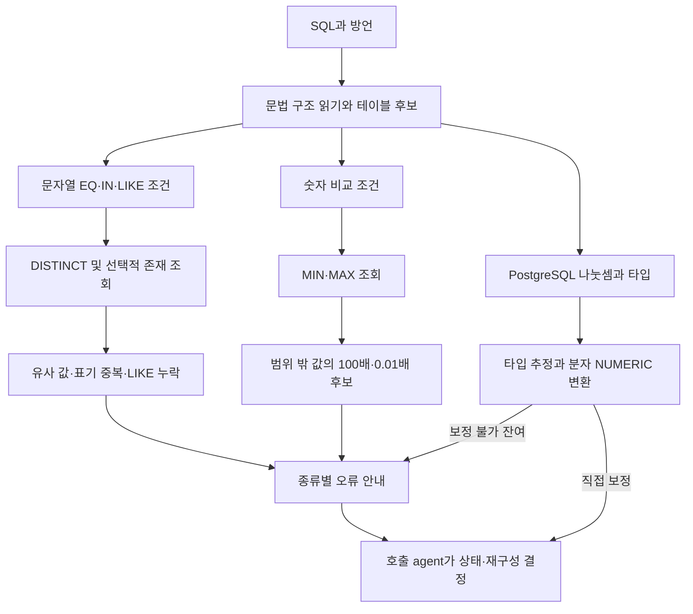
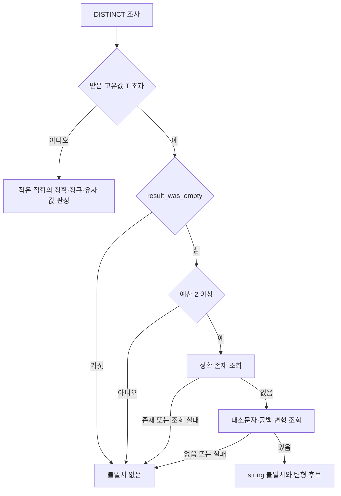
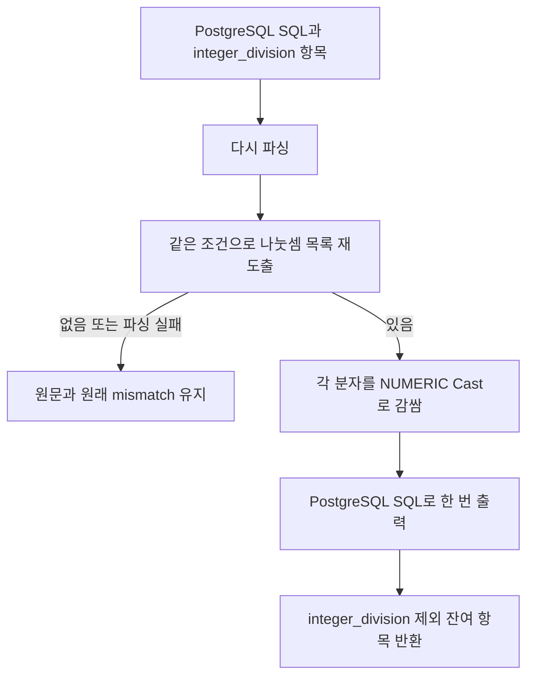

# Chapter 04-1. 저장 값·숫자 스케일·정수 나눗셈의 판정과 보정

- 분석일: 2026-11-14.
- 범위: `db_probe/literal_check.py`의 추출·원본 DB 조회·불일치 판정·직접 보정·오류 메시지와 관련 테스트의 정적 분석. 원본 코드 수정·실제 DB·모델·테스트 실행은 하지 않았다.
- 선행: [합성 precheck와 상태](chapter-04-combined-precheck-and-state.md), [probe 실행·예산·timeout](chapter-03-value-validation-and-probe.md).
- 용어집: [상세 용어집](../01-architecture/chapter-00-glossary.md)

| 용어 | 뜻·이 문서에서의 의미 |
|---|---|
| Literal | SQL에 직접 쓴 값이다. |
| Mismatch | 사용한 값·연산과 저장 데이터·타입 사이에서 발견한 불일치 항목이다. |
| Helper / 호출 agent | helper는 항목 목록을 반환하고, 호출 agent가 SQL 보정이나 재구성을 선택한다. |

## 1. 세 검사와 실제 호출자

| 함수 | 입력·주요 근거 | 반환 역할 |
|---|---|---|
| `find_literal_mismatches` | executor, 방언, SQL, `result_was_empty=False` | 저장 문자열의 유사 값·표기 중복·LIKE 누락 목록 |
| `find_numeric_scale_mismatches` | executor, 방언, SQL | 실제 MIN/MAX와 100배 후보를 비교한 숫자 규모 불일치 목록 |
| `find_integer_division_mismatches` | PostgreSQL 방언, SQL, known_types | 정수 나눗셈으로 판단한 `/` 목록. 원본 DB 조회 없음 |
| `try_self_apply_integer_division_fixes` | 위 mismatch와 SQL·타입 사전 | 보정 SQL과 아직 남은 mismatch |
| `build_value_repair_error` | 여러 종류 mismatch | 모델 재구성에 전달하는 종류별 오류 문자열 |

executor는 확인용 조회를 실행하며 예산·읽기 SQL·LIMIT·결과 잘림·timeout 전달을 담당하는 객체다. 방언은 DB별 SQL 문법이다. 이 장에서 SQLGlot은 SQL을 AST(Abstract Syntax Tree, 구문 트리)로 읽고 수정하는 라이브러리다.

실행 전 `ProactiveValueCheckAgent`는 한 executor에서 문자열 → 숫자 스케일 순서로 검사한 뒤, 관련 컬럼 타입을 이용한 정수 나눗셈 검사·직접 보정을 한다. 실행 후 `EmptyResultValueRepairAgent`는 결과가 비고 공유 flag가 허용할 때 문자열 검사에 `result_was_empty=True`를 전달하고 숫자 스케일 검사도 한다. 뒤쪽 caller는 정수 나눗셈 검사를 호출하지 않는다.

helper 파일의 “이미 SQL이 실행돼 이름이 유효하다”는 주석은 실행 전 caller까지의 보장으로 읽으면 안 된다. 이 파일은 실행 전·후 두 경로에서 재사용한다. 실패한 probe에서 불일치를 주장하지 않는 분기가 중요하다.

근거: [literal_check.py](../../../code/auto-ontology/auto_ontology/retrieval/text_to_sql/db_probe/literal_check.py), [실행 전 caller](../../../code/auto-ontology/auto_ontology/retrieval/text_to_sql/agents/proactive_value_check.py), [빈 결과 caller](../../../code/auto-ontology/auto_ontology/retrieval/text_to_sql/agents/empty_result_value_repair.py).

## 2. 조건 추출과 컬럼 소유 테이블 찾기

### 2.1 지원하는 SQL 모양

세 검출 함수는 파싱 예외·빈 트리·테이블 노드 없음에서 빈 목록을 반환한다. 빈 목록은 정보 부족·검사 범위 밖도 포함하므로 실제 값·타입이 맞다는 인증으로 해석하지 않는다.

문자열 EQ(등호)·IN은 비교 대상이 **직접 컬럼 노드**이고 값이 문자열 literal이어야 한다. `LOWER(status)='active'`처럼 함수를 감싼 컬럼은 이 추출기의 직접 컬럼 조건을 만족하지 않는다. 전체 구문 트리를 순회하므로 WHERE에만 한정하지 않는다.

LIKE는 `%`가 여러 글자, `_`가 한 글자를 나타내는 패턴 비교다. `_like_predicates`는 직접 컬럼과 문자열 패턴을 받으며 NOT wrapper 또는 `negate=True`를 명시적으로 제외한다. ILIKE는 이 LIKE 검사에서 다루지 않는다.

숫자는 `>`, `>=`, `<`, `<=`의 한쪽에 직접 컬럼, 다른 쪽에 직접 숫자 literal이 있어야 한다. 방향·연산자를 mismatch 데이터에 보존하지 않고 컬럼과 숫자의 크기만 모은다. `ABS(col)>0.15`, BETWEEN, 숫자 EQ 전체를 이 경로에서 검사하지 않는다.

### 2.2 주석보다 좁거나 넓은 추출 경계

- EQ·IN 추출은 조상 NOT 여부를 검사하지 않는다. “positive 조건만”이라는 주석과 달리 부정식 안의 해당 노드를 순회할 수 있다. 실제 parser 버전별 부정 구문 재현은 하지 않았다.
- 오른쪽 숫자 추출 결과와 왼쪽 결과를 Python `or`로 고른다. 오른쪽의 `0.0`은 거짓으로 평가되어 반대편 None으로 대체될 수 있다. 왼쪽 0은 마지막 값으로 남을 수 있어 양방향 0의 추출이 동일하다고 보장하지 않는다.
- 문자열 EQ도 같은 `or`를 사용하므로 빈 문자열 위치에 따라 같은 경계가 있다. IN 목록은 별도 순회다.
- 음수 등 별도 AST로 표현되는 값 전체를 float literal로 해석하는 함수는 아니다.

위 내용은 조건식에서 도출한 범위이며 실행한 회귀 테스트 결과가 아니다.

### 2.3 테이블 후보·별칭·조회 이름

`_table_nodes`는 SQL 전체의 테이블 노드를 수집하고 짧은 이름·alias(별칭)로 조회 사전을 만든다. 컬럼에 붙은 qualifier가 사전에 있으면 해당 테이블만, 없거나 qualifier를 못 찾으면 모든 테이블을 후보로 돌려준다. CTE(WITH 임시 이름)·하위 SELECT별로 독립된 이름 공간을 만드는 구현은 아니다.

probe의 FROM에는 원래 테이블 노드를 복사하되 alias를 제거하고, 컬럼에는 그 테이블 이름을 붙인다. 예를 들어 `set_translations AS st`의 `st.language`는 확인용 조회에서 `set_translations.language`로 바뀐다. 원래 schema·DB 접두어와 인용 표기는 테이블 노드 출력에 반영한다.

이 한정 이름은 잘못된 후보 테이블에 없는 컬럼을 SQLite가 인용 문자열로 받아들여 가짜 한 값처럼 보이는 문제를 피하려는 처리다. 후보가 여럿이면 **성공한 첫 값 집합 또는 첫 고유값 과다 후보**를 소유 테이블로 사용한다. 전체 SQL의 JOIN 조건·다른 WHERE 조건을 실행해 소유를 결정하지 않는다.

컬럼별 local cache 키는 `(소문자 짧은 테이블명, 소문자 컬럼명)`이다. schema·DB·alias 전체가 키가 아니므로 서로 다른 이름 공간의 동명 테이블·self JOIN은 정확히 구별되지 않을 수 있다. 이 cache는 해당 함수 호출 동안만 존재하며 다음 helper 호출·재구성까지 공유하지 않는다.

## 3. 조회 SQL·결과와 제한

아래 SQL은 `_probe_refs`의 한정·인용 결과를 `t`, `t.c`로 줄여 쓴 설명용 형식이다. 실제 생성 SQL 실행 기록은 아니다.

| 목적 | 생성 SQL 형태 | 반환 해석 |
|---|---|---|
| 고유값 조사 | `SELECT DISTINCT t.c AS value FROM t WHERE t.c IS NOT NULL LIMIT T+1` | 실패·0행이면 `(None, False)`. 받은 rows 길이가 T 초과면 `(None, True)`. 그 외 값을 문자열 목록으로 변환한다. |
| 정확 존재 | `SELECT 1 AS hit FROM t WHERE t.c = 'value' LIMIT 1` | 실패 None, 성공 rows 없음 False, 있음 True. |
| 대소문자·공백 변형 | `SELECT DISTINCT t.c AS value FROM t WHERE LOWER(TRIM(cast_ref)) = LOWER(TRIM('value')) LIMIT T` | 실패·0행이면 빈 목록, 성공하면 반환값 문자열 목록. PostgreSQL의 cast_ref는 `t.c::text`다. |
| 숫자 범위 | `SELECT MIN(t.c) AS lo, MAX(t.c) AS hi FROM t WHERE t.c IS NOT NULL` | 실패·0행·lo/hi float 변환 실패면 None, 그 외 `(float(lo), float(hi))`. |

DISTINCT는 중복을 제거하는 연산이다. cardinality는 서로 다른 값의 개수다. T는 `DB_PROBE_LOW_CARD_THRESHOLD`이며 기본 20, import 때 환경에서 읽는다. 따라서 기본 고유값 조회는 21개까지 받아 20개 이하면 작은 범주로, 21개면 전체 비교를 피해야 하는 컬럼으로 분류한다.

이 helper가 읽는 설정은 T다. 테이블·컬럼 8개 상수로 추출 목록을 자르는 코드는 이 파일에 없다. 순회 비용은 executor 예산으로도 제한되며 proactive caller의 기본 40회 예산은 문자열·숫자 범위 검사끼리 공유한다.

### 결과 잘림과 예산의 상호작용

고유값 과다 판정은 executor 결과의 `row_count`나 `truncated`가 아니라 **rows 목록 길이**를 사용한다. executor의 `max_rows`가 T+1보다 작으면 큰 값 집합도 작은 집합으로 판단할 수 있다. 기본 50과 T=20은 이 탐지에 충분하지만 설정을 바꾸면 같은 조건이 유지되는지는 별도 문제다.

`_resolve_distinct`와 숫자 후보 순회는 예산이 남았는지 **local cache 조회 전에** 확인한다. 예산이 0이면 이미 기억한 같은 컬럼 결과까지 재사용하지 못할 수 있다. 조회 실패·0행도 cache에 남으며 해당 함수 안에서는 같은 후보를 즉시 재조회하지 않는다.

MIN/MAX는 타입을 catalog에서 확인하지 않는다. DB가 반환한 두 결과를 float로 바꾸는 데 성공하면 사용한다. 실제 컬럼이 문자형 숫자이고 DB가 다른 순서로 MIN/MAX를 계산한 경우까지 올바른 숫자 분포라고 증명하지 않는다. 범위 집계의 전체 스캔 비용도 LIMIT가 자동으로 제한하는 것은 아니다.

## 4. 문자열 값 판정의 세 종류

### 4.1 작은 값 집합: 유사 값과 표기 중복

고유값 목록 actual을 얻으면 `str(value).strip().casefold()`로 정규화하고 같은 정규값의 저장 표기들을 묶는다. strip은 앞뒤 공백 제거, casefold는 대소문자 차이를 줄이는 변환이다.

| 사용 값과 actual 관계 | 실제 판정 |
|---|---|
| 사용 문자열이 actual에 정확히 있고 정규화 형제가 없음 | 불일치 없음 |
| 정확 일치가 있으며 대소문자·공백만 다른 다른 저장값도 있음 | `kind=case_duplicate`, 전체 siblings 목록과 방언 반환 |
| 정확 일치는 없지만 정규화 형제가 있음 | `kind=string`, 그 형제들을 suggested로 반환 |
| 위 형제가 없음 | 원래 문자열을 `difflib.get_close_matches`에 넣어 최대 3개, cutoff 0.6의 유사 값 선택 |
| 유사 후보도 없음 | 실제로 없는 값을 묻는 질문일 수 있어 불일치를 추가하지 않음 |

`difflib`는 Python의 문자열 유사도 계산 모듈이다. 이 경로는 정규화한 값이 아니라 원래 used와 actual에 유사도를 적용한다. 0.6은 편집 오류·의미 동일성을 증명하는 기준이 아니며, 후보를 최대 세 개로 줄이는 휴리스틱(경험적 판단 규칙)이다.

`case_duplicate`는 `Certified`와 `CERTIFIED` 같은 표기를 같은 업무 값으로 보도록 재구성을 유도한다. 실제 업무에서 대소문자가 다른 식별자를 구별해야 하는지 질문·데이터 사전과 대조하는 판단은 이 함수 안에 없다. DB의 collation(문자열 비교 규칙)과 Python의 정확 비교·casefold도 항상 같지는 않다.

### 4.2 큰 값 집합: 빈 결과가 있을 때만 개별 조회

고유값 과다인 경우 실행 전 기본 `result_was_empty=False`에서는 더 조회하지 않는다. 실행 후 빈 결과 caller가 True를 넘긴 경우에만 원래 값의 정확 존재 → 표기 변형 탐색 순서로 진행한다.

정확 존재를 보기 전 예산이 두 번 미만이면 그 항목을 시작하지 않는다. 정확 존재가 True이면 변형 조회를 하지 않으므로 그 큰 컬럼의 case_duplicate를 추가로 탐지하는 경로는 아니다. 변형을 찾으면 actual은 빈 목록이고 suggested만 채운다. 철자 유사도 탐색은 전체 집합이 없으므로 수행하지 않는다.

## 5. LIKE 누락 판정

LIKE는 같은 DISTINCT local cache를 재사용한다. 작은 actual 목록이 없으면 검사하지 않으며, 고유값 과다 컬럼의 LIKE에는 개별 패턴 probe를 추가하지 않는다.

`_sql_like_pattern_to_regex`는 패턴을 `^...$` 정규식으로 바꾸고 `%`를 `.*`, `_`를 `.`로 변환한다. 하나는 기본, 하나는 `re.IGNORECASE`로 만든 뒤 **대소문자를 무시하면 맞지만 기본 패턴에는 안 맞는 actual 값**을 missed로 모은다. missed가 있으면 `kind=case_duplicate_like`다.

실제 DB에서 LIKE를 실행해 두 결과를 비교하는 방식은 아니다. SQL ESCAPE 문자·DB별 collation·Unicode 비교·개행 매칭을 완전히 흉내 내지 않는다. 같은 소문자/대문자 집합이 별도로 있는지보다 정규식 두 결과의 차이를 본다.

오류 문자열은 이 유형에 LIKE를 ILIKE로 바꾸라고 지시한다. 방언별 대안 분기가 없으므로 ILIKE를 지원하지 않는 방언에도 같은 권고가 나갈 수 있다는 한계가 소스 주석에도 명시돼 있다. 이 문자열은 모델에게 주는 수리 지시이며 코드가 실제 SQL을 즉시 바꾸는 것은 아니다.

## 6. 숫자 스케일: 실제 범위와 100배 후보

숫자 조건을 모아 컬럼별 MIN/MAX를 조사하고, 성공한 첫 후보의 범위를 사용한다. range_cache는 앞의 DISTINCT cache와 별개이며 키 형태는 같은 짧은 테이블명·컬럼명이다.

| 조건 | 결과 |
|---|---|
| lo ≤ used ≤ hi | 이미 범위 안이므로 검사 종료 |
| 범위 밖이며 used×100이 범위 안 | 그 값을 suggested로 추가 |
| 위가 아니고 used×0.01이 범위 안 | 그 값을 suggested로 추가 |
| 두 배율 모두 범위 밖·조회 실패 | 불일치 없음 |

예를 들어 실제 `[0.1, 0.9]`에 used=60이면 0.6을 후보로 제안할 수 있다. 이는 설명용 예시이며 실행 기록이 아니다. 배율은 100 → 0.01 순서로 보고 첫 후보만 사용한다. 반환은 `kind=numeric_scale`, table·column·used·suggested·real_min·real_max다.

주석의 “범위에서 훨씬 벗어남”에 대한 추가 거리·비율 임계값은 없다. 범위 밖이고 위 후보가 안으로 들어오면 제안한다. 의도적으로 모두 선택·모두 제외하는 범위 밖 기준일 수도 있으므로 정답 보장은 아니다. 이 함수는 연산자 방향·사용자 질문·단위 metadata를 입력받지 않으며 **직접 숫자를 바꾸지 않는다**.

범위 실패·비숫자·키 정보 부족을 모델 재구성 오류로 억지 변환하지 않는다. 반대로 불일치가 없다는 반환도 원래 단위가 맞다는 인증은 아니다.

## 7. 정수 나눗셈의 타입 추정과 직접 보정

정수 나눗셈은 소수 부분이 잘리는 연산을 말한다. 이 helper는 방언이 정확히 `postgres`일 때만 동작한다. 관련 컬럼에서 받은 known_types를 사용하며 타입 조회용 원본 DB·catalog 호출을 새로 하지 않는다.

### 7.1 각 피연산자의 추정

피연산자는 `/`의 분자와 분모다. `_resolves_to_known_integer`는 다음 규칙으로 True·False·None(모름)을 반환한다.

- 식 자체가 `Count`면 True다.
- 그 밖에는 식 내부 Column 노드가 정확히 하나여야 한다. 0개 또는 여러 개면 None이다.
- 후보 테이블에서 첫 known type을 찾으면 그 이름이 integer·int2/4/8·bigint·smallint·serial 계열의 정확 목록에 있는지 반환한다.
- 알려진 타입이 없으면 None이다. 식 전체의 함수·산술·cast 결과 타입을 일반적으로 계산하지 않는다.

`_has_non_integer_cast`는 분자 또는 분모의 **내부**에서 Cast를 찾아 PostgreSQL 표기의 target에 numeric·decimal·float·double·real·money 등의 문자열이 포함되는지 확인한다. 하나라도 있으면 그 나눗셈을 제외한다. 나눗셈 바깥 결과에 붙은 cast는 이 내부 검사 범위가 아니다.

### 7.2 실제 True/False/None 조합

| 분자 추정 | 분모 추정 | 비정수 cast 없음일 때 |
|---|---|---|
| True | True 또는 None | 검출 |
| None | True | 검출 |
| False | 어떤 값이든 | 제외 |
| 어떤 값이든 | False | 제외 |
| None | None | 제외 |

따라서 “양쪽이 정수로 확정된 연산만”이라는 일부 주석보다 실제 조건이 넓다. 한쪽 Count와 다른 쪽 알 수 없는 식도 검출할 수 있다. 컬럼 하나가 포함된 함수·수식의 전체 타입을 그 컬럼 타입으로 대표할 수 있다는 추정 경계도 있다. 질문이 의도한 나눗셈인지, 0 나눗셈인지까지 판정하는 함수는 아니다.

### 7.3 AST 보정과 잔여 목록

직접 보정은 전달받은 numerator 텍스트를 위치별 치환하지 않고 현재 SQL에서 검출 조건을 다시 실행한다. 해당 분자에 `CAST(... AS NUMERIC)`을 붙인다. NUMERIC은 십진수를 표현하는 타입이다. 다른 종류 mismatch는 그대로 남겨 호출 agent가 재구성 판단에 쓰게 한다.

비PostgreSQL·정수 항목 없음·파싱 실패·다시 찾은 연산 없음이면 원문과 원래 목록을 유지한다. 정상 보정에서는 재도출한 전체 검출 나눗셈을 바꾸고 정수 종류 항목을 잔여에서 제외한다. 정확한 원래 오류 위치 집합과 새 위치의 일대일 대응 검사는 없다.

보정 helper 자체가 path_state를 저장하지 않는다. proactive agent가 반환 SQL을 두 저장 위치에 맞추고, 잔여가 있으면 오류를 만들며, 전부 고쳤으면 공유 flag를 설정하고 valid를 반환한다. 전체 의도 검사 재진입 유무와 flag 수명은 [Chapter 04](chapter-04-combined-precheck-and-state.md)의 계약을 따른다.

## 8. 재구성 오류·상태·저장 경계

`build_value_repair_error`는 아래 순서로 독립 section을 합친다. `kind`가 없으면 string으로 간주한다.

| 종류 | 모델에게 전달하는 근거·지시 |
|---|---|
| string | 사용 값 없음·저장 값 최대 20개·유사 후보. 질문에 맞는 저장 값만 바꾸라고 지시한다. |
| case_duplicate | 원래 값도 있지만 표기 형제가 있으므로 LOWER/TRIM 비교를 사용하도록 지시한다. PostgreSQL에서는 컬럼에 ::text를 보충한다. |
| case_duplicate_like | 놓치는 실제 값들과 ILIKE 변경 지시. 방언별 지원 검사는 이 문자열 생성에 없다. |
| numeric_scale | 실제 범위·100배 후보를 보여주되 확정 진단이 아니며 근거가 있을 때만 바꾸라고 지시한다. |
| integer_division | 남은 나눗셈과 분자/분모를 나눗셈 자체에서 cast하라는 지시. 보통 직접 보정 후 잔여가 없으면 이 section은 생성되지 않는다. |

문자열 section은 “쿼리가 매칭 행을 반환하지 않는다”고 단정하는 표현을 포함하지만 helper의 probe는 **각 컬럼이 있는 테이블을 따로 조회**한다. OR·NOT·여러 IN 값·JOIN을 포함한 최종 SQL 전체 결과가 실제로 빈지 항상 실행한 것은 아니다. 실행 전 caller에서도 이 메시지를 쓴다는 범위를 구분한다.

LIKE·표기 중복·스케일 안내는 조건이나 연산자를 바꿀 수 있는 재구성 지시다. [Chapter 03의 값만 치환하는 모델 기반 검사](chapter-03-value-validation-and-probe.md)와 변경 계약이 다르다. 여기서는 원본 SQL의 literal skeleton을 비교해 모델 재구성을 제한하는 절차가 helper 안에 없다.

확인한 저장 경계는 executor를 통한 원본 DB 읽기, helper 호출 동안의 local cache·오류 목록·SQL 문자열 생성이다. catalog·원본 DB 값·의미 모델을 저장하는 호출은 이 파일에 없다. 호출 agent의 error·known_fixable·공유 flag와 모델 재구성은 바깥 단계의 책임이다.

## 9. 관련 테스트와 확인 수준

[test_literal_check.py](../../../code/auto-ontology/auto_ontology/tests/test_literal_check.py)의 20개 테스트를 읽었다. 실제 ProbeExecutor를 사용하지만 connector는 순서대로 준비된 DataFrame을 반환하는 `_ScriptedConnector` 또는 특정 이름에서 실패하도록 한 대체 객체다. SQL을 실제 DB에서 실행해 검증한 테스트 결과로 읽으면 안 된다.

| 테스트 묶음 | 실제 assertion |
|---|---|
| `test_case_duplicate_flagged_when_literal_exact_matches_but_has_siblings`, `test_no_mismatch_when_exact_match_has_no_case_siblings` | 저장 표기 형제가 있을 때 종류·컬럼·사용 값·siblings, 없을 때 빈 목록 |
| `test_near_miss_reports_every_case_sibling_as_a_suggestion`, `test_dead_executor_reports_nothing` | 모든 정규 표기 형제가 suggested로 나오고 연결 없음에서 빈 목록 |
| `test_case_duplicate_mismatch_casts_to_text_on_postgres`, `test_case_duplicate_mismatch_has_no_cast_on_unrecognized_dialect` | 오류 문자열의 ::text·LOWER/TRIM 방언 표기 |
| LIKE 관련 5개 테스트 | missed 집합, ILIKE 제외, 놓칠 형제 없음, NOT LIKE 제외, 수리 문자열의 ILIKE |
| 고유값 과다 관련 5개 테스트 | 빈 결과 True에서 정확 부재→변형 후보, exact hit이면 총 2회, 변형 없으면 유지, 실행 전에는 DISTINCT 1회만, actual 빈 목록 메시지 |
| `test_probe_qualifies_column_and_drops_table_alias`, `test_unowned_candidate_table_does_not_shadow_the_real_one` | 실제 생성 probe의 테이블 한정·alias 제거와 실패한 후보 다음 테이블 조회 |
| 오류 렌더링 관련 나머지 테스트 | case_duplicate 안내와 string 안내의 분리, 다른 저장 표기·후보 표시 |

코드 전체의 `*test*.py` 검색에서 숫자 스케일 검사·정수 나눗셈 검출·직접 보정 함수를 이름으로 직접 호출하는 테스트는 찾지 못했다. 0·빈 문자열 방향 차이, NOT EQ/IN, schema·CTE 충돌, executor 잘림과 T 조합, 타입 unknown 조합·함수 결과 추정의 재현도 이 작업에서는 하지 않았다.

## 10. 사실·추론·다음 시작점

확인한 사실은 추출 조건·조회 SQL·cache 키·예산 검사 위치·문자열 비교·두 배율·타입 조합·보정·오류 반환이다. False/None 처리의 정확성 경계·이름 충돌·표본 잘림·실제 업무 의미 오판 가능성은 코드에서 도출한 추론이며 발생 빈도나 실제 정답률을 측정한 결과가 아니다.

실제 DB 버전·문자열 비교 규칙·query plan 비용·모델의 지시 이행·수리 SQL 정확성·graph 통합·Mermaid 렌더링은 미검증이다. 테스트는 assertion을 읽었으며 실행하지 않았다.

후속 [Chapter 04-2](chapter-04-2-join-path-overlap-and-repair.md)에서 JOIN 경로·겹침·직접 보정을, [Chapter 04-3](chapter-04-3-jsonb-key-path-validation.md)에서 JSONB 키·타입·보정을 추적했다. [세부 계획](../../../.codex/plan/auto-ontology/01-9-3_combined-prechecks.md)의 예정 정적 분석은 완료이며 재구성·실행·빈 결과 후처리는 계속 후속 범위다.
