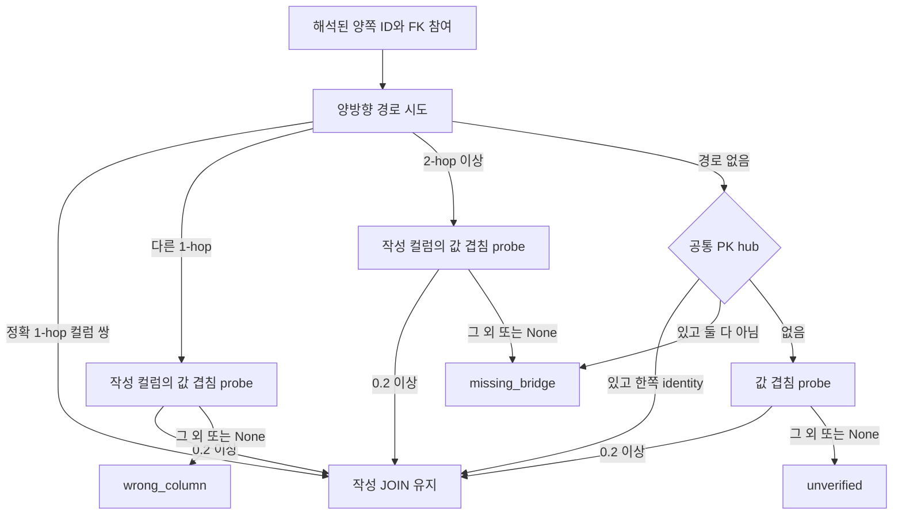
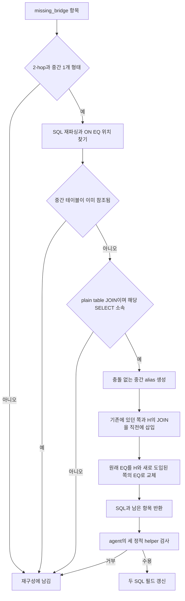
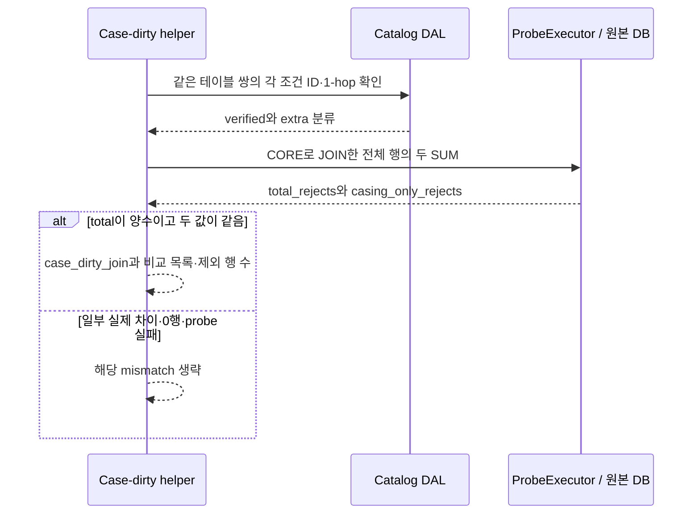

# Chapter 04-2. JOIN 경로·값 겹침·컬럼과 중간 테이블 보정

- 분석일: 2026-11-14.
- 범위: `db_probe/join_path_check.py` 전체와 실제 경로 DAL(Data Access Layer, 저장소 조회 계층), 관련 테스트의 정적 분석. 원본 수정·실제 DB·모델·테스트 실행은 하지 않았다.
- 선행: [합성 검사와 agent 계약](chapter-04-combined-precheck-and-state.md), [probe 실행 경계](chapter-03-value-validation-and-probe.md), [컬럼 소유 후보 helper](chapter-04-1-literal-scale-and-division-checks.md).
- 용어집: [상세 용어집](../01-architecture/chapter-00-glossary.md)

| 용어 | 뜻·이 문서에서의 의미 |
|---|---|
| JOIN | 여러 테이블의 행을 조건으로 연결하는 SQL 연산이다. |
| Hop | 경로에서 테이블 사이 연결 한 번이다. |
| Bridge | 직접 연결 대신 거치는 중간 테이블이다. |
| Hub | 여러 테이블이 참조하는 공통 중심 테이블이다. |

## 1. 두 검사와 반환 계약

`JoinPathCheckAgent`는 한 executor에서 먼저 `find_join_path_mismatches`, 다음 `find_case_dirty_join_mismatches`를 호출한다. executor는 원본 DB 확인용 SQL을 실행하는 객체다. 앞 함수는 연결 컬럼·경로가 맞는지, 뒤 함수는 확인된 연결에 추가한 비교 조건이 대소문자·공백 때문에 행을 놓치는지 본다.

| 함수·반환 | 의미 |
|---|---|
| `wrong_column` | 같은 테이블 사이에 알려진 다른 1-hop 컬럼 쌍이 있으며 사용한 연결을 유지할 값 겹침 근거가 부족함 |
| `missing_bridge` | 여러 hop 또는 공통 hub 경로로 바꿀 후보 |
| `unverified` | 알려진 경로·hub가 없고 값 겹침으로도 유지하지 못한 연결. 정답 보정 경로는 없음 |
| `case_dirty_join` | 확인된 컬럼 쌍으로 연결되는 행 중 추가 조건이 제외한 행을 정규화하면 모두 다시 맞는 것으로 집계됨 |
| 빈 목록 | 검사 대상 제외·정보 미해결·일부 실패·문제 미검출 등. 전체 SQL 정확성 인증은 아님 |

경로 mismatch의 공통 필드는 `table_a`, `col_a`, `table_b`, `col_b`, `verdict`, `hops`, `bridge_tables`다. unverified에는 `overlap`도 붙고 값이 None일 수 있다. 각 항목은 별도의 오류 설명이나 직접 보정의 입력이 된다.

근거: [JOIN helper](../../../code/auto-ontology/auto_ontology/retrieval/text_to_sql/db_probe/join_path_check.py), [JOIN agent](../../../code/auto-ontology/auto_ontology/retrieval/text_to_sql/agents/join_path_check.py).

## 2. ON·WHERE·상관 하위 쿼리의 실제 추출

SQLGlot은 SQL을 AST(Abstract Syntax Tree, 구문 트리)로 분석하는 라이브러리다. `_join_equalities`는 다음 두 위치에서 양쪽이 직접 Column인 EQ(등호) 노드를 찾는다.

- 모든 `JOIN ... ON` 내부.
- 모든 WHERE 내부. 암시적 `FROM a,b WHERE a.x=b.y`와 외부 컬럼을 참조하는 상관 하위 쿼리 WHERE도 포함한다.

파일 처음의 “ON 조건만”이라는 주석보다 실제 추출 범위가 넓다. 함수·cast로 감싼 비교, 범위 JOIN, USING 전체를 동일하게 검사하는 추출기는 아니다. OR·NOT 안의 EQ를 그 논리적 의미와 함께 별도 분류하는 조건도 없다. 중첩 WHERE가 여러 조상 순회에 걸리는 경우까지 구조별 중복 방지를 하는 함수는 아니며, 경로 검사 쪽의 별도 checked_pairs가 중복을 줄인다.

테이블과 alias(별칭)는 SQL 전체를 순회하는 공통 `_table_nodes`로 찾는다. `_resolve_table_name`은 컬럼 후보가 정확히 한 테이블로 좁혀졌을 때만 짧은 테이블명을 반환한다. 모호하면 생략하고, 두 쪽이 같은 짧은 테이블명인 self JOIN도 생략한다. 하위 SELECT별 독립 이름 공간·schema별 동명 구별은 이 helper에 없다.

경로 검사는 양쪽 `(소문자 테이블명, 소문자 컬럼명)` 쌍을 정렬해 방향과 반복을 제거한다. 같은 쌍이 다른 alias·조건 위치에서 반복되면 하나의 항목으로 합쳐질 수 있다. 뒤의 직접 보정이 실제 발생 위치 전체를 고치는지와는 별도 계약이다.

## 3. catalog ID와 의미 관계 참여

semantic FK는 컬럼이 다른 컬럼의 의미 속성을 참조하는 프로젝트 내부 관계다. FK(Foreign Key, 외래 키)는 다른 테이블 행을 참조하는 키라는 뜻이다. 컬럼의 소유 속성과 참조 관계를 catalog에서 읽어 테이블 연결로 바꾼다.

먼저 `find_column_id_by_table_and_name(table, column, database_name)`로 양쪽 ID(식별자)를 찾는다. table·column은 대소문자를 무시하고, database_name은 값이 있으면 일치 범위를 제한한다. schema 인수는 없다. DB를 지정하면 LIMIT 1, 없으면 최대 2행을 보고 복수 매칭이면 미해결로 반환한다. 같은 DB 내 동명 schema·테이블의 첫 일치 문제는 남는다.

양쪽 ID가 모두 있어야 진행한다. 그다음 적어도 한쪽 `column_participates_in_semantic_fk`가 True여야 한다. 이 DAL은 컬럼의 직접 참조 관계 또는 소유 속성으로 들어오는 참조가 있는지 EXISTS(행 존재 검사)로 확인한다.

참여 확인은 `use_in_join_paths=True`를 필터링하지 않는다. 경로용으로 선택되지 않은 관계도 “의미 FK 모양의 컬럼인가”라는 진입 조건에는 영향을 줄 수 있다. 반면 실제 경로 조회는 선택 flag를 적용한다. 따라서 참여 True와 사용할 경로 있음은 다르다.

이름 미해결·양쪽 참여 False면 probe까지 가지 않고 그 비교를 생략한다. catalog 조회의 예외 전부를 여기서 빈 목록으로 바꾸는 것은 아니며, 개별 DAL과 바깥 agent의 예외 경계를 따른다.

근거: [datasources DAL](../../../code/auto-ontology/auto_ontology/dal/datasources.py)의 `find_column_id_by_table_and_name`, [attributes DAL](../../../code/auto-ontology/auto_ontology/dal/attributes.py)의 `column_participates_in_semantic_fk`.

## 4. 실제 경로 탐색: 방향 재시도와 테이블 BFS

`_find_join_path_either_direction`은 `find_join_path(a,b)`가 비었을 때만 `find_join_path(b,a)`를 시도한다. 역순에서 찾은 hops를 여기서 다시 반전시키지 않고 그대로 반환한다. 첫 방향에서 찾은 경로보다 두 번째 방향 경로가 짧거나 적합한지 비교하지도 않는다.

### 4.1 현재 DAL은 컬럼 정방향만 걷지 않는다

helper 주석은 “정방향 SEMANTIC_FK만 따라가므로 반대 순서 재시도가 필요”하다고 설명하지만 현재 `find_join_path`는 **입력 컬럼이 속한 두 테이블**을 연결한다. 입력 컬럼 자체가 실제 JOIN 키일 필요는 없다.

1. `fetch_col_table_contexts`로 endpoint 테이블·DB를 얻는다. 누락·같은 테이블·다른 DB면 빈 경로다.
2. `_find_table_join_hops`가 해당 DB의 선택된 semantic FK와 속성 소유 관계를 한 번 조회한다.
3. 참조 컬럼의 테이블 → 소유 컬럼의 테이블 방향 edge를 추가한다.
4. 소유 컬럼 이름이 소유 테이블의 PK(Primary Key, 기본 키) 목록에 포함되면 역방향 edge도 추가한다.
5. 테이블 단위 BFS(Breadth-First Search, 가까운 이웃부터 탐색)를 수행하며 실제 양쪽 컬럼 ID를 각 edge에 유지한다.
6. 찾은 컬럼 쌍의 이름·schema·DB를 보충해 hops를 반환한다.

`MAX_PATH_DEPTH=30`을 `(30+2)//4`로 환산하므로 기본 테이블 경로 상한은 8-hop이다. parents 사전으로 이미 방문한 테이블을 다시 확장하지 않아 순환을 막는다. 인접 edge는 ID tuple 순서로 정렬하며 같은 길이의 여러 경로 중 먼저 찾은 하나를 사용한다. 질문 적합성이나 실제 값 겹침으로 경로 순위를 매기지는 않는다.

역방향 허용 조건은 복합 PK 전체의 유일성을 검사하는 방식이 아니라 **해당 컬럼 이름이 PK 배열의 한 원소인가**다. 또한 이 경로 투영은 선택된 semantic FK/owner 관계를 사용하며 DB의 선언 FK 전체를 별도 합집합으로 넣는 함수는 아니다.

### 4.2 공통 hub fallback

양방향 경로가 없으면 `find_shared_hub_bridge`를 호출한다. 두 컬럼의 선택된 semantic FK가 **같은 속성 ID**를 가리키고, 그 속성의 소유 컬럼이 hub의 선언 PK 목록에 포함돼야 한다. LIMIT 1이며 반환은 schema 없는 `hub_table`, `hub_column`이다. 조회 실패는 `{}`로 바꾼다.

hub를 찾으면 두 쪽의 PK·관찰 unique 목록도 읽는다. 어느 한쪽 컬럼이라도 개별 목록에 포함되면 직접 연결을 유지한다. 둘 다 아니면 표본 겹침을 조회하지 않고 두 개의 hub향 hop으로 missing_bridge를 만든다. 이 키 검사는 복합 PK 조합 전체를 검증하지 않는다.

현재 테이블 BFS도 PK owner 역방향을 허용하므로 주석의 “hub는 일반 경로로 절대 찾을 수 없음”을 현재 구현의 보장으로 사용하지 않는다. hub fallback은 여전히 호출 코드에 남아 있으며 경로 없음·한도·오류 등의 실제 조건에서 어떤 빈도로 도달하는지는 미검증이다.

근거: [attributes DAL](../../../code/auto-ontology/auto_ontology/dal/attributes.py)의 `_SEMANTIC_TABLE_EDGES`, `_find_table_join_hops`, `find_join_path`, `find_shared_hub_bridge`, [키 조회](../../../code/auto-ontology/auto_ontology/dal/datasources.py)의 `find_table_key_columns`.

## 5. 원본 값 겹침 probe와 세 판정

값 겹침은 “왼쪽의 서로 다른 비NULL 값 중 오른쪽에도 있는 비율”이다. NULL은 값 없음이다. `_value_overlap`이 보내는 SQL은 아래 형태다. 인용은 선택 방언으로 렌더링하며, 설명용 A/B/c/d 표기다.

```sql
SELECT COUNT(DISTINCT a.c) AS total,
       COUNT(DISTINCT CASE WHEN b.d IS NOT NULL THEN a.c END) AS matched
FROM A a LEFT JOIN B b ON a.c = b.d
WHERE a.c IS NOT NULL
```

실제 helper는 테이블·컬럼을 강제 인용한다. 그러나 입력 이름은 SQL에서 얻은 짧은 이름이며, catalog의 정확한 철자로 다시 치환한 결과를 넘기는 코드가 아니다. 이름 조회가 대소문자 무시로 성공했어도 probe가 동일한 이유로 성공한다고 보장하지 않는다. schema·DB 접두어도 이 SQL에는 전달되지 않는다.

성공하고 total이 0이 아니면 `matched/total`, 실행 실패·0행·total=0이면 None이다. 비율이 **0.2 이상**이면 작성된 JOIN을 유지한다. 이는 중복 행 수 비율도, 질문 정답률도 아니다. 원본 SQL의 WHERE·다른 JOIN 조건을 적용하지 않으며 두 컬럼 전체 집계다. executor의 LIMIT는 집계 결과 행을 제한할 뿐 원본 집계 비용을 작게 만드는 표본 SQL은 아니다.

정방향 probe가 None일 때만 반대로 조회한다. 0.05처럼 낮지만 유효한 비율이면 반대 방향은 보지 않는다. 따라서 SQL에서 양쪽을 바꿔 쓰면 분모가 달라 판정이 달라질 수 있다. 역순 실행 전 추가 예산 검사를 별도로 하지 않지만 executor가 예산 소진 오류를 반환한다.



| 경로 상황 | overlap 낮음·None의 결과 |
|---|---|
| 알려진 다른 직접 컬럼 쌍 | wrong_column과 그 hop 반환 |
| 알려진 여러 hop | missing_bridge와 중간 테이블 이름 반환 |
| 경로·hub 없음 | unverified, 빈 hops·bridge와 overlap 반환 |

파일의 “probe를 못 돌리면 확인된 오류 없음”이라는 설명과 달리 **None도 위 mismatch 생성 조건**으로 내려간다. 특히 unverified 오류 메시지는 실제 값이 거의 겹치지 않는다고 표현하지만 overlap=None일 수도 있다. 조회 실패·권한·예산 부족과 관찰된 낮은 겹침을 구분해 해석해야 한다. 0.2라는 경험적 기준도 관계의 의미나 식별자 역할을 증명하지 않는다.

## 6. 잘못된 컬럼의 직접 교체

`try_self_apply_wrong_column_fixes`는 verdict가 wrong_column이고 hops가 있는 항목만 대상으로 삼는다. SQL을 다시 파싱하고 ON·WHERE EQ에서 `(테이블, 원래 컬럼)`의 양쪽 집합이 일치하는 위치를 찾는다. table_a/table_b의 순서는 상관없다.

첫 hop의 실제 컬럼 이름으로 양쪽 Column을 고치며 기존 alias·기존 인용 flag는 유지한다. helper는 필요한 인용을 새롭게 추론해 전부 붙이지 않는다. 적용한 mismatch의 객체 ID를 applied에 넣고 SQL을 선택 방언으로 출력한다.

한 mismatch는 첫 일치 위치에서 적용된 뒤 더 적용하지 않는다. 검출 단계에서 같은 쌍의 반복을 합친 경우 다른 위치의 같은 잘못된 비교까지 반드시 고친다는 보장은 없다. applied 항목은 잔여에서 제거하며 전체 SQL을 다시 진단하는 호출은 이 함수 안에 없다. 이 반복 위치 경계는 코드로부터 도출했고 재현하지 않았다.

## 7. bridge 직접 삽입의 AST 변경

### 7.1 허용하는 두 모양

- hub 모양: `A → H ← B`. 두 hop의 source는 양 끝 테이블이고 target은 같은 H다.
- chain 모양: `A → H → B` 또는 반대 끝에서 시작하는 같은 순서 체인. 두 번째 hop을 반전해 양 끝에서 H로 향하는 형식으로 정규화한다.

두 모양 모두 hops가 정확히 2개, bridge_tables가 정확히 1개여야 한다. chain recognizer는 hop 순서·양 끝 테이블 집합·중간 테이블을 확인한다. 두 hop의 hub쪽 컬럼이 항상 같은 컬럼이어야 한다는 일반 조건은 없다.

### 7.2 삽입과 기존 ON 조건 유지



변경 위치는 명시적인 JOIN ON 안이어야 한다. WHERE 암시적 JOIN은 검출되더라도 이 삽입 경로에서 고치지 않는다. JOIN 대상이 하위 쿼리이면 생략한다. 중간 테이블의 짧은 이름이 SQL 어디에라도 이미 있으면 재사용 여부를 추측하지 않고 남긴다.

기존 JOIN이 지금 도입하는 테이블을 `join.this`로 알아내고 반대편을 이미 범위에 있는 테이블로 취급한다. 중간 alias는 테이블명의 영숫자 앞 세 글자를 소문자로 만들고, 충돌하면 2·3 등을 붙인다. 이름이 비면 hub를 쓴다.

기존 쪽 컬럼을 실제 hop source로 고친 뒤 새 중간 JOIN을 현재 JOIN 바로 앞에 넣는다. 원래 비교의 한쪽을 hub alias·대응 target 컬럼으로 바꾸고, 도입된 쪽은 그 쪽 hop의 source 컬럼으로 바꾼다. ON의 다른 조건·기존 JOIN 종류를 통째로 재생성하지 않고 해당 Column들을 수정한다.

삽입하는 새 JOIN은 `SELECT 1 FROM x JOIN H ...` 템플릿을 파싱해 가져온 **기본 JOIN**이다. 원래 outer JOIN 종류를 새 JOIN에 맞춰 복사하는 분기는 없다. LEFT/RIGHT/FULL 연결의 NULL 보존 의미까지 증명한 수정은 아니다.

hub 테이블·새 hub쪽 컬럼은 강제 인용하지만 테이블 SQL은 hub의 짧은 이름만 사용한다. hop에 있던 schema·DB 이름으로 새 테이블을 한정하지 않는다. 기존 비교 컬럼은 원래 인용 flag를 따른다.

### 7.3 후보 수용과 실패 경계

helper는 적용한 항목을 잔여에서 뺀 SQL을 반환한다. agent가 이어 무의미 SQL·무효 집계·집계 누락 helper를 적용해 거부 이유가 없을 때만 채택한다. 무효 집계는 별도 설정에 따라 비활성일 수 있다. 전체 catalog parse·의도 모델·실행 결과 비교를 다시 수행하는 절차는 아니다.

새 JOIN을 만드는 try에 들어가기 전에 기존 컬럼을 AST에서 바꾸는 순서도 있다. 후보 생성 실패 시 그 변경을 위치별로 되돌리는 처리는 없다. 적용이 전혀 없으면 원문 문자열로 돌아가지만, 다른 항목이 적용된 뒤 출력되면 중간 변경이 함께 나갈 수 있는 경계는 미재현으로 남긴다.

직접 보정과 agent의 경로·관련 테이블 보충, 두 SQL 필드 갱신·카운터·다음 전체 검증 미재진입은 [Chapter 04](chapter-04-combined-precheck-and-state.md)의 상태 계약을 따른다. 올바른 graph 경로가 질문이 요구한 관계·집계 단위까지 보장하지는 않는다.

## 8. case-dirty: 확인된 연결에 붙은 추가 조건 검사

case-dirty는 대소문자·앞뒤 공백 차이 때문에 추가 동등 조건이 매칭 행을 놓치는 문제다. `_group_join_equalities_by_table_pair`는 ON·WHERE에서 모은 비교들을 짧은 테이블 쌍 기준으로 그룹화한다. 두 개 미만이거나 executor 예산이 없으면 건너뛴다.

`_is_verified_edge`가 ID·양방향 경로를 조회하고 정확한 1-hop 컬럼 쌍인지 확인한다. verified가 하나 이상이고, 나머지 extra도 있어야 probe를 수행한다. 모든 조건이 알려져 있거나 전부 모르면 추가 비교를 검증할 기준이 없어 생략한다. 같은 table pair의 별도 alias·하위 SELECT·OR 비교들을 독립 JOIN 문맥으로 나누는 그룹은 아니다.

### 8.1 실제로 세는 두 개의 합계

다음은 생성 SQL의 설명용 형태다. CORE는 verified 비교들을 AND로 연결한 식, EXTRA는 extra의 원래 비교들을 AND로 연결한 식, NORM은 extra 양쪽을 `LOWER(TRIM(...))`으로 바꾼 AND다.

```sql
SELECT SUM(CASE WHEN NOT (EXTRA) THEN 1 ELSE 0 END) AS total_rejects,
       SUM(CASE WHEN NOT (EXTRA) AND (NORM) THEN 1 ELSE 0 END) AS casing_only_rejects
FROM A a JOIN B b ON CORE
```



두 값이 같고 양수일 때만 mismatch를 만든다. 예를 들어 13/13이면 후보, 13/8 또는 0/0이면 조용히 지나간다. 이는 설명용 수치이며 테스트 fixture에도 같은 수치가 사용된다. 원래 질문의 WHERE·나머지 JOIN·출력은 적용하지 않고 두 테이블을 재구성한 probe다.

SQL의 NULL 비교에서 UNKNOWN이 된 EXTRA는 `NOT(EXTRA)`도 참이 아닐 수 있어 이 집계의 “제외 행” 전체에 포함되지 않는다. 실제 제외 행 모두를 NULL까지 포괄해 검사했다고 확대하지 않는다. 여러 extra는 함께 정규화했을 때의 합계로 비교한다.

이 probe는 겹침 probe와 달리 이름을 강제 인용하지 않으며 schema도 전달하지 않는다. `LOWER/TRIM` 전에 비문자 타입을 text로 바꾸는 방언 분기도 없다. 지원 타입·대소문자 식별자·DB 비교 규칙으로 실패하면 None으로 생략할 수 있다.

반환은 `table_a`, `table_b`, `verified_columns`, `extra_columns`, `rejected_rows`, `verdict=case_dirty_join`이다. agent는 이 목록을 직접 정규화하지 않고 재구성 오류 안내로 전달한다.

## 9. 오류 안내·조회·상태·실패 계약

| 오류 안내 | 재구성에 주는 수정 범위 |
|---|---|
| wrong_column | 실제 1-hop 키 쌍을 제시하고 해당 JOIN만 수정 |
| missing_bridge | 중간 테이블·각 hop을 제시하고 그 경로 사용 |
| unverified | 이미 범위 안에 필요한 값이 있는지 먼저 보고, 필요하면 JOIN 삭제·값 공급 테이블/컬럼 변경도 허용 |
| case_dirty_join | 추가 비교 양쪽에 LOWER/TRIM을 적용하되 조건을 삭제하지 말라고 지시 |

앞의 세 종류 오류를 만드는 함수는 실제 경로·probe의 확실성보다 강한 표현을 사용할 수 있다. 특히 None 겹침도 “실제 값이 거의 겹치지 않음” 안내를 받을 수 있다. 코드가 반환한 증거와 모델에게 보여주는 문장 강도를 나눠 기록한다.

조회 경계는 catalog의 컬럼·의미 FK·선택 edge·소유·PK/unique 조회와, executor를 통한 원본 두 테이블의 집계다. BFS 메모리 구조·mismatch 목록·후보 SQL을 만들지만 catalog·의미 관계·원본 DB 값을 쓰지 않는다. 모델 호출도 helper에 없다.

executor 예산은 원본 DB query 횟수이며 catalog의 경로·ID 조회 횟수를 제한하지 않는다. 두 검사 사이에는 executor만 공유하고 경로 조회 cache를 공유하는 코드가 없다. 같은 테이블 비교마다 DB 전체 의미 edge를 읽는 경로 호출이 반복될 수 있다. `_find_table_join_hops` 한 번의 edge 조회가 1회인 것과 JOIN 검사 전체가 1회 조회라는 것은 다르다.

구문 파싱 오류는 해당 검출 함수에서 빈 목록으로 처리한다. `find_join_path`의 edge 탐색 예외·hub 조회 예외는 빈 결과를 만들지만 endpoint·이름 보충·참여 조회 예외 전체가 같은 try에 들어 있지는 않다. 원본 실행 실패는 executor 오류 entry, 정상 형식이 아닌 집계 값의 일부 연산 예외는 바깥 agent까지 전파될 수 있다. soft 상한·카운터·공유 flag의 처리는 합성 노드 계약을 따른다.

## 10. 테스트 근거와 미확인 사항

[test_case_dirty_join_check.py](../../../code/auto-ontology/auto_ontology/tests/test_case_dirty_join_check.py)의 7개 테스트를 읽었다. 컬럼 ID·경로 조회를 mock으로 대체하고 connector는 정해진 DataFrame을 반환한다. 실제 DB에서 위 COUNT/SUM SQL을 실행한 검증 결과는 아니다.

| 테스트 | assertion 범위 |
|---|---|
| `test_flagged_when_every_rejected_row_is_casing_only` | 13/13에서 verdict·제외 수·verified/extra 문자열 |
| `test_not_flagged_when_some_rejected_rows_differ_for_real` | 13/8에서 빈 목록 |
| `test_not_flagged_when_extra_predicate_rejects_nothing` | 0/0에서 빈 목록 |
| `test_not_flagged_when_no_predicate_is_graph_verified` | verified 없음에서 빈 목록 |
| `test_not_flagged_with_a_single_join_predicate` | 비교 하나면 빈 목록 |
| `test_dead_executor_reports_nothing` | case-dirty probe 실행 불가에서 빈 목록. 경로 검사의 None→unverified 동작과 다름 |
| `test_build_case_dirty_join_repair_error_renders_expected_content` | 행 수·문제 비교·LOWER/TRIM·조건 삭제 금지 안내 |

[DAL 경로 테스트](../../../code/auto-ontology/auto_ontology/dal/tests/test_attributes.py)에서는 실제 catalog schema를 필요로 하는 fixture와 assertion을 읽었다. `POSTGRES_USER`·schema 접근이 없으면 skip하는 구성이고 이 작업에서는 실행하지 않았다. 다음 테스트들이 현재 구현 경계를 뒷받침한다.

- `test_a_two_column_join_is_one_hop`, `test_join_path_uses_only_the_selected_parallel_semantic_fk`: hop의 실제 이름·선택 edge.
- `test_two_referencing_tables_join_through_the_attribute_owner`, `test_sibling_fks_do_not_join_through_a_non_identity_shared_attribute`: PK owner를 통한 형제 연결과 비identity 공유 속성 차단.
- `test_join_path_is_oriented_from_anchor_table_in_both_directions`, `test_endpoints_are_tables_to_connect_not_required_join_columns`, `test_path_can_enter_and_leave_an_intermediate_fk_table`: 양방향·입력 컬럼과 실제 JOIN 키 분리·중간 테이블 진출입.
- `test_a_multi_hop_path_pairs_its_columns_correctly`, `test_a_cycle_terminates`, `test_the_depth_bound_is_enforced`: hop 쌍·순환 종료·깊이 상한.
- `test_find_table_join_hops_queries_once_regardless_of_fan_out`: 내부 edge 조회에서 store 호출 1회. 외부 전체 경로 이름 보충 조회까지 1회라고 주장하는 assertion은 아니다.
- shared hub 관련 6개 테스트: 같은 PK 속성·입력 순서·비선택 edge 제외·같은 컬럼·비PK·서로 다른 속성 제외.

로컬 `*test*.py` 검색에서 `find_join_path_mismatches`, 두 직접 보정 함수, `_value_overlap`를 이름으로 직접 호출하는 테스트는 찾지 못했다. helper 주석의 실험 성공 사례를 이번 테스트 실행 증거로 사용하지 않는다.

## 11. 사실·추론·다음 시작점

확인한 사실은 현재 소스의 추출 범위·DAL 방향 규칙·BFS·겹침 식·0.2 분기·None 거부·직접 AST 변경·집계·오류 메시지다. 반복 위치 보정 누락 가능성·partial AST 변경·outer JOIN 의미·schema 이름 충돌·NULL 집계·질문과 다른 경로 선택은 코드로부터 도출한 경계이며 실제 실패 재현 결과가 아니다.

실제 DB 권한·문자열/타입·대용량 비용·통합 graph·모델의 수리 정확성·카운터/캐시 수명 전체와 Mermaid 렌더링은 미검증이다. 원본 코드와 AGENTS.md는 이번 분석에서 수정하지 않았다.

후속 [Chapter 04-3](chapter-04-3-jsonb-key-path-validation.md)에서 JSONB 키·컨테이너의 조회·판정·직접 보정·관련 테스트를 추적했다. [세부 계획](../../../.codex/plan/auto-ontology/01-9-3_combined-prechecks.md)의 예정 정적 분석은 완료이며 재구성·실행·빈 결과 후처리는 다음 09단계 작업이다.
