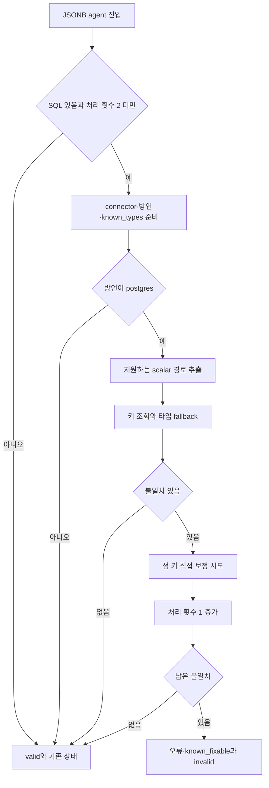
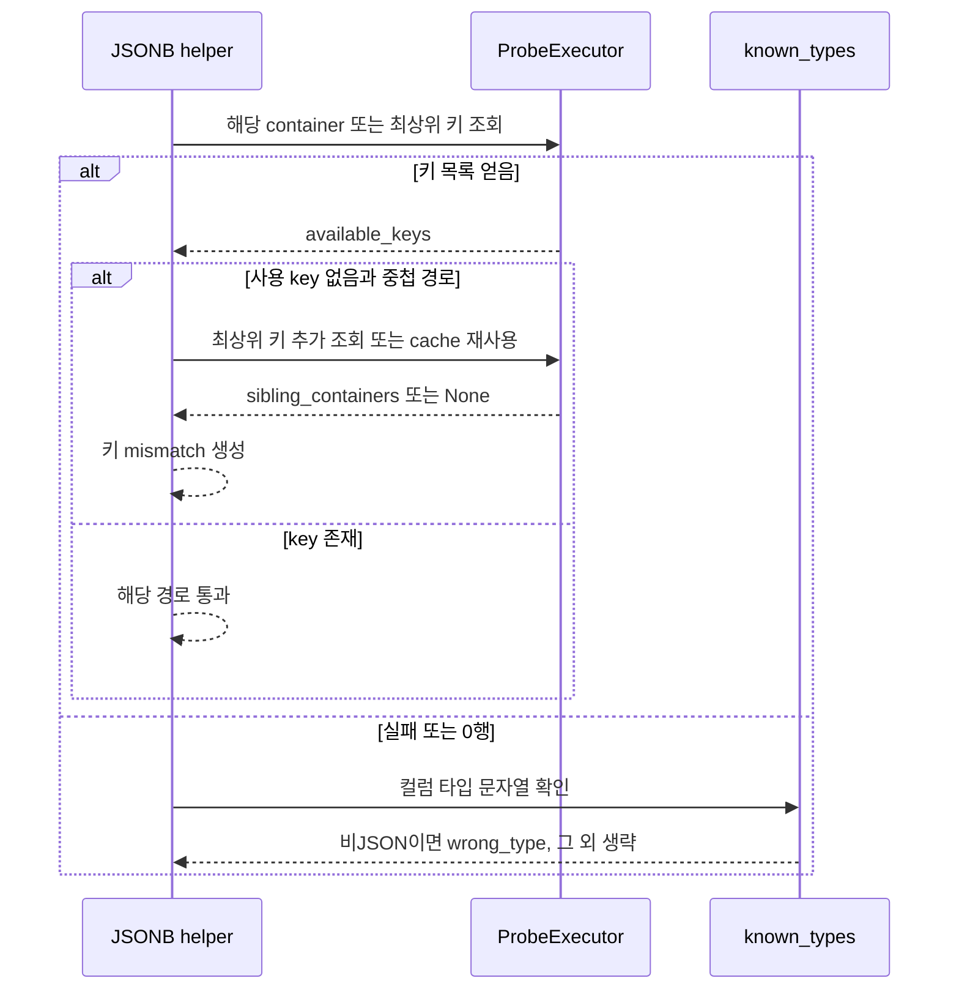
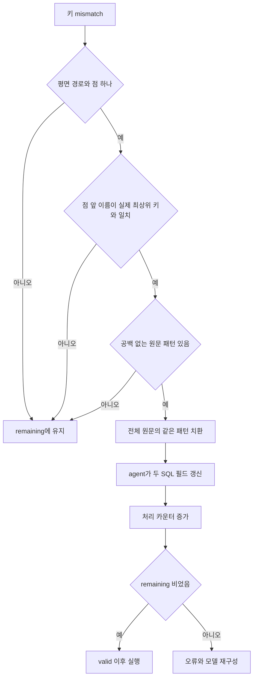

# Chapter 04-3. JSONB 키·컨테이너 조회와 중첩 경로 보정

- 분석일: 2026-11-14.
- 범위: `db_probe/jsonb_path_check.py`, JSONB agent·공통 probe·관련 테스트의 정적 분석. 실제 DB·모델·테스트는 실행하지 않았다.
- 선행: [합성 검사와 상태](chapter-04-combined-precheck-and-state.md), [probe 실행 계약](chapter-03-value-validation-and-probe.md), [JOIN 검사와 JSONB 실행 순서](chapter-04-2-join-path-overlap-and-repair.md).
- 용어집: [상세 용어집](../01-architecture/chapter-00-glossary.md)

| 용어 | 뜻·이 문서에서의 의미 |
|---|---|
| JSON | 키와 값으로 구성한 데이터를 표현하는 형식이다. |
| JSONB | PostgreSQL의 JSON 저장 타입이다. 이 장의 명칭이 모든 JSON 타입·방언 지원을 뜻하지는 않는다. |
| 키 | 값을 찾는 이름이다. |
| 컨테이너 | 다른 키를 담는 상위 객체다. |

## 1. 역할과 전체 호출

`payload->'profile'->>'city'`는 profile 안의 city를 문자열로 읽는 예다. 잘못된 키가 문법 오류 없이 NULL(값 없음)로 이어지는 문제를 찾으려고 원본 DB의 실제 키를 조회한다. 전체 SQL의 결과 행이 비어 있을 때만 수행하는 검사는 아니다.

graph의 합성 노드가 JSONB flag에 따라 `JsonbPathCheckAgent.execute`를 호출한다. JOIN 하위 검사가 invalid이면 그 차례에는 JSONB를 생략한다. agent가 관련 컬럼 타입과 executor를 준비하고 `find_jsonb_path_mismatches`를 호출한 뒤 직접 보정·재구성을 선택한다.



근거: [JSONB helper](../../../code/auto-ontology/auto_ontology/retrieval/text_to_sql/db_probe/jsonb_path_check.py), [JSONB agent](../../../code/auto-ontology/auto_ontology/retrieval/text_to_sql/agents/jsonb_path_check.py), [graph](../../../code/auto-ontology/auto_ontology/retrieval/text_to_sql/text_to_sql_graph.py).

## 2. 지원 방언·구문과 추출 범위

helper는 방언이 정확히 `postgres`가 아니면 빈 목록을 반환한다. PostgreSQL로 파싱할 수 없거나 빈 트리·테이블 없음에서도 빈 목록이다. SQLGlot은 SQL을 AST(Abstract Syntax Tree, 구문 트리)로 읽는 라이브러리다.

트리 전체의 `JSONExtractScalar`를 순회하고 `_parse_extract`로 다음 모양만 분해한다. WHERE·SELECT 등 어느 절에 있는지에 따른 별도 제한은 없다.

| 모양 | 분해 결과 |
|---|---|
| `col->>'key'` | `(컬럼, None, key)` |
| `col->'container'->>'key'` | `(컬럼, container, key)` |
| 함수로 감싼 원본·배열 인덱스·더 깊은 체인 등 | 지원 조건에 맞지 않으면 해당 추출을 생략 |
| `col->'key'`만 있는 JSON 반환 연산 | scalar 추출 노드 순회의 전체 검사 대상이라고 볼 수 없음 |

`_single_json_key`는 JSONPath의 root를 제외한 부분이 정확히 하나이고 JSONPathKey일 때만 문자열을 돌려준다. JSONPath는 JSON 안의 위치를 나타내는 구조다. 여러 구간·와일드카드·배열 위치를 하나의 키처럼 추측하지 않는다.

컬럼 소유 후보는 [값 helper의 공통 함수](chapter-04-1-literal-scale-and-division-checks.md)를 재사용한다. SQL 전체의 짧은 테이블명·alias 사전을 사용하며 qualifier를 해석하지 못하면 모든 테이블을 후보로 본다. schema별 동명·하위 SELECT별 alias 범위를 엄격하게 나누는 구현은 아니다. 후보 중 처음으로 키 목록을 얻은 테이블을 소유자로 선택한다.

## 3. 키를 조회하는 실제 SQL

`_fetch_jsonb_keys`는 컬럼의 원래 이름·인용을 출력하지만 소유 qualifier는 붙이지 않는다. 테이블은 원래 SQL 노드를 출력하므로 schema·alias를 포함할 수 있다. 원본 질문 SQL의 JOIN·다른 WHERE를 실행하지 않고 한 후보 테이블만 조회한다.

```sql
SELECT DISTINCT jsonb_object_keys(target) AS value
FROM table_ref
WHERE target IS NOT NULL AND jsonb_typeof(target) = 'object'
```

target은 평면 경로면 컬럼, 중첩 경로면 `column->'container'`다. `jsonb_object_keys`는 객체의 키를 행으로 펼치고, `jsonb_typeof`는 값이 객체인지 확인한다. DISTINCT는 중복 키 제거다. 실제 발행 시 executor가 LIMIT를 보충할 수 있다.

컨테이너 문자열은 `exp.Literal`로 escape(특수문자를 SQL 값으로 표현하는 처리)해서 넣는 방식이 아니라 작은따옴표 안에 직접 조립한다. 작은따옴표 등이 포함된 키의 조회 성공·정확성은 미검증이다. 빈 컨테이너 문자열도 target 구성에서는 거짓으로 평가되어 평면 컬럼처럼 처리될 수 있다.

| 반환 | helper의 해석 |
|---|---|
| probe 실패 | None: 여기서 해결하지 못함 |
| probe 성공·rows 없음 | None: 키 없음으로 확정하지 않음 |
| rows 있음 | 각 행 첫 값을 문자열로 바꾼 키 목록 |

따라서 JSON 값이 전부 NULL·scalar·배열·빈 객체이거나 컨테이너가 아예 없어서 조회가 0행이면 키 부재 mismatch를 바로 만들지 않는다. 다음 타입 fallback을 확인한다.

### 키 표본과 부재 판정의 한계

이 SQL 자체에는 LIMIT·ORDER BY가 없다. 일반 executor 설정에서는 LIMIT 50을 붙여 반환하며, helper는 `truncated`·전체 건수·더 가져올 페이지를 검사하지 않는다. 실제 키가 많으면 목록에 안 들어온 키를 “없음”으로 판단할 수 있다. LIMIT 문자열 검사의 예외와 반환 head 제한은 [Chapter 03](chapter-03-value-validation-and-probe.md)의 계약을 따른다.

키 목록은 테이블의 객체 행들에서 모은 합집합이다. 한 행에서 key가 발견됐다고 모든 행의 접근이 성공함·NULL이 없음·그 키가 질문에 맞음을 보장하지 않는다. 원래 SQL의 필터로 좁힌 객체 집합의 키 목록도 아니다.

## 4. 예산·local cache와 타입 fallback

local cache는 `(소문자 짧은 테이블명, 소문자 컬럼명, 원래 container 또는 None)`을 키로 한다. schema·DB·alias·데이터 버전은 포함하지 않는다. 실패 None도 cache에 넣고 같은 함수 호출 동안 기억한다. 다른 agent·다음 재구성까지 유지하는 상위 값 검사 cache와는 별개다.

후보 루프는 예산이 있는지 cache 조회 전에 확인한다. 0이면 이미 기억한 성공 목록도 그 자리에서 꺼내지 못할 수 있다. 다만 다음 타입 fallback은 별도 예산 검사를 하지 않는다. 원본 DB 조회는 JSONB agent가 새로 만든 executor의 예산을 사용하며 다른 subcheck와 하나의 전체 예산으로 합쳐지지 않는다.

키 목록을 얻지 못하면 `known_types[(table, column)]`를 후보 순서대로 찾는다. 값이 있고 소문자로 바꾼 타입 문자열에 **`json`이 포함되지 않으면** wrong_type을 반환한다.

| 키 조회·타입 조건 | 결과 |
|---|---|
| 목록을 얻었고 key가 있음 | 해당 경로 불일치 없음 |
| 목록을 얻었고 key가 없음 | 키 mismatch |
| 목록 미해결·타입 text/integer 등 비JSON 표기 | wrong_type |
| 목록 미해결·타입 json/jsonb 등 json 포함 | 조용히 생략 |
| 목록 미해결·타입 정보 없음 | 조용히 생략 |

known_types는 agent가 이미 가져온 `relevant_tables[].columns[].data_type`으로 만든다. 이 helper가 원본 DB·catalog에 타입을 새로 조회하는 것은 아니다. 대체 후보가 여럿이면 어느 테이블이 실제 소유자인지 완전히 해결하기 전에 비JSON 타입을 발견해 오류를 낼 수도 있다.

“json이 포함됨”은 타입 이름의 문자열 규칙이지 현재 함수·연산자의 타입 지원 검증이 아니다. 반대로 probe 예산 소진·연결 없음에서도 비JSON 정보만으로 wrong_type을 낼 수 있다. 오류 원인과 독립적인 타입 근거를 나누어 읽는다.

## 5. 키 mismatch와 형제 컨테이너 보충

키 mismatch는 `table`, `column`, `container`, `used_key`, `available_keys`, `sibling_containers`를 반환한다. 타입 mismatch는 앞의 네 필드와 `wrong_type`을 가진다. 두 종류를 키 오류와 타입 오류로 구분해 재구성한다.

중첩 접근에서 현재 container의 키 목록은 얻었지만 key가 없으면, 원본 컬럼의 top-level 키도 조회해 sibling_containers로 보충한다. top-level은 최상위 객체 층이다. 모델이 다른 상위 섹션을 찾아볼 수 있도록 하는 단서이며 다른 섹션 안에서 원하는 하위 key를 찾아 검증한 결과는 아니다.



존재하지 않는 container로부터 rows가 아예 안 나오면 이 보충 분기까지 도달하지 않는다. “틀린 컨테이너를 모두 찾아 형제 섹션을 제시한다”는 일반 보장으로 확대하지 않는다.

## 6. 점으로 뭉친 키의 직접 보정

`try_self_apply_fixes`는 항목을 순서대로 `_self_apply_one`에 넘긴다. 성공한 문자열을 다음 항목의 입력으로 사용하고 고치지 못한 항목만 remaining으로 돌려준다.

직접 수용 조건은 다음과 같다.

1. wrong_type이 없고 원래 container가 None이다.
2. used_key 안에 점이 정확히 하나 있다.
3. 점 앞부분을 대소문자 무시로 비교했을 때 available_keys 중 일치하는 최상위 키가 있다.
4. SQL 원문에 공백 없는 정확한 `->>'container.key'` 문자열이 있다.

수정은 `->>'container.key'`를 `->'실제상위키'->>'key'`로 바꾸는 `str.replace`다. 대소문자가 맞는 실제 상위 키 표기를 사용한다. 예를 들어 설명용 SQL `payload->>'Profile.city'`에서 저장 상위 키가 profile이면 `payload->'profile'->>'city'`를 만들 수 있다.



### 실제 수용 보장과 빠진 검사

- 하위 key가 새 상위 객체 안에 실제 존재하는지 추가 probe를 하지 않는다. 상위 key 존재가 직접 보정의 근거다.
- 컬럼·테이블 AST 위치를 찾아 바꾸지 않고 SQL 전체의 같은 텍스트를 교체한다. 다른 컬럼·문자열·주석의 같은 패턴이 영향을 받는지 구분하는 검사는 없다.
- `->> 'profile.city'`처럼 사이에 공백이 있으면 위 정확 패턴을 찾지 못해 남긴다. 인용·escape를 일반적으로 정규화하는 함수도 아니다.
- 보정 뒤 SQL 파싱·literal skeleton 비교·새 경로 조회를 helper 안에서 수행하지 않는다.
- 같은 패턴의 여러 mismatch가 있으면 첫 교체가 모든 등장 위치를 바꾸고 뒤 항목은 원문 패턴을 못 찾아 remaining에 남을 수 있다.

이는 소스에서 도출한 경계이며 실제 잘못된 보정 결과를 재현한 것은 아니다. “한 가지 명확한 오타만 자동 수정”이라는 주석과 구현이 실제 검사하는 조건을 구분한다.

## 7. 오류 메시지·상태와 다음 분기

키 오류는 실제 키 앞 20개와 선택적 형제 섹션 앞 20개를 보여주고 경로만 고치라고 지시한다. 타입 오류는 해당 컬럼의 타입을 밝히고 JSON 연산자를 없애 직접 컬럼을 참조하라고 지시한다. 서로 다른 section으로 합쳐 전달한다.

키 메시지에는 “모든 행에서 NULL을 반환한다”는 표현이 있다. 하지만 관찰은 LIMIT로 제한된 키 합집합일 수 있고, 원래 질문의 필터·모든 행을 검증하지 않았다. 문구를 실제 부재 증명으로 읽지 않는다. 타입 메시지도 정확한 업무 대체 표현까지 독립적으로 검증한 결과는 아니다.

| agent 종료 조건 | 갱신과 분기 |
|---|---|
| mismatch 없음 | 카운터 유지, valid |
| mismatch 처리·전부 직접 보정 | `_set_sql_code`로 실행용 SQL·생성 결과 객체 사본을 맞추고 카운터 1 증가, valid |
| 일부 또는 전부 remaining | 같은 카운터 증가·오류 문자열·`error_known_fixable=True`, invalid |
| 기존 `jsonb_path_repair_attempts>=2` | 해당 검사 생략과 valid |

known_fixable은 재구성의 오류 분류를 생략할 수 있게 하는 표시다. 오류 분석이 아직 수행되지 않았다는 조건에서 소비하며 전체 반복 횟수·다른 오류와의 병합은 [합성 검사](chapter-04-combined-precheck-and-state.md)를 따른다.

직접 보정 후 합성 노드가 valid이면 전체 구문·의도 검사를 재진입하지 않고 실행으로 간다. helper가 valid를 직접 반환하는 것은 아니고, mismatch/remaining을 받은 agent와 graph가 이 결정을 만든다. 공유 soft router는 재구성 이력 5개 초과에서 invalid 차단을 중단할 수 있다.

조회·저장 경계는 원본 후보 테이블의 키 읽기, 메모리 cache·mismatch·보정 SQL과 agent의 path_state·로그 변경이다. 이 helper에서 catalog·의미 모델·원본 DB 값을 쓰거나 모델을 호출하지 않는다. 타입 정보는 이전 상태를 읽는다. 일부 예외의 전체 처리·부분 변경은 공통 agent wrapper의 경계이며 DB transaction으로 전체 검사를 묶지 않는다.

## 8. 테스트 근거와 미확인

[test_jsonb_path_check.py](../../../code/auto-ontology/auto_ontology/tests/test_jsonb_path_check.py)의 테스트 6개를 읽었다. 앞 4개는 helper의 타입 fallback·오류 구분, 뒤 2개는 의미 문맥 포맷터의 타입 표시를 다룬다. 실제 DB·모델·pytest 실행은 하지 않았다.

| 테스트 | assertion 범위 |
|---|---|
| `test_wrong_type_flagged_when_known_types_says_not_json` | 연결 없는 executor에 text 타입을 주면 wrong_type·table·column 반환 |
| `test_no_mismatch_when_known_types_absent` | 같은 조회 실패라도 타입 정보 없으면 빈 목록 |
| `test_no_mismatch_when_known_type_is_jsonb` | jsonb 타입이면 연결 실패만으로 wrong_type을 만들지 않음 |
| `test_repair_error_renders_wrong_type_distinctly_from_key_mismatch` | 수동 항목의 키·타입 오류 section을 각각/함께 표시 |
| `test_format_semantic_context_includes_datatype_tags` | anchor와 경로 속성 문맥에 `[jsonb]`, `[text]` 표시 |
| `test_format_semantic_context_omits_tag_when_datatype_unknown` | datatype 누락 시 대괄호 표시가 추가되지 않음 |

포맷터는 [formatters_util.py](../../../code/auto-ontology/auto_ontology/retrieval/text_to_sql/formatters_util.py)의 `format_semantic_context`다. 프롬프트의 속성 `datatype` 표시와 agent의 원본 컬럼 `data_type` 사전은 다른 입력이며, 표시 테스트가 실시간 키·타입 검사를 수행하는 것은 아니다.

로컬 `*test*.py` 검색에서 `_single_json_key`, `_parse_extract`, `try_self_apply_fixes`를 직접 호출하는 JSONB 테스트와 실키 조회·형제 컨테이너·점 키 보정의 직접 assertion은 찾지 못했다. 같은 이름의 타 기능 helper와 혼동하지 않는다.

확인한 사실은 gate·지원 AST·조회 SQL·None 처리·cache/예산·substring 타입 규칙·보정·상태·오류와 테스트 assertion이다. 많은 키의 잘림·없는 container 생략·후보 타입 오해석·전역 문자열 교체·하위 key 미검증에서 생기는 부정확성 가능성은 코드로 도출한 추론이다.

실제 DB 타입·객체 분포·키 표기·문자열 인용·권한·query 비용·모델 재구성 정확성·graph 통합·Mermaid 렌더링은 미검증이다. 원본 코드·AGENTS.md는 이번 분석에서 수정하지 않았다.

## 9. 다음 시작점

이 문서까지로 [실행 전 합성 검사 세부 계획](../../../.codex/plan/auto-ontology/01-9-3_combined-prechecks.md)의 Chapter 04·04-1·04-2·04-3 예정 정적 분석을 마쳤다. 실제 실행 검증 완료를 뜻하지 않는다.

후속 [Chapter 05](chapter-05-sql-reconstruction-and-failure.md)에서 오류 분류·추가 테이블 발견·프롬프트 이력·수정 결과·종료/생성 불가 응답을 추적했다. [09단계 계획](../../../.codex/plan/auto-ontology/01-9_sql-validation.md)의 다음은 실행·숫자 보정이며, 빈 결과 보정은 그 뒤에 이어간다.
