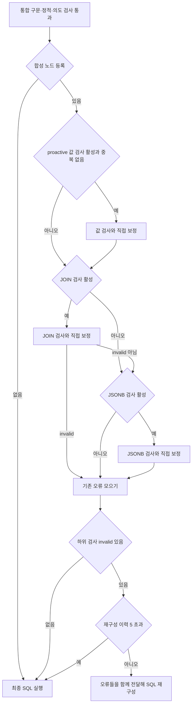
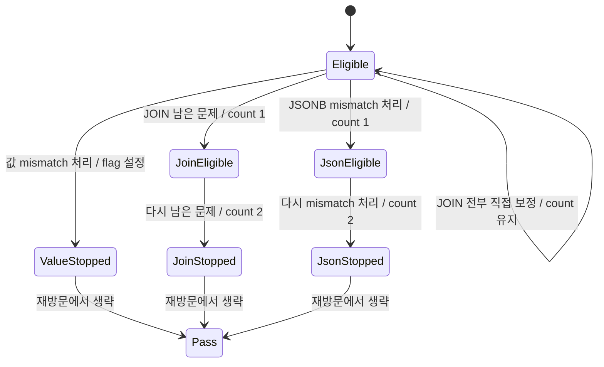
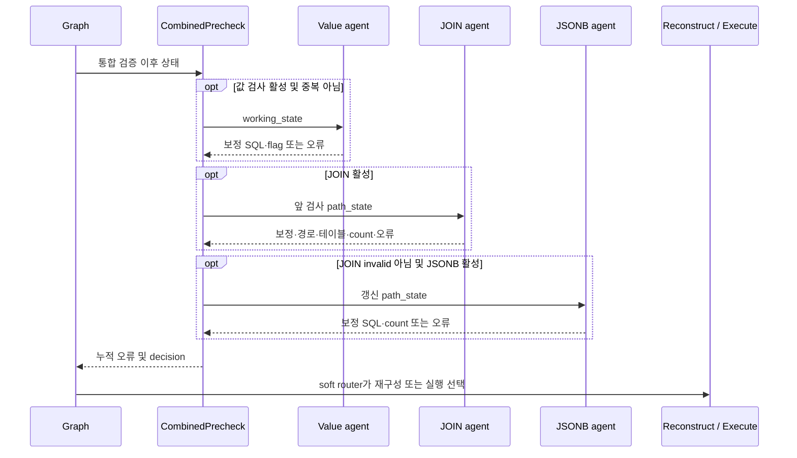

# Chapter 04. 실행 전 합성 검사·직접 보정과 상태 병합

- 분석일: 2026-11-14.
- 범위: `CombinedPrecheckAgent`, 값·JOIN·JSONB 하위 agent의 호출·상태·직접 보정 계약, graph 분기. 로컬 소스·관련 테스트를 정적으로 읽었으며 실제 DB·모델·테스트는 실행하지 않았다.
- 선행: [구문·정적 검사](chapter-01-parse-and-static-validation.md), [의도 검사와 분기](chapter-02-intent-validation-and-routing.md), [선택적 값 검사와 probe](chapter-03-value-validation-and-probe.md).
- 용어집: [상세 용어집](../01-architecture/chapter-00-glossary.md)

| 용어 | 뜻·이 문서에서의 의미 |
|---|---|
| Precheck | 최종 SQL 실행 전에 잘못된 값·연결·JSON 경로를 확인하는 검사다. |
| Combined | 여러 검사를 한 graph 노드에서 묶어 실행한다는 뜻이다. |
| Graph 노드 | 상태를 입력받아 처리하고 다음 분기로 넘기는 작업 단위다. |

## 1. 한 번의 재구성에 여러 오류를 전달하는 역할

실제 노드 이름은 `precheck_combined`다. 통합 구문·정적·의도 검사가 통과하면 이 노드가 있을 때 여기로, 없을 때 바로 `execute_sql_query`로 간다. 합성 노드는 다음 세 agent를 순서대로 호출한다.

| 순서 | agent | 다루는 문제 |
|---|---|---|
| 1 | `ProactiveValueCheckAgent` | 조건의 저장 값·숫자 단위 규모·정수 나눗셈 |
| 2 | `JoinPathCheckAgent` | 테이블을 연결하는 JOIN 컬럼·중간 테이블 경로·대소문자/공백 불일치 조건 |
| 3 | `JsonbPathCheckAgent` | JSONB 컬럼에서 키·중첩 경로를 잘못 찾는 문제 |

JOIN은 여러 테이블의 행을 조건으로 연결하는 SQL 연산이다. JSONB는 PostgreSQL의 JSON 저장 타입이며, 키는 JSON 객체 안에서 값을 찾는 이름이다. 예를 들어 `payload->'profile'->>'city'`는 profile 객체 안의 city 값을 문자열로 읽는 경로다.

노드를 합친 목적은 값·JOIN 오류를 각각 다른 차례에 재구성시키기보다 한 오류 메시지로 모으는 것이다. 다만 모든 검사를 매번 실행하는 구성은 아니다. JOIN 오류가 있으면 그 SQL의 연결 구조가 바뀔 수 있어 같은 차례의 JSONB 검사는 생략한다. 값 검사는 그보다 먼저 실행한다.

근거: [합성 agent](../../../code/auto-ontology/auto_ontology/retrieval/text_to_sql/agents/combined_precheck.py)의 `execute`, [graph](../../../code/auto-ontology/auto_ontology/retrieval/text_to_sql/text_to_sql_graph.py)의 `create_graph`, `_make_soft_check_router`.

## 2. 활성화 설정은 두 시점에서 읽는다

graph를 생성할 때 `DB_PROBE_PROACTIVE`, `DB_PROBE_JOIN_PATH_CHECK`, `DB_PROBE_JSONB_PATH_CHECK` 중 하나라도 참이면 노드를 등록한다. 셋 다 거짓이면 노드 자체가 없다. 각 flag는 기본 False이며 `1`, `true`, `yes`, `on`을 참으로 인정한다.

합성 agent가 실행될 때도 같은 helper를 호출해 하위 검사의 실행 여부를 결정한다. 따라서 노드가 이미 등록된 뒤 모든 flag가 꺼지면 하위 검사 없이 valid를 반환할 수 있고, 처음부터 노드가 없었던 graph에서는 환경 flag만 바꿔도 새 노드가 생기지 않는다. 환경이 중간에 바뀌는 통합 동작은 실행하지 않았다.

값 검사는 `DB_PROBE_PROACTIVE`가 참이면서 요청의 `validate_sql_values`가 False일 때만 실행한다. 앞 장의 모델 기반 값 검사를 켜면 중복 조회를 줄이기 위해 이 하위 검사를 생략한다. 이 조건은 앞 장의 검사가 모든 값을 확인했다는 성공 기록을 읽지 않는다. 정수 나눗셈 검사도 이 agent 안에 있으므로 같은 생략 조건의 영향을 받는다.

하위 agent들은 자기 `execute`에서 환경 flag를 다시 검사하지 않는다. flag로 하위 호출을 선택하는 책임은 합성 노드에 있다. 이 클래스들을 별도 호출할 때는 같은 활성 조건이 자동 적용된다고 가정하지 않는다.

근거: [설정 helper](../../../code/auto-ontology/auto_ontology/retrieval/text_to_sql/db_probe/config.py), [선택적 값 검사](chapter-03-value-validation-and-probe.md)의 완료 계약.

## 3. 입력·중간 상태와 오류 집계

입력은 기존 `AgentState`다. `path_state`는 SQL·관련 테이블·진행 횟수 등을 담은 사전이다. `_get_sql_code`는 실행용 `path_state.sql_code`를 우선하고 없으면 생성 결과 객체의 SQL을 읽는다. SQL이 비면 하위 호출 없이 valid와 path_state를 반환한다.

합성 노드는 path_state와 상위 상태를 각각 얕게 복사한다. 얕은 복사는 바깥 사전만 새로 만들고 내부 목록·객체는 공유할 수 있는 복사다. `working_state.path_state`를 현재 작업 상태로 지정한 뒤 `run_subcheck`가 다음 작업을 수행한다.

1. 하위 agent의 `execute(working_state)`를 직접 호출한다.
2. 결과에 path_state가 있으면 현재 상태를 그것으로 교체한다.
3. 바뀐 path_state를 다음 하위 agent의 working_state에 넣는다.
4. `decision=invalid_sql`인 결과에 대해서만 error를 수집하고 `error_known_fixable` 값을 AND로 누적한다.

하위 호출에는 개별 `agent_wrapper`가 없다. 각 클래스의 입력 검사·개별 node 시작 이벤트를 자동으로 거치는 구성도 아니다. 바깥 합성 노드만 공통 wrapper로 감싼다. 반환의 messages·상위 evidence 같은 다른 키를 일반적으로 병합하는 helper도 아니며 이 하위 agent들의 실제 계약인 path_state·decision에 맞춘 처리다.

| 누적 값 | 시작값과 최종 동작 |
|---|---|
| `any_invalid` | False. 하위 invalid가 한 번이라도 있으면 True를 유지한다. 뒤의 검사 valid가 앞 오류를 지우지 않는다. |
| `join_ok` | True. JOIN을 호출했고 invalid였을 때만 False로 바뀐다. |
| `error_sections` | 하위 invalid 시점의 오류 문자열을 순서대로 저장한다. 최종적으로 빈 문자열은 제외한다. |
| `known_fixable` | True. 하위 invalid 시점의 path_state flag와 AND를 누적한다. |

오류 문자열이 두 개 이상이면 “여러 문제가 발견됐으므로 모두 고치라”는 머리말과 함께 합친다. 하나면 그대로, invalid인데 문자열이 전부 비었으면 빈 오류를 저장한다. 임의의 오류 내용을 새로 생성해서 채우지는 않는다.

모든 invalid 결과에서 known_fixable이 참이면 최종 `error_known_fixable=True`를 쓴다. 하나라도 거짓이면 해당 키를 제거한다. 모든 하위 결과가 valid면 기존 error·known_fixable을 명시적으로 지우지 않고 valid와 현재 상태를 반환한다.

### JOIN 실패와 JSONB 생략의 정확한 조건

JOIN 결과가 invalid이면 JSONB를 실행하지 않는다. JOIN 검사가 비활성·횟수 소진·문제 미검출·직접 보정 완료 등으로 valid를 반환하면 JSONB 실행 조건을 만족할 수 있다. 따라서 “JSONB가 실행됨”이 “원본 DB에서 모든 JOIN의 정확성을 증명함”이라는 뜻은 아니다.

값 검사가 invalid여도 JOIN은 실행한다. JOIN이 valid이면 JSONB도 실행한다. 이때 서로 다른 오류와 직접 보정이 한 상태에 공존할 수 있으며 최종 판정은 누적 invalid를 따른다.

## 4. 값 하위 agent의 계약

`ProactiveValueCheckAgent`는 SQL이 비었거나 `value_repair_attempted`가 이미 참이면 valid를 반환한다. 관련 테이블과 connector로 방언을 정하고 관련 컬럼에서 `(짧은 테이블명, 컬럼명) → 타입` 사전을 만든다.

동일한 `ProbeExecutor` 안에서 `find_literal_mismatches` → `find_numeric_scale_mismatches`를 호출한다. 이어 DB executor 밖에서 `find_integer_division_mismatches`를 호출한다. 마지막 함수에는 이미 가져온 타입 정보를 전달한다. 각 helper의 추출·표본·후보 판정 알고리즘은 후속 Chapter 04-1 범위다.

integer division은 정수끼리 나눌 때 소수 부분이 사라질 수 있는 연산이다. 직접 보정 helper는 PostgreSQL에서 확인된 정수 나눗셈의 분자를 NUMERIC으로 cast(타입 변환)한다. helper가 고칠 수 없는 다른 mismatch는 남긴다. 적용하면 `_set_sql_code`로 두 SQL 저장 위치를 함께 갱신한다.

| 검사 결과 | 상태·반환 |
|---|---|
| 처음부터 mismatch 없음 | 횟수 flag를 설정하지 않고 valid. 다른 원인으로 재방문하면 다시 검사할 수 있다. |
| mismatch가 전부 직접 보정됨 | `value_repair_attempted=True`, 보정 SQL, valid. |
| 보정 후 남은 mismatch 있음 | `value_repair_attempted=True`, 오류 문자열, `error_known_fixable=True`, invalid. |

“요청당 한 번”이라는 주석은 정확히는 **문제를 찾아 보정·재구성 신호를 낸 뒤 다시 차단하지 않는 조건**이다. 문제 없는 모든 방문을 한 번으로 제한하는 flag는 아니다. 또한 `value_repair_attempted`는 뒤의 빈 결과 보정과 공유하는 상태 이름이므로 후속 장에서 실행 순서에 따른 소비 범위를 추적한다.

근거: [값 agent](../../../code/auto-ontology/auto_ontology/retrieval/text_to_sql/agents/proactive_value_check.py), [값 helper](../../../code/auto-ontology/auto_ontology/retrieval/text_to_sql/db_probe/literal_check.py)의 `try_self_apply_integer_division_fixes`.

## 5. JOIN 하위 agent의 계약

`JoinPathCheckAgent`는 `join_path_repair_attempts>=2` 또는 빈 SQL이면 valid를 반환한다. 한 executor 안에서 `find_join_path_mismatches`와 `find_case_dirty_join_mismatches`를 수행한다. 조회 DB 범위 인수는 `path_state.target_db`다. 관련 테이블로 선택한 connector와 이 인수를 별도로 전달한다.

semantic FK는 의미 모델에 저장된 컬럼 연결이다. FK(Foreign Key, 외래 키)는 다른 테이블의 행을 참조하는 키를 뜻하며, 여기서는 저장된 의미 연결 경로로 JOIN을 판단하는 데 사용한다. 실제 경로 탐색·값 겹침 조회의 순서와 기준은 후속 Chapter 04-2에서 추적한다.

### 5.1 모델 재구성 전에 시도하는 직접 보정

| 처리 순서 | agent의 수용 조건·경계 |
|---|---|
| 잘못된 JOIN 컬럼 | `try_self_apply_wrong_column_fixes`로 같은 테이블 쌍의 비교 컬럼을 교체한다. 원래 테이블·컬럼 쌍으로 대상 조건을 찾으며 helper가 적용한 항목을 mismatch에서 제거한다. |
| 중간 테이블 누락 | `try_self_apply_missing_bridge_fixes`가 한 중간 테이블을 삽입하는 제한된 모양을 제안한다. candidate SQL에 세 정적 helper를 다시 적용한다. |
| bridge candidate 정적 검사 | 무의미 SQL → 무효 집계 → 집계 누락 중 거부 이유가 나오면 candidate를 채택하지 않는다. 무효 집계는 별도 flag가 꺼져 있으면 빈 이유를 반환한다. |
| 남은 mismatch·표기 불일치 모두 없음 | 관련 테이블 목록으로 대문자 포함 이름을 재인용하고 valid를 반환한다. |

bridge는 직접 연결 대신 두 테이블 사이를 이어주는 중간 테이블이다. helper는 허브를 공유하는 두 테이블이나 2-hop(관계 두 번) 체인의 제한된 모양을 다룬다. 소스의 오래된 helper 주석 중 “bridge는 재구성에 맡김”이라는 표현보다 현재 agent의 뒤이은 bridge 직접 보정 호출을 우선한다.

candidate 정적 검사에 사용하는 세 함수는 catalog parse 전체나 모델 의도 검사를 다시 실행하는 것이 아니다. 직접 보정된 SQL의 질문 의미·행 수 증가·모든 참조 정확성까지 보장하지 않는다. helper 내부의 제한 조건·AST 변경은 후속 분석 대상이다.

### 5.2 남은 문제를 재구성에 전달

남은 mismatch 또는 case-dirty 문제가 있으면 `join_path_repair_attempts`를 1 증가시킨다. case-dirty는 확인된 연결에 붙은 추가 비교 조건이 대소문자·공백 때문에 행을 제외하는 문제다. 이 agent는 그 조건을 바로 삭제하거나 정규화하지 않고 설명을 재구성에 넘긴다.

verdict(판정 종류)가 `unverified`가 아닌 mismatch는 고칠 경로가 있다고 분류한다. 해당 hops를 `attribute_join_paths`에 `{"path": hops}` 형태로 추가하고, 관련 목록에 없는 bridge 이름을 ID로 찾아 `fetch_tables_by_ids`로 가져온다. 기존 테이블 ID와 중복되지 않는 항목을 `relevant_tables`에 넣는다. 이름 비교는 짧은 이름·소문자 기준이며 ID 검색에는 DB 범위를 전달한다.

이 보충은 **남은 repairable mismatch를 재구성에 넘기는 분기**에서 수행한다. 직접 bridge 보정으로 모두 해결된 조기 반환까지 항상 같은 테이블 재조회가 실행되는 것은 아니다. 이미 수집한 case-dirty 목록도 앞선 직접 JOIN 보정 후 새 SQL로 다시 조회하는 단계는 없다.

남은 mismatch가 모두 repairable이면 known_fixable은 참이고, `unverified`가 있으면 거짓이다. case-dirty만 있는 경우는 알려진 정규화 방향이 있어 참을 유지한다. 경로를 못 찾았다고 이 agent가 모델 검색을 직접 호출하지는 않는다.

근거: [JOIN agent](../../../code/auto-ontology/auto_ontology/retrieval/text_to_sql/agents/join_path_check.py)의 `execute`, `_merge_missing_bridge_tables`, [JOIN helper](../../../code/auto-ontology/auto_ontology/retrieval/text_to_sql/db_probe/join_path_check.py)의 직접 보정 함수들.

## 6. JSONB 하위 agent의 계약

`JsonbPathCheckAgent`는 `jsonb_path_repair_attempts>=2` 또는 빈 SQL이면 valid를 반환한다. 관련 테이블의 타입 사전을 만들고 새 executor로 `find_jsonb_path_mismatches`를 호출한다. agent 자체에 방언을 PostgreSQL로 제한하는 조기 분기는 없으며 helper에 방언을 전달한다. 실제 방언·키 조회 조건은 후속 Chapter 04-3 범위다.

mismatch가 없으면 카운터를 늘리지 않는다. 있으면 `try_self_apply_fixes`를 먼저 수행하고 SQL이 바뀌면 두 SQL 위치를 갱신한다. 그 뒤에는 **직접 보정만으로 끝났어도 카운터를 1 증가**시킨다. JOIN agent는 남은 문제가 있을 때만 카운터를 늘리므로 서로 다르다.

직접 보정은 예를 들어 `payload->>'profile.city'`를 `payload->'profile'->>'city'`로 바꾸는 좁은 경우다. helper는 점이 하나인 키이고 앞부분이 관찰한 top-level 키에 일치하는지 등을 확인한 뒤 원문 문자열 패턴을 치환한다. 실제 하위 city 키까지 같은 조건으로 증명하는지, 공백 표기·다른 컬럼의 같은 패턴을 어떻게 처리하는지는 후속 장에서 분석한다.

전부 직접 고쳤으면 valid, 남은 문제는 오류 문자열과 `error_known_fixable=True`, invalid로 반환한다. 파일 주석에 있는 과거 실험의 직접 보정 비율은 이번 작업에서 실험 자료를 확인하지 않았으므로 현재 정확도·성공률 근거로 사용하지 않는다.

근거: [JSONB agent](../../../code/auto-ontology/auto_ontology/retrieval/text_to_sql/agents/jsonb_path_check.py), [JSONB helper](../../../code/auto-ontology/auto_ontology/retrieval/text_to_sql/db_probe/jsonb_path_check.py)의 `try_self_apply_fixes`, `_self_apply_one`.

## 7. 횟수·known_fixable·직접 보정의 수명

위 그림은 세 종류의 상태 전이를 함께 비교한 것이다. 하나의 agent가 모든 상태를 순서대로 거친다는 뜻은 아니다. JSONB의 “처리”에는 직접 보정이 포함되고 JOIN은 전부 직접 고치면 카운터를 유지한다.

재구성의 오류 분석이 아직 수행되지 않았을 때 `error_known_fixable`이 참이면 모델 오류 분류·추가 테이블 탐색을 생략하고 fixable(현재 정보로 수정 가능)로 분류한다. `error_analysis_done`이 이미 참이면 그 분석 분기를 다시 수행하지 않는다.

### flag 병합에서 남는 경계

합성 노드는 하위 호출 전에 기존 `error_known_fixable`을 지우지 않는다. JOIN agent도 `known_fixable=False`인 분기에서 기존 True 값을 명시적으로 제거하지 않고, 참일 때만 True를 쓴다. 따라서 앞의 값 검사나 이전 상태가 True를 남긴 뒤 JOIN의 unverified가 나와도 합성 노드가 그 상태의 True를 읽을 가능성이 있다.

이는 코드의 상태 전달에서 도출한 경계이며 실제 오분류 재현은 하지 않았다. “모든 오류가 독립적으로 fixable임을 증명한 AND”라고 설명하기보다 **각 invalid 반환 시점의 공유 flag를 AND**한다는 실제 계약을 기록한다.

전체 재시도는 현재 상태에서 카운터를 단순 감소시키는 동작이 아니다. [main.py](../../../code/auto-ontology/auto_ontology/retrieval/text_to_sql/main.py)의 `_restore_for_full_pipeline_retry`가 원래 path_state를 복원하고 세 횟수 키와 오류·경로·관련 테이블 등을 제거한다. 상위 SQL 값 검사 cache 유지와 이 카운터 제거는 다른 수명이다.

## 8. graph 분기·조회·저장·예외 경계

합성 노드의 valid는 바로 실행으로, invalid는 `_make_soft_check_router`로 간다. 이 router는 invalid이며 `len(failed_attempts)>5`이면 차단을 중단하고 실행으로 보낸다. 5일 때는 재구성을 요구한다. 카운터 2 도달 생략, 값 flag 생략, shared soft 상한은 서로 다른 조건이다. soft 상한으로 실행할 때 하위 agent가 만든 오류·카운터·부분 보정이 자동 롤백되는 것도 아니다.

직접 보정 후 합성 노드가 valid이면 graph는 구문·정적·의도 검사로 재진입하지 않고 실행으로 간다. 세 agent 모두 `_set_sql_code`를 사용해 실행 SQL과 생성 결과 객체 사본을 맞춘다. 하지만 이 경로에서 `sql_tables`·`sql_columns`를 다시 parse해 갱신하는 단계는 없다. 검사 전 metadata와 보정 후 SQL의 일치 여부는 미검증이다.

각 하위 agent는 별도 `ProbeExecutor`를 만든다. 값 agent 안의 두 probe helper는 예산을 공유하고, JOIN의 두 helper도 서로 공유하지만 세 agent 전체의 예산 객체는 다르다. 기본 최대 호출 40은 각 executor의 초기값이고 새 방문에서도 재생성된다. config의 테이블·컬럼 제한은 각 helper의 사용 지점에서 확인해야 하며 합성 노드가 공통으로 제한하지는 않는다. 실행기의 실제 LIMIT·timeout 계약은 [Chapter 03](chapter-03-value-validation-and-probe.md)에 있다.

확인한 저장 경계는 원본 DB 조회, JOIN 경로·bridge metadata를 위한 catalog 조회, 메모리 SQL·경로·상태·로그 변경이다. 이 agent 호출 경로에 catalog·의미 모델 쓰기나 모델 호출은 없다. 모델 재구성은 다음 노드에서 수행한다.

하위 agent의 예외를 잡고 다음 검사를 계속하는 try가 합성 노드에는 없다. 일부 하위 처리 뒤 예외가 나면 오류 집계 최종 반환까지 도달하지 못할 수 있다. 바깥 공통 wrapper는 일반 예외를 오류 사전으로 기록하지만 합성 클래스에는 실패 decision이 지정되지 않아 이전 decision이 남을 수 있는 경계가 있다. 얕은 복사 내부 객체의 부분 변경도 전부 되돌리는 transaction(여러 변경을 한 묶음으로 확정·취소하는 처리)은 아니다.

근거: [공통 wrapper](../../../code/auto-ontology/auto_ontology/retrieval/text_to_sql/base.py), [공통 SQL setter](../../../code/auto-ontology/auto_ontology/retrieval/text_to_sql/agents/empty_like_result_check.py)의 `_get_sql_code`, `_set_sql_code`.

## 9. 테스트와 미확인 범위

직접 합성 노드 assertion으로 확인한 것은 [test_sql_value_validation.py](../../../code/auto-ontology/auto_ontology/retrieval/text_to_sql/tests/test_sql_value_validation.py)의 `test_agentic_flag_skips_duplicate_proactive_value_probe`다. proactive flag를 True, JOIN·JSONB flag를 False로 대체하고, 값 하위 execute가 호출되면 실패하게 만든다. `validate_sql_values=True`인 상태에서 최종 valid가 나오는지 확인한다. 이 테스트는 모델 값 검사가 모든 값을 검증했음을 시험하지 않는다.

로컬 `test*.py` 검색에서 `CombinedPrecheckAgent` 및 세 agent 클래스·두 repair 카운터 이름을 직접 사용하는 추가 테스트는 위 합성 테스트 외에는 찾지 못했다. [값 helper 테스트](../../../code/auto-ontology/auto_ontology/tests/test_literal_check.py)·[JSONB helper 테스트](../../../code/auto-ontology/auto_ontology/tests/test_jsonb_path_check.py) 등은 각 helper 후속 분석에서 assertion을 추적한다. helper 테스트의 존재를 오류 병합·실제 graph 반복 검증으로 대신하지 않는다.

이 장에서 복수 오류 병합, JOIN 실패 시 JSONB 생략, 직접 보정 후 하위 전달, 2회·soft 5/6 경계, stale known_fixable·부분 예외는 코드로 추적했다. 해당 시나리오를 실제 테스트·DB·모델·graph에서 재현하지는 않았다. 실제 권한·데이터 분포·동시성·원격 취소·보정 SQL 정확성·Mermaid 렌더링도 미검증이다.

## 10. 다음 분석 경계

이 장은 합성 순서와 agent 수준의 입출력·상태 계약을 설명한다. 각 helper가 어떤 SQL을 어떤 순서로 보내고, 표본·최소/최대·경로·JSON 키를 어떤 조건으로 불일치라고 판단하는지는 아직 상세 분석 완료가 아니다.

[값·숫자·정수 나눗셈 상세](chapter-04-1-literal-scale-and-division-checks.md), [JOIN 경로·겹침·보정 상세](chapter-04-2-join-path-overlap-and-repair.md), [JSONB 키·컨테이너 상세](chapter-04-3-jsonb-key-path-validation.md)를 작성했다. 타입 unknown·실제 DAL의 역방향·probe 실패·키 조회 None과 점 키 보정의 경계를 구분한다. [세부 계획](../../../.codex/plan/auto-ontology/01-9-3_combined-prechecks.md)의 예정 정적 분석은 완료이며 실제 검증은 미수행이다. 09단계 다음 작업은 SQL 재구성 내부다.
