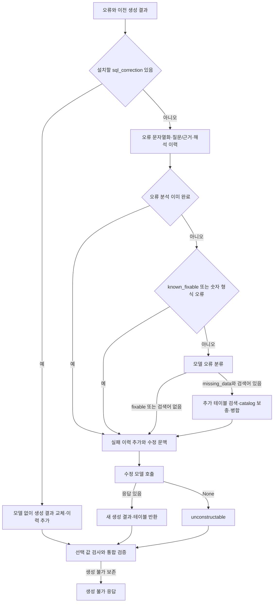
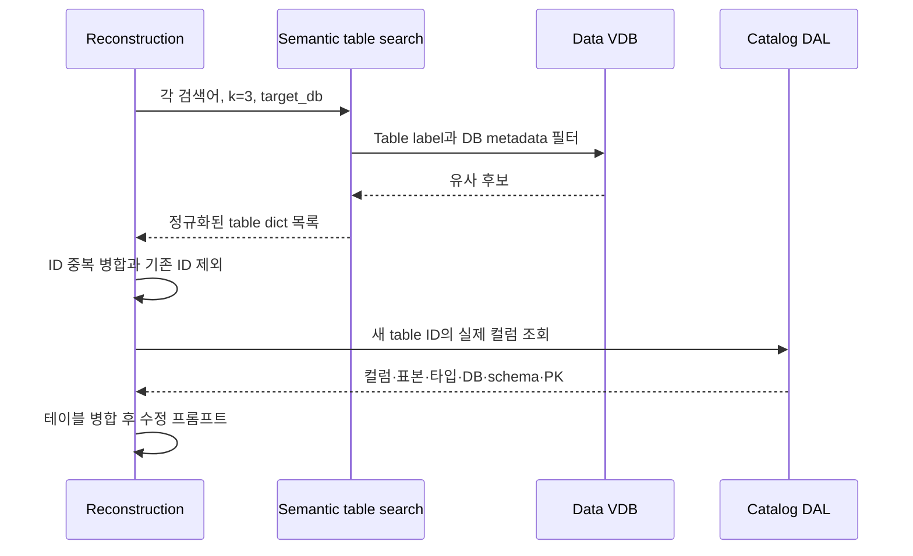
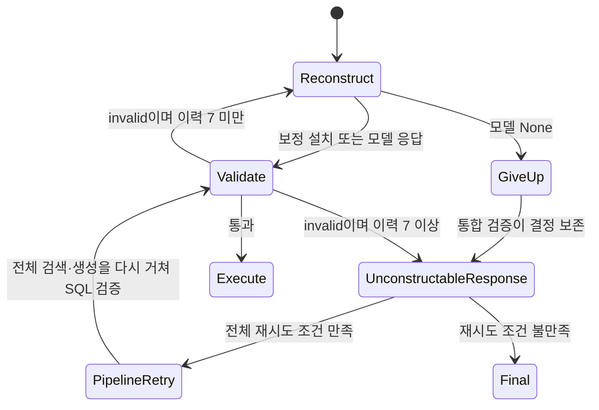

# Chapter 05. SQL 재구성·오류 분류·추가 검색과 생성 불가 응답

- 분석일: 2026-11-14.
- 범위: `SQLReconstructionAgent` 전체·실행 보정 SQL 인계·오류 분류·추가 테이블 검색·모델 입력/출력·graph·`SQLUnconstructableAgent`와 관련 테스트의 정적 분석.
- 확인 수준: 원본 코드 수정·실제 DB·모델·pytest·graph 실행은 하지 않았다. 함수 조건과 테스트 assertion을 읽은 결과이며 실행 결과와 구분한다.
- 선행: [의도 검사·재구성 분기](chapter-02-intent-validation-and-routing.md), [실행 전 검사](chapter-04-combined-precheck-and-state.md), [전체 재시도·재개](../08-sql-generation/chapter-06-full-retry-and-resume.md).
- 용어집: [상세 용어집](../01-architecture/chapter-00-glossary.md)

| 용어 | 뜻·이 문서에서의 의미 |
|---|---|
| 재구성 | 검증·실행에서 실패한 SQL을 오류 정보와 함께 다시 만드는 내부 반복이다. |
| 전체 재시도 | 처음부터 검색·생성을 다시 하는 처리다. 내부 재구성과 반복 단위가 다르다. |

## 1. 진입·입력과 큰 분기

graph의 노드 이름은 `reconstruct_sql`, 클래스의 내부 이름은 `sql_reconstruction`이다. 검증·실행 오류와 보조 검사에서 재구성이 필요할 때 들어온다. 실제 router·7회 상한·보조 검사 차단 상한은 앞 장을 따른다.

`validate_input`은 truthy한 `path_state.error`와 `sql_generation_result`를 요구한다. 이전 응답이 반드시 정상 모델 인스턴스인지까지 여기서 검사하지는 않는다. 공통 wrapper에서 입력 실패는 이 클래스에 failure_decision이 없으므로 명시 오류를 발생시킨다.

일반 execute는 `state.llm`, `state.evidence`, `state.messages`를 직접 인덱싱한다. 이 키들의 존재를 위 입력 검사에서 모두 보장하지는 않는다. 모델 없는 보정 경로는 그 키들을 읽기 전에 반환할 수 있다.

| 입력 | 사용 |
|---|---|
| `sql_generation_result` | 잘못된 SQL·이전 thought·response의 원천. 실행용 `path_state.sql_code`보다 이 객체의 SQL을 읽는다. |
| `error`, 선택 `sql_correction` | 수정 이유와 실행 단계가 제안한 SQL |
| `llm`, `messages`, `evidence` | 일반 분류·수정 모델과 기존 생성 지시·별도 근거 |
| `relevant_tables`, `target_db`, `connectors` | 수정 가능한 스키마·추가 검색 DB·생성 방언 |
| `primary_attribute`, `attribute_join_paths` | 이전 단계가 해석한 의미 컬럼·관계 경로 |
| 실패·해석 이력과 분류 flag | 수정 횟수, 이전 답변 가정, 분류·검색 재실행 여부 |

근거: [재구성 agent](../../../code/auto-ontology/auto_ontology/retrieval/text_to_sql/agents/sql_reconstruction.py), [공통 wrapper](../../../code/auto-ontology/auto_ontology/retrieval/text_to_sql/base.py), [graph](../../../code/auto-ontology/auto_ontology/retrieval/text_to_sql/text_to_sql_graph.py).

## 2. 실행 보정 SQL의 모델 없는 채택

`_pending_sql_correction`은 오류가 정확히 `SQL_CORRECTION_ERROR`이고, `sql_correction` 문자열이 비어 있지 않으며 이전 생성 SQL과 strip 후 다를 때 후보를 반환한다. 상수 값은 `sql_correction`이다. 실행 단계는 제출할 SQL과 실제로 필요한 실행 SQL을 맞추기 위해 이 상태로 invalid를 반환한다.

`_install_sql_correction`은 다음을 수행하고 즉시 반환한다.

1. 기존 SQL과 보정 오류를 `failed_attempts`에 추가한다.
2. `error`, `sql_correction`을 제거한다.
3. 고친 문장을 제출하도록 바꾼다는 trace(단계별 처리 기록)를 남긴다.
4. 이전 thought·response가 있으면 strip 후 유지하고 없으면 기본 문구를 사용한다.
5. 새 `SQLGenerationModel`과 관련 테이블 목록 사본을 반환한다.

모델·오류 분류·추가 검색·일반 프롬프트 구성은 이 경로에서 호출하지 않는다. 일반 해석 이력 추가도 건너뛴다. 이 보정은 모델 호출이 없어도 실패 이력을 한 개 소비한다.

이 함수는 `_set_sql_code`로 두 SQL 필드를 동시에 쓰는 precheck 보정과 다르다. 생성 결과 객체를 새로 만들지만 실행용 `path_state.sql_code`를 이 자리에서 갱신하지 않는다. 다음 값 검사는 생성 결과를 우선 읽고, 통합 검증은 생성 결과를 검사해 통과한 SQL을 실행용 필드에 준비한다. 따라서 다음 검증을 건너뛰어도 두 값이 항상 최신이라고 가정하지 않는다.

보정 값이 없거나 이전 SQL과 같으면 fast path를 사용하지 않고 일반 오류 처리로 간다. 여기서 fast path는 특정 조건에서 모델 작업을 생략하는 지름길이라는 뜻이다. 보정 SQL을 실행 단계가 어떻게 만드는지는 후속 실행 chapter에서 추적한다.

근거: 재구성의 `_pending_sql_correction`, `_install_sql_correction`, [실행 agent](../../../code/auto-ontology/auto_ontology/retrieval/text_to_sql/agents/sql_execution.py)의 `sql_correction` 반환, [상수](../../../code/auto-ontology/auto_ontology/retrieval/text_to_sql/numeric_types.py).

## 3. 오류 정규화와 한 번의 분류

### 3.1 문자열이 아닌 오류

일반 경로는 `_error_to_text`로 오류를 문자열로 만든다. dict에 message가 있으면 이를 먼저 문자열화하고 type·agent를 부가한다. 다른 값은 JSON 직렬화(default=str), 일반 문자열 변환, 출력 불가 기본값 순으로 대체한다. JSON은 구조화 데이터를 표현하는 형식이다.

예를 들어 `{type: ValueError, message: duplicate output label, agent: sql_execution}`은 `duplicate output label (type=ValueError, agent=sql_execution)`이 된다. 실제 값 표기는 테스트 입력을 풀어 쓴 예다.

원래 오류가 문자열이 아니면 `error_details`에 `setdefault`로 보존하고 error를 문자열로 바꾼다. 이미 error_details가 있으면 새 원문으로 덮지 않는다. 현재 오류와 상세 원문이 언제나 같은 세대라는 보장은 없다.

### 3.2 분류의 실제 조건

`error_analysis_done`이 거짓일 때만 분류한다. 먼저 이 flag를 True로 설정한 다음 다음 순서를 따른다.

| 조건 | 처리 |
|---|---|
| `pop(error_known_fixable, False)`가 참 | 모델 없이 `error_type=fixable`. 현재 자료로 고칠 수 있다는 뜻이다. |
| 숫자 형식 cast 오류 정규식 일치 | 모델 없이 fixable. |
| 그 외 | `_analyze_error`로 구조화 분류 호출. |
| 이미 error_analysis_done | 새 오류여도 이 분류·검색 블록 전체 생략. |

숫자 형식 정규식은 PostgreSQL식 `invalid input syntax for type numeric/double precision/integer/bigint` 오류의 인용 값 안에 `%`, `$`, USD·EUR·GBP가 있는지 본다. 다른 통화·임의 구분자 전체를 포괄하지 않으며 이 분기에 방언을 확인하는 별도 조건은 없다. 일치하는 텍스트를 근거로 같은 테이블에서 고칠 문제로 분류한다.

에러가 바뀔 때마다 원인을 다시 검토하는 반복은 아니다. flag를 분석 호출 전에 설정하므로 중간 예외·실패 뒤에도 상태에 남을 수 있다. 일반 재구성 반환은 flag를 초기화하지 않는다. 전체 재시도나 debug seed가 이를 초기화하는 경계는 별도다.

## 4. 분류 모델의 입력·출력과 지시의 강도

`ErrorAnalysis`는 `error_type`으로 `missing_data` 또는 `fixable`, 선택적 `search_queries=[]`, `explanation=""`을 받는다. Pydantic은 구조화 응답의 필드·타입을 검사하는 라이브러리이며 추가 필드를 금지한다.

missing_data는 현재 테이블·컬럼으로는 질문에 답할 데이터가 부족하다는 분류다. 프롬프트와 필드 설명은 검색어 2~4개, fixable에서는 빈 검색어를 요구한다. 그러나 목록 길이·두 필드의 조합을 강제하는 validator는 없다. 실제 검색은 missing_data이면서 검색어가 truthy일 때만 수행한다.

입력에는 원질문/처리 질문 블록, **테이블 이름 목록**, 알려진 컬럼/관계, 실패 SQL·이전 설명·실제 오류를 넣는다. `path_state.error`도 External feedback으로 붙여 기존 문맥의 오류와 중복될 수 있다. 이 분류 프롬프트 자체에 별도의 evidence 시스템 메시지를 추가하는 코드는 없다. evidence는 이후 수정 모델에서 별도로 전달한다.

알려진 컬럼은 label·짧은 table.column·선택 datatype, hop은 source table.column = target table.column으로 모은다. schema·DB를 포함하는 일반 정규 이름 출력은 아니다. 컬럼·hop의 중복 키는 원래 문자열 기준이며 방향이 뒤집힌 hop을 무조건 합치지는 않는다.

동일한 자료도 분류 시에는 “이전 단계가 잠정 해석했고 불완전할 수 있음”, 수정 시에는 “이미 해석한 정확한 이름·JOIN 키 사용”으로 다르게 표현한다. 전자는 missing_data 재탐색 가능성을 열고, 후자는 이름을 다시 추측하는 수정을 줄이려는 지시다. 이전 의미 해석의 실제 정확성을 독립적으로 검증하는 단계는 아니다.

`invoke_with_structured_output(state.llm, ..., ErrorAnalysis)`가 None이면 fixable로 대체한다. 생성 단계의 reasoning 모델 우선 선택을 여기서 별도로 하지 않는다. 설명이 있으면 trace에 남긴다. 같은 helper라도 **분류 None은 fixable**, **수정 None은 생성 불가**라는 서로 다른 정책이다.

## 5. missing_data의 추가 테이블 검색

`_discover_tables`는 data_retriever가 없으면 빈 목록으로 끝난다. VDB(Vector Database, 벡터 저장소)는 의미가 비슷한 테이블 설명을 찾는 검색 저장소다. 여기서 검색 대상은 data VDB의 table label이며 의미 속성 후보를 전부 다시 검색하는 흐름은 아니다.

각 검색어를 순차 처리하며 `get_relevant_tables(..., k=3, database_name=target_db)`를 호출한다. schema 인수는 전달하지 않는다. 공통 검색은 label·DB metadata 필터를 만들고 검색·재시도·결과 수 제한을 수행한다. 상세 filter/embedding 실패 계약은 [검색 분석](../07-retrieval/chapter-01-search-contract-and-retry.md)을 따른다.

검색어 수는 위 설명의 2~4로 코드 제한하지 않으므로 추가 검색 호출 수도 그 설명만으로 상한을 세울 수 없다. 검색어별 예외는 기록하고 다음 검색어를 계속한다. 공통 `get_relevant_tables` 안에서도 검색 예외를 빈 결과로 바꾸는 경로가 있다.

후보를 table ID로 정규화·병합한 뒤 **기존 ID를 제외한 새 ID만** `fetch_tables_by_ids`에 보낸다. 기존 테이블의 빠진 컬럼을 다시 보충하는 일반 재조회 경로는 아니다. 이 DAL은 실제 테이블명·설명·DB/schema·PK와 컬럼명·타입·설명·format·sample_values·nullable·semantic_fk를 반환한다. 컬럼 없는 테이블은 inner join으로 빠지고 조회 오류는 빈 목록이다.

`_merge_tables`는 ID가 있는 기존 테이블을 기준으로 새 테이블을 추가한다. 동일 ID를 직접 넘기면 컬럼의 이름이 기존 집합에 없을 때 append하며 대소문자를 정규화하지 않는다. 기존 컬럼의 설명·타입을 새 정보로 덮는 병합은 아니다. 바깥 목록은 새로 만들어도 기존 dict·columns는 공유해 수정할 수 있다.

검색 후 모델 적합성 필터·anchor/관계 재계산을 다시 수행하는 단계는 이 함수에 없다. 병합한 테이블로 connector를 다시 고르므로 DB metadata가 섞이면 그 선택에서 실패할 수 있다. DB 검색 필터를 보냈다는 것과 모든 반환 ID를 target_db로 재검증했다는 것은 다르다.

근거: [관련 테이블 검색·정규화](../../../code/auto-ontology/auto_ontology/retrieval/data_access/relevant_tables.py), [semantic search](../../../code/auto-ontology/auto_ontology/retrieval/data_access/semantic_search.py), [catalog 조회](../../../code/auto-ontology/auto_ontology/dal/datasources.py)의 `fetch_tables_by_ids`.

## 6. 실패 이력·해석 이력·메시지 수명

### 6.1 두 종류의 실패 목록

일반 경로는 현재 실패를 `failed_attempts`에 `{sql, error}`로 append한다. 이 길이가 graph의 재구성 한도 근거다. 이전 실패를 수정 프롬프트에 넣을 때에는 방금 추가한 마지막 항목을 제외하고, 현재 SQL·오류는 별도로 전체 내용을 넣는다.

`prior_round_failed_attempts`는 debug 차례의 이전 실패를 읽기용 문맥으로 넣는 목록이다. 이것도 렌더링하지만 현재 실패 횟수에는 합치지 않는다. 각 목록 항목의 SQL·오류는 **각각 600자**까지만 표시한다. 전체 항목 개수·현재 오류·전체 schema에 같은 600자 제한을 적용하지 않는다.

### 6.2 해석 가정의 누적

이전 생성 결과의 thought가 비어 있지 않고 기존 `interpretation_history`에 정확히 같은 문자열이 없으면 추가한다. thought는 질문 해석·SQL 접근의 간단한 설명 필드다. 여러 수정에서 나온 가정을 번호 목록으로 넣고, 유효한 가정을 유지하되 질문·schema·오류와 충돌할 때만 변경 이유를 밝히도록 지시한다.

SQL 구현 선택인 JOIN·alias·쿼리 구조까지 영구 고정하지 말라는 지시도 함께 있다. 모델이 이를 실제로 지켰는지 코드가 가정의 의미를 비교해 검증하지는 않는다. 새 응답의 thought는 그 자리에서 trace에는 쓰지만 해석 이력에 추가되는 것은 이후 다시 재구성에 들어올 때다.

### 6.3 기존 오류 메시지 반복 제거

`_without_prior_repair_turns`는 HumanMessage의 content 문자열이 정확히 `The following SQL contains an ERROR:`로 시작하면 현재 모델 입력에서 제거한다. 다른 종류 메시지·앞에 다른 문자가 붙은 메시지까지 일반적으로 제거하지 않는다.

기존 `state.messages`를 사본으로 받아, 이전 repair turn을 뺀 뒤 truthy한 현재 evidence의 SystemMessage와 새 오류 HumanMessage를 붙인다. 이 messages 사본은 반환하지 않는다. 실패 history를 한 프롬프트에 넣고 이전 schema 반복 전송을 줄이는 구조다. 기존 생성 메시지의 오래된 schema·다른 근거까지 모두 삭제하거나 새 테이블과 정합성을 맞추는 처리는 아니다.

## 7. 수정 프롬프트와 구조화 결과

현재 오류 프롬프트에는 실패 SQL·현재 오류·이전 실패·전체 해석 이력·최신 관련 테이블/컬럼·정확한 의미 컬럼/JOIN 키·질문을 넣는다. “같은 SQL을 반복하지 말라”, “오류가 요구하는 부분을 고치고 유효한 질문 가정은 유지하라”는 지시가 있다.

테이블 출력 방언은 **추가 검색·병합 뒤** connector로 결정한다. `format_tables_for_prompt`에 target_db·dialect를 전달한다. 관련 테이블이 비면 해당 section을 넣지 않는다. 알려진 의미 컬럼/경로는 기존 상태를 사용하므로 검색으로 늘어난 테이블과 의미 경로가 자동으로 새로 계산됐다는 뜻은 아니다.

수정 모델도 `state.llm`과 `SQLGenerationModel`을 사용한다. 모델은 `thought`, `sql_code`, `response`를 요구하고 추가 필드를 금지하며 빈 문자열·일부 placeholder를 거부한다. 이는 출력 형식 검사이며 실행 가능한 SQL·의미 보존·실제 테이블 사용의 증명은 아니다. 정상 모델이 빈 SQL을 내면 형식 검증 실패·helper 재시도/None 정책의 영향을 받으며 이 agent의 독립적인 “빈 SQL이면 별도 decision” 분기는 없다.

| 결과 | 반환과 상태 |
|---|---|
| 수정 helper None | `decision=unconstructable`과 현재 path_state. 별도 설명을 이 agent가 새로 채우지는 않는다. |
| 응답 있음 | 새 `sql_generation_result`, 병합 테이블, 선택 `custom_analyses_used`. thought가 있으면 trace 기록. |
| 정상 응답의 SQL이 이전과 같음 | 직접 문자열 비교로 거부하는 분기 없음. 다음 검증에서 다시 판단한다. |
| 일반 예외 | 로컬 전체 try로 감싸지 않음. 공통 wrapper의 오류·이전 decision 보존 경계를 따른다. |

응답에 custom_analyses_used 속성이 있으면 classification이 참인 ID·label을 추린다. 현재 SQLGenerationModel에 그 필드가 필수로 선언된 것은 아니므로 호환 속성 처리와 실제 기본 모델 계약을 구분한다.

정상 반환은 이전 error·error_details·분류 상태·기존 실행용 SQL·DB 결과·참조 ID를 전부 지우지 않고 생성 결과를 바꾼다. 통합 검증이 검사 후 실행용 SQL·참조·DB 결과 초기화를 준비한다. 성공했다는 새 decision도 일반 반환에 명시하지 않는다.

추가 검색한 테이블은 정상 응답 반환의 `relevant_tables`에 반영한다. 수정 응답이 None이면 일반 반환 대신 기존 path_state만 돌려주므로 새로 찾은 테이블 목록이 항상 저장된다고 보장하지 않는다.

## 8. 횟수·생성 불가 응답과 전체 재시도

정상 graph의 강제 한도는 `len(failed_attempts)` 기준 7회 재구성이다. 최초 SQL 검사 자체를 7회 중 첫 수정으로 세는 것이 아니다. 모델 helper의 내부 요청 재시도·분류 호출·추가 검색은 각각 다른 단위다. 보정 fast path도 이력을 append한다. 일반 경로는 오류 분석·검색 이후에 append하므로 그 이전 예외까지 항상 횟수로 남는 것은 아니다.

graph의 공통 단계 수 상한도 별도로 적용되므로 모든 요청이 이 재구성 한도까지 반드시 진행한다는 보장은 아니다.

`SQLUnconstructableAgent`는 `unconstructable_explanation`이 truthy이면 사용하고 없으면 기본 설명을 사용한다. 최종 응답 dict는 `response`, 빈 `sql_code`, 빈 `sql_columns`, 빈 `custom_analyses_used`, `sql_response_from_db=None`이다. 이를 path_state.final_response에 넣고 기존 messages 목록에 AIMessage를 추가한다. SQL을 실행하거나 모델로 설명을 만드는 노드는 아니다.

상위 main의 `_extract_answer`는 final_response를 우선 읽는다. 생성 불가 노드가 끝나도 원요청 복원값·전체 시도 수·SQL 없음 조건을 만족하면 두 번째 전체 실행을 할 수 있다. 마지막에는 `last_intent_rejected_sql`을 대체 반환하는 별도 fallback도 있어, 최종 반환 SQL과 재검증·실행 여부를 나누어 봐야 한다. 상세 조건은 [전체 재시도·fallback 분석](../08-sql-generation/chapter-06-full-retry-and-resume.md)을 따른다.

debug seed는 [coordinator](../../../code/auto-ontology/auto_ontology/retrieval/interactive/coordinator.py)의 `_apply_debug_seed`가 이전 실패를 별도 목록으로 옮기고 현재 이력·분류 flag를 초기화해 재구성에서 재개한다. 해당 주석의 “5회 뒤 의도 검사 생략” 설명은 현재 통합 의도 검사가 계속 호출되는 코드와 구분한다. 실제 별도 한도는 [Chapter 02](chapter-02-intent-validation-and-routing.md)의 soft router다.

근거: [생성 불가 agent](../../../code/auto-ontology/auto_ontology/retrieval/text_to_sql/agents/sql_unconstructable.py), [main](../../../code/auto-ontology/auto_ontology/retrieval/text_to_sql/main.py), [모델 helper](../../../code/auto-ontology/auto_ontology/utils/llm_invoke.py).

## 9. 조회·저장·실패 경계

이 단계의 외부 작업은 분류/수정 모델 호출, 선택 VDB 검색, catalog의 새 테이블·컬럼 읽기다. 원본 DB에서 SQL을 실행하거나 catalog·의미 모델에 새 테이블을 저장하는 단계가 아니다. 메모리 이력·오류·trace·생성 결과·관련 테이블과 로그를 변경한다. 대화 영구 저장은 뒤의 chat 런타임 범위다.

모델 helper 내부 재시도·실패 None 정책은 공통 helper의 계약이다. 분류 호출이 None이면 계속 수정하지만, 예상 밖 예외가 분류·포맷터·connector·모델 호출 등에서 빠져나갈 수 있다. 이 클래스는 failure_decision을 지정하지 않아 공통 wrapper의 일반 예외 업데이트에 새 decision이 없다. 부분 상태가 남고 분류 flag가 이미 True인 경계를 실제 graph에서 재현하지 않았다.

## 10. 관련 테스트와 미확인 사항

[test_sql_reconstruction.py](../../../code/auto-ontology/auto_ontology/retrieval/text_to_sql/tests/test_sql_reconstruction.py)의 7개 테스트를 읽었다. 모델·검색을 대체한 단위 수준 assertion이며 실제 수리 SQL 실행 검증은 아니다.

| 테스트 | 확인 범위 |
|---|---|
| `test_sql_correction_is_installed_without_calling_the_llm` | 모델 미호출·보정 SQL/이전 thought 유지·오류/보정 키 제거·실패 이력 추가 |
| `test_table_discovery_uses_target_database` | 검색에 k=3·target_db 전달, 빈 검색 결과 |
| `test_reconstruction_uses_evidence_from_state` | 현재 근거를 별도 시스템 메시지로 넣고 오류 프롬프트에 섞지 않음 |
| `test_reconstruction_drops_prior_repair_turns` | 이전 생성 메시지 유지·이전 repair 메시지 제외·현재 한 turn과 과거 실패 문맥·messages 미반환 |
| `test_dictionary_error_is_normalized_before_classification` | 오류 dict 원문·정규 문자열·실패 이력·분류/수정 프롬프트의 문자열 |
| `test_historical_dictionary_errors_are_rendered_safely` | 과거 오류 dict를 안전한 줄로 렌더링 |
| `test_numeric_cast_detection_accepts_dictionary_errors` | dict의 숫자 형식 오류도 fast 분류 패턴에 일치 |

[interactive의 분류 문맥 테스트](../../../code/auto-ontology/auto_ontology/tests/interactive/test_reconstruction_error_context.py) 3개도 읽었다. External feedback 포함, 오류 키 없는 호출, known column의 잠정 표현·타입 표시를 확인한다. 이 테스트들은 mock structured-output client를 사용하며 현재 helper의 타입 검증까지 성공했다고 이 정적 열람으로 단정하지 않는다.

[인프라 오류 테스트](../../../code/auto-ontology/auto_ontology/retrieval/text_to_sql/tests/test_infrastructure_failure.py)에서는 생성 불가 decision 보존, invalid 재시도·상한 초과, 7개 이력의 router 반복, 최종 설명 dict·AIMessage·기본 설명 assertion을 확인했다. 이 반복은 목록 append로 router를 구동하며 실제 graph·모델·DB 실행이 아니다.

추가 검색의 비어 있지 않은 결과 보충·병합, 분류 flag의 오류 변경 수명, 같은 SQL 재반환·예외 뒤 부분 상태, 해석 가정의 의미 보존은 이 장에서 직접 실행 검증하지 않았다. 검색 단계의 정확도·권한·모델 수정률·전체 fallback 정답률·Mermaid 렌더링도 미확인이다.

## 11. 사실·추론·다음 시작점

확인한 사실은 오류/보정 조건·한 번의 분류·검색과 병합·이력·메시지·모델 결과·상태·종료 호출이다. 분류 실패 flag 잔존·이전 오류 상세와 현재 오류의 세대 차이·부분 테이블 보존·같은 SQL 반복·메시지 schema 중복의 가능성은 코드로부터 도출한 경계이며 재현 결과가 아니다.

후속 [Chapter 06](chapter-06-sql-execution-and-result-contract.md)은 실행 SQL 선택·DB 호출·타임아웃·오류 분류·결과 구조를, [Chapter 06-1](chapter-06-1-numeric-and-order-submission.md)은 숫자/정렬 보정의 실제 제출 호출자를 분석한다. 빈 결과의 LIKE·값·NULL 보정은 01-9-6에서 이어간다.
