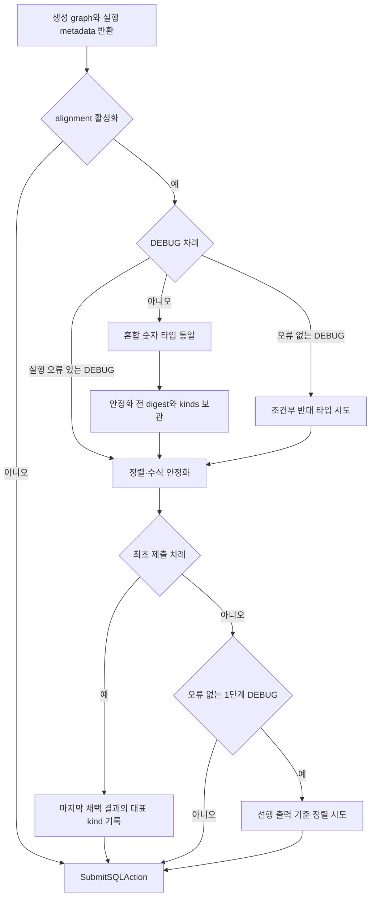
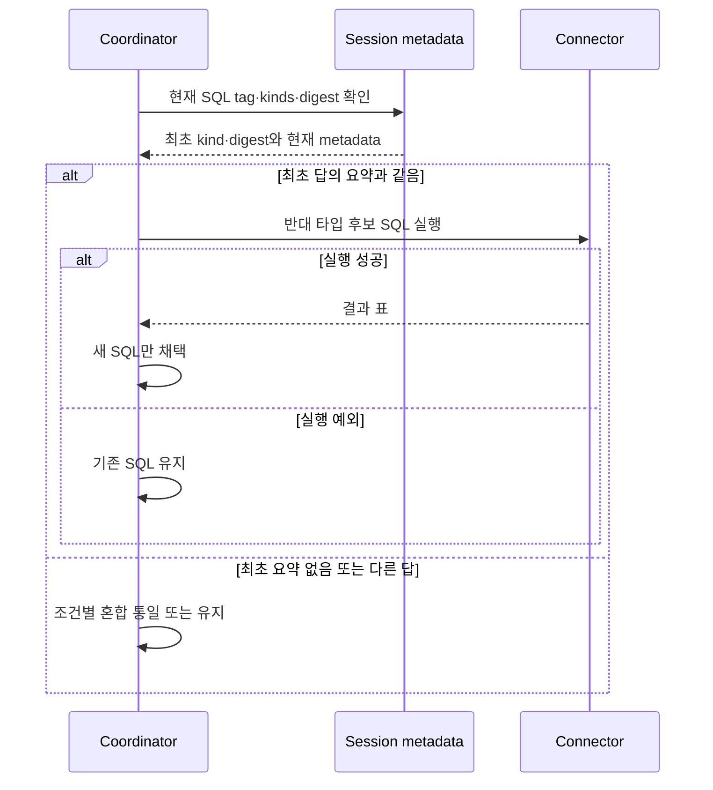
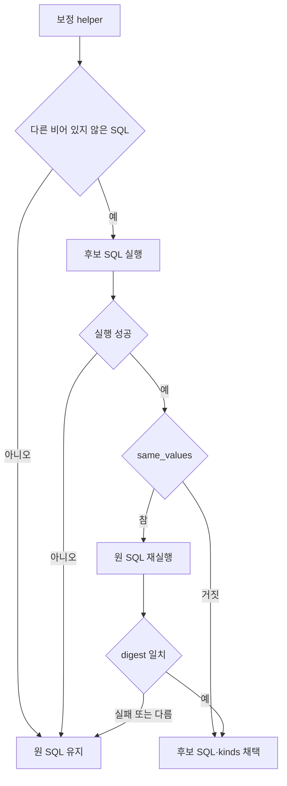

# Chapter 06-1. 숫자 타입·정렬 보정과 interactive 제출 경계

- 분석일: 2026-11-14.
- 범위: `numeric_types.py`의 출력 타입·정렬 helper와 interactive coordinator의 실제 호출·상태·테스트 정적 분석. 실제 DB·모델·테스트 실행은 하지 않았다.
- 선행: [SQL 실행·결과 계약](chapter-06-sql-execution-and-result-contract.md), [대상 DB·방언](../08-sql-generation/chapter-05-database-and-dialect-routing.md).
- 용어집: [상세 용어집](../01-architecture/chapter-00-glossary.md)

| 용어 | 뜻·이 문서에서의 의미 |
|---|---|
| Interactive | 질문·제출·오류 피드백을 차례로 주고받는 세션 방식이다. |
| DEBUG | 제출 뒤 피드백을 받아 SQL을 다시 만드는 차례다. |
| Cast | 값을 다른 타입으로 변환하는 SQL 표현이다. |
| Projection | SELECT의 출력 항목이다. |

## 1. 실행 노드와 제출 호출자의 책임

실행 노드는 결과의 숫자 종류(kind)·SQL 표식(tag)·값 요약(digest)을 선택적으로 기록한다. 이 장의 혼합 타입 통일·반대 타입 재시도·행 정렬 수정은 `SQLExecutionAgent`가 자동으로 모두 실행하는 기능이 아니다. 실제 호출자는 `retrieval/interactive/coordinator.py`다.

`_run_sql_generation`은 세션의 `numeric_type_alignment`를 생성 요청에 전달한다. 이 호출은 `calculation_only=True`, `shorten_answer=True`, `validate_sql_values=True`를 사용하고, 반환된 path_state를 세션에 병합한 뒤 SQL을 받는다. 세션의 alignment 기본값은 False다.

alignment가 켜져 있으면 생성 뒤 추가 SQL을 실제 실행할 수 있다. 코드 주석은 평가기의 수치 비교·저장 SQL 관찰을 동기로 설명하지만, 이 장에서 외부 평가기 구현·정답률은 확인하지 않았다. 일반 Text-to-SQL 요청 전체의 보편적 정확성 규칙으로 해석하지 않는다.



여기서 “오류 없는 DEBUG”는 `debug_error is None` 조건이다. 실행은 됐지만 답이 틀렸다는 피드백을 다루려는 경로다. 실행 오류가 있으면 반대 타입 재시도와 마지막 선행 출력 정렬은 생략하지만 일반 안정화까지 전부 끄지는 않는다.

근거: [coordinator.py](../../../code/auto-ontology/auto_ontology/retrieval/interactive/coordinator.py)의 `_run_sql_generation`, `step`; [세션 상태](../../../code/auto-ontology/auto_ontology/retrieval/interactive/state.py).

## 2. 어느 SQL의 결과인지 먼저 확인한다

`_numeric_kinds_for`, `_values_digest_for`는 `result_numeric_kinds_sql`이 현재 SQL의 strip 결과와 정확히 같을 때만 metadata를 쓴다. 의미가 같은 SQL이어도 공백·표기 변화가 있으면 일치하지 않을 수 있다. 다른 SQL·실패 이전 SQL의 결과 타입을 재사용하지 않기 위한 문자열 gate다.

값 요약은 [Chapter 06](chapter-06-sql-execution-and-result-contract.md)의 소수 둘째 자리·날짜 단위 정규화 결과다. 행·열 순서는 구분하고 컬럼 이름·원래 숫자 타입은 구분하지 않는다. SQL tag와 digest는 각각 문장 출처와 제한된 값 비교를 담당한다.

`dominant_kind`는 개수의 최빈값이 아니다. decimal이 하나라도 있으면 decimal, 없고 float가 있으면 float, 둘 다 없으면 None이다. `opposite_target`은 최초 decimal을 double로, 그 외를 numeric으로 바꾼다.

## 3. 출력 위치별 타입 변환

`flip_numeric_output_types`는 PostgreSQL 계열 방언에서 최상위 SELECT를 파싱하고, 출력 항목 수와 kinds 길이가 맞을 때 동작한다. UNION·파싱 실패·수 불일치 등은 보정 없음(None)이다. 어떤 projection 아래에서든 Star 노드를 발견하면 전체 보정을 생략한다. 따라서 단순 `SELECT *`뿐 아니라 내부 별표가 있는 표현도 이 gate의 영향을 받을 수 있다.

| 목표 | 바꾸는 위치 | 유지하는 위치 |
|---|---|---|
| numeric | kind가 float인 출력에 NUMERIC cast | decimal·정수/기타 출력, 고유 float 계열로 판정한 출력 |
| double | kind가 decimal인 출력에 DOUBLE PRECISION cast | float·정수/기타 출력 |

alias는 유지한다. COUNT와 NTILE·ROW_NUMBER·RANK·DENSE_RANK 계열 창 함수 출력은 정수 성격으로 제외한다. numeric 목표에서 WithinGroup 또는 PERCENT_RANK·CUME_DIST 계열 창 함수가 발견되면 고유 float 출력으로 제외한다. 창 함수는 여러 행의 순위·비율을 각 행에 계산하는 SQL 함수다. 이 규칙은 DB의 모든 함수 반환 타입을 조회한 목록이 아니다.

예를 들어 kinds가 `[None, "decimal", "float"]`라면 numeric 목표는 마지막 출력만 감싼다. 이 설명용 예시는 실제 DB 실행 결과가 아니다. helper 자체는 SQL 문자열만 만들며 채택은 caller가 결정한다.

근거: [numeric_types.py](../../../code/auto-ontology/auto_ontology/retrieval/text_to_sql/numeric_types.py)의 `flip_numeric_output_types`, `_is_integer_projection`, `_is_intrinsic_float_projection`, `dominant_kind`, `opposite_target`.

## 4. 최초 제출과 DEBUG의 숫자 분기

### 4.1 혼합 타입 통일

`_align_mixed_numeric_types`는 현재 SQL에 매칭된 kinds에 decimal과 float가 모두 있을 때 numeric 변환을 만든다. 관련 테이블로 connector를 선택하고 새 SQL을 실행한다. 연결 없음·후보 없음·실행 예외면 기존 SQL을 유지한다.

성공하면 새 표의 kinds·SQL tag·digest를 path_state에 기록하고 새 SQL을 채택한다. 원 SQL과 결과 값이 같은지 다시 비교하는 단계는 없다. numeric으로 통일해도 수치·성능·의미가 완전히 보존된다는 독립 검증은 아니다.

### 4.2 반대 타입 재시도

| 조건 | 동작 |
|---|---|
| 현재 SQL의 kinds 없음·tag 불일치 | 원 SQL 유지 |
| 최초 kind 없음, 최초 digest도 None, 현재 decimal 있음 | double 대체 시도 |
| 최초 kind 없음, 최초 digest는 있음 | 원 SQL 유지. 정수 최초 제출과 무기록을 구분 |
| 최초 kind 있음, 최초 digest가 없거나 현재 digest와 다름 | 반대 타입 대신 혼합 통일 경로 |
| 최초 kind 있음, 유효한 최초 digest와 현재 digest 일치 | 최초 kind의 반대 타입으로 변환·실행 |
| 후보 실행 실패 | 원 SQL 유지 |

최초 digest가 다른 것은 SQL 수정으로 값이 달라졌을 수 있다는 신호다. 이때 최초 타입의 반대가 새 답에도 맞는다고 가정하지 않는 구조다. 다만 digest의 반올림·순서 규칙 때문에 완전한 의미 동일성 판단은 아니다.

반대 타입과 무기록 double 재시도는 새 SQL이 실행되는지만 확인한다. 후보 실행 결과를 다시 원 결과와 비교하거나 새 kinds·tag·digest로 일반 갱신하지 않는다. 혼합 통일 성공의 상태 갱신과 구분한다.



근거: [coordinator.py](../../../code/auto-ontology/auto_ontology/retrieval/interactive/coordinator.py)의 `_align_mixed_numeric_types`, `_flip_numeric_types_for_retry`, `_retry_double_without_a_recorded_type`.

## 5. 정렬·수식 안정화의 실제 순서

`_stabilize_submitted_order`는 숫자 분기 다음에 실행한다. 이름과 달리 ORDER BY뿐 아니라 SUM·JSON 수식 타입도 바꾼다. 매번 직전 채택 SQL을 다음 helper에 넣는다. 마지막에 채택된 보정의 결과 kinds를 반환한다.

| 순서·helper | 구체 조건·변경 | 채택 기준 |
|---|---|---|
| 1. `order_groups_by_identifier` | 최상위 SELECT에 GROUP BY·ORDER BY가 있고 LIMIT 없음. 그룹 키와 맞는 출력 중 이름 끝이 id/key/code이고 아직 정렬하지 않은 항목을 오름차순 NULLS LAST로 추가 | 새 SQL 실행 성공 |
| 2. `order_periods_chronologically` | 첫 정렬 이름 끝이 rank/row_number/rn이고 기간 이름(month/date/year/day/time) 정렬 키가 있음. 기간 키만 오름차순 NULLS LAST로 남김 | 새 SQL 실행 성공 |
| 3. `sum_decimal_casts_to_integer` | 전체 구문 트리의 SUM 안에서 직접 DECIMAL cast인 피연산자를 INT cast로 변경 | 실행 성공과 원 SQL 값 요약 일치 |
| 4. `float_json_arithmetic` | 알려진 real 컬럼의 DECIMAL cast와 JSON 추출의 DECIMAL cast가 같은 트리에 존재하면 JSON cast를 DOUBLE로 변경 | 새 SQL 실행 성공 |

NULLS LAST는 빈 값을 정렬 마지막에 놓는 지시다. 그룹 보정은 직접 집계 출력은 건너뛰며, ID처럼 보이는 접미사·그룹 식 일치에 의존한다. 실제 유일 키인지, 선행 정렬이 집계인지까지 증명하지 않는다.

기간 보정은 질문 의도를 다시 읽지 않는 이름 규칙이다. 그룹 보정과 달리 LIMIT 차단 조건이 없으며 다른 정렬 키를 버린다. 이때 최상위 출력의 직접 FLOAT/DOUBLE cast도 제거하며 특정 AVG 표현에만 한정하지 않는다.

SUM 보정은 DECIMAL의 소수 자리·값의 정수 여부를 helper에서 검사하지 않는다. 그래서 caller가 값 비교를 추가한다. JSON 보정은 real 컬럼 쪽 DECIMAL cast를 남기며, JSON을 포함한 최상위 출력의 바깥 DECIMAL cast는 제거할 수 있다. real과 JSON이 같은 개별 산술식에 속하는지까지 맞추는 gate는 아니며 트리 전체에서 조건을 찾는다.

SQL parser의 AST(Abstract Syntax Tree, 문장을 구조로 나눈 구문 트리) 변경은 모델 재생성이 아니다. 이 후보들은 전체 검증 graph에 다시 넣지 않고 직접 SQL 실행으로 확인한다. 앞선 [구문 검사](chapter-01-parse-and-static-validation.md)의 `order_string_aggregates`는 별도 호출이며 이 네 단계에 포함되지 않는다.

### 5.1 float 컬럼 이름 조회와 방언 선택

`_real_column_names`는 SQL에 문자열 `->>`가 있을 때만 동작한다. 주석의 “JSON cast” 설명보다 실제 조건은 단순하다. cache가 없으면 관련 테이블 connector에서 다음 SQL을 실행한다.

```sql
SELECT column_name FROM information_schema.columns
WHERE table_schema = 'public'
AND data_type IN ('real', 'double precision')
```

소문자 컬럼 이름만 정렬해 `path_state.real_column_names`에 저장한다. 관련 테이블·테이블별 소유·다른 schema·DB 식별자를 cache key에 넣지 않는다. 조회 실패는 빈 집합으로 돌아가고 성공 cache를 쓰지 않는다. public schema 전체의 동명 컬럼 때문에 실제 표현 소유 타입과 달라질 수 있다는 것은 코드에서 도출한 미재현 경계다.

`_postgres_dialect`는 전체 세션 connector 중 첫 PostgreSQL 방언을 고른다. 후보를 실제 실행할 때는 관련 테이블로 connector를 다시 선택한다. 여러 엔진이 섞인 세션에서 보정용 방언과 실행 대상이 항상 같다는 검사는 이 helper에 없다.

## 6. 실행 확인·값 비교와 마지막 정렬

`_submit_if_it_runs`는 후보가 비거나 같으면 실행하지 않는다. 다른 후보면 connector에서 실행하고 예외 시 원 SQL을 유지한다. 기본은 실행 성공만 확인하며 후보 표의 kinds를 함께 반환한다.

여기서 fallback은 주로 `execute_chat_sql` 호출의 try 범위다. connector 선택·후속 kinds/digest 계산까지 모든 예외를 잡아 원문으로 복구하는 계약은 아니다. 예를 들어 혼합 통일의 실행 성공 뒤 metadata 계산 예외는 그 실행용 catch 밖에 있다.

`same_values=True`인 SUM 단계만 `_result_values_match`를 추가한다. 후보가 먼저 실행된 뒤 원 SQL을 재실행하고 두 digest를 비교한다. 원문 재실행 실패·다른 digest면 후보를 버린다. 두 빈 표는 digest가 모두 None이므로 같다고 판정할 수 있다. 같은 snapshot·transaction을 잡거나 외부 변경을 차단하는 코드는 이 caller에 없다.



안정화 뒤, 오류 없는 DEBUG이면서 phase가 `ROUND1_CLARIFY`일 때만 `order_by_leading_aggregate`를 추가한다. 이 helper는 LIMIT 없는 최상위 SELECT에서 첫 정렬이 뒤쪽의 대상 출력이면 첫 대상 출력 alias로 바꾼다. 방향은 유지하고 추가 동률 키는 버린다. 후속 2단계는 그대로 둔다.

대상 출력 집합을 만드는 `_aggregate_outputs`는 이름과 달리 실제 AggFunc 존재를 요구하지 않는다. alias가 있고 내부가 단순 Column이 아닌 식 중 ID·rank 계열 이름을 제외한다. 따라서 “반드시 첫 집계로 정렬”보다 실제 식·이름 조건으로 이해해야 한다. 이 마지막 보정도 기본 실행 성공만 확인한다.

## 7. 세션 상태·반환 SQL·저장 경계

최초 제출의 `first_submit_values_digest`는 혼합 통일 이후이면서 안정화 이전 결과에서 저장한다. 반면 `first_submit_numeric_kind`는 안정화에서 마지막으로 채택한 결과 kinds를 우선한다. SUM이 정수가 되거나 기간 보정이 float cast를 제거하면 최초 kind도 달라질 수 있다. 후속 DEBUG와 안정화 전 값끼리 비교하려는 구조다.

| 작업 | 갱신하는 것 | 일반 갱신하지 않는 것 |
|---|---|---|
| 생성 graph 반환 | 세션 path_state 병합 | 최종 제출 전 모든 보정의 결과까지 선반영하지 않음 |
| 혼합 타입 통일 성공 | 결과 kinds·SQL tag·digest | DB 결과 JSON·path_state.sql_code 전체 동기화 |
| 반대 타입 재시도 | 반환할 SQL | 결과 kinds·SQL tag·digest |
| 일반 안정화 성공 | 로컬 SQL·반환 kinds, 최초 차례의 대표 kind | 결과 JSON·SQL tag·기존 SQL 필드·최초 digest |
| 마지막 선행 출력 정렬 | 최종 제출 SQL | 대표 kind 재기록·결과 JSON 동기화 |

최종 반환은 `SubmitSQLAction(sql=sql)`이다. 반환 SQL과 기존 DB 결과 JSON·path_state.sql_code가 같은 세대라고 단정하면 안 된다. 이 장의 코드는 직접 DB 조회와 세션 메모리 갱신이며 catalog 쓰기·대화 영구 저장 호출은 없다. 전체 interactive 상태 전이·세션 수명·외부 제출 프로토콜은 12단계에서 분석한다.

## 8. 테스트 근거·미확인 사항과 인계

다음 assertion을 정적으로 읽었으며 실행하지 않았다.

| 근거 | 확인한 계약 |
|---|---|
| [test_numeric_types.py](../../../code/auto-ontology/auto_ontology/retrieval/text_to_sql/tests/test_numeric_types.py) | 위치/alias·개수/Star/UNION·방언·정수/창 함수 제외, 그룹 ID/카테고리/LIMIT, 기간/rank/cast, 선행 출력·SUM·JSON float 조건 |
| [test_coordinator.py](../../../code/auto-ontology/auto_ontology/tests/interactive/test_coordinator.py) 숫자·정렬 관련 | 같은/다른 답·누락 digest·stale tag·정수 최초 제출·무기록 decimal·실행 오류/후보 실패·flag 기본/옵트인·혼합 통일 상태 갱신 |
| 같은 coordinator 테스트의 안정화 관련 | 1단계/2단계 정렬 차이, 최초 kind와 안정화 전 digest, 정수 SUM 채택·분수 SUM 거부·실행 실패 유지·기간 cast 제거 |

coordinator 테스트는 생성 호출을 대체하고 가짜 connector가 준비한 DataFrame을 반환한다. 원격 PostgreSQL의 cast·반올림·NULL 순서·동시 변경을 실제 검증한 결과가 아니다.

코드 사실은 호출 순서·gate·필드·후보 실행·비교 규칙이다. 이름 휴리스틱(간단한 추정 규칙)의 정답성, coarse digest의 구분 한계, 다중 DB 방언/cache·상태 세대 차이는 코드에서 도출한 경계다. 실제 평가기·정답률·권한·추가 실행 비용·DB/모델/graph 통합·테스트 실행·Mermaid 렌더링은 미검증이다.

후속 [Chapter 07](chapter-07-empty-result-repair-and-fallback.md)은 빈 결과 LIKE 검사·값/NULL 보정·재실행·최종 fallback을 분석한다. 이 장의 interactive DEBUG와 빈 DB 결과를 graph 내부에서 고치는 경로를 구분한다.
