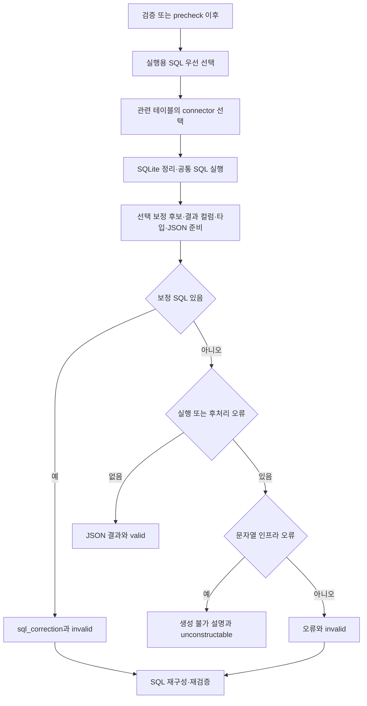
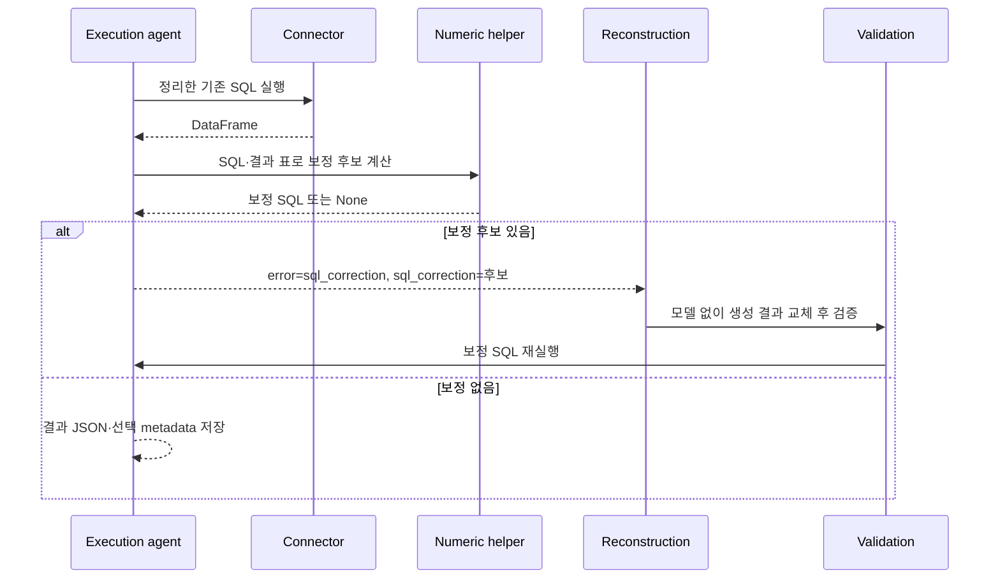
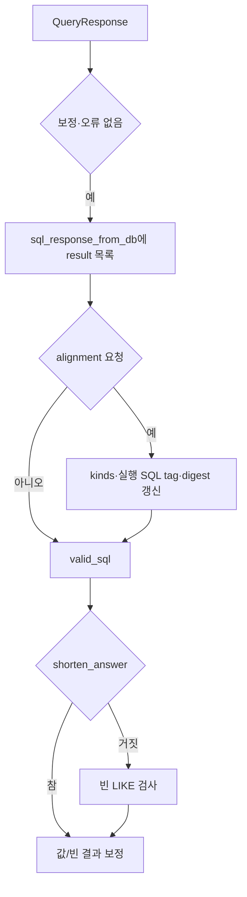

# Chapter 06. SQL 실행·오류 분류와 결과 계약

- 분석일: 2026-11-14.
- 범위: `SQLExecutionAgent`, `_run_sql`, 공통 SQL 호출·DB 오류 분류·직접 호출 숫자 helper와 관련 테스트의 정적 분석. 원본 수정·실제 DB·모델·pytest 실행은 하지 않았다.
- 선행: [재구성·보정 설치](chapter-05-sql-reconstruction-and-failure.md), [구문·정적 검사](chapter-01-parse-and-static-validation.md), [커넥터 실행·timeout·자원](../03-connectors/chapter-11-execution-timeout-and-resources.md).
- 용어집: [상세 용어집](../01-architecture/chapter-00-glossary.md)

| 용어 | 뜻·이 문서에서의 의미 |
|---|---|
| Connector | DB 연결과 SQL 실행을 담당하는 객체다. |
| DataFrame | 실행 결과를 행·열로 담는 표 구조다. |
| JSON | 이 결과를 문자열로 전달할 때 사용하는 데이터 형식이다. |

## 1. 실제 진입과 SQL·DB 선택

graph의 노드 이름은 `execute_sql_query`다. 통합 검증과 선택적 precheck를 거쳐 들어오며 실행용 `path_state.sql_code`를 우선한다. 그 값이 없거나 strip 후 비면 `sql_generation_result.sql_code`를 사용한다. 실행 전 SQL 존재를 같은 규칙으로 검사한다.

이 agent는 `failure_decision="invalid_sql"`을 지정한다. 입력 검사 실패·일반 예외가 공통 wrapper로 처리될 때도 이전 valid decision을 그대로 유지하지 않고 invalid로 바꾸는 계약이다. 실행용 SQL과 생성 결과가 서로 다르면 이 자리에서는 실행용 필드가 우선이며 독립적인 일치 검사는 없다.

관련 테이블과 전체 connector 목록을 `resolve_connector_from_tables`에 넘긴다. 첫 connector를 무조건 실행한다는 오래된 클래스 주석과 실제 코드는 다르다. 테이블 DB 이름이 여러 개면 거부하고, 식별된 DB와 일치하는 연결을 선택한다. DB metadata가 없고 연결이 하나면 그 연결을 쓴다. 자세한 대소문자·중복·누락 계약은 [대상 DB·방언](../08-sql-generation/chapter-05-database-and-dialect-routing.md)을 따른다.

연결이 전혀 없어 None이면 `_run_sql`이 오류 결과를 반환한다. 여러 연결의 모호함·불일치 등 connector 선택의 예외는 `_run_sql` 밖에서 나므로 공통 wrapper가 처리한다. 모든 연결 문제에 같은 “접속 실패” 설명이 나오는 것은 아니다.



근거: [실행 agent](../../../code/auto-ontology/auto_ontology/retrieval/text_to_sql/agents/sql_execution.py), [connector 선택](../../../code/auto-ontology/auto_ontology/retrieval/text_to_sql/connector_routing.py), [공통 wrapper](../../../code/auto-ontology/auto_ontology/retrieval/text_to_sql/base.py).

## 2. 방언 정리·로그와 timeout

`_sanitize_sql_for_dialect`는 dialect를 소문자로 봤을 때 sqlite이면 SQL 전체의 `\bPUBLIC\.`를 정규식으로 제거한다. 다른 방언은 유지한다. AST(Abstract Syntax Tree, SQL 구문 트리) 기반 한정 이름 수정이 아니므로 문자열·주석의 같은 텍스트까지 구분해 제외하지 않는다.

실행은 `execute_chat_sql(connector, sql)` 한 번으로 시작한다. 이 helper는 DB 이름·실행 종류·가능하면 auth_mode를 INFO 로그에 넣는다. auth_mode는 사용 인증 방식 표기이며 토큰 자체를 그 자리에 출력하는 필드는 아니다. 로그 SQL은 앞 4,000자와 생략 길이로 제한하지만 실제 전송 SQL을 자르는 것은 아니다.

| 조건 | 전달 인수 |
|---|---|
| `supports_statement_timeout=False` 또는 없음 | `connector.execute(sql)` |
| timeout 지원, 명시 timeout 없음 | 설정에서 읽은 `timeout_s`를 전달 |
| 공통 helper에 명시 timeout 전달 | 설정 대신 해당 값을 전달. 실행 agent의 현재 호출은 이를 따로 지정하지 않음 |

SQL Query Timeout 기본은 30초다. 설정 조회 실패·행 없음·정수 변환 실패·허용 범위 1~3600초 밖이면 기본값을 쓴다. 지원 connector에서는 문장마다 읽으므로 다음 SQL부터 변경 설정을 반영할 수 있다.

timeout 인수 전달은 전체 작업의 정확한 경과 시간 상한·연결 수립·웨어하우스 대기·원격 쿼리 종료를 모두 보장하는 것은 아니다. 엔진별 구현은 기존 Connector Chapter 11의 분석을 연결한다. `_run_sql`에 자체 thread·일괄 retry·LIMIT 보충·읽기 전용 SQL 검사는 없다. probe 실행기의 별도 guard와 구분한다.

근거: [chat_sql.py](../../../code/auto-ontology/auto_ontology/retrieval/text_to_sql/chat_sql.py), [설정 조회](../../../code/auto-ontology/auto_ontology/infra/feature_flags.py)의 `get_sql_query_timeout_seconds`, `read_configuration_int`.

## 3. `_run_sql`의 순서와 예외 범위

실행과 후처리가 한 try에 있다.

```text
원본 SQL 기억
→ 방언별 문자열 정리
→ execute_chat_sql로 DataFrame 취득
→ 선택적 sql_correction 후보 계산
→ 중복 결과 컬럼 label 정리
→ 선택적 숫자 kind·values digest 계산
→ DataFrame을 records JSON으로 직렬화
→ QueryResponse 반환
```

SQL이 DB에서 성공했어도 보정 계산·컬럼 처리·타입 metadata·JSON 변환이 실패하면 같은 `error=str(exception)` 결과가 된다. 이 경우 statement에는 정리 후 SQL이 들어간다. “실행 오류”라는 반환 이름만으로 DB가 문장을 거부했는지 후처리가 실패했는지 구분할 수는 없다.

숫자 보정 후보가 있더라도 위의 metadata·JSON 처리까지 완료한 뒤 QueryResponse를 반환한다. 후처리 예외가 나면 보정 후보를 별도로 유지해 반환하지 않는다. 연결이 None인 조기 오류는 statement 없이 `No connector available ...`을 반환한다.

## 4. 중복 label과 JSON 결과

결과 label은 컬럼 이름·alias처럼 출력 표의 열을 식별하는 값이다. 같은 label은 records JSON으로 바꾸기 어려우므로 `_deduplicate_result_columns`가 유일한 이름으로 바꾼다.

기존 모든 label을 reserved 집합에 두고, 처음 label은 유지하며 이후 중복에 `__2`, `__3` 등을 붙인다. 이미 예약된 다른 열의 이름을 빼앗지 않는다. 예를 들어 `ID, ID, ID__2`는 `ID, ID__3, ID__2`가 된다. 실제 변경이 있을 때만 DataFrame 사본을 만들고 컬럼 label을 바꾸므로 원래 표의 이름을 직접 덮지 않는다.

이 처리는 SQL의 SELECT alias 자체를 바꾸지 않는다. 반환 JSON의 key 이름과 생성 SQL의 출력 label이 다를 수 있다. SQL 의미나 요청 출력 이름과의 일치를 새로 판단하는 검사는 아니다.

`df.to_json(orient="records", date_format="iso", default_handler=str)`로 행 객체 목록의 문자열을 만든다. 빈 DataFrame이면 문자열 `"[]"`를 만든다. 최종 QueryResponse.result는 **JSON 문자열 한 개를 담은 목록**이다.

```text
DataFrame: ID=1, Name=Ada 한 행
QueryResponse.result: ['[{"ID":1,"Name":"Ada"}]']
빈 표의 result: ['[]']
path_state.sql_response_from_db: 위 result 목록
```

이는 설명용 데이터 형식 예시다. 마지막 path_state에는 QueryResponse 객체 자체를 저장하지 않는다. 클래스 docstring의 객체 표기보다 실제 `.result` 대입을 우선한다. 빈 표도 바깥 목록 길이는 1이므로 후속 empty 검사는 내부 JSON을 해석해야 한다.

`sliced`는 현재 성공·실패 모두 False다. 이 함수가 결과를 잘라냈다는 표시를 새로 계산하지 않는다. probe의 max_rows와 달리 실행 helper에 명시 결과 행 수 제한이 없으며 connector·SQL 자체의 반환 정책은 별도다.

## 5. 결과 타입 분류와 digest

`numeric_type_alignment`가 truthy일 때만 `_run_sql(..., record_numeric_kinds=True)`를 호출한다. 일반 요청은 추가 숫자 metadata를 계산하지 않는다. JSON 직렬화 전 DataFrame을 바탕으로 계산한다.

### 5.1 열별 kind

`numeric_column_kinds`는 위치별 첫 비NULL 값을 보고 Decimal이면 decimal, Real이면서 Integral이 아니면 float, 그 외는 None으로 분류한다. Decimal은 십진수 객체이고 Real/Integral은 Python의 실수/정수 범주다. 빈 결과 열·전부 NULL인 열도 None이다.

NULL 때문에 정수 컬럼이 pandas float로 올라갈 수 있어, float 후보 열에 NULL이 있고 비NULL 값이 모두 정수 형태면 None으로 취급한다. 실제 float 컬럼의 값이 우연히 정수·NULL 조합이어도 같은 처리다. DB 선언 타입 전체를 재조회하거나 모든 혼합 타입을 분석하는 함수는 아니다.

### 5.2 값 비교용 요약

digest는 값을 정규화해 만든 비교용 hash(짧은 요약 문자열)다. `result_values_digest`는 비어 있지 않은 표를 행·열 순서대로 읽어 정규화한 뒤 SHA-1로 요약한다. 컬럼 label·원래 수치 타입은 요약 입력에 포함하지 않는다.

| 값 범주 | 정규화 |
|---|---|
| 정수·실수·Decimal | Decimal을 이용해 소수 둘째 자리, ROUND_HALF_UP 방식으로 반올림한 문자열 |
| None·NaT·`<NA>` | `NULL` |
| bool | True/False의 문자열 표현 |
| strftime을 가진 날짜/시간 객체 | 연-월-일 문자열 |
| dict·list | key 정렬 JSON |
| 기타 | 문자열 표현 |

날짜의 시간 부분·컬럼 label·수치 소수 셋째 자리 이후를 구분하는 원본 결과 동일성 검사는 아니다. 예를 들어 숫자 5와 Decimal 5.00은 같은 요약을 만들 수 있고, None과 문자열 NULL처럼 일부 다른 값도 같은 정규 문자열로 표현될 수 있다. 숫자의 NaN·Infinity 처리도 타입별 분기에 영향을 받는다. 실제 데이터에서 충돌·오판을 재현하지 않았다.

행 순서·열 순서는 유지하므로 같은 값의 행을 뒤집으면 요약이 달라진다. 표가 비거나 열이 없으면 None을 반환한다. 보충 [Chapter 06-1](chapter-06-1-numeric-and-order-submission.md)은 이 요약을 재시도 조건으로 쓰는 실제 caller를 설명한다.

근거: [numeric_types.py](../../../code/auto-ontology/auto_ontology/retrieval/text_to_sql/numeric_types.py)의 `numeric_column_kinds`, `_normalise_cell`, `result_values_digest`.

## 6. 실행 성공 뒤에도 재구성이 필요한 보정 신호

`_sql_correction_for`는 숫자 alignment 요청에서만 동작한다. 정리 후 SQL에 `cast_jsonb_numeric_projections`를 적용하고, 새 SQL이 없으면 정리 후 SQL 자체를 후보로 본다. strip 후 원래 SQL과 같으면 None, 다르면 보정 후보를 반환한다.

JSONB scalar 출력 보정은 PostgreSQL/별칭 postgresql, 비어 있지 않은 결과, 최상위 SELECT와 결과 컬럼 수 일치가 필요하다. 각 bare `JSONExtractScalar` 출력의 비NULL 값이 모두 문자열이고 `^-?\d+\.\d+$` 형태일 때 그 출력을 NUMERIC cast로 감싼다. NUMERIC은 십진수 타입이다.

정수 형태 문자열·지수 표기·플러스 기호·문자 코드·명시적 다른 cast 출력 등은 같은 조건을 만족하지 않는다. 관찰된 결과 전부가 숫자 모양이라는 근거이며, future 행의 타입·업무상 코드 의미까지 보장하지 않는다. helper는 이 자리에서 새 SQL을 실행하지 않는다.

SQLite의 PUBLIC 접두어 제거도 original/executed 차이라서 alignment 요청이면 보정 후보가 될 수 있다. alignment가 꺼져 있으면 SQLite 문자열 정리는 실행하되 이 차이를 sql_correction으로 다시 제출시키지 않는다.



agent는 보정 신호를 오류보다 먼저 처리하며 error·sql_correction·trace를 기록하고 invalid를 반환한다. 이미 실행한 DataFrame의 result·metadata는 정상 성공 상태에 새로 대입하지 않는다. 재구성의 모델 없는 설치도 실패 이력을 소비하며, 새 SQL이 다시 검증·실행돼야 한다.

## 7. 인프라 오류와 SQL 오류를 나누는 실제 규칙

`is_infrastructure_error`는 예외 클래스·SQLSTATE(드라이버의 상태 코드) 분기 대신 **문자열 포함 검사**를 사용한다. 세션 손실 표현과 접속 거절·reset·broken pipe·DNS·transport·connector 없음 등 정해진 marker가 대상이다.

먼저 `_diagnosis(error, statement)`가 오류를 소문자·공백 축약으로 정리한다. `== SQL ==` 뒤의 echoed SQL 부분을 제거하고, 실제 전송 statement 및 그 안의 따옴표 literal 조각들도 긴 것부터 오류 문장에서 공백으로 치환한다. 사용자 SQL의 `'connection reset'` 같은 값이 진단으로 오인되지 않게 하려는 처리다.

statement는 생성 원문보다 실제 정리 후 SQL을 전달한다. 인용 문자열 추출은 SQL parser가 아닌 정규식이므로 escape·드라이버의 모든 echo 표기를 완전히 처리하는 것은 아니다. 원래 SQL literal과 실제 진단 문구가 같으면 진단 일부도 제거될 수 있는 경계는 미재현으로 남긴다.

| 분류 | agent 상태와 다음 분기 |
|---|---|
| marker 포함 | error 원문·짧은 trace·고정 접속 문제 설명, `unconstructable` |
| 그 외 | error 원문·재수정 trace, `invalid_sql` |
| 보정 신호 있음 | 분류 전에 `sql_correction` invalid 경로 |

권한 거부·알 수 없는 컬럼·문법·일반 cast 오류는 이 marker 집합만으로 인프라로 분류되지 않을 수 있다. timeout도 모든 표현을 똑같이 처리하는 것이 아니라 marker에 들어간 접속/socket 문구 등에 좌우된다. “인프라 아님”이 모델 수정으로 실제 해결 가능하다는 증명은 아니다.

trace에 쓰는 오류는 공백을 한 줄로 모으고 앞 300자와 생략 기호로 제한한다. path_state.error는 이 짧은 요약이 아닌 전체 문자열이다. 인프라 기본 설명은 쿼리가 실행되지 않았다는 접속 문제 문구지만, 공통 try가 실행 후처리 오류도 담으므로 이 문자열 분류가 모든 실제 실행 시점을 독립 검증하는 것은 아니다.

근거: [db_errors.py](../../../code/auto-ontology/auto_ontology/connectors/db_errors.py)의 `_diagnosis`, `is_session_lost`, `is_infrastructure_error`.

## 8. 정상 결과·상태·후속 검사



alignment 요청이면 `result_numeric_kinds`, `result_numeric_kinds_sql`에 strip한 실제 SQL, `result_values_digest`를 갱신한다. SQL tag는 어느 문장의 결과인지 구분하는 표식이다. flag가 꺼져 있을 때 이 키를 새로 쓰지 않지만, 이미 있던 키를 명시 삭제하는 코드도 아니다.

성공 시 기존 error·sql_correction·이전 생성 불가 설명을 전부 초기화하는 단계는 없다. 오류·보정 조기 반환도 이전 DB 결과·숫자 metadata를 전부 지우지는 않는다. 이전 검증의 결과 초기화와 상위 SQL tag 확인에 의존하는 경계를 구분한다.

원본 DB 읽기·실행, 결과 표/JSON·메모리 상태·trace·로그가 이 장의 경계다. catalog에 실행 SQL을 저장하거나 대화 기록을 영구 쓰는 호출은 이 노드에 없다. connector의 자원 정리·권한·읽기 전용 보장은 커넥터 계약에서 확인해야 한다.

## 9. 관련 테스트·한계와 다음 문서

이 작업에서 다음 assertion을 읽었으며 실행하지 않았다.

| 테스트 파일 | 확인한 계약 |
|---|---|
| [test_sql_execution.py](../../../code/auto-ontology/auto_ontology/retrieval/text_to_sql/tests/test_sql_execution.py) 3개 | 결과 label 충돌 회피·원표 유지·유일 label 유지, metadata 예외도 query error로 반환. 실제 SQL 호출은 DataFrame 반환으로 대체한다. |
| [test_numeric_types.py](../../../code/auto-ontology/auto_ontology/retrieval/text_to_sql/tests/test_numeric_types.py) 실행/보정/kind/digest 관련 | SQL tag·flag off·JSONB 숫자 문자열·SQLite 정리 보정 신호, nullable 정수·빈 결과·숫자 타입·2자리/행 순서 요약. connector는 준비된 표를 반환한다. |
| [test_chat_sql.py](../../../code/auto-ontology/auto_ontology/retrieval/text_to_sql/tests/test_chat_sql.py) 12개 | 로그 종류·auth_mode·길이·기본/변경/명시 timeout·설정 실패 기본값·미지원 인수 생략. 실제 원격 timeout 종료 시험은 아니다. |
| [test_db_errors.py](../../../code/auto-ontology/auto_ontology/connectors/tests/test_db_errors.py) | 세션·접속 marker, SQL 오류 유지, SQL echo·재렌더링·인용 literal 제거의 문자열 assertion. |
| [test_infrastructure_failure.py](../../../code/auto-ontology/auto_ontology/retrieval/text_to_sql/tests/test_infrastructure_failure.py) | 세션 손실 생성 불가·잘못된 컬럼 재구성·short answer 분기·router 상한·설명 전달. `_run_sql`을 대체한다. |
| [test_graph_state_failures.py](../../../code/auto-ontology/auto_ontology/retrieval/text_to_sql/tests/test_graph_state_failures.py) | 실행 입력 실패·예외가 stale valid 대신 invalid와 오류 사전을 반환. |

코드 사실은 실행/후처리 순서·조건·필드·분류 문자열이다. SQL 문자열 정리·echo 제거·kind 표본·digest 정규화·이전 상태 잔존의 정확성 경계는 코드에서 도출한 추론이며 실제 실패 재현 결과가 아니다. 실제 DB·모델·graph 통합·권한·대용량 메모리/시간·원격 취소·Mermaid 렌더링은 미검증이다.

다음 [Chapter 06-1](chapter-06-1-numeric-and-order-submission.md)은 기록된 종류·digest를 interactive 제출 시 어떻게 소비하고 숫자 타입·행 순서를 추가 수정하는지 설명한다. 그 뒤 01-9-6에서 빈 결과·LIKE·값·NULL 처리로 이어간다.
