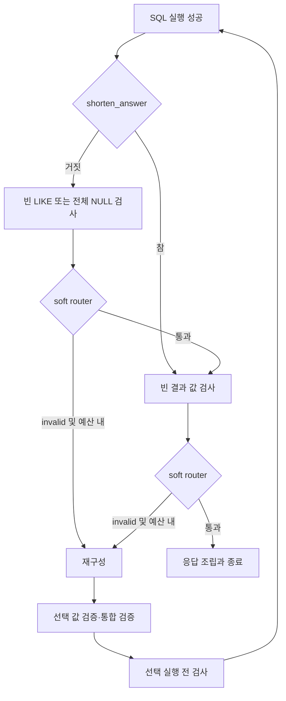
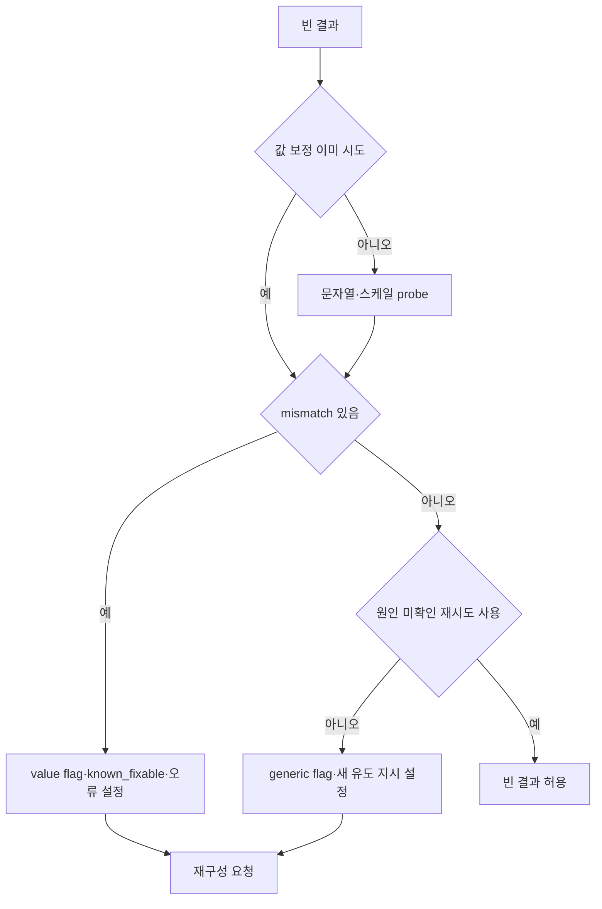
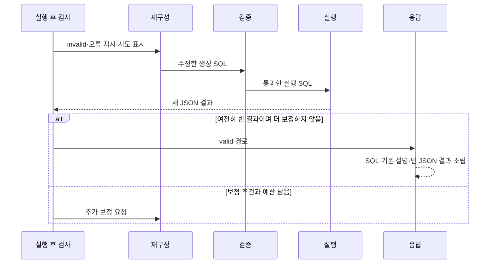

# Chapter 07. 빈 결과·NULL·LIKE 보정과 최종 반환

- 분석일: 2026-11-14.
- 범위: 실행 후 두 검사 agent, 관련 결과 해석·probe·모델·graph 분기·상태 수명·응답/fallback과 테스트의 정적 분석. 원본 코드·실제 DB·모델·테스트 실행은 포함하지 않는다.
- 선행: [SQL 실행·결과 계약](chapter-06-sql-execution-and-result-contract.md), [값·숫자 helper](chapter-04-1-literal-scale-and-division-checks.md), [SQL 재구성](chapter-05-sql-reconstruction-and-failure.md).
- 용어집: [상세 용어집](../01-architecture/chapter-00-glossary.md)

| 용어 | 뜻·이 문서에서의 의미 |
|---|---|
| NULL | DB의 값 없음이다. |
| LIKE | 문자열 패턴 조건이다. |
| ILIKE | 대소문자를 구분하지 않는 패턴 조건이다. |
| Probe | 원인을 좁히는 확인용 DB 조회다. |
| Fallback | 정상 경로가 실패했을 때 쓰는 대체 처리다. |

## 1. 책임·진입과 실제 graph

실행 성공은 결과가 질문의 답이라는 보장이 아니다. 이 단계는 빈 결과에서 너무 강한 문자열 조건·실제 값과 다른 literal(조건에 직접 적은 값)·숫자 단위 문제를 의심하고 기존 재구성으로 되돌린다. 결과가 비어 있지 않아도 JSONB 출력이 모두 NULL이면 한 번 경로 수정을 요청한다. JSONB는 PostgreSQL의 구조화된 JSON 저장 타입이다.

두 agent는 SQL을 직접 고치거나 재실행하지 않는다. 오류 지시와 `invalid_sql`을 반환하고, 실제 SQL 수정·검증·재실행은 기존 graph가 담당한다. 빈 결과 자체가 잘못된 답이라는 독립 증명은 없다.



`execute_sql_query` 성공의 일반 경로는 `check_empty_like_result → check_value_repair → format_and_respond`다. `shorten_answer=True`이면 첫 검사 노드 전체를 건너뛴다. 따라서 LIKE 모델뿐 아니라 같은 노드의 all-NULL JSONB 검사도 생략한다. interactive coordinator는 이 짧은 응답 옵션을 켠다.

두 노드는 별도 활성화 flag 없이 등록된다. 실행 전 `DB_PROBE_PROACTIVE`와 실행 후 값 검사는 다른 경로다. 실행 전 검사가 꺼져 있어도 실행 후 빈 결과 값 검사는 남는다.

근거: [graph](../../../code/auto-ontology/auto_ontology/retrieval/text_to_sql/text_to_sql_graph.py)의 `route_sql_execution`, `create_graph`; [LIKE/NULL agent](../../../code/auto-ontology/auto_ontology/retrieval/text_to_sql/agents/empty_like_result_check.py), [값 agent](../../../code/auto-ontology/auto_ontology/retrieval/text_to_sql/agents/empty_result_value_repair.py).

## 2. 빈 결과의 자료형 계약

두 agent의 `validate_input`은 `sql_response_from_db is not None`만 확인한다. SQL 존재·결과 형식·decision까지 새로 검증하지 않는다. SQL은 `_get_sql_code`가 실행용 `path_state.sql_code`를 우선하고 생성 결과의 SQL로 대체한다.

실행의 정상 반환은 JSON 문자열 한 개를 담은 목록이다. `_is_empty_db_result`는 이 형식 외 일부 변형도 처리한다.

| 입력 예시 | empty 판정 |
|---|---|
| None | False. 단, 실제 wrapper 입력 검사에서는 누락으로 거부 |
| `[]`, `"[]"`, 빈 문자열, `['[]']`, `['']` | True |
| JSON 문자열이 빈 list로 해석됨 | True |
| 여러 원소의 list | 각 원소가 재귀적으로 모두 empty일 때 True |
| 행 dict 목록·행이 있는 JSON list | False |
| 일반 dict·숫자·해석 불가능한 비어 있지 않은 문자열 | False |

따라서 `[{"count":0}]`과 `[{"metric":null}]` 형태의 JSON 결과는 행이 있어 empty가 아니다. 하나의 NULL 집계 행을 “0행”과 같게 처리하지 않는다. JSON 문자열의 null과 DB 결과 자체의 None도 구분한다. 해석 실패를 빈 답으로 단정하는 규칙은 아니다.

두 agent는 path_state를 얕은 사전 복사로 시작한다. 중첩 객체까지 독립 복사하는 것은 아니며, 성공/통과 시 기존 error·재시도 flag·결과를 일괄 삭제하지 않는다.

## 3. 행은 있지만 JSONB 출력이 전부 NULL인 경우

`EmptyLikeResultCheckAgent.execute`는 먼저 empty 여부를 본다. 비어 있지 않으면 `null_jsonb_retry_attempted`가 아직 없는 경우에만 `_null_jsonb_aliases`를 호출한다. 이 분기에는 LIKE 조건이 없어도 들어간다.

`_parse_db_rows`는 행 dict 목록, 단일 JSON 문자열 목록, JSON 문자열에서 dict 행만 얻으려 한다. 직접 list의 첫 항목이 dict이면 그 목록을 그대로 반환한다. 임의의 혼합 목록을 모두 정규화하는 일반 parser는 아니다.

alias는 SQL 구문 트리 대신 정규식으로 얻는다. 정확한 `->>` 문자열이 있고, 작은따옴표 key 뒤 같은 쉼표/줄바꿈 구간에 `AS`와 `\w+` alias가 있어야 한다. 중첩 접근·cast 뒤 alias 일부를 찾을 수 있지만 quoted alias·암시 alias·공백이 다른 연산자 표기 전체를 지원하지 않는다.

추출 alias를 소문자로 바꾸고 중복을 제거한 뒤 결과 행의 같은 key를 찾는다. 해당 key가 존재하는 값이 하나 이상이고 그 값들이 전부 Python None이면 대상이다. key가 없는 행은 제외한다. SQL alias 대소문자와 결과 JSON key가 다르면 놓칠 수 있고, 일부 행의 누락을 NULL로 계산하지 않는다. 결과 label 중복 정리도 alias 대응과 별도다.

검출하면 `null_jsonb_retry_attempted=True`, 대상 alias와 중첩/키 이름 수정 지시를 error에 넣고 invalid를 반환한다. 이 검출 자체는 DB probe·모델 호출을 하지 않는다. 재구성 모델 작업은 뒤에서 발생한다.

오류 문구는 JSONB 경로가 잘못됐다고 단정하지만, 정상적으로 값이 없는 데이터·필터 결과도 같은 all-NULL 모양일 수 있다. 이는 코드 신호의 정확성 경계이며 실제 오탐 재현은 하지 않았다. 한 번 시도한 뒤 같은 신호로 계속 차단하지 않는다.

## 4. 빈 결과의 LIKE 분류와 보존 지시

empty일 때 SQL 전체에서 대소문자 무시 `\bI?LIKE\b`를 찾는다. AST(Abstract Syntax Tree, SQL을 구조로 나눈 구문 트리)의 조건 추출이 아니므로 문자열·주석 안 단어도 gate를 통과할 수 있다. LIKE가 없거나 `empty_like_retry_attempted`가 이미 True면 valid로 통과한다.

원래 질문과 처리용 질문을 `format_dual_question_block`으로 만들고 SQL과 함께 `create_empty_like_check_prompt`에 넣는다. 모델에는 보수적인 분류 지시와 질문/SQL을 담은 SystemMessage 두 개를 전달한다. 실제 DB 행·샘플·별도 근거 조회는 이 호출에 넣지 않는다.

| 모델 출력 | 뜻 | 실제 후처리 |
|---|---|---|
| `essential_like_predicates: list[str]` | 질문의 주 대상을 식별해 유지할 조건 | 문자열 strip, 빈 항목 제거 |
| `non_essential_like_predicates: list[str]` | 선호·부가 속성이어서 완화/제거할 조건 | 문자열 strip, 빈 항목 제거 |

`EmptyLikeCheckModel`은 추가 필드를 금지하고 두 목록의 기본값을 빈 목록으로 둔다. 프롬프트는 모든 LIKE/ILIKE 조건을 정확히 인용하고, 불확실하면 essential로 분류하며 JOIN·숫자·비LIKE 조건 제거를 제안하지 말라고 한다.

실제 코드는 반환 문자열이 현재 SQL에 있는 조건인지, 두 목록이 겹치는지, 모든 조건이 분류됐는지 독립 검사하지 않는다. 이는 모델 지시와 코드 보장의 차이다. non-essential이 하나 이상이면 flag를 True로 바꾸고 재구성용 오류를 만든다. SQL을 직접 삭제·완화하지 않는다.

오류는 “나열한 부가 조건만 제거/완화하고 주요 대상·JOIN·숫자 임계값은 유지”하도록 요청한다. 예를 들어 텐트 종류 조건과 색상 선호를 나누라는 설명용 상황을 생각할 수 있지만, 실제 어떤 조건이 선택되는지는 모델 결과이며 이 작업에서 실행하지 않았다.

모델 호출 예외·None·부가 조건 없음은 모두 valid로 통과한다. 이때 retry flag는 새로 설정하지 않으므로 다른 이유로 노드를 재방문하면 분류를 다시 호출할 수 있다. 프롬프트 구성과 결과 후처리까지 모두 같은 try로 감싸는 것은 아니다.

근거: [LIKE agent](../../../code/auto-ontology/auto_ontology/retrieval/text_to_sql/agents/empty_like_result_check.py)의 `EmptyLikeCheckModel`, `build_empty_like_reconstruction_error`; [프롬프트](../../../code/auto-ontology/auto_ontology/retrieval/text_to_sql/prompts.py)의 `create_empty_like_check_prompt`.

## 5. 빈 결과의 실제 값·숫자 스케일 probe

`EmptyResultValueRepairAgent`는 결과가 비어 있지 않으면 바로 valid로 반환한다. 빈 결과이면서 `value_repair_attempted`가 없을 때 관련 테이블로 connector를 고르고 새 `ProbeExecutor` 안에서 아래 두 함수를 순서대로 실행한다.

```text
find_literal_mismatches(result_was_empty=True)
→ find_numeric_scale_mismatches
→ mismatch 목록 합치기
```

문자열은 equality/IN 값의 표기 차이·근접 후보·대소문자 변형과 양의 LIKE의 누락 변형을 검사한다. 숫자는 실제 MIN/MAX와 100배 스케일 후보를 비교한다. 자세한 추출·조건·예외·오류 문구는 [Chapter 04-1](chapter-04-1-literal-scale-and-division-checks.md)에 있다. 실행 전 검사와 달리 여기서는 정수 나눗셈 helper·직접 cast 보정을 호출하지 않는다.

empty 전용 차이는 `result_was_empty=True`다. DISTINCT가 기본 20개 임계값을 넘긴 고유값이 많은 컬럼에서도 특정 equality/IN literal의 실제 존재와 대소문자/공백 변형을 추가 조회할 수 있다. 고유값 전체 없이 철자 유사 후보를 찾는 기능으로 확장하는 것은 아니다.

probe는 현재 SQL에 등장한 테이블·컬럼을 개별 조회한다. 원래 JOIN·모든 WHERE 조합에서 그 후보가 결과 행을 만든다는 증거가 아니다. SQL 텍스트만으로 소유 후보를 찾는 조건과 전체 catalog 조회도 구분한다.

기본 budget은 executor당 실행 40회, 반환 50행이며 두 helper가 같은 executor 예산을 나눠 쓴다. 새 방문은 새 executor를 만들므로 설정 주석의 “질문당”을 전체 graph 누적 예산으로 해석하면 안 된다. helper 내부 cache와 executor 로그를 이 agent가 path_state에 영구 저장하는 호출도 없다.

읽기용 SELECT/WITH·문장/키워드·LIMIT guard와 공통 timeout은 [probe 실행 경계](chapter-03-value-validation-and-probe.md), [SQL 실행](chapter-06-sql-execution-and-result-contract.md)을 따른다. 개별 조회 실패·연결 없음은 보통 실패 결과로 바뀌어 mismatch를 못 찾는 방향이다. connector 선택 예외·다른 helper 예외까지 모두 “문제 없음”으로 같은 자리에서 잡는 것은 아니다.

mismatch가 있으면 `value_repair_attempted=True`, `error_known_fixable=True`, 후보/스케일 지시 error를 기록하고 invalid로 반환한다. 새 DB 값으로 SQL을 직접 치환하지 않고 재구성 모델이 수정한다. 실행 전 proactive 보정도 같은 `value_repair_attempted`를 사용하므로 먼저 소비했다면 이 후속 probe를 건너뛴다.

근거: [값 agent](../../../code/auto-ontology/auto_ontology/retrieval/text_to_sql/agents/empty_result_value_repair.py), [literal helper](../../../code/auto-ontology/auto_ontology/retrieval/text_to_sql/db_probe/literal_check.py)의 `find_literal_mismatches`, `_check_high_card_literals`; [설정](../../../code/auto-ontology/auto_ontology/retrieval/text_to_sql/db_probe/config.py), [실행 전 값 agent](../../../code/auto-ontology/auto_ontology/retrieval/text_to_sql/agents/proactive_value_check.py).

## 6. 원인을 찾지 못한 빈 결과의 별도 재생성

mismatch가 없으면 `empty_result_retry_attempted`를 확인한다. 이미 True면 빈 결과를 valid로 받아들인다. 없으면 True로 바꾸고 “다른 컬럼/테이블·JOIN 누락·날짜/단위를 다시 검토해 스키마부터 새로 유도”하라는 오류로 재구성을 요청한다.

이 분기 자체는 `error_known_fixable`을 새로 설정하지 않는다. 새 데이터가 필요하다고 분류되면 추가 테이블 검색을 허용하려는 의도다. 다만 기존 값을 명시 제거하거나 `error_analysis_done`을 False로 초기화하지도 않는다. 재구성의 분류는 chain에서 첫 한 번만 하므로 이전 분류를 이미 썼다면 항상 새 분류/검색이 보장되는 것은 아니다.



generic flag 검사보다 probe가 먼저다. mismatch가 없어서 `value_repair_attempted`를 쓰지 않았으면 generic 재생성 후 또 빈 결과일 때 probe를 다시 할 수 있다. 이미 generic 시도를 썼어도 새 mismatch가 나오면 targeted 보정이 먼저 선택된다. “원인 미확인 시도 한 번”은 모든 보정 합계가 한 번이라는 뜻이 아니다.

generic 오류는 literal을 DB와 확인했으니 오타가 아니라고 설명한다. 그러나 값 flag 때문에 probe를 건너뛰었거나 연결/예산/파싱 문제로 확인하지 못해도 같은 문구가 나온다. 테스트도 connector가 없는 상태에서 이 경로를 만든다. 따라서 그 문구를 DB 검증 성공 사실로 인용하면 안 된다.

## 7. 상태 수명·예외·재구성 한도

| 표시 | 쓰는 조건 | 같은 흐름의 효과 |
|---|---|---|
| `null_jsonb_retry_attempted` | all-NULL alias 발견 | 다음 비empty 결과의 NULL 경로 지적 생략 |
| `empty_like_retry_attempted` | 모델이 부가 조건을 반환 | 다음 empty 결과의 LIKE 분류 생략 |
| `value_repair_attempted` | 실제 mismatch 또는 실행 전 보정 소비 | 다음 empty 값 probe 생략 |
| `empty_result_retry_attempted` | 원인 미확인 재생성 요청 | mismatch가 없을 때 추가 generic 재시도 생략 |
| `error_known_fixable` | 값 mismatch 증거 | 재구성의 첫 분류에서 pop하면 모델 분류 생략 |

일반 재구성은 이 표시들을 모두 초기화하지 않는다. invalid를 받은 soft router는 `failed_attempts` 길이가 5 초과면 valid 경로로 통과시킨다. 이는 검사를 실행하기 전 생략하는 조건이 아니라 실행/flag 변경 이후 분기다. 별도의 실행·통합 검증 hard router는 invalid일 때 재구성 이력 7개 이상이면 생성 불가로 간다.

따라서 단일 검사 flag와 전체 이력 상한을 단순 합산한 고정 재실행 횟수로 설명할 수 없다. 6회 이상 이력이 있는 soft 검사는 invalid를 반환해도 다음 노드로 넘어갈 수 있다. soft router의 non-invalid도 valid로 매핑하며 state의 decision을 새로 수정하는 함수는 아니다.

두 agent는 `failure_decision`을 지정하지 않는다. 입력 검사 실패는 공통 wrapper의 execute try 앞에서 `AgentExecutionError`를 던진다. 일반 execute 예외는 error 사전을 기록하지만 새 decision을 주지 않아 직전 결정이 남을 수 있다. 정상 실행 후 valid가 남아 있으면 soft router가 통과할 수 있다. 모델 분류 내부의 명시 valid fallback과 이 공통 예외 경로를 구분한다.

전체 재시도와 interactive DEBUG/후속 질문의 삭제 목록은 값·NULL·LIKE 표시를 포함하지만 `empty_result_retry_attempted`는 포함하지 않는다. 전체 재시도는 현재 실패 상태가 아니라 최초 restore 사본에서 시작하므로 첫 시도 도중 생긴 generic flag가 그대로 남는다는 뜻은 아니다. 반면 최초 seed에 있던 generic flag는 삭제되지 않고, interactive 세션에 남은 flag도 해당 두 seed 함수에서 직접 제거하지 않는다. 다음 차례에서 generic 재시도 예산이 자동 복구된다고 단정할 수 없는 경계다. 실제 여러 차례 통합 재현은 하지 않았다.

근거: [공통 wrapper](../../../code/auto-ontology/auto_ontology/retrieval/text_to_sql/base.py), [router](../../../code/auto-ontology/auto_ontology/retrieval/text_to_sql/text_to_sql_graph.py)의 `_make_soft_check_router`, `route_sql_validation`; [main.py](../../../code/auto-ontology/auto_ontology/retrieval/text_to_sql/main.py)의 `_restore_for_full_pipeline_retry`, [coordinator](../../../code/auto-ontology/auto_ontology/retrieval/interactive/coordinator.py)의 `_apply_debug_seed`, `_apply_follow_up_seed`.

## 8. 재실행·응답·상위 fallback의 구분



재구성 후 값 검증 선택·통합 검증·선택 precheck·실행을 거친다. 두 검사 노드의 invalid 자체가 최종 SQL을 수정했다는 뜻은 아니다. 재구성 모델의 보존 지시 준수·새 SQL의 실제 의미는 별도 검증 대상이다.

통과하면 `ResponseAgent`는 생성 결과 객체의 sql_code와 설명, 현재 sql_columns·sql_response_from_db를 최종 사전에 담고 AIMessage를 추가한다. 빈 결과를 자동으로 설명하는 별도 모델 호출이나 다른 행으로 교체하는 로직은 이 조립 단계에 없다. 이 최종 사전을 만드는 것과 대화 기록의 영구 저장은 다른 경계다.

한도/실행 오류로 `unconstructable_sql_response`에 도착한 경우의 상위 전체 재시도는 [SQL 생성 Chapter 06](../08-sql-generation/chapter-06-full-retry-and-resume.md)에 있다. 빈 결과가 valid로 응답까지 도달한 것만으로 전체 pipeline을 다시 시작하지 않는다.

전체 두 시도가 생성 불가로 끝난 뒤의 deterministic SQL fallback은 마지막 의도 거부 SQL 기록이 있을 때 이를 최종 응답에 넣는 별도 경로다. 빈 결과를 보고 항상 실행하는 대체가 아니며, 그 함수는 SQL을 재실행하거나 결과 JSON을 새로 만들지 않는다. “반환 SQL 있음”과 “그 SQL의 검증된 결과 있음”을 구분한다.

근거: [응답 agent](../../../code/auto-ontology/auto_ontology/retrieval/text_to_sql/agents/response.py), [main.py](../../../code/auto-ontology/auto_ontology/retrieval/text_to_sql/main.py)의 `_should_retry_full_pipeline`, `_apply_last_deterministic_sql_fallback`.

## 9. 테스트·확인 수준과 다음 단계

| 근거 | 읽어서 확인한 assertion·범위 |
|---|---|
| [test_empty_result_retry.py](../../../code/auto-ontology/auto_ontology/tests/test_empty_result_retry.py) 5개 | 비empty 통과·원인 미확인 시도 표시/invalid·새 known_fixable 없음·한 번 사용 후 허용·값 보정 소비 뒤에도 generic 시도 가능. connector 없는 최소 상태로 직접 execute를 호출한다. |
| [test_infrastructure_failure.py](../../../code/auto-ontology/auto_ontology/retrieval/text_to_sql/tests/test_infrastructure_failure.py) 관련 사례 | 짧은 응답의 LIKE 노드 우회·일반 응답 유지·hard router 한도·생성 불가 설명. 전체 DB 실행이 아닌 모형 상태/함수 호출이다. |
| [test_literal_check.py](../../../code/auto-ontology/auto_ontology/tests/test_literal_check.py) | 기존 Chapter 04-1에서 추적한 문자열/패턴 probe와 오류 문구 assertion. 이 작업에서 빈 결과 graph 전체의 성공을 새로 확인한 것은 아니다. |
| [전체 재시도 문서](../08-sql-generation/chapter-06-full-retry-and-resume.md)의 관련 테스트 | 복원·최대 두 시도·의도 거부 SQL 대체·interactive seed의 기존 확인 범위를 재사용했다. |

로컬 테스트 검색에서 LIKE agent의 모델 분류·all-NULL alias 검출·empty parser를 직접 호출하는 테스트는 찾지 못했다. targeted 값 mismatch부터 재구성·재실행까지 이어지는 실제 DB 통합도 확인하지 않았다. 테스트 부재 검색과 실제 미구현 판정은 다르다.

확인한 사실은 결과 해석·문자열/alias 조건·모델 입력/응답·probe와 flag·router·응답 필드다. NULL/부가 조건의 오판·소문자 alias 대응·확인 실패를 단정하는 오류 문구·generic flag 초기화 누락·이전 분류 재사용은 코드에서 도출한 경계이며 실제 실패 재현 결과가 아니다.

실제 DB·모델·테스트·graph 통합·권한·빈 답의 정당성·필터 완화의 질문 보존·대용량 probe 비용·재시도 시간·다중 차례 상태·Mermaid 렌더링은 미검증이다. 원본 조회와 메모리/로그 변경을 분석했으며 이 두 검사에 catalog·대화 영구 저장 호출은 없다.

이 장으로 09단계의 예정 정적 분석을 마친다. 실행 검증은 각 장의 미확인 사항으로 인계한다. 다음은 10단계 chat runtime의 요청·대화 식별과 실제 호출 진입부터 계획을 작성해 분석한다.
