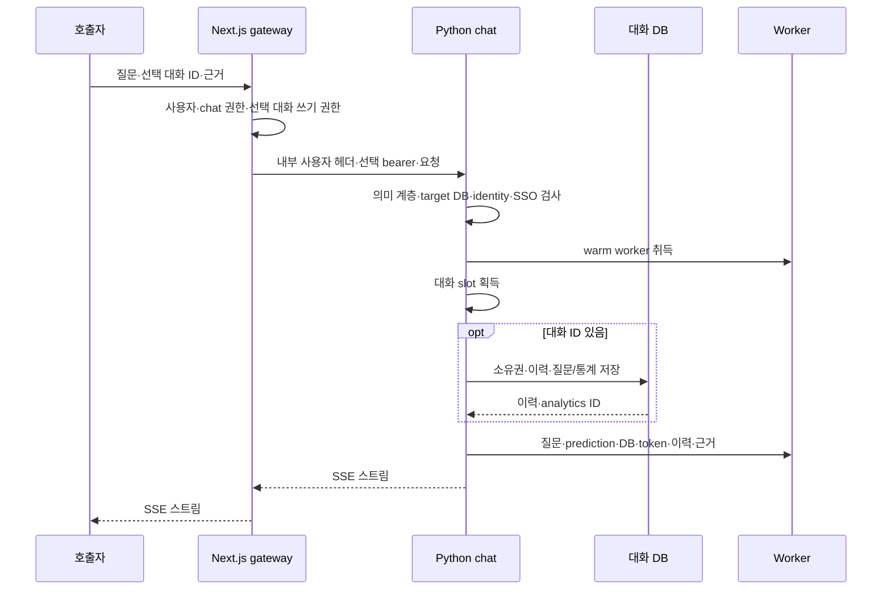
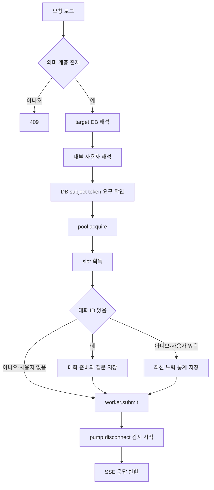
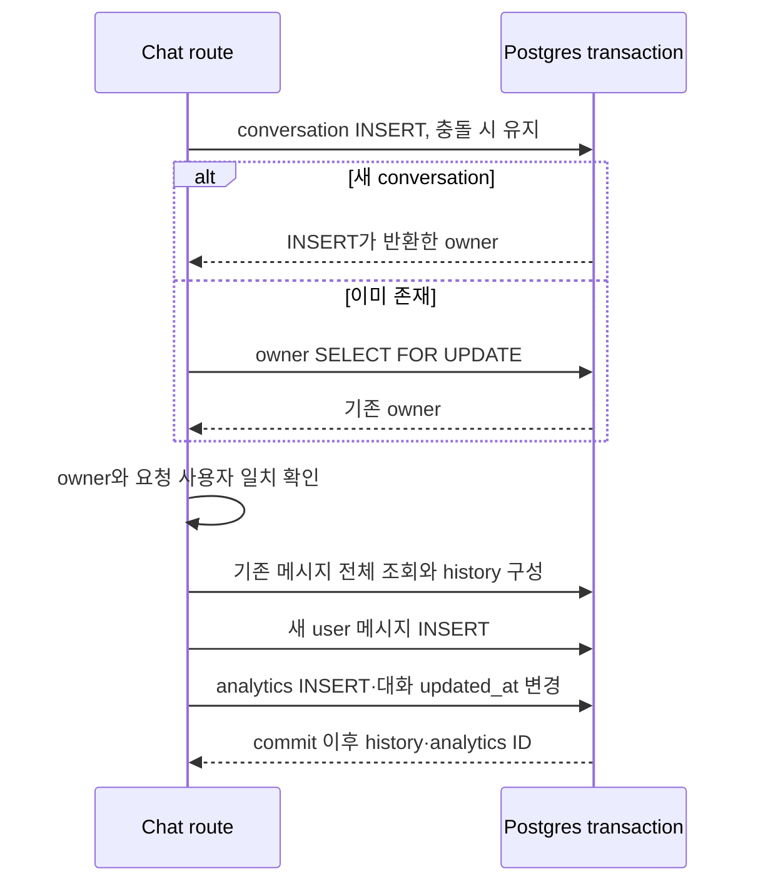

# Chapter 01. Chat 요청·사용자 식별과 대화 준비

- 분석일: 2026-11-14.
- 범위: Next.js chat 진입·FastAPI 요청 모델·identity·대상 DB·대화 준비·worker 인계와 관련 테스트 정적 분석. 원본 코드·실제 서비스·DB·모델·테스트 실행은 포함하지 않는다.
- 선행: [SQL 생성 상태·graph 계약](../08-sql-generation/chapter-01-request-state-and-graph-contract.md), [SQL 실행·결과 계약](../09-sql-validation/chapter-06-sql-execution-and-result-contract.md).
- 용어집: [상세 용어집](../01-architecture/chapter-00-glossary.md)

| 용어 | 뜻·이 문서에서의 의미 |
|---|---|
| Gateway | 외부 요청을 인증해 내부 서버로 넘기는 중간 서버다. |
| Identity | 요청한 사용자를 식별하는 값이다. |
| Runtime | 요청이 실제 실행되는 동안의 작업·자원 관리다. 이 장의 분석 대상은 실행 시작까지다. |

## 1. 두 HTTP 진입과 책임

웹의 `frontend/app/api/chat/completions/route.ts`는 인증·권한을 확인하고 Python의 `/api/chat/completions`로 요청을 전달한다. FastAPI는 [서버 진입점](../../../code/auto-ontology/auto_ontology/server/__main__.py)의 `create_app`에서 chat router에 `/api` 접두어를 붙인다. Python router의 선언 경로는 `/chat/completions`다.

HTTP는 요청·응답 통신 규약이다. 반환은 JSON 응답 한 번이 아니라 SSE(Server-Sent Events, 서버가 이벤트를 연속 보내는 방식) 스트림이다. 웹과 Python에 같은 상대 경로가 있어도 인증과 실행의 책임은 나뉜다.

worker는 실행을 맡는 별도 프로세스이고 slot은 한 대화의 진행 중 작업을 표시하는 서버 메모리 객체다. 전체 프로세스·동시성·이벤트 수명은 후속 장에서 분석한다. 위 흐름은 코드 호출 순서이며 실제 통신 재현 결과가 아니다.

## 2. 요청 모델과 웹 전처리

Python의 `ChatRequest`는 Pydantic 모델로 요청 필드를 해석한다. Pydantic은 입력 타입과 제한을 확인하는 라이브러리다.

| 필드 | 기본·검사 | 다음 소비자 |
|---|---|---|
| `question` | 필수 str, 최소 길이 1 | slot.question·대화 저장·worker |
| `evidence` | 선택 str, 기본 None | 질문과 별도 worker 인수 |
| `conversation_id` | 선택 UUID, 기본 None | 사용자 필수 여부·slot key·대화 DB |
| `prediction` | 선택 bool, 기본 None | worker를 통해 의도/예측 분기 |
| `target_db` | 선택 str, 기본 None | catalog UUID/이름을 정식 DB 이름으로 해석 |

UUID는 식별자로 사용하는 고정 형식 값이다. 모델은 question을 strip하거나 공백만 있는 입력을 금지하는 validator, 최대 질문 길이, 추가 필드 금지 설정을 이 클래스에 따로 정의하지 않는다. 실제 라이브러리의 모든 coercion(입력 형식 변환) 사례는 실행하지 않았다.

웹은 raw body를 JSON.parse하고 null 아닌 object이면 사용하며, 실패하면 `{}`로 바꿔 Python에 다시 JSON.stringify해 보낸다. 배열도 JavaScript의 object 검사에 해당한다. 웹에서 ChatRequest와 같은 전체 필드 검증을 복제하지 않는다. 최종 자료형·필수 필드는 Python 요청 모델의 경계다.

웹의 대화 쓰기 권한 추가 조건은 `conversation_id`가 비어 있지 않은 문자열일 때다. 그 외 값의 유효성을 이 권한 gate가 보장하지 않는다. `evidence`는 이 경로에서 원 질문에 이어 붙이지 않으며, Python의 수락 로그는 `request.model_dump()` 전체를 출력하므로 질문·근거도 로그 대상이다.

근거: [요청 모델](../../../code/auto-ontology/auto_ontology/server/chat/helpers.py)의 `ChatRequest`, [웹 진입](../../../code/auto-ontology/frontend/app/api/chat/completions/route.ts)의 `parseBody`, `POST`.

## 3. gateway 사용자·권한과 내부 헤더

웹 POST는 `withPermission({chat:['use']})`로 감싼다. 사용자 해석 실패는 401, 역할 권한 없음은 403이다. 대화 ID가 있으면 `conversation:['write']`도 확인한다. `userCan`은 이미 해석한 사용자의 role을 메모리 역할 집합에 대입하며, role 누락·알 수 없는 역할은 거부한다.

`resolveUser`의 실제 호출 순서는 세션 → 제품 API token → 제품 OAuth access token → SSO bearer다. API는 프로그램 호출 인터페이스, OAuth는 토큰으로 접근 권한을 전달하는 규약, SSO(Single Sign-On)는 한 번 로그인한 사용자 인증을 다른 서비스에 연결하는 방식이다. 특정 API/OAuth token 모양을 인식하면 해당 verifier 결과를 바로 반환하고 뒤 인증 방식으로 재시도하지 않는다.

마지막 bearer principal은 email로 기존 user를 찾고, 없으면 subject에 맞는 account link의 user를 찾는다. 이 함수는 일치하지 않는 사용자를 새로 생성하지 않는다. verifier 내부의 서명·발급자·만료 검증과 로그인 수명 전체는 이 장에서 분석 완료로 처리하지 않는다.

인증한 사용자 ID는 `buildInternalIdentityHeaders`가 `x-auto-ontology-user-id`로 새로 만든다. 외부 요청의 같은 헤더를 그대로 복사하는 방식이 아니다. 반면 Python의 `resolve_internal_user`는 해당 헤더의 strip한 문자열만 읽는다. 사용자 존재·role·서명·웹 session을 Python에서 독립 검사하지 않는다.

Python은 대화 ID가 있으면 `required=True`라서 헤더 누락 시 401이다. 대화 ID가 없으면 사용자 ID 없이도 진행할 수 있다. 직접 Python 호출과 인증 gateway 경유 호출의 계약이 다르다. 헤더를 신뢰하는 내부 연결이라는 소스의 전제를 설명한 것이며 실제 네트워크 접근 통제는 확인하지 않았다.

근거: [권한 wrapper](../../../code/auto-ontology/frontend/auth/with-auth.ts), [역할 검사](../../../code/auto-ontology/frontend/auth/permissions.ts), [사용자 resolver](../../../code/auto-ontology/frontend/auth/resolve-user.ts), [헤더 생성](../../../code/auto-ontology/frontend/lib/internalIdentity.ts), [Python identity](../../../code/auto-ontology/auto_ontology/server/identity.py).

## 4. DB 실행용 subject token은 사용자 ID와 별도다

subject token은 DB가 “이 사용자로 SQL을 실행”하도록 교환하는 원래 인증 토큰이다. 내부 사용자 헤더를 대신하는 값이 아니다. 웹의 `resolveSubjectToken`은 전달된 bearer가 있으면 우선 반환한다. 없으면 최근 갱신된 비credential account에서 신선한 idToken, refresh 결과, 아직 유효한 accessToken 순으로 찾는다.

신선도는 만료 60초 전을 경계로 보며 JWT의 exp를 해석한다. JWT(JSON Web Token)는 claim을 담는 토큰 형식이다. 여기의 payload 해석은 신선도 판정이며 서명 검증 함수가 아니다. refresh는 provider endpoint 호출과 account token 갱신을 포함한다. 자세한 갱신/실패 수명은 [사용자 인증·connector 경계](../03-connectors/chapter-12-secrets-and-user-auth.md)에 연결한다.

Python `_subject_token`은 설정된 연결 중 하나라도 SSO federation을 사용하면 `Authorization: Bearer`의 비어 있지 않은 token을 요구하고, 없으면 401을 반환한다. target DB만 확인하는 조건이 아니라 전체 연결 목록 기준이다. 이 함수 자체는 JWT 구조·서명을 검사하지 않으며, 실제 교환/DB 인증은 뒤 connector의 책임이다.

아무 연결도 해당 설정을 쓰지 않으면 요청에 bearer가 있어도 None을 반환한다. 연결 설정 조회는 30초 cache를 사용하고 조회 예외면 False로 처리한다. 따라서 “항상 닫힌 실패”라는 주석과 달리 저장소 조회 실패는 token 필수 검사를 생략할 수 있다. 이것이 실제 DB 권한 우회로 이어지는지는 이 함수만으로 단정하지 않는다.

근거: [웹 token resolver](../../../code/auto-ontology/frontend/auth/sso-token.ts), [Python token gate](../../../code/auto-ontology/auto_ontology/server/chat/router.py)의 `_subject_token`, [설정 조회](../../../code/auto-ontology/auto_ontology/connectors/databricks_oauth.py)의 `any_connection_uses_sso_federation`.

## 5. Python 수락 순서·의미 계층·target DB

요청 모델 해석 뒤 `chat_completions` 내부 순서는 다음과 같다.

`semantic_layer_calculated`는 semantic source의 Term 행이 하나라도 있는지 조회한다. Term은 업무 개념을 표현하는 의미 계층 객체다. 모든 테이블의 compile 완료·선택 DB의 준비·질문 답변 가능성까지 확인하는 검사가 아니다. 이 호출은 async handler에서 직접 수행하며, target DB와 대화 저장 호출은 `asyncio.to_thread`로 넘긴다. 전체 handler가 DB 대기를 모두 비동기로 전환한 구조는 아니다.

`_resolve_chat_target_db`는 None/공백을 None으로 보고 나머지는 strip한다. catalog DB 목록에서 ID 정확 일치 또는 이름 casefold 일치인 첫 항목의 이름을 반환한다. 일치 없으면 422다. UUID 문법을 별도로 파싱하는 것이 아니라 catalog에 저장된 ID 문자열과 비교한다.

조회는 `fetch_databases(zone_ids=None)`이므로 사용자 zone 범위를 이 호출에서 전달하지 않는다. DAL은 schema와 inner JOIN해 목록을 만들기 때문에 schema 없는 DB는 이 조회 결과에 없을 수 있다. DB 이름 확인 자체는 활성 connector·DB 접속·대상 DB 권한 검증이 아니다. 실제 connector 선택은 뒤 pipeline의 [DB·방언 routing](../08-sql-generation/chapter-05-database-and-dialect-routing.md)을 따른다.

## 6. 신규·기존·무상태 대화와 부수 효과

대화 요청의 slot key는 `user_id:conversation_id`, 무상태 요청은 요청마다 새 UUID다. worker를 취득한 다음 slot을 차지한다. 이미 같은 key에 client_alive인 작업이 있으면 409이고 새로 취득한 worker를 pool에 돌려준다. 이전 client가 사라졌으면 기존 slot을 대체하고 이전 작업을 cancel 표시 후 release한다. 전체 동시성·재접속 처리는 후속 Chapter 03 범위다.

slot 획득 후 `prepare_conversation`이 frontend schema의 Postgres에 연결한다. 연결 timeout은 3초지만 전체 SQL·트랜잭션 시간 제한과 같은 뜻은 아니다.

새 UUID는 요청 user_id와 질문 앞 50자로 conversation을 만든다. 기존 UUID는 기존 소유자와 정확히 같아야 한다. 다른 소유자/조회 실패는 `ConversationAccessError`이고 route는 404로 바꾼다. 기존 대화 제목을 새 질문으로 덮지 않는다. 이 schema에는 별도 보관 상태 필드가 없으며 이 함수도 보관 여부를 분기하지 않는다.

새 질문은 원문 전체를 user 메시지로 저장하고 analytics에도 기록한다. 요청 중복 ID·질문 내용 중복을 검사하는 idempotency 처리는 이 함수에 없다. 앞서 같은 대화의 진행 요청을 slot으로 막는 것과 완료 후 같은 질문을 다시 저장하는 것은 별개다.

정상 context manager 종료는 commit, 예외는 rollback 경계다. 대화 접근 오류는 404, 다른 저장 오류는 503이며 둘 다 slot을 release한다. 질문 저장이 완료된 뒤 worker.submit이 실패하면 앞 트랜잭션을 같이 되돌리는 구조는 아니다. submit·thread 시작 전체를 감싼 cleanup try도 이 handler에 없다. 이 실패 시 자원 상태는 실제 재현하지 않았다.

무상태 요청은 대화/history/메시지를 만들지 않는다. 다만 내부 user_id가 있으면 `create_stateless_analytics`를 시도한다. 이 저장 실패는 로그만 남기고 실행을 계속한다. source는 전달 헤더가 없거나 빈 값이면 api이며 허용 목록 검사는 이 Python 호출에 없다. “stateless”는 모든 저장을 금지한다는 뜻이 아니다.

근거: [대화 DAL](../../../code/auto-ontology/auto_ontology/server/chat/conversation_dal.py)의 `prepare_conversation`, `create_stateless_analytics`; [대화 schema](../../../code/auto-ontology/frontend/prisma/schema.prisma)의 `Conversation`, `Message`.

## 7. 이력 구성의 입출력과 크기 경계

대화 준비는 현재 질문을 INSERT하기 전에 기존 메시지를 `created_at ASC, id ASC`로 전부 읽는다. SQL LIMIT으로 최근 5개만 읽는 방식이 아니다. 전송 context를 줄이는 것과 DB 조회량을 제한하는 것은 다르다.

`_rows_to_history`는 user 행을 pending 질문으로 두고 뒤의 적합한 assistant와 한 쌍을 만든다. 답 없는 user 다음에 새 user가 오면 pending을 교체한다. 별도 turn ID로 연결하지 않으며 같은 시각의 행 순서는 id로 결정한다.

assistant는 sql_response가 None이어야 하고, 본문이 chart/chart-carousel fence 또는 정확한 `Agent failed:`/`Agent stream failed:` 접두어로 시작하면 제외한다. 본문 또는 SQL이 있어야 한다. 오류 문자열 모두를 의미로 판정하거나 일반 설명의 정확성까지 검사하는 필터는 아니다.

각 쌍을 질문 2,000자·응답 4,000자·SQL 6,000자로 먼저 잘라 새 `ConversationTurn`으로 만든다. 최신부터 최대 5쌍·합계 12,000자를 고른 뒤 시간순으로 되돌린다. 최소 한 쌍을 먼저 허용하지만 개별 합계 상한도 12,000자다. 글자 수이며 token 수 제한은 아니다.

이 잘림은 원본 메시지를 DB에서 수정하지 않는다. SQL을 중간에서 자를 수 있으며, 이전 결과 행·차트·요청 evidence를 독립 이력 필드로 넘기지 않는다. route가 worker에 전달하는 history의 항목은 `{question, response, sql_code}`다.

## 8. 실행 인계·오류·다음 경계

`worker.submit`은 `_MSG_ASK`와 `(question, prediction, target_db, subject_token, history or [], evidence)` tuple을 입력 queue에 넣는다. queue는 프로세스 간 작업/이벤트를 전달하는 통로다. 이 시점에 이 route가 SQL을 실행하거나 history를 모델 메시지로 직접 변환하는 것은 아니다.

뒤이어 daemon pump thread와 disconnect 감시 task를 시작하고 `_stream_slot`의 SSE 응답을 반환한다. 응답 헤더는 Python에서 no-store·buffering 비활성이다. 웹은 upstream 실패 상태/본문을 전달하고 fetch 연결 실패는 502로 바꾼다. token resolver 등 fetch try 이전 실패까지 모두 같은 502로 감싸지는 않는다.

웹은 upstream stream을 tee로 둘로 나누고 `after()` 작업이 한 갈래를 끝까지 읽는다. 이 때문에 브라우저와 Python의 연결 생존은 항상 같은 것이 아니다. 세부 스트림·watch/cancel·저장 관계는 Chapter 03~04로 인계한다. router의 오래된 proxy 저장 관련 설명보다 현재 Python 저장 호출과 웹 drain 코드를 우선한다.

| 실패 시점 | 확인한 처리 |
|---|---|
| 웹 사용자/역할 | 401/403, upstream 실행 전 |
| Python 의미 계층 없음 | 409, DB 대상/사용자/worker 전 |
| target DB 불일치 | 422, worker 전 |
| 필수 내부 identity·DB bearer 없음 | 401, worker 전 |
| 같은 slot의 살아 있는 client | 409, 새 worker 반환 |
| 대화 접근·대화 저장 실패 | 404/503, slot release |
| 무상태 analytics 실패 | 로그 후 계속 |
| worker 취득·submit·thread 시작 실패 | 이 handler 전체의 통합 복구를 보장하는 catch는 없음 |

## 9. 테스트 근거·확인 수준과 인계

| 근거 | 정적으로 읽은 assertion |
|---|---|
| [test_identity.py](../../../code/auto-ontology/auto_ontology/server/tests/test_identity.py) 3개 | 헤더 사용자·필수 누락 401·무상태 identity 생략. 실제 gateway 인증 시험은 아니다. |
| [test_target_database.py](../../../code/auto-ontology/auto_ontology/server/chat/tests/test_target_database.py) 3개 | catalog UUID/대소문자 이름 해석·알 수 없는 DB 422. catalog 조회를 대체한다. |
| [test_conversation_dal.py](../../../code/auto-ontology/auto_ontology/server/chat/tests/test_conversation_dal.py) 4개 | 결과/차트/오류 제외·최근 5쌍·미응답 교체·한 쌍 문자 상한. `_rows_to_history` 직접 시험으로 실제 저장/소유권/트랜잭션 시험은 아니다. |
| [test_databricks_oauth.py](../../../code/auto-ontology/auto_ontology/connectors/tests/test_databricks_oauth.py)의 설정 조회 사례 | federation 발견/cache 무효화·연결 조회 실패 False. 전체 인증/토큰 교환 검증과 구분한다. |
| [test_worker.py](../../../code/auto-ontology/auto_ontology/server/chat/tests/test_worker.py)의 evidence 사례 | 질문·processing_question 유지, evidence 별도 전달. queue·모델·connector를 대체한 worker loop 시험이다. |

이 작업은 위 assertion을 읽었으며 실행하지 않았다. 로컬 검색에서 chat_completions 전체 수락 순서·prepare_conversation 트랜잭션·subject_token route gate의 직접 테스트는 찾지 못했다. 웹 권한·token resolver의 전체 시험은 이번 확인 범위 밖이다.

확인한 사실은 호출 순서·필드·신뢰 헤더·DB 쿼리·이력 축소·queue 인수·명시 오류 분기다. 의미 계층 전역 gate·대상 DB/권한 분리·헤더의 독립 검증 부재·통계 저장·이력 잘림·중복 질문·저장 후 submit 실패의 영향은 코드에서 도출한 경계다. 실제 보안 경계·SSO 검증·DB 동시성/rollback·웹/worker 통합·부하·Mermaid 렌더링은 미검증이다.

후속 [Chapter 02](chapter-02-worker-pool-and-queues.md)는 WarmPool·프로세스 초기화·queue·connector 준비/갱신·실행/종료를 분석한다. 10단계 전체 완료를 뜻하지 않는다.
