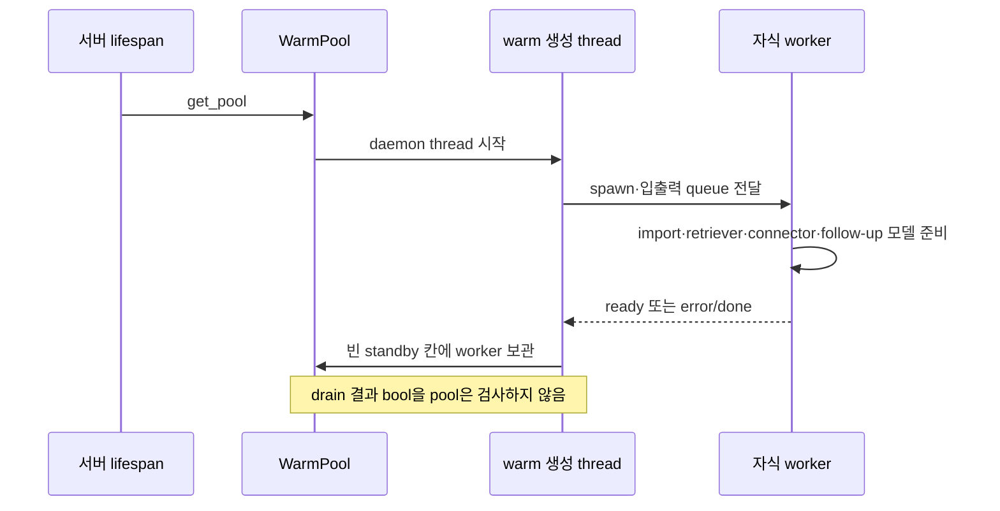
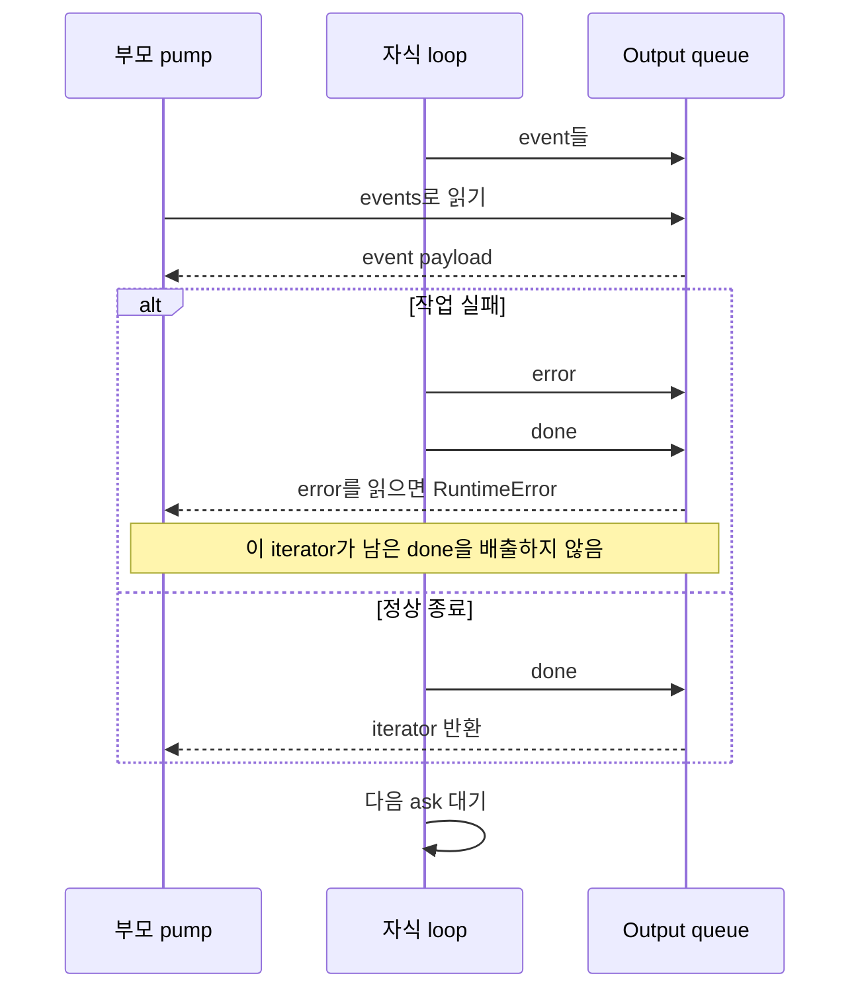
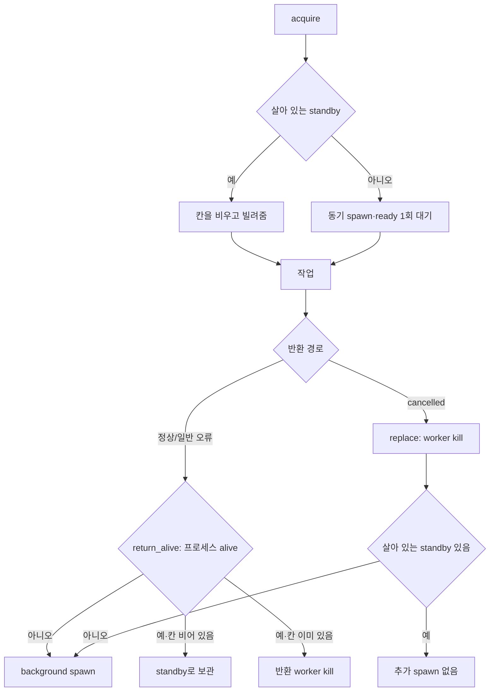

# Chapter 02. WarmPool·worker·queue와 실행 자원 수명

- 분석일: 2026-11-15.
- 범위: worker.py·실제 시작/종료/갱신 호출·질문별 입력 준비·관련 테스트 정적 분석. 원본 수정·프로세스 기동·실제 DB/모델/테스트 실행은 하지 않았다.
- 선행: [요청·대화 준비](chapter-01-request-identity-and-conversation.md), [connector registry/cache](../03-connectors/chapter-02-registry-and-cache.md), [사용자 인증](../03-connectors/chapter-12-secrets-and-user-auth.md).
- 용어집: [상세 용어집](../01-architecture/chapter-00-glossary.md)

| 용어 | 뜻·이 문서에서의 의미 |
|---|---|
| Worker | agent를 실행하는 자식 프로세스다. |
| Prewarm | 요청 전에 무거운 객체를 준비하는 일이다. |
| Standby | 빌려줄 수 있는 대기 worker다. |
| Queue | 부모·자식 사이의 메시지 통로다. |
| Pool | 여기서는 대기 worker를 보관/재사용하는 객체를 뜻한다. |

## 1. 왜 프로세스인가·동시 실행은 어디서 제한하는가

소스는 동기 Python agent가 DB/HTTP/embedding 라이브러리 호출 안에서 기다릴 때 다른 Python thread로 그 호출을 중단하기 어려워, 실행 단위를 자식 프로세스로 격리한다고 설명한다. 취소는 worker에 협조적 stop 명령을 보내는 방식이 아니라 프로세스를 종료하는 방식이다. 원격 DB 문장이 실제로 언제 중단되는지까지 이 코드가 보장하지는 않는다.

`WarmPool`의 대기 칸은 하나다. 이는 전체 동시 작업을 하나로 제한한다는 뜻이 아니다. 서로 다른 대화가 동시에 요청하면 첫 요청은 standby를 받고, 다음 요청은 새 프로세스를 만들 수 있다. pool에는 전체 활성 worker 수 상한·대기열 admission 제어가 없다. 실제 한계는 OS·메모리·외부 서비스 등에 좌우되며 측정하지 않았다.

같은 대화의 단일 실행은 pool이 아니라 router의 slot에서 제한한다. 또한 pool은 대화별 전용 worker를 영구 고정하지 않는다. 정상 종료한 worker는 다른 대화 요청에도 재사용할 수 있다. 대화 문맥은 요청별 history 인수로 전달한다.

근거: [worker.py](../../../code/auto-ontology/auto_ontology/server/chat/worker.py)의 모듈 설명·`WarmPool`; [router](../../../code/auto-ontology/auto_ontology/server/chat/router.py)의 `chat_completions`, `_release`.

## 2. 서버 시작·singleton과 standby 생성

서버 `lifespan`은 schema 확인 뒤 `get_pool()`을 호출한다. singleton은 한 Python 프로세스의 모듈 전역 `_pool`이며 `_pool_lock`으로 첫 생성을 보호한다. 서버 프로세스 여러 개가 공유하는 외부 pool은 아니다.

`WarmPool.__init__`은 lock·빈 standby를 만들고 daemon thread에서 `_spawn_sync`를 실행한다. daemon은 부모 종료 시 계속 살아 있도록 보장하지 않는 실행 속성이다. `PrewarmedWorker` 생성은 `multiprocessing.get_context("spawn")`의 queue 두 개와 daemon Process를 만들고 `.start()`한다. spawn은 자식에서 모듈·객체를 새로 준비하는 시작 방식이다.



서버 시작은 이 thread의 준비 완료를 기다리지 않는다. 첫 요청 전에 완전히 warm 상태가 된다는 보장은 없다. 아직 standby가 설치되지 않았으면 `acquire`가 별도 cold worker를 만들며, 준비 중인 background worker와 동시에 존재할 수 있다. cold start는 요청 시 처음 초기화 비용을 지불하는 경우다.

`_spawn_sync`는 준비 뒤 lock을 잡아 standby가 None이면 설치한다. 다른 반환 worker가 먼저 칸을 채웠으면 새로 만든 worker를 kill한다. 대기 한 칸을 맞추는 코드이지 생성 중 프로세스 수까지 항상 하나로 유지하는 구조는 아니다.

근거: [서버 lifespan](../../../code/auto-ontology/auto_ontology/server/__main__.py), [worker.py](../../../code/auto-ontology/auto_ontology/server/chat/worker.py)의 `get_pool`, `PrewarmedWorker.__init__`, `_spawn_async`, `_spawn_sync`.

## 3. 자식 초기화·readiness와 실패 경계

자식은 INFO logging을 다시 설정한다. spawn 자식에서 부모 logging 설정을 그대로 기대하지 않기 위한 처리다. stdout/stderr는 부모 쪽으로 이어지는 설정이며 요청별 독립 로그 파일을 만드는 코드는 아니다.

초기화 순서는 agent/후속 질문 함수와 factory import → data retriever → semantic retriever → 기본 connectors → follow-up용 모델이다. retriever는 catalog/의미 객체를 찾는 검색기다. follow-up 모델은 non-reasoning client(max_tokens=1024)를 먼저 시도하고 factory 예외 시 일반 모델을 시도한다. 둘 다 예외면 None으로 진행한다. 첫 factory가 None을 반환한 경우까지 예외 fallback을 타는 것은 아니다.

모델 factory 둘의 실패는 raw 질문 처리로 낮추지만, 다른 import/retriever/connector 초기화 예외는 바깥 `BaseException`에 잡혀 error·done을 부모에 넣고 자식 함수가 끝난다. 초기화한 객체 일부를 finally에서 모두 닫는 별도 정리 구문은 이 함수에 없다.

`ready`는 이 초기화 블록을 끝냈다는 신호다. connector 목록이 비어 있어도 보낼 수 있고 실제 DB 질의·모델 호출까지 성공한 상태를 뜻하지 않는다. 전송 자체가 실패하면 자식은 반환한다.

`drain_until_ready(timeout=None)`는 출력 queue에서 메시지 **한 개**를 받아 tag가 ready인지 비교한다. ready가 나올 때까지 모든 메시지를 반복 배출하지 않는다. queue.Empty는 False, error/done 같은 다른 tag도 False다. 프로세스 사망을 주기적으로 확인하는 loop도 없다.

pool의 `_spawn_sync`와 cold `acquire`는 timeout을 주지 않고 이 bool을 검사하지 않는다. 따라서 초기화 오류가 직접 acquire 예외로 변환된다고 설명하면 안 된다. error를 drain이 소비하고 done이 남거나, 사망한 worker가 cold 경로에서 반환될 가능성은 코드로 도출한 미재현 경계다. 아무 tag도 못 보낸 초기화 정지·사망에서는 준비 대기가 끝난다는 보장도 이 함수에 없다.

## 4. 작업별 ASK 계약과 입력 loop

입력 wire format은 다음 tuple이다. wire format은 두 프로세스가 맞춰 읽는 메시지 모양이다.

```text
("ask", (question, prediction, target_db, subject_token, conversation_history, evidence))
```

`submit`은 이를 input queue에 put하고 history가 falsy면 빈 목록으로 보낸다. 이미 실행 중인지·프로세스가 살아 있는지·질문 ID가 중복인지 확인하지 않는다. caller가 한 worker의 작업 경계를 지키는 전제이며 별도 request ID도 없다.

자식은 무한 loop에서 `in_q.get()`을 기다리고 EOFError/OSError면 끝난다. 바깥 메시지가 길이 2 tuple이 아니거나 tag가 ask가 아니면 무시한다. 하지만 내부 payload의 6개 값 unpack은 작업 try 바깥이다. 내부 형식이 잘못되면 작업용 error/done 전송을 거치지 않고 자식이 종료될 수 있다. 부모 submit과 자식 unpack을 함께 맞춰야 하는 이유다.

각 작업 try 안에서 connector 선택 → 후속 질문 해석 → custom prompts/약어 조회 → agent payload 구성 → `stream_agent_response` 순으로 실행한다. 매 event를 output queue의 `("event", event)`로 전달한다. 작업 예외는 BaseException까지 받아 error 문자열을 보내고 finally에서 done을 시도한 뒤 다음 ASK를 기다린다. 일반 작업 오류가 항상 자식 프로세스 종료를 뜻하지는 않는다.

## 5. connector의 재사용·빈 초기값 회복·사용자별 교체

| 조건 | 실제 동작 |
|---|---|
| 초기 connectors가 비어 있음 | 매 ASK에서 `get_connectors()`를 다시 호출한 뒤 ask_connectors를 결정 |
| 초기/회복 connectors가 비어 있지 않음 | 같은 worker의 local snapshot을 재사용 |
| subject_token이 None 아님 | `get_connectors_for_subject_token`으로 이번 작업용 목록 선택 |
| subject_token이 None | 기본 snapshot 사용 |

재조회는 ask_connectors 대입보다 먼저다. 나중에 기본 목록을 재대입해도 이미 잡은 빈 참조가 자동 교체되는 것은 아니기 때문이다. registry는 연결 spec이 없으면 빈 목록을 반환하고 비어 있지 않은 결과를 process-local cache에 보관한다. 정상 snapshot을 매 작업마다 무조건 최신 catalog로 다시 만드는 구조는 아니다.

사용자별 factory는 federated 연결에 토큰을 교환해 새 connector를 만들고, 비federated 연결은 기본 cache 목록에서 재사용한다. subject_token이 있다는 이유로 모든 DB 연결을 새 사용자 connector로 바꾸는 것은 아니다. 해당 factory가 실패하면 기본 저장 자격으로 여기서 fallback하지 않고 작업 오류가 된다.

사용자별 ask_connectors는 기본 connectors 변수에 덮어쓰지 않는다. 반면 worker가 작업 종료마다 그 목록을 일괄 close하는 finally도 없다. DB별 실제 자원 수명·토큰 cache는 기존 [connector 실행/정리](../03-connectors/chapter-11-execution-timeout-and-resources.md)와 [인증 경계](../03-connectors/chapter-12-secrets-and-user-auth.md)에서 확인한다. Python 참조를 바꾸는 것과 원격 연결 정리를 같은 것으로 처리하지 않는다.

근거: [registry](../../../code/auto-ontology/auto_ontology/connectors/registry.py)의 `get_connectors`, `get_connectors_for_subject_token`; [worker.py](../../../code/auto-ontology/auto_ontology/server/chat/worker.py)의 `_worker_loop`.

## 6. history 소비·질문 해석과 설정 읽기

`resolve_follow_up`은 history가 없거나 llm이 None이면 모델 없이 `(False, 원질문)`을 반환한다. history가 있으면 각 turn의 질문·응답·선택 SQL을 텍스트로 묶고 현재 질문과 함께 HumanMessage 한 개로 보낸다.

모델 출력은 `FollowUpResolutionModel`의 `is_follow_up`, `standalone_question`이다. 프롬프트는 기존 이력에 없는 제약을 만들지 말고, 독립 질문이면 원문을 복사하며, SQL/답변을 만들지 말라고 지시한다. 실제 코드도 is_follow_up=False이면 모델의 수정문을 버린다. True이면 strip한 standalone을 사용하고 비면 원문으로 대체한다. 의미 보존 자체를 별도 비교하지는 않는다.

invoke 예외·None은 원문 fallback이다. 다만 history 포맷/프롬프트 생성은 그 invoke try 밖이며, 임의의 잘못된 history 형식 전체를 같은 fallback으로 잡는 것은 아니다. caller는 앞 장의 제한된 history를 주지만 이 함수 자체가 최근 5쌍·12,000자를 다시 제한하지는 않는다.

worker는 원질문을 `question`, 해석문을 `processing_question`으로 나눠 전달한다. is_follow_up bool은 로그에 쓰고 별도 agent payload 필드로 보내지 않는다. history 목록 자체도 payload에 그대로 싣지 않는다. 요청 evidence는 `evidence or ""`로 별도 전달하며 history 재작성 프롬프트에 함께 넣지 않는다.

`fetch_custom_prompts`와 `fetch_acronyms`는 매 작업 frontend Postgres에서 읽는다. prompts는 content 목록의 truthy 값을 빈 줄 두 개로 합치며 ORDER BY가 없다. 약어는 name/description 사전을 created_at 순으로 읽는다. user_id·대화 ID 조건은 없다. 저장소 예외면 각각 빈 문자열·목록으로 낮춘다. connect_timeout=3은 전체 SQL 시간 제한이 아니다.

payload는 질문·근거·처리 질문·prediction·검색기 두 개·선택 connectors·약어·custom prompts이며, target_db가 truthy일 때만 추가한다. graph/의도/예측의 세부 분기는 [SQL 생성 문서](../08-sql-generation/chapter-02-intent-and-information-routing.md)에서 이어진다. submit 주석의 “prediction이면 분류 생략”보다 실제 의도 분기 조건을 우선한다.

근거: [후속 질문 resolver](../../../code/auto-ontology/auto_ontology/retrieval/text_to_sql/follow_up.py), [응답 모델](../../../code/auto-ontology/auto_ontology/retrieval/text_to_sql/models.py)의 `FollowUpResolutionModel`, [프롬프트](../../../code/auto-ontology/auto_ontology/retrieval/text_to_sql/prompts.py)의 `create_follow_up_resolution_prompt`, [설정 DAL](../../../code/auto-ontology/auto_ontology/server/chat/settings_dal.py).

## 7. output queue·event 종료와 오류의 다음 작업 영향

| tag | 부모 `events()` 처리 |
|---|---|
| ready | 무시하고 계속 |
| event | payload를 yield |
| error | RuntimeError를 발생시키고 generator 종료 |
| done | generator 반환 |
| 그 외 | 별도 tag 검증 없이 payload를 yield |

queue가 0.25초 비면 프로세스 생존을 확인한다. 살아 있으면 None을 yield하고 계속, 죽었으면 별도 오류 없이 반환한다. 따라서 result event 없이 자식이 죽은 것도 이 함수만으로 반드시 error event가 되지는 않는다. queue의 EOF/OSError·잘못된 tuple 등은 Empty와 같은 처리가 아니다.

None은 worker poll 신호이며 router pump는 buffer에 저장하지 않는다. 사용자에게 나가는 heartbeat는 별도 `_stream_slot`의 책임이다. 이 함수에는 작업 전체 timeout·출력 크기 상한·명시 backpressure 정책이 없고 queue 생성에도 maxsize를 지정하지 않는다.



중요한 경계는 error 뒤의 done이다. 자식은 error 후 finally로 done을 보내지만 부모 events는 error에서 즉시 raise한다. pump는 RuntimeError를 오류 event로 바꾸고 finally의 `_release`를 호출한다. cancelled가 아니고 프로세스가 살아 있으면 그 worker가 standby로 돌아갈 수 있다.

이때 남은 done을 지우거나 request ID로 구분하는 절차가 없다. 다음 ASK의 events가 이전 done을 먼저 읽어 일찍 끝나고 새 작업의 event가 다음 소비로 남을 가능성이 있다. 이는 실제 재현한 버그가 아니라 부모/자식 queue 규칙을 합쳐 도출한 위험 경계다. 프로세스 alive 여부만으로 queue가 다음 작업에 깨끗하다고 판단할 수는 없다.

## 8. acquire·반환·강제 교체와 shutdown



`acquire`는 standby를 lock 안에서 비운 뒤 alive를 본다. 빌려줄 때 바로 대체 standby를 채우지 않는다. `return_alive`는 프로세스가 살아 있으면 빈 칸에 넣고 칸이 차 있으면 반환 worker를 kill한다. 죽었으면 비동기 spawn을 요청한다. 동시에 끝나는 여러 요청 중 어느 worker가 남을지는 반환/lock 순서에 좌우된다.

`replace`는 빌린 worker를 kill한 뒤 살아 있는 standby가 이미 있으면 멈추고, 없으면 background spawn한다. `kill`은 살아 있을 때 terminate → join 최대 1초 → 여전히 alive면 kill → join 최대 1초를 호출한다. POSIX 신호 이름을 적은 주석과 달리 실제 효과는 OS별 multiprocessing 구현에 따르며, 최종 종료 성공을 재확인해 오류를 반환하는 코드도 없다.

`kill`은 입력 queue에 종료 명령을 넣거나 agent finally를 끝까지 기다리는 방식이 아니다. queue close/join_thread·명시 connector 종료도 이 메서드에 없다. 외부 SQL/모델 요청 취소와 같은 시점이라고 단정하지 않는다.

서버 종료의 `shutdown_pool`은 전역 pool을 None으로 바꾼 뒤 `pool.shutdown`을 호출한다. shutdown은 현재 standby만 떼어 kill한다. 활성 worker 목록을 pool에 보관하지 않으므로 이 메서드가 진행 중 모든 작업을 순회 종료하는 것은 아니다. pending spawn thread의 join·closed flag도 없다. 종료/refresh 중 생성 thread가 나중에 standby를 설치할 수 있는 경계는 미재현이다.

## 9. 연결 갱신의 영향 범위·저장 경계

연결 service의 `_refresh_connection_caches`는 연결 저장 뒤 connector cache 무효화·`refresh_chat_workers`·SSO flag cache 무효화를 각각 최선 노력으로 실행한다. 한 갱신 실패가 나머지 저장 후 작업을 막지 않도록 각 예외를 기록한다.

`refresh_chat_workers`는 현재 pool의 standby를 비우고 있으면 kill한 다음 새 warm spawn을 요청한다. 이미 빌려 실행 중인 worker는 직접 찾아 바꾸지 않는다. 진행 중 worker가 나중에 반환되어 새 standby와 먼저/나중에 경쟁할 수도 있으므로 “갱신 뒤 다음 요청은 반드시 새 설정”을 동시성 전체에서 증명하는 규칙으로 읽지 않는다.

기본 connector snapshot·retriever·모델 client와 module cache는 worker 프로세스 수명에 묶인다. 부모의 connector cache를 비운 것이 자식의 local snapshot을 직접 수정하는 것은 아니다. prompts/약어는 매 ASK 조회이고 사용자별 factory는 별도 경로이므로 설정마다 최신성 경계가 다르다.

worker.py 자체는 질문/답을 frontend DB에 쓰지 않는다. metadata 설정 읽기·원본 DB/모델 호출을 agent에 위임하고, event를 queue에 보낸다. 최종 대화·analytics·차트 저장은 부모 pump의 책임이며 Chapter 04~05에서 분석한다.

근거: [연결 service](../../../code/auto-ontology/auto_ontology/server/connections/service.py)의 `_refresh_connection_caches`, [worker.py](../../../code/auto-ontology/auto_ontology/server/chat/worker.py)의 `refresh_chat_workers`, `shutdown_pool`; [router pump](../../../code/auto-ontology/auto_ontology/server/chat/router.py)의 `_pump`, `_release`.

## 10. 테스트·사실/추론·다음 작업

| 근거 | 정적으로 확인한 assertion |
|---|---|
| [test_worker.py](../../../code/auto-ontology/auto_ontology/server/chat/tests/test_worker.py) 3개 | 빈 초기 connector 회복이 payload에 반영·정상 snapshot 재사용·evidence 별도 전달. 가짜 queue와 factory/stream 대체로 loop를 현재 프로세스에서 직접 실행한다. |
| [test_prediction_override.py](../../../code/auto-ontology/auto_ontology/retrieval/text_to_sql/tests/test_prediction_override.py)의 worker 3개 | prediction 기본/지정·선택 인수 keyword·6개 payload unpack 계약. `__new__`와 가짜 queue로 실제 spawn을 생략한다. |
| [test_follow_up.py](../../../code/auto-ontology/auto_ontology/retrieval/text_to_sql/tests/test_follow_up.py) 4개 | history 없으면 모델 생략·독립 질문 수정 거부·후속 질문 standalone 사용·invoke 실패 원문 fallback. 모델 응답을 대체한다. |
| [test_service.py](../../../code/auto-ontology/auto_ontology/server/connections/tests/test_service.py)의 cache 갱신 실패 사례 | worker 갱신 예외가 연결 update 뒤 재수집 호출을 막지 않음. 실제 warm 교체 성공 시험은 아니다. |

위 테스트는 읽었으며 실행하지 않았다. 로컬 검색에서 WarmPool acquire/return/shutdown의 동시성·readiness 실패·events의 error/done 재사용·실제 kill을 직접 검증하는 테스트는 찾지 못했다.

확인한 사실은 메시지 모양·try 위치·pool 상태/분기·대기 값·호출자다. 준비 bool 무시·잔여 done·silent death·refresh/종료 경쟁·원격 취소/자원 정리 범위는 코드에서 도출한 경계다. 실제 프로세스·OS 신호·DB/모델·queue 전송/압력·여러 사용자 격리·통합 취소·부하·Mermaid 렌더링은 미검증이다.

후속 [Chapter 03](chapter-03-slots-streaming-and-cancellation.md)은 slot 동시성·pump/buffer·SSE/watch·disconnect/cancel·release 경합을 분석한다. 10단계 전체 완료를 뜻하지 않는다.
