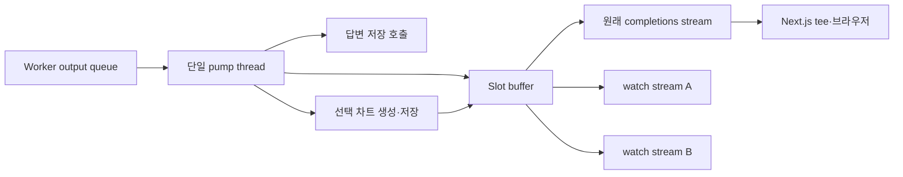
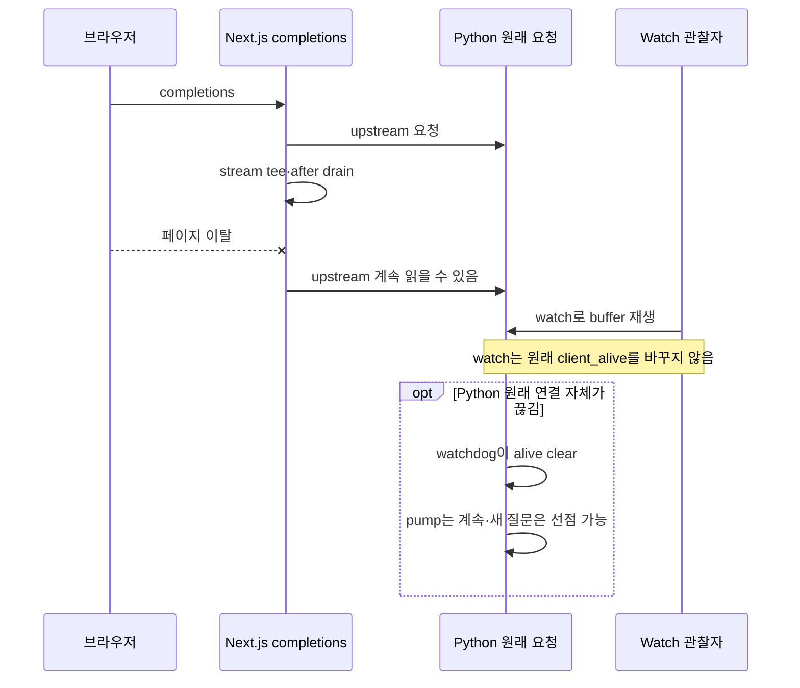
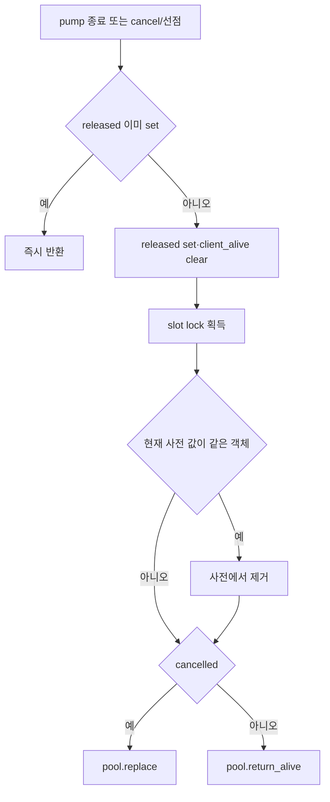

# Chapter 03. Slot·SSE 재생·재접속과 취소

- 분석일: 2026-11-15.
- 범위: Python chat router의 slot·pump·buffer·stream/watch/disconnect/cancel, 웹 proxy와 소비자의 관련 경로·테스트 정적 분석. 원본 수정·실제 서비스/DB/모델/테스트 실행은 하지 않았다.
- 선행: [요청·identity](chapter-01-request-identity-and-conversation.md), [worker·queue](chapter-02-worker-pool-and-queues.md).
- 용어집: [상세 용어집](../01-architecture/chapter-00-glossary.md)

| 용어 | 뜻·이 문서에서의 의미 |
|---|---|
| Slot | 진행 중 대화 작업의 메모리 표식이다. |
| SSE (Server-Sent Events) | HTTP 연결로 이벤트를 연속 보내는 방식이다. |
| Pump | worker 출력을 계속 받아 옮기는 thread다. |
| Replay | 누적 이벤트 재생이다. |
| Preempt | 기존 작업을 밀어내고 새 작업을 받는 동작이다. |

## 1. 생산자·메모리 buffer·소비자 분리

실행 producer는 worker, 중앙 소비자/재전송 준비자는 `_pump`, HTTP 소비자는 각 `_stream_slot`이다. 원래 completions와 watch는 모두 slot.buffer를 읽지만 worker queue를 각각 직접 읽지는 않는다. 이 분리가 브라우저 없이 작업을 계속하고 여러 watch가 같은 진행을 보는 기반이다.



buffer는 append-only list이고 읽기/추가 때 `buffer_lock`을 잡는다. “append-only”는 이 구현에서 기존 이벤트를 삭제/수정하지 않는다는 뜻이다. 외부 저장소의 replay log·checkpoint는 아니다. 길이/바이트 상한·이벤트별 ID·TTL을 별도로 정의하지 않는다. 오래 실행되거나 큰 결과가 쌓일 때 메모리 비용은 미측정이다.

근거: [router.py](../../../code/auto-ontology/auto_ontology/server/chat/router.py)의 `_Slot`, `_pump`, `_stream_slot`.

## 2. Slot 식별·동시 요청·선점

대화가 있으면 key는 `user_id:conversation_id`, 무상태 요청은 새 UUID다. `_active_slots`와 `_slot_lock`은 현재 Python 프로세스에만 있다. 여러 서버 프로세스/인스턴스의 전역 잠금이나 공통 작업 등록이 아니다.

`_try_claim_slot`은 lock 안에서 이전 slot의 client_alive를 본다. True면 409 `Conversation in progress`, 아니면 새 slot으로 교체하고 이전 slot을 반환한다. 호출자는 displaced.cancelled를 set하고 `_release(displaced)`로 이전 worker를 교체한다. 이미 대체한 새 slot을 이전 release가 지우지 않도록 `_release`는 사전의 값이 같은 객체인지 확인한다.

client_alive는 연결 소비자 전체의 수가 아니다. completions 수락 시 set하고 원래 HTTP 요청의 watchdog 또는 release가 clear한다. watcher가 한 명 이상 붙어 있어도 값이 False일 수 있다. 이전 slot이 finished인지·worker가 alive인지로 claim을 결정하는 조건도 아니다.

따라서 원래 요청이 끊겼고 watch만 남았다면 새 질문이 기존 작업을 선점할 수 있다. 무상태 요청은 대화 key가 없어서 이 대화별 충돌·watch/cancel 식별 경로와 다르다. 여러 서버로 분산된 동일 대화 요청의 중복 실행 방지는 이 메모리 사전만으로 보장되지 않는다.

## 3. Pump의 변환·저장·buffer 순서

`_pump`는 worker.events를 순회한다. None은 worker queue poll 신호여서 buffer에 넣지 않는다. step은 node 이름의 표시 label을 보충하고 sql은 slot.last_sql을 갱신한다. 나머지 이벤트를 별도 허용 목록으로 걸러내지는 않는다.

각 이벤트에서 **저장 시도 → buffer append → result라면 차트 생성** 순서다. 저장은 user_id/analytics_id가 있고, 아직 persisted가 아니며, result/error에 저장할 본문 또는 SQL이 있을 때만 한다. DB 저장 예외는 로그 후 event 전달을 계속한다. 성공한 첫 저장 뒤에는 persisted=True라서 다음 result/error의 같은 답변 저장을 생략한다. 자세한 SQL·트랜잭션은 Chapter 04 범위다.

result는 buffer에 넣은 다음 `_build_charts_event`를 같은 pump thread에서 호출한다. cancelled가 아니어야 시작하며 helper 예외는 로그 후 무시한다. charts event가 있으면 뒤에 추가한다. 따라서 result 도착과 전체 스트림 종료는 다르며, 차트 작업 동안 worker의 다음 queue 항목 배출도 기다린다. 저장 지연은 event의 buffer 도착을 늦출 수 있다.

worker가 RuntimeError를 내면 `Agent stream failed: ...` error event를 만들고 저장/append한다. 다른 예외 전체를 같은 error event로 변환하는 catch는 아니다. finally는 finished를 set하고 release한다. 오류 없이 iterator가 끝나면 반드시 result가 있어야 한다고 검사하지 않는다. [Chapter 02](chapter-02-worker-pool-and-queues.md)의 silent death·잔여 done 경계와 연결된다.

## 4. SSE frame·재생 index·heartbeat·완료

`_sse`는 `data: {json.dumps(event)}\n\n` 형식이다. SSE의 event/id/retry 필드를 따로 보내지 않으며 재접속 시 Last-Event-ID를 처리하지 않는다. 모든 소비자는 index=0에서 시작해 현재 buffer 전체를 재생하고 이후 tail을 읽는다.

```text
data: {"type": "sql", "sql": "SELECT 1"}

: ping

data: [DONE]

```

위는 형식 설명 예시다. `[DONE]`은 JSON 객체가 아닌 특별 종료 문자열이다. `_stream_slot`은 lock 안에서 buffer[index:]와 새 index를 얻고 lock 밖에서 직렬화/yield한다. 새 이벤트가 있으면 바로 다시 돌고, 없을 때 finished면 종료한다. 아직 실행 중이면 `: ping\n\n` 주석을 보내고 0.25초 sleep한다. heartbeat는 각 소비자에서 만들며 buffer에는 쌓이지 않는다.

이 0.25초는 SQL/전체 실행 timeout이 아니다. 직렬화 오류나 HTTP 전송 실패를 이 generator 안에서 final error로 바꾸는 catch도 없다. Python 응답은 no-store·X-Accel-Buffering:no이고 웹 proxy는 no-cache,no-transform 등 자체 헤더를 구성한다. 두 구간의 cache header가 동일한 것은 아니다.

빈 snapshot 읽기와 finished 확인은 같은 lock의 단일 상태 판정이 아니다. pump가 그 사이 마지막 이벤트를 append하고 finished를 set하면 소비자가 새 이벤트를 다시 읽기 전에 DONE으로 끝날 가능성이 있다. 이는 코드에서 도출한 순서 경계이며 실제 누락을 재현하지 않았다.

## 5. Watch: 진행 중 buffer의 수동 관찰

Python `GET /api/chat/watch?conversation_id=UUID`는 내부 사용자 헤더가 필수다. user/대화 key로 slot을 찾고 없으면 200 SSE의 `[DONE]`만 보낸다. DB에서 대화 이력이나 완료한 buffer를 다시 읽지는 않는다. 실행이 끝나 release로 사전에서 제거된 뒤에는 새 watch가 해당 buffer를 얻지 못한다. 이미 객체 참조를 얻은 소비자는 계속 읽을 수 있다.

watch는 client_alive·cancelled를 바꾸거나 watchdog을 만들지 않고, 새 worker·SQL·영구 저장을 시작하지 않는다. watch 단절은 원래 작업의 생존 판단을 바꾸지 않는다. “watch가 작업을 재개한다”는 표현은 여기서는 실행 복원이 아닌 관찰 재접속이라는 뜻이다.

웹 watch route는 `conversation:['read']` 권한과 `findOwnedConversation`의 DB 소유권을 확인하고 ID 헤더를 만들어 Python으로 보낸다. ID 없으면 웹 400, 없는/다른 소유 대화면 404다. Python watch 자체는 DB 소유권을 재조회하지 않고 신뢰 헤더/key를 사용한다. 내부 identity의 신뢰 경계는 [Chapter 01](chapter-01-request-identity-and-conversation.md)을 따른다.

다른 서버 프로세스로 라우팅되거나 재시작 뒤 메모리가 사라지면 같은 대화라도 slot 없음으로 보일 수 있다. 이 경로는 그 경우와 실제 idle을 별도 status로 구분하지 않는다. 실제 다중 서버 재접속은 미검증이다.

## 6. 원래 요청의 disconnect와 웹 tee

`_watch_disconnect`는 원래 ASGI 요청의 `is_disconnected`를 0.1초 간격으로 조회한다. ASGI는 Python 웹 서버와 앱이 요청/연결 상태를 주고받는 인터페이스다. 감지하면 client_alive만 clear한다. cancelled·finished를 set하거나 worker를 release하지 않는다. 조회 예외는 로그 후 종료하고 client_alive를 강제로 clear하지 않는다.

따라서 단절만으로 SQL 실행/대화 저장이 취소되지 않는다. pump가 계속 수행하려는 구조이며, “항상 답변이 저장된다”는 모듈 주석은 DB 실패·프로세스 사망·차트 실패와 무관한 절대 보장이 아니다.



웹 completions는 upstream body를 tee로 나눠 한쪽은 브라우저, 다른 쪽은 `after()`에서 빈 WritableStream으로 drain한다. 브라우저 이탈과 Python upstream 단절이 일치하지 않으므로 웹의 새 질문은 계속 409를 받을 수 있다. watch proxy는 별도 tee drain을 만들지 않는다. 실제 프록시/런타임의 장기 연결 보장은 실행하지 않았다.

근거: [웹 completions](../../../code/auto-ontology/frontend/app/api/chat/completions/route.ts), [watch proxy](../../../code/auto-ontology/frontend/app/api/chat/watch/route.ts), [소유권 helper](../../../code/auto-ontology/frontend/lib/chatConversations.ts).

## 7. Cancel: 관찰 중지가 아닌 worker 교체 요청

Python `POST /api/chat/cancel`도 내부 사용자와 UUID로 slot을 찾는다. 없으면 `{cancelled:false}`, 있으면 cancelled.set → `_release` → `{cancelled:true}`다. True는 그 시점에 slot을 찾고 이 경로를 실행했다는 뜻이며 원격 SQL/모든 parent 작업 종료 증명은 아니다.

웹 cancel은 `conversation:['write']`와 소유권을 검사한다. ID 없거나 소유 대화가 없으면 404다. Python release는 worker를 replace해 kill을 시도한다. 상세 OS 동작은 [Chapter 02](chapter-02-worker-pool-and-queues.md)에 있다. cancel 함수 자체가 buffer에 별도 cancelled event를 넣거나 finished를 즉시 set하지는 않는다.

자식 사망 후 worker.events가 끝나면 pump finally가 finished를 set하고 기존 stream은 DONE으로 끝날 수 있다. 하지만 이미 queue에 있던 result/error를 취소 즉시 모두 폐기하는 조건은 없다. persist_event에는 cancelled 차단이 없다. 차트 helper는 시작 여부 판단 외에도 생성 뒤와 저장 직전에 cancelled를 확인한다. 이미 실행 중인 모델 호출·시작한 DB 저장을 자식 kill이 중단하거나 되돌리는 것은 아니다.

따라서 주석의 “취소하면 user 메시지만 남고 assistant는 없음”은 취소가 result 저장 전에 충분히 일찍 일어난 경우의 기대다. 저장된 답을 취소 시 삭제/rollback하는 코드는 이 route에 없다. 차트/DB 완료·새 요청과의 실제 경합은 미재현이다.

## 8. Release의 상태 변화와 경합 경계



released의 is_set/set은 `_slot_lock` 바깥의 두 연산이다. thread Event 각각의 동작과 두 단계의 원자적 check-and-set은 다르다. pump thread와 async cancel이 겹치면 double release 가능성을 이 코드만으로 배제할 수 없다. “idempotent” 주석을 실제 경쟁 검증 결과로 옮기지 않는다.

released는 pool 작업 전에 set한다. pool 반환/교체가 실패해도 다음 release가 재시도하는 구조는 아니다. 사전에서는 worker 종료 확인 전에 빠지므로 새 요청 수락과 이전 pump의 완전 종료도 같은 시점이 아니다. 객체 동일성 검사는 이전 release가 새 slot을 삭제하는 것을 방지하지만 이전 작업의 저장 완료까지 순서화하지 않는다.

## 9. 브라우저 parser·복원·Stop

`frontend/api/chat.ts`의 공통 parser는 newline 단위 `data: ` 줄을 JSON으로 읽어 step/sql/result/charts/error callback으로 보낸다. ping 등 주석은 무시한다. 여러 data 줄을 하나의 SSE event로 조립하는 범용 parser는 아니며 이 서버의 한 줄 JSON 형식에 맞는다. 마지막 newline 없는 잔여 줄을 EOF에서 별도 처리하지 않는다.

result는 종료가 아니다. DONE이면 정상 완료 표시를 하고, error event도 streamCompleted=True로 만들어 현재 batch 처리 뒤 읽기를 마친다. 그 뒤 onDone도 호출할 수 있다. result만 받고 DONE 없이 연결이 닫히면 오류 callback이다. JSON parse와 callback 호출이 같은 try 안이라 callback 예외도 malformed line처럼 무시될 수 있다. 명시 reader.cancel/releaseLock finally는 이 함수에 없다.

`watchChat`의 HTTP 실패/본문 없음은 onDone만 호출해 idle처럼 처리한다. 반면 completions는 서버 오류 본문을 onError로 보낸다. `useChat`은 정확히 `Conversation in progress`이면 임시 user 메시지를 제거하고 watch로 붙는다. watch result는 끝의 assistant 메시지를 먼저 제거해 재생 중복을 줄인 뒤 새 답을 붙인다. event ID 기반의 일반 중복 제거는 아니다.

watch가 활동 없이 끝나고 transcript 마지막이 user면 1초 간격 최대 3회 저장 이력을 다시 읽는다. 답변/차트가 별도 insert일 수 있어 보완하려는 경로다. 기존 주석의 “Next after가 assistant 저장” 대신 실제 Python pump 저장 호출을 우선한다.

Stop은 local stream/watch AbortController를 abort하고, 대화 ID가 있으면 cancelChat도 호출한다. 다음 send는 진행 중 cancel Promise를 기다린다. 그러나 cancelChat은 HTTP status나 응답 cancelled bool을 검사하지 않고 fetch 완료만 기다린다. 성공적 취소 확인과 같은 뜻은 아니다. 페이지 정리/대화 지우기의 `stopGeneration(false)`는 관찰만 끊는다.

stale charts는 requestId로 차단하고 일부 완료/오류도 현재 controller/requestId를 확인한다. 모든 callback이 같은 guard를 쓰는 것은 아니다. 전체 React 상태 경쟁·연속 전송 품질은 실제 실행하지 않았다.

근거: [브라우저 API](../../../code/auto-ontology/frontend/api/chat.ts), [useChat](../../../code/auto-ontology/frontend/lib/useChat.ts), [cancel proxy](../../../code/auto-ontology/frontend/app/api/chat/cancel/route.ts).

## 10. 테스트·확인 수준과 다음 단계

[test_pump_sql_events.py](../../../code/auto-ontology/auto_ontology/server/chat/tests/test_pump_sql_events.py)의 5개 assertion을 읽었다. sql event가 buffer에 들어감·오류 시 마지막 SQL 저장·SQL 없는 답의 대체·최종 답 SQL 우선·SQL event 없으면 None을 확인한다. fake worker가 event 목록을 반환하며 저장·차트·release를 대체하므로 실제 thread/DB/취소 검증은 아니다.

로컬 검색에서 claim/release 경합·stream snapshot/finished·watch/cancel/disconnect endpoint를 직접 시험하는 Python 테스트는 찾지 못했다. 프런트의 parser/Stop/재접속 직접 테스트도 이번 검색 범위에서 찾지 못했다. 관련 테스트 실행은 하지 않았다.

확인한 사실은 key·flag·lock 위치·이벤트 순서·header·proxy/소비자 분기다. double release·마지막 snapshot 누락·취소 뒤 저장·여러 서버의 slot 차이·완료 후 replay 소실·callback 예외는 코드에서 도출한 경계다. 실제 ASGI/브라우저·프록시 연결·DB/차트 동시성·worker kill·메모리/부하·Mermaid 렌더링은 미검증이다.

후속 [Chapter 04](chapter-04-conversation-results-and-analytics.md)는 대화/analytics·답변/결과 메시지 저장·트랜잭션·오류/마지막 SQL·웹 이력 readback을 분석한다. 차트 생성 알고리즘과 결과 표시는 01-10-5로 인계한다.
