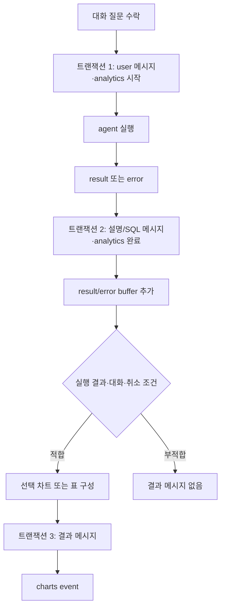
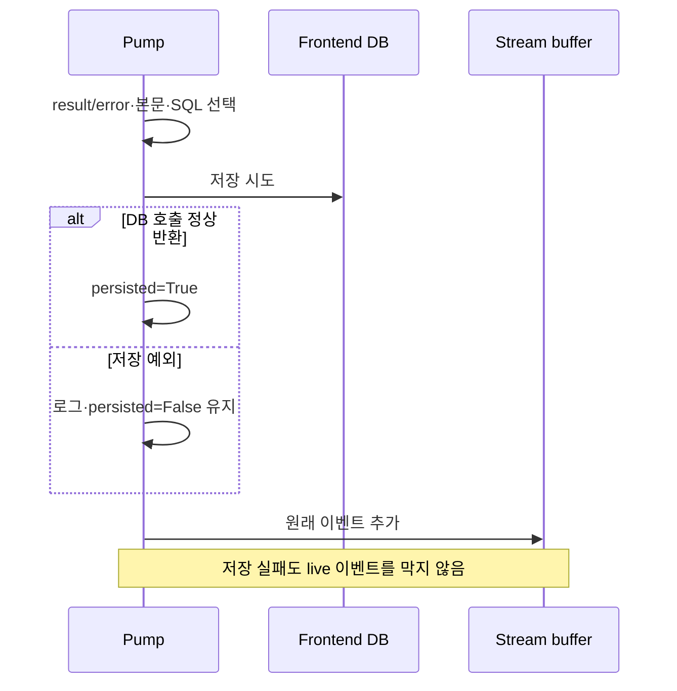
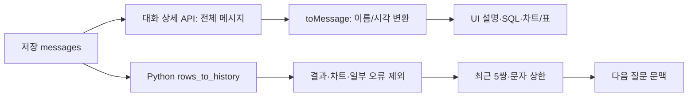

# Chapter 04. 대화·답변·결과·analytics의 저장과 재조회

- 분석일: 2026-11-15.
- 범위: 대화 DAL·pump의 저장 판단·결과 메시지 형태·웹 대화/통계 API·UI 재조회와 관련 테스트의 정적 분석. 원본 수정·실제 서비스/DB/모델/테스트 실행은 하지 않았다.
- 선행: [대화 준비](chapter-01-request-identity-and-conversation.md), [스트림·취소](chapter-03-slots-streaming-and-cancellation.md).
- 용어집: [상세 용어집](../01-architecture/chapter-00-glossary.md)

| 용어 | 뜻·이 문서에서의 의미 |
|---|---|
| DAL (Data Access Layer) | 저장소 조회·쓰기를 담당하는 코드다. |
| Analytics | 질문·응답 사용 통계다. |
| Readback | 저장한 데이터를 다시 읽는 일이다. |
| Transaction | 여러 DB 변경을 함께 확정하거나 되돌리는 단위다. |

## 1. 하나의 답이 최대 두 메시지로 나뉜다

화면의 Message 1은 설명과 SQL, Message 2는 차트 또는 원본 결과 표다. 둘 다 assistant 역할의 messages 행이지만 필드가 다르다. UI가 두 번째 생성을 별도 요청해서 저장하는 구조가 아니라 Python pump가 각각 저장하고 이벤트로 전달한다.



세 트랜잭션은 한 요청 전체를 원자적으로 저장하지 않는다. 질문만, 질문+답변만, 답변 없이 결과만 남는 상황을 각각 구분해야 한다. 실패가 있어도 SSE(Server-Sent Events, 연속 이벤트 전송)를 계속하려는 코드와 영구 저장 성공은 별도다.

## 2. Schema·ID·저장 내용과 관계

| 저장 객체 | 주요 필드·관계 | 포함하지 않는 연결/값 |
|---|---|---|
| conversations | UUID id·user_id·title·created_at/updated_at | 진행 중 worker/slot 상태 없음 |
| messages | UUID id·conversation_id·role·content·sql_code·sql_response·created_at | 요청별 turn ID·analytics_id·thoughts 없음 |
| conversation_analytics | UUID id·user_id·source·질문/시각·설명/응답 시각·sql | conversation_id·실행 결과 행·차트·status 없음 |

UUID는 각 행을 구분하는 식별자다. 질문·설명·차트 사이에 공통 turn 식별자를 저장하지 않는다. Python slot의 analytics_id가 응답 통계 갱신을 연결하지만 messages 행에 그 ID를 쓰지 않는다.

Prisma schema는 conversation 삭제 시 messages cascade, user 삭제 시 conversation/analytics cascade 관계를 선언한다. cascade는 부모 행 삭제에 맞춰 자식 행도 지우는 관계다. 대화 삭제만으로 analytics가 같이 사라지는 관계는 없다. 실제 DB 제약이 이 schema와 일치하는지는 이번 작업에서 DB를 조회하지 않았다.

근거: [schema.prisma](../../../code/auto-ontology/frontend/prisma/schema.prisma)의 `Conversation`, `Message`, `ConversationAnalytics`; [API 선택 필드](../../../code/auto-ontology/frontend/lib/apiSelects.ts).

## 3. 질문 수락과 통계 시작

`prepare_conversation`은 소유권/신규 생성 → 기존 history 조회 → user 메시지 INSERT → analytics INSERT → 대화 updated_at 변경을 한 psycopg 연결 context에서 처리한다. 정상 종료는 commit, 예외는 rollback 경계다. 연결 timeout=3초가 전체 transaction timeout을 뜻하지 않는다.

질문은 원문 전체이며 source는 요청 헤더 또는 api다. title은 새 대화를 만들 때 질문 앞 50자를 사용하고 기존 제목은 유지한다. 저장 후 worker 인계 실패·실행 중 취소가 앞선 질문 저장을 자동 rollback하지 않는다. 상세 소유권/history 선택은 [Chapter 01](chapter-01-request-identity-and-conversation.md)에 있다.

무상태 요청은 user_id가 있으면 별도 analytics 행만 생성한다. 없으면 이 통계 경로도 없다. 대화 없는 요청의 실행 결과 표를 Message 2로 저장하는 기능은 현재 helper에서 생략한다.

## 4. Pump의 첫 저장·SQL 선택과 실패

`persist_event`는 slot에 user_id와 analytics_id가 모두 있고 persisted=False일 때만 저장을 시도한다. result는 `answer.response`를 문자열로 만들고 SQL은 `answer.sql_code or slot.last_sql`을 고른다. error는 event.message와 last_sql을 쓴다. 본문과 SQL이 둘 다 falsy면 쓰지 않는다.

last_sql은 앞서 도착한 sql event에서 기억한다. “마지막으로 성공 실행한 SQL” 보장이 아니라 스트리밍된 마지막 시도다. 최종 답에 SQL이 있으면 우선하고 없으면 실패 이전 SQL도 이력에 남긴다. 이 선택은 저장 인수용이며 원래 result event의 answer.sql_code를 수정하지 않는다. live 화면과 새로 읽은 메시지의 SQL이 다를 수 있다.



첫 성공 뒤 persisted=True이므로 후속 result/error를 같은 답변 통계로 다시 쓰지 않는다. 예를 들어 error가 먼저 저장되면 나중 result는 덮지 않는다. 실패면 False가 남아 이후 적합한 이벤트가 재시도할 수 있지만, 독립 retry job·횟수·대기 정책은 없다. 이벤트가 더 없으면 자동 재시도도 없다.

### 4.1 대화 답변 저장

`persist_assistant_result`는 대화 id/user_id 소유권 SELECT → assistant 설명/SQL INSERT → analytics id/user_id UPDATE → conversation updated_at UPDATE를 한 transaction으로 실행한다. 결과 표와 thoughts는 이 INSERT에 넣지 않는다. SQL 인수는 parameter로 바인딩하고 schema 이름은 FRONTEND_SCHEMA 설정에서 구성한다.

analytics UPDATE는 영향을 받은 행 수를 검사하지 않는다. 대상 통계가 없어도 예외 없이 나머지 message INSERT가 commit되고 caller가 persisted=True로 판단할 수 있다. 소유권 SELECT는 존재 확인이며 prepare의 기존 대화 SELECT FOR UPDATE와 같은 잠금 구문은 아니다. 삭제·수동 메시지 쓰기·여러 서버의 실행을 전체 turn 단위로 직렬화하는 처리는 없다.

### 4.2 무상태 응답 통계

`persist_analytics_result`는 analytics id와 user_id가 맞는 행의 response·sql·response_timestamp만 갱신한다. 대화/메시지는 만들지 않고, 여기서도 row count를 확인하지 않는다. 응답 시각은 SQL 계산 종료 직후가 아니라 이 저장 query의 NOW()다. 차트 완료 시각·첫 토큰 지연을 담는 별도 필드는 없다.

근거: [대화 DAL](../../../code/auto-ontology/auto_ontology/server/chat/conversation_dal.py)의 `persist_assistant_result`, `persist_analytics_result`; [pump](../../../code/auto-ontology/auto_ontology/server/chat/router.py)의 `_pump`.

## 5. Message 2의 조건·문자열 형태·차트/표 선택

`_build_charts_event`는 conversation_id/user_id와 truthy 실행 결과가 있을 때 동작한다. 모델·시각화 설정이 적합하면 차트 생성을 시도하고 실패/비활성/차트 없음이면 표 형태로 내린다. 생성 알고리즘은 Chapter 05 범위다.

`build_result_message`는 charts가 truthy면 각 spec을 chart Markdown fence에 담은 content와 sql_response=None을 반환한다. 원 결과 행을 별도 sql_response에 동시에 저장하지 않는다. chart spec 안 데이터와 원본 표 전체가 같은 것은 아니다.

charts가 없으면 `stringify_sql_response`로 표를 문자열화하고 content는 빈 문자열로 둔다. None/공백뿐인 문자열은 결과 없음, 비어 있지 않은 문자열은 원문 유지, 다른 값은 json.dumps다. TypeError/ValueError면 None이다. JSON은 구조화 데이터를 문자열로 표현하는 형식이다.

```text
실행 반환: ['[{"n":1}]']
표 저장: 바깥 목록을 다시 JSON 문자열로 만듦
저장 문자열을 JSON 해석한 값: ['[{"n":1}]']
```

안쪽 JSON records 문자열 하나를 자동 풀어 저장하는 함수가 아니다. 빈 결과의 `['[]']`도 truthy라서 표 문자열로 갈 수 있다. 단순 빈 목록은 차트 helper 진입에서 falsy로 생략된다. helper의 “compact JSON/프런트와 동일”이라는 설명과 달리 Python 기본 dumps는 공백·문자 escape가 JavaScript JSON.stringify와 다를 수 있어 바이트 동일성을 주장하지 않는다.

`persist_result_message`는 소유권 확인 → assistant content/sql_response INSERT → conversation updated_at UPDATE를 별도 transaction에서 수행한다. sql_code·analytics는 갱신하지 않는다. 이 저장이 실패해도 helper는 로그 후 charts event를 반환해 live UI에 결과가 보일 수 있다.

차트 helper는 생성 뒤와 build 결과 이후 저장 직전에 cancelled를 확인한다. 이미 모델 호출 중인 시점이나 DB 저장을 시작한 뒤의 취소는 별도다. 앞 Chapter 03의 “시작 전에만 확인” 표현은 이번 상세 추적에서 수정했다. 결과 저장 성공 직후 event append 전에 프로세스/연결 문제가 생기면 live와 readback의 도착 시점도 다를 수 있다.

## 6. 부분 저장·취소·삭제의 실제 경계

| 상황 | 코드상 가능한 저장/전달 결과 |
|---|---|
| 사용자 질문 저장 후 취소/worker 실패 | 질문·응답 없는 analytics가 남을 수 있음 |
| 답변 저장 실패·결과 저장 성공 | Message 1 없이 Message 2만 남을 수 있음 |
| 답변 성공·결과 실패 | 설명/SQL과 완료 analytics만 남고 live charts는 보일 수 있음 |
| 취소가 결과 helper의 마지막 gate 전 | 결과 메시지 생략, 이미 저장된 답변은 유지 |
| 취소가 저장 호출 시작 후 | 자동 rollback/삭제 요청 없음 |
| 대화 삭제가 실행과 겹침 | 후속 소유권 확인 실패가 로그로 낮아질 수 있고 stream은 계속될 수 있음 |

analytics에는 취소/오류/성공 enum이 없다. 본문에 오류 문자열이 저장될 수 있지만 이를 별도 status로 분류하지 않는다. 응답 NULL만으로 실행 중·취소·실패·응답 빈값을 완전히 구분할 수 없다. 위 표는 코드로 도출한 경계이며 실제 DB 경쟁을 재현한 결과는 아니다.

## 7. 웹 대화 API와 수동 메시지 쓰기

웹 API는 사용자 권한 wrapper와 소유자 조건을 사용한다. Python DAL과 같은 DB schema를 Prisma로 접근한다. Prisma는 타입 기반 DB 접근 라이브러리다.

| 경로·기능 | 권한·소유 조건 | 조회/쓰기 |
|---|---|---|
| `/api/conversations` GET | conversation read·user_id | created_at desc 목록, 메시지 없음·pagination 없음 |
| 같은 경로 POST | conversation write | title 기본 빈 문자열로 빈 대화 생성·201 |
| `/api/conversations/{id}` GET | read·id/user_id | 모든 messages를 created_at asc로 읽음 |
| 같은 경로 PATCH | write·id/user_id updateMany | title 변경 후 id로 재조회, count 0이면 404 |
| 같은 경로 DELETE | delete·id/user_id | deleteMany·없으면 404, 있으면 204 |
| `/api/conversations/{id}/messages` POST | write·소유 대화 조회 | 별도 수동 메시지 INSERT·updated_at 변경·201 |

목록은 updated_at이 아니라 생성일 순이다. 상세 메시지 정렬은 created_at만 쓰므로 Python의 history 조회가 쓰는 created_at+id tie-break와 다르다. 같은 시각 메시지의 두 조회 순서가 항상 같다고 단정하지 않는다.

수동 POST는 body.role/content/sql_code/sql_response를 직접 넣고 그 뒤 updated_at을 별도 await로 갱신한다. 명시 `$transaction`이 없으므로 메시지 작성 성공 후 시각 갱신 실패가 같은 transaction으로 rollback되는 구조는 아니다. role 허용 목록·요청별 중복 방지·진행 slot 확인을 route에서 별도 구현하지 않는다. 정상 useChat은 서버 저장에 의존하며 addMessage 호출을 하지 않는다.

DELETE도 실행 중 slot을 취소하는 호출은 없다. schema의 messages cascade와 analytics 유지가 읽기 이력·통계에 다른 영향을 준다. PATCH/수동 POST의 소유 확인과 뒤 재조회/쓰기 전체가 단일 transaction이라는 주장도 하지 않는다.

근거: [목록/생성 route](../../../code/auto-ontology/frontend/app/api/conversations/route.ts), [단일 대화 route](../../../code/auto-ontology/frontend/app/api/conversations/[id]/route.ts), [수동 메시지 route](../../../code/auto-ontology/frontend/app/api/conversations/[id]/messages/route.ts).

## 8. 저장 후 UI readback과 모델 history는 다르다



`toMessage`는 sql_code→sql, sql_response→sqlResponse, created_at→timestamp로 바꾼다. readback에는 thoughts 필드가 없어 live 답변의 thoughts가 그대로 복원되지는 않는다. live Message 1 builder는 chart fence를 제거하지만 Python persist_event는 response 원문을 저장하므로, 원문 자체에 chart가 있을 때 live/readback이 항상 같은 content라는 보장도 없다.

UI의 `isResultMessage`는 assistant이면서 sqlResponse가 null이 아니거나 chart/chart-carousel fence가 있으면 Message 2로 본다. DB에 명시적인 message-kind 열이 있는 것은 아니다. readback polling은 마지막 assistant를 채택하고 Message 2 모양이면 멈추는 최대 3회 보완이며, 실행 완료를 DB의 status로 확인하는 절차는 아니다. 자세한 watch 전환은 [Chapter 03](chapter-03-slots-streaming-and-cancellation.md)에 있다.

다음 질문용 `_rows_to_history`는 결과/차트·일부 오류 메시지를 제외하고 질문/설명/SQL만 제한한다. 화면의 모든 메시지를 모델에게 다시 넣는 방식과 구분한다. turn ID 없이 인접 user/assistant를 묶으므로 수동 쓰기·겹친 결과의 실제 이력 품질은 미검증이다.

근거: [브라우저 대화 API/변환](../../../code/auto-ontology/frontend/api/conversations.ts), [답변 builder](../../../code/auto-ontology/frontend/lib/answerMessages.ts), [결과 문자열 helper](../../../code/auto-ontology/frontend/lib/sqlResponse.ts), [useChat](../../../code/auto-ontology/frontend/lib/useChat.ts).

## 9. Analytics 조회는 대화 소유자 이력 조회가 아니다

`/api/analytics` GET은 analytics read 권한을 요구하고 최근 30일 question_timestamp 기준으로 모든 대상 사용자의 통계를 읽는다. 요청 user_id로 필터하지 않는다. 사용자 name/email/role을 join하고 role이 null이면 Viewer로 표시한다. 실제 권한 부여 역할 전체는 이 장의 범위 밖이다.

count 후 findMany를 별도로 실행하므로 두 결과의 동시 snapshot을 명시하지 않는다. skip 기본 0, limit 생략 시 take도 생략한다. Number.parseInt 결과의 유한 여부만 보며 음수/최대치 clamp는 없다. 실제 잘못된 pagination의 Prisma 처리·오류 응답은 실행하지 않았다.

대화 삭제 후에도 analytics는 남을 수 있으며 요청별 conversation_id가 없어 통계에서 특정 대화로 직접 연결하는 외래키는 없다. 통계의 sql은 저장 판단에서 선택한 값이지 항상 성공 실행 SQL은 아니다. [analytics route](../../../code/auto-ontology/frontend/app/api/analytics/route.ts), [읽기 API](../../../code/auto-ontology/frontend/api/analytics.ts)의 오래된 “proxy가 저장” 주석보다 실제 Python DAL 호출을 우선한다.

## 10. 테스트·미확인·다음 작업

[pump SQL 테스트](../../../code/auto-ontology/auto_ontology/server/chat/tests/test_pump_sql_events.py) 5개 assertion은 last_sql 전달·최종 SQL 우선·SQL 없음·buffer를 확인한다. 저장 함수를 대체하므로 실제 Postgres INSERT/UPDATE·트랜잭션·row count·중복을 검증한 것은 아니다. [history 테스트](../../../code/auto-ontology/auto_ontology/server/chat/tests/test_conversation_dal.py) 4개는 순수 이력 변환을 확인한다. 이번 작업에서도 실행하지 않았다.

로컬 검색에서 persist_*의 실제 transaction, 결과 helper 직렬화·취소 gate·웹 대화/analytics 쓰기/readback의 직접 테스트는 찾지 못했다. 테스트 파일 검색 결과와 기능 미구현을 혼동하지 않는다.

확인한 사실은 schema·쿼리·인수·저장 시점·예외·조회 필터다. row count 미확인·부분 저장·live/readback 차이·순서 차이·취소/삭제 경쟁·통계 상태의 모호함은 코드에서 도출한 경계다. 실제 DB/모델/서비스·제약/rollback·여러 사용자/동시성·JSON round trip·UI 렌더링·테스트·Mermaid 렌더링은 미검증이다.

다음은 01-10-5의 차트 활성화·결과 파싱·모델 입력/출력·명세 정리·표 fallback·UI 소비를 분석한다. 10단계 전체 완료는 아니다.
